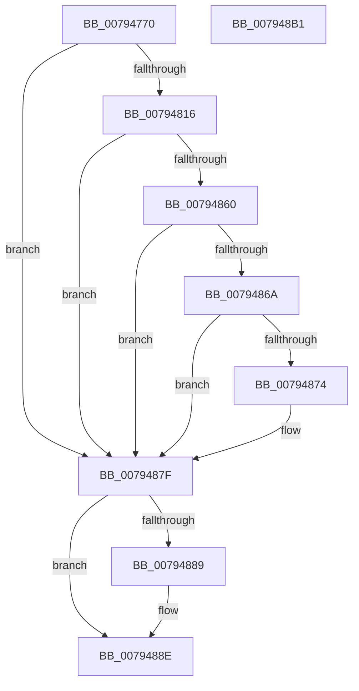

# RtlOsDeploymentState

- RVA: `0x00794770`–`0x007948B2` (길이 `322` bytes)
- VA: `0x0000000140794770`
- 실행 섹션: `PAGE`
- PDB 이름 있음: `예`; PDB Function 태그: `아니요`
- unwind 정보 RVA: `0x000CFEA4`
- 디코드: `68`개 명령, `322/322` bytes 표시
- 미해석 바이트: `0` (있으면 어셈블리에 `.byte`로 보존)

> 이 문서는 커널 이미지의 기계어와 PDB 기호를 분석해 생성했습니다. 4번과 5번은 함수 원형과 자료형을 바이너리 사용 방식에서 추정한 C 해석이며 원본 소스 복구 결과는 아닙니다.

## 1. Dependencies

- 직접 호출 지점: **6**; 고유 호출 대상: **5**
- 직접 호출자로 확인된 함수: **0**
- RIP 상대 이미지 참조: **3**

### Outgoing calls
- `0x007947D0` → [RtlInitUnicodeString](../../text/42/RtlInitUnicodeString_function_0042A780.md) (function, `0x0042A780`)
- `0x0079480D` → [ZwOpenKey](../../text/6A/ZwOpenKey_function_006AD310.md) (function, `0x006AD310`)
- `0x00794825` → [RtlInitUnicodeString](../../text/42/RtlInitUnicodeString_function_0042A780.md) (function, `0x0042A780`)
- `0x00794857` → [ZwQueryValueKey](../../text/6A/ZwQueryValueKey_function_006AD3B0.md) (function, `0x006AD3B0`)
- `0x00794889` → [ZwClose](../../text/6A/ZwClose_function_006AD2B0.md) (function, `0x006AD2B0`)
- `0x0079489B` → [_security_check_cookie](../../text/6A/_security_check_cookie_function_006AC640.md) (function, `0x006AC640`)

### Direct callers
- 이 함수 시작 RVA로 연결되는 직접 call은 확인되지 않았습니다. 간접 호출은 완전히 역산할 수 없습니다.

### Static image references
- `0x0079477F` → RVA `0x00E0A740` (`.data`; read)
- `0x007947C5` → RVA `0x00AFD440` (` ?? ::NNGAKEGL::`string'`; read)
- `0x00794816` → RVA `0x00B05C10` (` ?? ::NNGAKEGL::`string'`; read)

## 2. Other-region calls and transfers

- 다른 실행 섹션으로 향하는 call: **6**
  - `0x007947D0` → [RtlInitUnicodeString](../../text/42/RtlInitUnicodeString_function_0042A780.md) (`PAGE` → `.text`)
  - `0x0079480D` → [ZwOpenKey](../../text/6A/ZwOpenKey_function_006AD310.md) (`PAGE` → `.text`)
  - `0x00794825` → [RtlInitUnicodeString](../../text/42/RtlInitUnicodeString_function_0042A780.md) (`PAGE` → `.text`)
  - `0x00794857` → [ZwQueryValueKey](../../text/6A/ZwQueryValueKey_function_006AD3B0.md) (`PAGE` → `.text`)
  - `0x00794889` → [ZwClose](../../text/6A/ZwClose_function_006AD2B0.md) (`PAGE` → `.text`)
  - `0x0079489B` → [_security_check_cookie](../../text/6A/_security_check_cookie_function_006AC640.md) (`PAGE` → `.text`)
- 별도 외부 분기/꼬리 이동을 확인하지 못했습니다.

## 3. Assembly (complete function range)

```asm
00794770  4C 8B DC                        mov r11, rsp
00794773  49 89 5B 08                     mov qword ptr [r11 + 8], rbx
00794777  56                              push rsi
00794778  48 81 EC B0 00 00 00            sub rsp, 0xb0
0079477F  48 8B 05 BA 5F 67 00            mov rax, qword ptr [rip + 0x675fba]
00794786  48 33 C4                        xor rax, rsp
00794789  48 89 84 24 A8 00 00 00         mov qword ptr [rsp + 0xa8], rax
00794791  48 83 64 24 30 00               and qword ptr [rsp + 0x30], 0
00794797  BB 01 00 00 00                  mov ebx, 1
0079479C  83 64 24 38 00                  and dword ptr [rsp + 0x38], 0
007947A1  33 C0                           xor eax, eax
007947A3  0F 57 C0                        xorps xmm0, xmm0
007947A6  0F 11 44 24 40                  movups xmmword ptr [rsp + 0x40], xmm0
007947AB  0F 11 44 24 50                  movups xmmword ptr [rsp + 0x50], xmm0
007947B0  49 89 43 A8                     mov qword ptr [r11 - 0x58], rax
007947B4  89 44 24 68                     mov dword ptr [rsp + 0x68], eax
007947B8  0F 11 44 24 70                  movups xmmword ptr [rsp + 0x70], xmm0
007947BD  0F 57 C9                        xorps xmm1, xmm1
007947C0  41 0F 11 4B C8                  movups xmmword ptr [r11 - 0x38], xmm1
007947C5  48 8D 15 74 8C 36 00            lea rdx, [rip + 0x368c74]
007947CC  49 8D 4B B8                     lea rcx, [r11 - 0x48]
007947D0  E8 AB 5F C9 FF                  call 0x14042a780
007947D5  C7 44 24 40 30 00 00 00         mov dword ptr [rsp + 0x40], 0x30
007947DD  48 83 64 24 48 00               and qword ptr [rsp + 0x48], 0
007947E3  C7 44 24 58 40 02 00 00         mov dword ptr [rsp + 0x58], 0x240
007947EB  48 8D 44 24 70                  lea rax, [rsp + 0x70]
007947F0  48 89 44 24 50                  mov qword ptr [rsp + 0x50], rax
007947F5  0F 57 C0                        xorps xmm0, xmm0
007947F8  F3 0F 7F 44 24 60               movdqu xmmword ptr [rsp + 0x60], xmm0
007947FE  4C 8D 44 24 40                  lea r8, [rsp + 0x40]
00794803  BA 19 00 02 00                  mov edx, 0x20019
00794808  48 8D 4C 24 30                  lea rcx, [rsp + 0x30]
0079480D  E8 FE 8A F1 FF                  call 0x1406ad310
00794812  85 C0                           test eax, eax
00794814  78 69                           js 0x14079487f
00794816  48 8D 15 F3 13 37 00            lea rdx, [rip + 0x3713f3]
0079481D  48 8D 8C 24 80 00 00 00         lea rcx, [rsp + 0x80]
00794825  E8 56 5F C9 FF                  call 0x14042a780
0079482A  48 8D 44 24 38                  lea rax, [rsp + 0x38]
0079482F  48 89 44 24 28                  mov qword ptr [rsp + 0x28], rax
00794834  C7 44 24 20 14 00 00 00         mov dword ptr [rsp + 0x20], 0x14
0079483C  4C 8D 8C 24 90 00 00 00         lea r9, [rsp + 0x90]
00794844  8D 73 01                        lea esi, [rbx + 1]
00794847  44 8B C6                        mov r8d, esi
0079484A  48 8D 94 24 80 00 00 00         lea rdx, [rsp + 0x80]
00794852  48 8B 4C 24 30                  mov rcx, qword ptr [rsp + 0x30]
00794857  E8 54 8B F1 FF                  call 0x1406ad3b0
0079485C  85 C0                           test eax, eax
0079485E  78 1F                           js 0x14079487f
00794860  83 BC 24 94 00 00 00 04         cmp dword ptr [rsp + 0x94], 4
00794868  75 15                           jne 0x14079487f
0079486A  83 BC 24 98 00 00 00 04         cmp dword ptr [rsp + 0x98], 4
00794872  75 0B                           jne 0x14079487f
00794874  83 BC 24 9C 00 00 00 00         cmp dword ptr [rsp + 0x9c], 0
0079487C  0F 45 DE                        cmovne ebx, esi
0079487F  48 8B 4C 24 30                  mov rcx, qword ptr [rsp + 0x30]
00794884  48 85 C9                        test rcx, rcx
00794887  74 05                           je 0x14079488e
00794889  E8 22 8A F1 FF                  call 0x1406ad2b0
0079488E  8B C3                           mov eax, ebx
00794890  48 8B 8C 24 A8 00 00 00         mov rcx, qword ptr [rsp + 0xa8]
00794898  48 33 CC                        xor rcx, rsp
0079489B  E8 A0 7D F1 FF                  call 0x1406ac640
007948A0  48 8B 9C 24 C0 00 00 00         mov rbx, qword ptr [rsp + 0xc0]
007948A8  48 81 C4 B0 00 00 00            add rsp, 0xb0
007948AF  5E                              pop rsi
007948B0  C3                              ret
007948B1  CC                              int3
```

## 4. C-style interpretation (structured pseudocode)

```c
__int64 __fastcall RtlOsDeploymentState(void)
{
    __int64 result;
    __int64 v_rbx;
    __int64 v_rsp;
    unsigned __int64 v_stack_m10;
    unsigned int v_stack_m1C;
    unsigned int v_stack_m20;
    unsigned int v_stack_m24;
    unsigned __int64 v_stack_m28;
    unsigned __int64 v_stack_m38;
    unsigned __int64 v_stack_m48;
    unsigned int v_stack_m50;
    unsigned __int64 v_stack_m58;
    unsigned int v_stack_m60;
    unsigned __int64 v_stack_m68;
    unsigned __int64 v_stack_m70;
    unsigned __int64 v_stack_m78;
    unsigned int v_stack_m80;
    unsigned __int64 v_stack_m88;
    unsigned __int64 v_stack_m90;
    unsigned int v_stack_m98;
    unsigned __int64 v_stack_p8;

    *(unsigned __int64 *)(v_rsp + 8) = v_rbx;
    v_rsp = (v_rsp) - (176);
    result = (*(unsigned __int64 *)(v_rip + 6774714)) ^ (v_rsp);
    v_stack_m10 = result;
    result = 0;
    v_stack_m78 = v_xmm0;
    v_stack_m68 = v_xmm0;
    *(unsigned __int64 *)(v_rsp - 88) = 0;
    v_stack_m50 = 0;
    v_stack_m48 = v_xmm0;
    *(unsigned __int64 *)(v_rsp - 56) = v_xmm1;
    result = RtlInitUnicodeString(v_rsp - 72, v_rip + 3574900, a3, a4);
    v_stack_m78 = 48;
    v_stack_m60 = 576;
    v_stack_m68 = v_stack_m48;
    v_stack_m58 = v_xmm0;
    result = ZwOpenKey(v_stack_m88, (unsigned int)(0x20019ULL), v_stack_m78, a4);
    if (sign_flag) goto loc_0079487F;
    result = RtlInitUnicodeString(v_stack_m38, v_rip + 3609587, v_stack_m78, a4);
    v_stack_m90 = v_stack_m80;
    v_stack_m98 = 20;
    result = ZwQueryValueKey(v_stack_m88, v_stack_m38, (unsigned int)((unsigned int)(1 + 1)), v_stack_m28);
    if (sign_flag) goto loc_0079487F;
    if (v_stack_m24 != 4) goto loc_0079487F;
    v_rbx = 1;
    if (v_stack_m20 == 4) {
        v_rbx = 1;
        if (v_stack_m1C != 0) { v_rbx = (unsigned int)(1 + 1); }
    }
    if (v_stack_m88 != 0) {
        result = ZwClose(v_stack_m88, v_stack_m38, (unsigned int)((unsigned int)(1 + 1)), v_stack_m28);
    }
    a1 = (v_stack_m10) ^ (v_rsp);
    result = _security_check_cookie(a1, v_stack_m38, (unsigned int)((unsigned int)(1 + 1)), v_stack_m28);
    v_rsp = (v_rsp) + (176);
    return result;
}
```

## 5. (Beta) C Style

```c
void RtlOsDeploymentState(void)
{
    int64_t result;
    int64_t local_rbx;
    int64_t local_rsp;
    uint64_t v_stack_m10;
    uint32_t v_stack_m1C;
    uint32_t v_stack_m20;
    uint32_t v_stack_m24;
    uint64_t v_stack_m28;
    uint64_t v_stack_m38;
    uint64_t v_stack_m48;
    uint32_t v_stack_m50;
    uint64_t v_stack_m58;
    uint32_t v_stack_m60;
    uint64_t v_stack_m68;
    uint64_t v_stack_m70;
    uint64_t v_stack_m78;
    uint32_t v_stack_m80;
    uint64_t v_stack_m88;
    uint64_t v_stack_m90;
    uint32_t v_stack_m98;
    uint64_t v_stack_p8;

    *(uint64_t *)(local_rsp + 0x8) = local_rbx;
    local_rsp = (local_rsp) - (176);
    result = (*(uint64_t *)(v_rip + 0x675FBA)) ^ (local_rsp);
    v_stack_m10 = result;
    result = 0;
    v_stack_m78 = v_xmm0;
    v_stack_m68 = v_xmm0;
    *(uint64_t *)(local_rsp - 0x58) = 0;
    v_stack_m50 = 0;
    v_stack_m48 = v_xmm0;
    *(uint64_t *)(local_rsp - 0x38) = v_xmm1;
    result = RtlInitUnicodeString(local_rsp - 72, v_rip + 3574900, a3, a4);
    v_stack_m78 = 48;
    v_stack_m60 = 576;
    v_stack_m68 = v_stack_m48;
    v_stack_m58 = v_xmm0;
    result = ZwOpenKey(v_stack_m88, (uint32_t)(0x20019ULL), v_stack_m78, a4);
    if (sign_flag) goto loc_0079487F;
    result = RtlInitUnicodeString(v_stack_m38, v_rip + 3609587, v_stack_m78, a4);
    v_stack_m90 = v_stack_m80;
    v_stack_m98 = 20;
    result = ZwQueryValueKey(v_stack_m88, v_stack_m38, (uint32_t)((uint32_t)(1 + 1)), v_stack_m28);
    if (sign_flag) goto loc_0079487F;
    if (v_stack_m24 != 4) goto loc_0079487F;
    local_rbx = 1;
    if (v_stack_m20 == 4) {
        local_rbx = 1;
        if (v_stack_m1C != 0) { local_rbx = (uint32_t)(1 + 1); }
    }
    if (v_stack_m88 != 0) {
        result = ZwClose(v_stack_m88, v_stack_m38, (uint32_t)((uint32_t)(1 + 1)), v_stack_m28);
    }
    a1 = (v_stack_m10) ^ (local_rsp);
    result = _security_check_cookie(a1, v_stack_m38, (uint32_t)((uint32_t)(1 + 1)), v_stack_m28);
    local_rsp = (local_rsp) + (176);
    return result;
}
```

## 6. Execution-region graph

[열기: 2D/3D 그래프와 함수 탐색 컨트롤 패널](../../../control-panel.html?section=page&rva=0x00794770&view=graph)

- 2D 그래프는 위에서 아래로 흐르고, 3D 그래프는 빈 공간을 드래그해 회전합니다. Shift+드래그는 이동, 휠은 확대·축소, 함수 노드 선택은 대상 보고서 이동입니다.

### Static fallback


