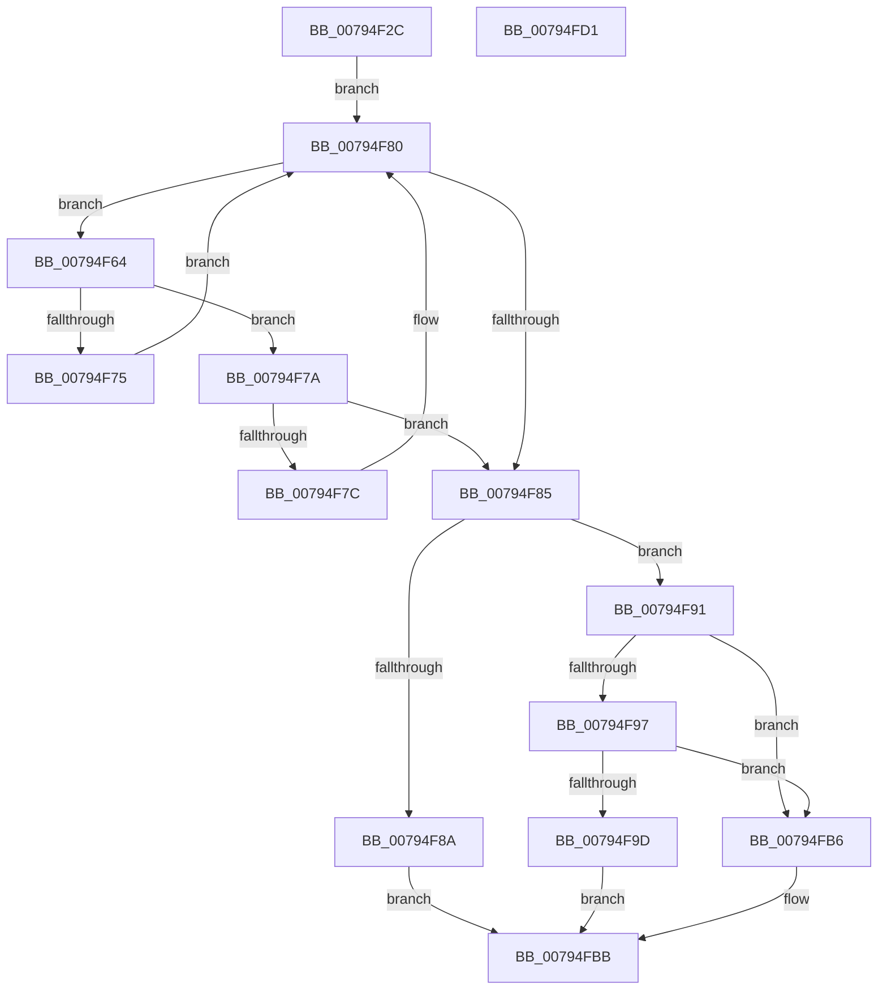

# RtlRemoveDynamicEnforcedAddressRange

- RVA: `0x00794F2C`–`0x00794FD2` (길이 `166` bytes)
- VA: `0x0000000140794F2C`
- 실행 섹션: `PAGE`
- PDB 이름 있음: `예`; PDB Function 태그: `아니요`
- unwind 정보 RVA: `0x000CFFA0`
- 디코드: `51`개 명령, `166/166` bytes 표시
- 미해석 바이트: `0` (있으면 어셈블리에 `.byte`로 보존)

> 이 문서는 커널 이미지의 기계어와 PDB 기호를 분석해 생성했습니다. 4번과 5번은 함수 원형과 자료형을 바이너리 사용 방식에서 추정한 C 해석이며 원본 소스 복구 결과는 아닙니다.

## 1. Dependencies

- 직접 호출 지점: **3**; 고유 호출 대상: **3**
- 직접 호출자로 확인된 함수: **1**
- RIP 상대 이미지 참조: **0**

### Outgoing calls
- `0x00794F6C` → [RtlpDynamicEnforcedAddressRangesTreeCompare](RtlpDynamicEnforcedAddressRangesTreeCompare_function_00794FD8.md) (function, `0x00794FD8`)
- `0x00794FA3` → [RtlAvlRemoveNode](../../text/29/RtlAvlRemoveNode_function_00296650.md) (function, `0x00296650`)
- `0x00794FAD` → [ExFreePoolWithTag](../../poolcode/B8/ExFreePoolWithTag_function_00B82870.md) (function, `0x00B82870`)

### Direct callers
- [PspProcessDynamicEnforcedAddressRanges](../78/PspProcessDynamicEnforcedAddressRanges_function_00782624.md) at `0x0078281E`

### Static image references
- 디코드된 RIP-relative 메모리 참조가 없습니다.

## 2. Other-region calls and transfers

- 다른 실행 섹션으로 향하는 call: **2**
  - `0x00794FA3` → [RtlAvlRemoveNode](../../text/29/RtlAvlRemoveNode_function_00296650.md) (`PAGE` → `.text`)
  - `0x00794FAD` → [ExFreePoolWithTag](../../poolcode/B8/ExFreePoolWithTag_function_00B82870.md) (`PAGE` → `POOLCODE`)
- 별도 외부 분기/꼬리 이동을 확인하지 못했습니다.

## 3. Assembly (complete function range)

```asm
00794F2C  48 8B C4                        mov rax, rsp
00794F2F  48 89 58 08                     mov qword ptr [rax + 8], rbx
00794F33  48 89 70 10                     mov qword ptr [rax + 0x10], rsi
00794F37  48 89 78 18                     mov qword ptr [rax + 0x18], rdi
00794F3B  41 56                           push r14
00794F3D  48 83 EC 50                     sub rsp, 0x50
00794F41  48 83 60 C8 00                  and qword ptr [rax - 0x38], 0
00794F46  0F 57 C0                        xorps xmm0, xmm0
00794F49  48 8B 19                        mov rbx, qword ptr [rcx]
00794F4C  49 8B F8                        mov rdi, r8
00794F4F  F3 0F 7F 40 D0                  movdqu xmmword ptr [rax - 0x30], xmm0
00794F54  48 8B F2                        mov rsi, rdx
00794F57  48 89 50 E0                     mov qword ptr [rax - 0x20], rdx
00794F5B  4C 8B F1                        mov r14, rcx
00794F5E  4C 89 40 E8                     mov qword ptr [rax - 0x18], r8
00794F62  EB 1C                           jmp 0x140794f80
00794F64  48 8B D3                        mov rdx, rbx
00794F67  48 8D 4C 24 20                  lea rcx, [rsp + 0x20]
00794F6C  E8 67 00 00 00                  call 0x140794fd8
00794F71  85 C0                           test eax, eax
00794F73  79 05                           jns 0x140794f7a
00794F75  48 8B 1B                        mov rbx, qword ptr [rbx]
00794F78  EB 06                           jmp 0x140794f80
00794F7A  7E 09                           jle 0x140794f85
00794F7C  48 8B 5B 08                     mov rbx, qword ptr [rbx + 8]
00794F80  48 85 DB                        test rbx, rbx
00794F83  75 DF                           jne 0x140794f64
00794F85  48 85 DB                        test rbx, rbx
00794F88  75 07                           jne 0x140794f91
00794F8A  B8 25 02 00 C0                  mov eax, 0xc0000225
00794F8F  EB 2A                           jmp 0x140794fbb
00794F91  48 39 73 18                     cmp qword ptr [rbx + 0x18], rsi
00794F95  75 1F                           jne 0x140794fb6
00794F97  48 39 7B 20                     cmp qword ptr [rbx + 0x20], rdi
00794F9B  75 19                           jne 0x140794fb6
00794F9D  48 8B D3                        mov rdx, rbx
00794FA0  49 8B CE                        mov rcx, r14
00794FA3  E8 A8 16 B0 FF                  call 0x140296650
00794FA8  33 D2                           xor edx, edx
00794FAA  48 8B CB                        mov rcx, rbx
00794FAD  E8 BE D8 3E 00                  call 0x140b82870
00794FB2  33 C0                           xor eax, eax
00794FB4  EB 05                           jmp 0x140794fbb
00794FB6  B8 18 00 00 C0                  mov eax, 0xc0000018
00794FBB  48 8B 5C 24 60                  mov rbx, qword ptr [rsp + 0x60]
00794FC0  48 8B 74 24 68                  mov rsi, qword ptr [rsp + 0x68]
00794FC5  48 8B 7C 24 70                  mov rdi, qword ptr [rsp + 0x70]
00794FCA  48 83 C4 50                     add rsp, 0x50
00794FCE  41 5E                           pop r14
00794FD0  C3                              ret
00794FD1  CC                              int3
```

## 4. C-style interpretation (structured pseudocode)

```c
__int64 __fastcall RtlRemoveDynamicEnforcedAddressRange(__int64 a1, __int64 a2, __int64 a3)
{
    __int64 result;
    __int64 v_rsp;
    unsigned __int64 v_stack_m38;
    unsigned __int64 v_stack_p10;
    unsigned __int64 v_stack_p18;
    unsigned __int64 v_stack_p8;

    *(unsigned __int64 *)(v_rsp + 8) = v_rbx;
    *(unsigned __int64 *)(v_rsp + 16) = v_rsi;
    *(unsigned __int64 *)(v_rsp + 24) = v_rdi;
    v_rsp = (v_rsp) - (80);
    *(unsigned __int64 *)(v_rsp - 48) = v_xmm0;
    *(unsigned __int64 *)(v_rsp - 32) = a2;
    *(unsigned __int64 *)(v_rsp - 24) = a3;
    goto loc_00794F80;
loc_00794F64:
    result = RtlpDynamicEnforcedAddressRangesTreeCompare(v_stack_m38, *(unsigned __int64 *)(a1), a3, a4);
    if (!sign_flag) goto loc_00794F7A;
    goto loc_00794F80;
loc_00794F7A:
    if (condition_is_less_or_equal) goto loc_00794F85;
loc_00794F80:
    if (*(unsigned __int64 *)(*(unsigned __int64 *)(*(unsigned __int64 *)(a1)) + 8) != 0) goto loc_00794F64;
loc_00794F85:
    if (*(unsigned __int64 *)(*(unsigned __int64 *)(*(unsigned __int64 *)(a1)) + 8) != 0) goto loc_00794F91;
    goto loc_00794FBB;
loc_00794F91:
    if ((*(unsigned __int64 *)(*(unsigned __int64 *)(*(unsigned __int64 *)(*(unsigned __int64 *)(a1)) + 8) + 24)) != a2) goto loc_00794FB6;
    if ((*(unsigned __int64 *)(*(unsigned __int64 *)(*(unsigned __int64 *)(*(unsigned __int64 *)(a1)) + 8) + 32)) != a3) goto loc_00794FB6;
    result = RtlAvlRemoveNode(a1, *(unsigned __int64 *)(*(unsigned __int64 *)(*(unsigned __int64 *)(a1)) + 8), a3, a4);
    a2 = 0;
    result = ExFreePoolWithTag(*(unsigned __int64 *)(*(unsigned __int64 *)(*(unsigned __int64 *)(a1)) + 8), a2, a3, a4);
    result = 0;
    goto loc_00794FBB;
loc_00794FB6:
loc_00794FBB:
    v_rsp = (v_rsp) + (80);
    return (unsigned int)(0xC0000018ULL);
}
```

## 5. (Beta) C Style

```c
int64_t RtlRemoveDynamicEnforcedAddressRange(void *Arg1, int64_t Arg2, int64_t Arg3)
{
    uint8_t *arg1 = (uint8_t *)Arg1;

    int64_t result;
    int64_t local_rsp;
    uint64_t v_stack_m38;
    uint64_t v_stack_p10;
    uint64_t v_stack_p18;
    uint64_t v_stack_p8;

    *(uint64_t *)(local_rsp + 0x8) = local_rbx;
    *(uint64_t *)(local_rsp + 0x10) = local_rsi;
    *(uint64_t *)(local_rsp + 0x18) = local_rdi;
    local_rsp = (local_rsp) - (80);
    *(uint64_t *)(local_rsp - 0x30) = v_xmm0;
    *(uint64_t *)(local_rsp - 0x20) = Arg2;
    *(uint64_t *)(local_rsp - 0x18) = Arg3;
    goto loc_00794F80;
loc_00794F64:
    result = RtlpDynamicEnforcedAddressRangesTreeCompare(v_stack_m38, *(uint64_t *)(arg1), Arg3, a4);
    if (!sign_flag) goto loc_00794F7A;
    goto loc_00794F80;
loc_00794F7A:
    if (condition_is_less_or_equal) goto loc_00794F85;
loc_00794F80:
    if (*(uint64_t *)(*(uint64_t *)(*(uint64_t *)(arg1)) + 0x8) != 0) goto loc_00794F64;
loc_00794F85:
    if (*(uint64_t *)(*(uint64_t *)(*(uint64_t *)(arg1)) + 0x8) != 0) goto loc_00794F91;
    goto loc_00794FBB;
loc_00794F91:
    if ((*(uint64_t *)(*(uint64_t *)(*(uint64_t *)(*(uint64_t *)(arg1)) + 0x8) + 0x18)) != Arg2) goto loc_00794FB6;
    if ((*(uint64_t *)(*(uint64_t *)(*(uint64_t *)(*(uint64_t *)(arg1)) + 0x8) + 0x20)) != Arg3) goto loc_00794FB6;
    result = RtlAvlRemoveNode(Arg1, *(uint64_t *)(*(uint64_t *)(*(uint64_t *)(arg1)) + 0x8), Arg3, a4);
    Arg2 = 0;
    result = ExFreePoolWithTag(*(uint64_t *)(*(uint64_t *)(*(uint64_t *)(arg1)) + 0x8), Arg2, Arg3, a4);
    result = 0;
    goto loc_00794FBB;
loc_00794FB6:
loc_00794FBB:
    local_rsp = (local_rsp) + (80);
    return (uint32_t)(0xC0000018ULL);
}
```

### 관측된 메모리 오프셋

구조체 형식이 확인되지 않은 접근은 인자 기준의 오프셋으로만 기록했습니다.

| 기준 인자 | 오프셋 표현 | 폭 (bit) | 접근 |
|---|---:|---:|---|
| `Arg1` | `+ 0x0` | `64` | `R` |

## 6. Execution-region graph

[열기: 2D/3D 그래프와 함수 탐색 컨트롤 패널](../../../control-panel.html?section=page&rva=0x00794F2C&view=graph)

- 2D 그래프는 위에서 아래로 흐르고, 3D 그래프는 빈 공간을 드래그해 회전합니다. Shift+드래그는 이동, 휠은 확대·축소, 함수 노드 선택은 대상 보고서 이동입니다.

### Static fallback


