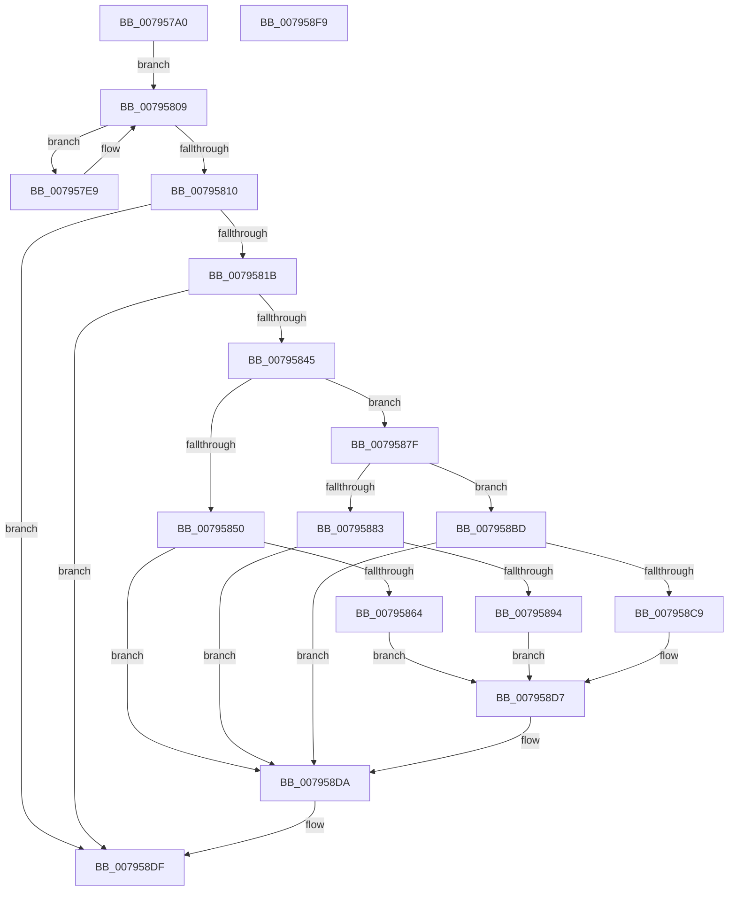

# RtlReserveChunkLZNT1

- RVA: `0x007957A0`–`0x007958FA` (길이 `346` bytes)
- VA: `0x00000001407957A0`
- 실행 섹션: `PAGE`
- PDB 이름 있음: `예`; PDB Function 태그: `아니요`
- unwind 정보 RVA: `0x000D02B8`
- 디코드: `102`개 명령, `346/346` bytes 표시
- 미해석 바이트: `0` (있으면 어셈블리에 `.byte`로 보존)

> 이 문서는 커널 이미지의 기계어와 PDB 기호를 분석해 생성했습니다. 4번과 5번은 함수 원형과 자료형을 바이너리 사용 방식에서 추정한 C 해석이며 원본 소스 복구 결과는 아닙니다.

## 1. Dependencies

- 직접 호출 지점: **5**; 고유 호출 대상: **2**
- 직접 호출자로 확인된 함수: **0**
- RIP 상대 이미지 참조: **0**

### Outgoing calls
- `0x007957DF` → [RtlDescribeChunkLZNT1](RtlDescribeChunkLZNT1_function_007956C0.md) (function, `0x007956C0`)
- `0x00795804` → [RtlDescribeChunkLZNT1](RtlDescribeChunkLZNT1_function_007956C0.md) (function, `0x007956C0`)
- `0x0079586D` → [memcpy](../../text/6C/memcpy_function_006C6840.md) (function, `0x006C6840`)
- `0x0079589D` → [memcpy](../../text/6C/memcpy_function_006C6840.md) (function, `0x006C6840`)
- `0x007958D2` → [memcpy](../../text/6C/memcpy_function_006C6840.md) (function, `0x006C6840`)

### Direct callers
- 이 함수 시작 RVA로 연결되는 직접 call은 확인되지 않았습니다. 간접 호출은 완전히 역산할 수 없습니다.

### Static image references
- 디코드된 RIP-relative 메모리 참조가 없습니다.

## 2. Other-region calls and transfers

- 다른 실행 섹션으로 향하는 call: **3**
  - `0x0079586D` → [memcpy](../../text/6C/memcpy_function_006C6840.md) (`PAGE` → `.text`)
  - `0x0079589D` → [memcpy](../../text/6C/memcpy_function_006C6840.md) (`PAGE` → `.text`)
  - `0x007958D2` → [memcpy](../../text/6C/memcpy_function_006C6840.md) (`PAGE` → `.text`)
- 별도 외부 분기/꼬리 이동을 확인하지 못했습니다.

## 3. Assembly (complete function range)

```asm
007957A0  48 8B C4                        mov rax, rsp
007957A3  48 89 58 10                     mov qword ptr [rax + 0x10], rbx
007957A7  48 89 68 18                     mov qword ptr [rax + 0x18], rbp
007957AB  56                              push rsi
007957AC  57                              push rdi
007957AD  41 54                           push r12
007957AF  41 56                           push r14
007957B1  41 57                           push r15
007957B3  48 83 EC 30                     sub rsp, 0x30
007957B7  4C 8B 31                        mov r14, qword ptr [rcx]
007957BA  4D 8B F8                        mov r15, r8
007957BD  48 83 60 D0 00                  and qword ptr [rax - 0x30], 0
007957C2  4C 8D 40 D0                     lea r8, [rax - 0x30]
007957C6  83 60 08 00                     and dword ptr [rax + 8], 0
007957CA  48 8B F9                        mov rdi, rcx
007957CD  41 8B F1                        mov esi, r9d
007957D0  48 8D 48 C8                     lea rcx, [rax - 0x38]
007957D4  4C 8D 48 08                     lea r9, [rax + 8]
007957D8  4C 89 70 C8                     mov qword ptr [rax - 0x38], r14
007957DC  48 8B EA                        mov rbp, rdx
007957DF  E8 DC FE FF FF                  call 0x1407956c0
007957E4  49 8B DE                        mov rbx, r14
007957E7  EB 20                           jmp 0x140795809
007957E9  49 3B DE                        cmp rbx, r14
007957EC  4C 8D 4C 24 60                  lea r9, [rsp + 0x60]
007957F1  4C 8D 44 24 28                  lea r8, [rsp + 0x28]
007957F6  48 8B D5                        mov rdx, rbp
007957F9  48 0F 44 5C 24 20               cmove rbx, qword ptr [rsp + 0x20]
007957FF  48 8D 4C 24 20                  lea rcx, [rsp + 0x20]
00795804  E8 B7 FE FF FF                  call 0x1407956c0
00795809  44 8B C8                        mov r9d, eax
0079580C  85 C0                           test eax, eax
0079580E  79 D9                           jns 0x1407957e9
00795810  3D 1A 00 00 80                  cmp eax, 0x8000001a
00795815  0F 85 C4 00 00 00               jne 0x1407958df
0079581B  8B 54 24 20                     mov edx, dword ptr [rsp + 0x20]
0079581F  41 BC 02 00 00 00               mov r12d, 2
00795825  2B D3                           sub edx, ebx
00795827  4D 89 37                        mov qword ptr [r15], r14
0079582A  48 8B 0F                        mov rcx, qword ptr [rdi]
0079582D  48 8B C5                        mov rax, rbp
00795830  41 03 D4                        add edx, r12d
00795833  48 2B C6                        sub rax, rsi
00795836  41 B9 23 00 00 C0               mov r9d, 0xc0000023
0079583C  48 3B C8                        cmp rcx, rax
0079583F  0F 87 9A 00 00 00               ja 0x1407958df
00795845  44 8B C2                        mov r8d, edx
00795848  81 FE 00 10 00 00               cmp esi, 0x1000
0079584E  75 2F                           jne 0x14079587f
00795850  48 8D 81 02 10 00 00            lea rax, [rcx + 0x1002]
00795857  BE 02 10 00 00                  mov esi, 0x1002
0079585C  49 03 C0                        add rax, r8
0079585F  48 3B C5                        cmp rax, rbp
00795862  77 76                           ja 0x1407958da
00795864  44 8B C2                        mov r8d, edx
00795867  48 03 CE                        add rcx, rsi
0079586A  48 8B D3                        mov rdx, rbx
0079586D  E8 CE 0F F3 FF                  call 0x1406c6840
00795872  48 8B 07                        mov rax, qword ptr [rdi]
00795875  66 C7 00 FF 3F                  mov word ptr [rax], 0x3fff
0079587A  4D 01 27                        add qword ptr [r15], r12
0079587D  EB 58                           jmp 0x1407958d7
0079587F  85 F6                           test esi, esi
00795881  75 3A                           jne 0x1407958bd
00795883  48 8D 41 06                     lea rax, [rcx + 6]
00795887  BE 06 00 00 00                  mov esi, 6
0079588C  49 03 C0                        add rax, r8
0079588F  48 3B C5                        cmp rax, rbp
00795892  77 46                           ja 0x1407958da
00795894  44 8B C2                        mov r8d, edx
00795897  48 03 CE                        add rcx, rsi
0079589A  48 8B D3                        mov rdx, rbx
0079589D  E8 9E 0F F3 FF                  call 0x1406c6840
007958A2  48 8B 07                        mov rax, qword ptr [rdi]
007958A5  66 C7 00 03 B0                  mov word ptr [rax], 0xb003
007958AA  48 8B 07                        mov rax, qword ptr [rdi]
007958AD  66 44 89 60 02                  mov word ptr [rax + 2], r12w
007958B2  48 8B 07                        mov rax, qword ptr [rdi]
007958B5  66 C7 40 04 FC 0F               mov word ptr [rax + 4], 0xffc
007958BB  EB 1A                           jmp 0x1407958d7
007958BD  48 8D 04 0E                     lea rax, [rsi + rcx]
007958C1  49 03 C0                        add rax, r8
007958C4  48 3B C5                        cmp rax, rbp
007958C7  77 11                           ja 0x1407958da
007958C9  44 8B C2                        mov r8d, edx
007958CC  48 03 CE                        add rcx, rsi
007958CF  48 8B D3                        mov rdx, rbx
007958D2  E8 69 0F F3 FF                  call 0x1406c6840
007958D7  45 33 C9                        xor r9d, r9d
007958DA  8B C6                           mov eax, esi
007958DC  48 01 07                        add qword ptr [rdi], rax
007958DF  48 8B 5C 24 68                  mov rbx, qword ptr [rsp + 0x68]
007958E4  41 8B C1                        mov eax, r9d
007958E7  48 8B 6C 24 70                  mov rbp, qword ptr [rsp + 0x70]
007958EC  48 83 C4 30                     add rsp, 0x30
007958F0  41 5F                           pop r15
007958F2  41 5E                           pop r14
007958F4  41 5C                           pop r12
007958F6  5F                              pop rdi
007958F7  5E                              pop rsi
007958F8  C3                              ret
007958F9  CC                              int3
```

## 4. C-style interpretation (structured pseudocode)

```c
__int64 __fastcall RtlReserveChunkLZNT1(__int64 a1, __int64 a2, __int64 a3, int a4)
{
    __int64 result;
    __int64 v_rbx;
    __int64 v_rsp;
    unsigned __int64 v_stack_m30;
    unsigned __int64 v_stack_m38;
    unsigned __int64 v_stack_p10;
    unsigned __int64 v_stack_p18;
    unsigned __int64 v_stack_p8;

    *(unsigned __int64 *)(v_rsp + 16) = v_rbx;
    *(unsigned __int64 *)(v_rsp + 24) = v_rbp;
    v_rsp = (v_rsp) - (48);
    *(unsigned __int64 *)(v_rsp - 56) = *(unsigned __int64 *)(a1);
    result = RtlDescribeChunkLZNT1(v_rsp - 56, a2, v_rsp - 48, v_rsp + 8);
    goto loc_00795809;
loc_007957E9:
    v_rbx = *(unsigned __int64 *)(a1);
    if ((*(unsigned __int64 *)(a1)) == (*(unsigned __int64 *)(a1))) { v_rbx = v_stack_m38; }
    result = RtlDescribeChunkLZNT1(v_stack_m38, a2, v_stack_m30, v_stack_p8);
loc_00795809:
    if (!sign_flag) goto loc_007957E9;
    if (((unsigned int)(result)) != 0x8000001AULL) goto loc_007958DF;
    a2 = (unsigned int)(((unsigned int)(v_stack_m38)) - ((unsigned int)(v_rbx)));
    *(unsigned __int64 *)(a3) = *(unsigned __int64 *)(a1);
    a2 = (unsigned int)((a2) + (2));
    result = (a2) - ((unsigned int)(a4));
    if ((*(unsigned __int64 *)(a1)) > result) goto loc_007958DF;
    if (((unsigned int)((unsigned int)(a4))) != 0x1000ULL) goto loc_0079587F;
    result = (*(unsigned __int64 *)(a1) + 4098) + ((unsigned int)((unsigned int)(a2)));
    if (result > a2) goto loc_007958DA;
    a1 = (*(unsigned __int64 *)(a1)) + ((unsigned int)(0x1002ULL));
    result = memcpy(a1, v_rbx, (unsigned int)((unsigned int)(a2)), (unsigned int)(0xC0000023ULL));
    *(unsigned __int16 *)(*(unsigned __int64 *)(a1)) = 0x3FFFULL;
    goto loc_007958D7;
loc_0079587F:
    if ((unsigned int)((unsigned int)(0x1002ULL)) != 0) goto loc_007958BD;
    result = (a1 + 6) + ((unsigned int)((unsigned int)(a2)));
    if (result > a2) goto loc_007958DA;
    a1 = (a1) + (6);
    result = memcpy(a1, v_rbx, (unsigned int)((unsigned int)(v_rbx)), (unsigned int)(0xC0000023ULL));
    *(unsigned __int16 *)(*(unsigned __int64 *)(a1)) = 0xB003ULL;
    *(unsigned __int16 *)(*(unsigned __int64 *)(a1) + 2) = 2;
    *(unsigned __int16 *)(*(unsigned __int64 *)(a1) + 4) = 0xFFCULL;
    goto loc_007958D7;
loc_007958BD:
    result = (6 + a1 * 1) + ((unsigned int)((unsigned int)(v_rbx)));
    if (result > a2) goto loc_007958DA;
    a1 = (a1) + (6);
    result = memcpy(a1, v_rbx, (unsigned int)((unsigned int)(v_rbx)), (unsigned int)(0xC0000023ULL));
loc_007958D7:
    a4 = 0;
loc_007958DA:
loc_007958DF:
    v_rsp = (v_rsp) + (48);
    return 0;
}
```

## 5. (Beta) C Style

```c
int64_t RtlReserveChunkLZNT1(void *Arg1, int64_t Arg2, void *Arg3, int32_t Arg4)
{
    uint8_t *arg1 = (uint8_t *)Arg1;
    uint8_t *arg3 = (uint8_t *)Arg3;

    int64_t result;
    int64_t local_rbx;
    int64_t local_rsp;
    uint64_t v_stack_m30;
    uint64_t v_stack_m38;
    uint64_t v_stack_p10;
    uint64_t v_stack_p18;
    uint64_t v_stack_p8;

    *(uint64_t *)(local_rsp + 0x10) = local_rbx;
    *(uint64_t *)(local_rsp + 0x18) = local_rbp;
    local_rsp = (local_rsp) - (48);
    *(uint64_t *)(local_rsp - 0x38) = *(uint64_t *)(arg1);
    result = RtlDescribeChunkLZNT1(local_rsp - 56, Arg2, local_rsp - 48, local_rsp + 8);
    goto loc_00795809;
loc_007957E9:
    local_rbx = *(uint64_t *)(arg1);
    if ((*(uint64_t *)(arg1)) == (*(uint64_t *)(arg1))) { local_rbx = v_stack_m38; }
    result = RtlDescribeChunkLZNT1(v_stack_m38, Arg2, v_stack_m30, v_stack_p8);
loc_00795809:
    if (!sign_flag) goto loc_007957E9;
    if (((uint32_t)(result)) != 0x8000001AULL) goto loc_007958DF;
    Arg2 = (uint32_t)(((uint32_t)(v_stack_m38)) - ((uint32_t)(local_rbx)));
    *(uint64_t *)(arg3) = *(uint64_t *)(arg1);
    Arg2 = (uint32_t)((Arg2) + (2));
    result = (Arg2) - ((uint32_t)(Arg4));
    if ((*(uint64_t *)(arg1)) > result) goto loc_007958DF;
    if (((uint32_t)((uint32_t)(Arg4))) != 0x1000ULL) goto loc_0079587F;
    result = (*(uint64_t *)(arg1) + 4098) + ((uint32_t)((uint32_t)(Arg2)));
    if (result > Arg2) goto loc_007958DA;
    Arg1 = (*(uint64_t *)(arg1)) + ((uint32_t)(0x1002ULL));
    result = memcpy(Arg1, local_rbx, (uint32_t)((uint32_t)(Arg2)), (uint32_t)(0xC0000023ULL));
    *(uint16_t *)(*(uint64_t *)(arg1)) = 0x3FFFULL;
    goto loc_007958D7;
loc_0079587F:
    if ((uint32_t)((uint32_t)(0x1002ULL)) != 0) goto loc_007958BD;
    result = (Arg1 + 6) + ((uint32_t)((uint32_t)(Arg2)));
    if (result > Arg2) goto loc_007958DA;
    Arg1 = (Arg1) + (6);
    result = memcpy(Arg1, local_rbx, (uint32_t)((uint32_t)(local_rbx)), (uint32_t)(0xC0000023ULL));
    *(uint16_t *)(*(uint64_t *)(arg1)) = 0xB003ULL;
    *(uint16_t *)(*(uint64_t *)(arg1) + 0x2) = 2;
    *(uint16_t *)(*(uint64_t *)(arg1) + 0x4) = 0xFFCULL;
    goto loc_007958D7;
loc_007958BD:
    result = (6 + Arg1 * 1) + ((uint32_t)((uint32_t)(local_rbx)));
    if (result > Arg2) goto loc_007958DA;
    Arg1 = (Arg1) + (6);
    result = memcpy(Arg1, local_rbx, (uint32_t)((uint32_t)(local_rbx)), (uint32_t)(0xC0000023ULL));
loc_007958D7:
    Arg4 = 0;
loc_007958DA:
loc_007958DF:
    local_rsp = (local_rsp) + (48);
    return 0;
}
```

### 관측된 메모리 오프셋

구조체 형식이 확인되지 않은 접근은 인자 기준의 오프셋으로만 기록했습니다.

| 기준 인자 | 오프셋 표현 | 폭 (bit) | 접근 |
|---|---:|---:|---|
| `Arg1` | `+ 0x0` | `64` | `R` |
| `Arg1` | `+ 0x0` | `64` | `R/W` |
| `Arg3` | `+ 0x0` | `64` | `R/W` |
| `Arg3` | `+ 0x0` | `64` | `W` |

## 6. Execution-region graph

[열기: 2D/3D 그래프와 함수 탐색 컨트롤 패널](../../../control-panel.html?section=page&rva=0x007957A0&view=graph)

- 2D 그래프는 위에서 아래로 흐르고, 3D 그래프는 빈 공간을 드래그해 회전합니다. Shift+드래그는 이동, 휠은 확대·축소, 함수 노드 선택은 대상 보고서 이동입니다.

### Static fallback


