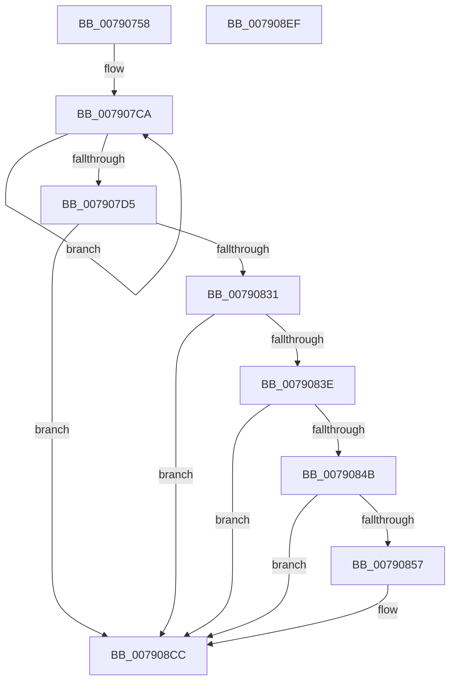

# RtlRestoreBootStatusDefaults

- RVA: `0x00790758`–`0x007908F0` (길이 `408` bytes)
- VA: `0x0000000140790758`
- 실행 섹션: `PAGE`
- PDB 이름 있음: `예`; PDB Function 태그: `아니요`
- unwind 정보 RVA: `0x000CFAF0`
- 디코드: `101`개 명령, `408/408` bytes 표시
- 미해석 바이트: `0` (있으면 어셈블리에 `.byte`로 보존)

> 이 문서는 커널 이미지의 기계어와 PDB 기호를 분석해 생성했습니다. 4번과 5번은 함수 원형과 자료형을 바이너리 사용 방식에서 추정한 C 해석이며 원본 소스 복구 결과는 아닙니다.

## 1. Dependencies

- 직접 호출 지점: **5**; 고유 호출 대상: **5**
- 직접 호출자로 확인된 함수: **1**
- RIP 상대 이미지 참조: **4**

### Outgoing calls
- `0x00790795` → [memset](../../text/6C/memset_function_006C6C40.md) (function, `0x006C6C40`)
- `0x007907A8` → [RtlGetNtProductType](../../text/43/RtlGetNtProductType_function_00436270.md) (function, `0x00436270`)
- `0x007907EA` → [RtlpRecordBootStatusData](../A8/RtlpRecordBootStatusData_function_00A8F57C.md) (function, `0x00A8F57C`)
- `0x00790822` → [ZwWriteFile](../../text/6A/ZwWriteFile_function_006AD1D0.md) (function, `0x006AD1D0`)
- `0x007908D5` → [_security_check_cookie](../../text/6A/_security_check_cookie_function_006AC640.md) (function, `0x006AC640`)

### Direct callers
- [PopBootStatRestoreDefaults](../AC/PopBootStatRestoreDefaults_function_00AC38E8.md) at `0x00AC3A84`

### Static image references
- `0x0079076F` → RVA `0x00E0A740` (`.data`; read)
- `0x00790831` → RVA `0x00F05C20` (`.data`; read)
- `0x0079083E` → RVA `0x00F05C28` (`.data`; read)
- `0x0079084B` → RVA `0x00F05C38` (`.data`; read)

## 2. Other-region calls and transfers

- 다른 실행 섹션으로 향하는 call: **4**
  - `0x00790795` → [memset](../../text/6C/memset_function_006C6C40.md) (`PAGE` → `.text`)
  - `0x007907A8` → [RtlGetNtProductType](../../text/43/RtlGetNtProductType_function_00436270.md) (`PAGE` → `.text`)
  - `0x00790822` → [ZwWriteFile](../../text/6A/ZwWriteFile_function_006AD1D0.md) (`PAGE` → `.text`)
  - `0x007908D5` → [_security_check_cookie](../../text/6A/_security_check_cookie_function_006AC640.md) (`PAGE` → `.text`)
- 별도 외부 분기/꼬리 이동을 확인하지 못했습니다.

## 3. Assembly (complete function range)

```asm
00790758  48 89 5C 24 10                  mov qword ptr [rsp + 0x10], rbx
0079075D  48 89 74 24 18                  mov qword ptr [rsp + 0x18], rsi
00790762  55                              push rbp
00790763  48 8D 6C 24 B0                  lea rbp, [rsp - 0x50]
00790768  48 81 EC 50 01 00 00            sub rsp, 0x150
0079076F  48 8B 05 CA 9F 67 00            mov rax, qword ptr [rip + 0x679fca]
00790776  48 33 C4                        xor rax, rsp
00790779  48 89 45 40                     mov qword ptr [rbp + 0x40], rax
0079077D  48 8B D9                        mov rbx, rcx
00790780  0F 57 C0                        xorps xmm0, xmm0
00790783  48 8D 4C 24 74                  lea rcx, [rsp + 0x74]
00790788  33 D2                           xor edx, edx
0079078A  41 B8 C4 00 00 00               mov r8d, 0xc4
00790790  0F 11 44 24 58                  movups xmmword ptr [rsp + 0x58], xmm0
00790795  E8 A6 64 F3 FF                  call 0x1406c6c40
0079079A  BE C8 00 00 00                  mov esi, 0xc8
0079079F  48 8D 4C 24 74                  lea rcx, [rsp + 0x74]
007907A4  89 74 24 70                     mov dword ptr [rsp + 0x70], esi
007907A8  E8 C3 5A CA FF                  call 0x140436270
007907AD  83 65 28 00                     and dword ptr [rbp + 0x28], 0
007907B1  48 8D 44 24 70                  lea rax, [rsp + 0x70]
007907B6  32 C9                           xor cl, cl
007907B8  66 C7 44 24 79 1E 01            mov word ptr [rsp + 0x79], 0x11e
007907BF  C6 45 A1 01                     mov byte ptr [rbp - 0x5f], 1
007907C3  8B D6                           mov edx, esi
007907C5  C6 44 24 7B 00                  mov byte ptr [rsp + 0x7b], 0
007907CA  2A 08                           sub cl, byte ptr [rax]
007907CC  48 FF C0                        inc rax
007907CF  48 83 EA 01                     sub rdx, 1
007907D3  75 F5                           jne 0x1407907ca
007907D5  48 21 54 24 50                  and qword ptr [rsp + 0x50], rdx
007907DA  4C 8B CE                        mov r9, rsi
007907DD  88 4D A2                        mov byte ptr [rbp - 0x5e], cl
007907E0  48 8D 54 24 70                  lea rdx, [rsp + 0x70]
007907E5  33 C9                           xor ecx, ecx
007907E7  45 33 C0                        xor r8d, r8d
007907EA  E8 8D ED 2F 00                  call 0x140a8f57c
007907EF  48 83 64 24 40 00               and qword ptr [rsp + 0x40], 0
007907F5  48 8D 44 24 50                  lea rax, [rsp + 0x50]
007907FA  48 89 44 24 38                  mov qword ptr [rsp + 0x38], rax
007907FF  45 33 C9                        xor r9d, r9d
00790802  48 8D 44 24 70                  lea rax, [rsp + 0x70]
00790807  89 74 24 30                     mov dword ptr [rsp + 0x30], esi
0079080B  48 89 44 24 28                  mov qword ptr [rsp + 0x28], rax
00790810  45 33 C0                        xor r8d, r8d
00790813  48 8D 44 24 58                  lea rax, [rsp + 0x58]
00790818  33 D2                           xor edx, edx
0079081A  48 8B CB                        mov rcx, rbx
0079081D  48 89 44 24 20                  mov qword ptr [rsp + 0x20], rax
00790822  E8 A9 C9 F1 FF                  call 0x1406ad1d0
00790827  8B D0                           mov edx, eax
00790829  85 C0                           test eax, eax
0079082B  0F 88 9B 00 00 00               js 0x1407908cc
00790831  80 3D E8 53 77 00 00            cmp byte ptr [rip + 0x7753e8], 0
00790838  0F 84 8E 00 00 00               je 0x1407908cc
0079083E  48 39 1D E3 53 77 00            cmp qword ptr [rip + 0x7753e3], rbx
00790845  0F 85 81 00 00 00               jne 0x1407908cc
0079084B  48 8B 0D E6 53 77 00            mov rcx, qword ptr [rip + 0x7753e6]
00790852  48 85 C9                        test rcx, rcx
00790855  74 75                           je 0x1407908cc
00790857  48 8D 44 24 70                  lea rax, [rsp + 0x70]
0079085C  41 B8 80 00 00 00               mov r8d, 0x80
00790862  0F 10 00                        movups xmm0, xmmword ptr [rax]
00790865  0F 11 01                        movups xmmword ptr [rcx], xmm0
00790868  0F 10 48 10                     movups xmm1, xmmword ptr [rax + 0x10]
0079086C  0F 11 49 10                     movups xmmword ptr [rcx + 0x10], xmm1
00790870  0F 10 40 20                     movups xmm0, xmmword ptr [rax + 0x20]
00790874  0F 11 41 20                     movups xmmword ptr [rcx + 0x20], xmm0
00790878  0F 10 48 30                     movups xmm1, xmmword ptr [rax + 0x30]
0079087C  0F 11 49 30                     movups xmmword ptr [rcx + 0x30], xmm1
00790880  0F 10 40 40                     movups xmm0, xmmword ptr [rax + 0x40]
00790884  0F 11 41 40                     movups xmmword ptr [rcx + 0x40], xmm0
00790888  0F 10 48 50                     movups xmm1, xmmword ptr [rax + 0x50]
0079088C  0F 11 49 50                     movups xmmword ptr [rcx + 0x50], xmm1
00790890  0F 10 40 60                     movups xmm0, xmmword ptr [rax + 0x60]
00790894  0F 11 41 60                     movups xmmword ptr [rcx + 0x60], xmm0
00790898  49 03 C8                        add rcx, r8
0079089B  0F 10 40 70                     movups xmm0, xmmword ptr [rax + 0x70]
0079089F  49 03 C0                        add rax, r8
007908A2  0F 11 41 F0                     movups xmmword ptr [rcx - 0x10], xmm0
007908A6  0F 10 08                        movups xmm1, xmmword ptr [rax]
007908A9  0F 11 09                        movups xmmword ptr [rcx], xmm1
007908AC  0F 10 40 10                     movups xmm0, xmmword ptr [rax + 0x10]
007908B0  0F 11 41 10                     movups xmmword ptr [rcx + 0x10], xmm0
007908B4  0F 10 48 20                     movups xmm1, xmmword ptr [rax + 0x20]
007908B8  0F 11 49 20                     movups xmmword ptr [rcx + 0x20], xmm1
007908BC  0F 10 40 30                     movups xmm0, xmmword ptr [rax + 0x30]
007908C0  0F 11 41 30                     movups xmmword ptr [rcx + 0x30], xmm0
007908C4  48 8B 40 40                     mov rax, qword ptr [rax + 0x40]
007908C8  48 89 41 40                     mov qword ptr [rcx + 0x40], rax
007908CC  8B C2                           mov eax, edx
007908CE  48 8B 4D 40                     mov rcx, qword ptr [rbp + 0x40]
007908D2  48 33 CC                        xor rcx, rsp
007908D5  E8 66 BD F1 FF                  call 0x1406ac640
007908DA  4C 8D 9C 24 50 01 00 00         lea r11, [rsp + 0x150]
007908E2  49 8B 5B 18                     mov rbx, qword ptr [r11 + 0x18]
007908E6  49 8B 73 20                     mov rsi, qword ptr [r11 + 0x20]
007908EA  49 8B E3                        mov rsp, r11
007908ED  5D                              pop rbp
007908EE  C3                              ret
007908EF  CC                              int3
```

## 4. C-style interpretation (structured pseudocode)

```c
__int64 __fastcall RtlRestoreBootStatusDefaults(__int64 a1, int a2)
{
    __int64 result;
    __int64 v_rsp;
    unsigned __int64 v_stack_m100;
    unsigned __int64 v_stack_m108;
    unsigned __int64 v_stack_m118;
    unsigned __int64 v_stack_m120;
    unsigned int v_stack_m128;
    unsigned __int64 v_stack_m130;
    unsigned __int64 v_stack_m138;
    unsigned __int64 v_stack_m18;
    unsigned int v_stack_m30;
    unsigned __int64 v_stack_m58;
    unsigned __int64 v_stack_m8;
    unsigned __int8 v_stack_mB6;
    unsigned __int8 v_stack_mB7;
    unsigned __int8 v_stack_mDD;
    unsigned __int16 v_stack_mDF;
    unsigned __int64 v_stack_mE4;
    unsigned int v_stack_mE8;
    unsigned __int64 v_stack_p10;
    unsigned __int64 v_stack_p18;

    v_stack_p10 = v_rbx;
    v_stack_p18 = v_rsi;
    v_rsp = (v_rsp) - (336);
    result = (*(unsigned __int64 *)(v_rip + 6791114)) ^ (v_rsp);
    v_stack_m18 = result;
    a2 = 0;
    v_stack_m100 = v_xmm0;
    result = memset(v_stack_mE4, a2, 196, a4);
    v_stack_mE8 = 200;
    result = RtlGetNtProductType(v_stack_mE4, a2, 196, a4);
    a1 = 0;
    v_stack_mDF = 286;
    v_stack_mB7 = 1;
    v_stack_mDD = 0;
loc_007907CA:
    a1 = (unsigned __int8)((a1) - (*(unsigned __int8 *)(v_stack_mE8)));
    result = (v_stack_mE8) + 1;
    a2 = (200) - (1);
    if (condition_is_not_equal) goto loc_007907CA;
    v_stack_mB6 = (unsigned __int8)(a1);
    a1 = 0;
    a3 = 0;
    result = RtlpRecordBootStatusData(a1, v_stack_mE8, a3, 200);
    v_stack_m120 = v_stack_m108;
    a4 = 0;
    v_stack_m128 = 200;
    v_stack_m130 = v_stack_mE8;
    a3 = 0;
    a2 = 0;
    v_stack_m138 = v_stack_m100;
    result = ZwWriteFile(0, a2, a3, a4);
    if (sign_flag) goto loc_007908CC;
    if ((*(unsigned __int8 *)(v_rip + 7820264)) == 0) goto loc_007908CC;
    if ((*(unsigned __int64 *)(v_rip + 7820259)) != 0) goto loc_007908CC;
    if (*(unsigned __int64 *)(v_rip + 7820262) != 0) {
        result = v_stack_mE8;
        a3 = 128;
        *(unsigned __int64 *)(*(unsigned __int64 *)(v_rip + 7820262)) = v_xmm0;
        *(unsigned __int64 *)(*(unsigned __int64 *)(v_rip + 7820262) + 16) = v_xmm1;
        *(unsigned __int64 *)(*(unsigned __int64 *)(v_rip + 7820262) + 32) = v_xmm0;
        *(unsigned __int64 *)(*(unsigned __int64 *)(v_rip + 7820262) + 48) = v_xmm1;
        *(unsigned __int64 *)(*(unsigned __int64 *)(v_rip + 7820262) + 64) = v_xmm0;
        *(unsigned __int64 *)(*(unsigned __int64 *)(v_rip + 7820262) + 80) = v_xmm1;
        *(unsigned __int64 *)(*(unsigned __int64 *)(v_rip + 7820262) + 96) = v_xmm0;
        a1 = (*(unsigned __int64 *)(v_rip + 7820262)) + (a3);
        result = (result) + (a3);
        *(unsigned __int64 *)(a1 - 16) = v_xmm0;
        *(unsigned __int64 *)(a1) = v_xmm1;
        *(unsigned __int64 *)(a1 + 16) = v_xmm0;
        *(unsigned __int64 *)(a1 + 32) = v_xmm1;
        *(unsigned __int64 *)(a1 + 48) = v_xmm0;
        result = *(unsigned __int64 *)(result + 64);
        *(unsigned __int64 *)(a1 + 64) = result;
    }
    a1 = (v_stack_m18) ^ (v_rsp);
    result = _security_check_cookie(a1, (unsigned int)((unsigned int)(result)), a3, a4);
    return result;
}
```

## 5. (Beta) C Style

```c
int64_t RtlRestoreBootStatusDefaults(int64_t Arg1, int32_t Arg2)
{
    int64_t result;
    int64_t local_rsp;
    uint64_t v_stack_m100;
    uint64_t v_stack_m108;
    uint64_t v_stack_m118;
    uint64_t v_stack_m120;
    uint32_t v_stack_m128;
    uint64_t v_stack_m130;
    uint64_t v_stack_m138;
    uint64_t v_stack_m18;
    uint32_t v_stack_m30;
    uint64_t v_stack_m58;
    uint64_t v_stack_m8;
    uint8_t v_stack_mB6;
    uint8_t v_stack_mB7;
    uint8_t v_stack_mDD;
    uint16_t v_stack_mDF;
    uint64_t v_stack_mE4;
    uint32_t v_stack_mE8;
    uint64_t v_stack_p10;
    uint64_t v_stack_p18;

    v_stack_p10 = local_rbx;
    v_stack_p18 = local_rsi;
    local_rsp = (local_rsp) - (336);
    result = (*(uint64_t *)(v_rip + 0x679FCA)) ^ (local_rsp);
    v_stack_m18 = result;
    Arg2 = 0;
    v_stack_m100 = v_xmm0;
    result = memset(v_stack_mE4, Arg2, 196, a4);
    v_stack_mE8 = 200;
    result = RtlGetNtProductType(v_stack_mE4, Arg2, 196, a4);
    Arg1 = 0;
    v_stack_mDF = 286;
    v_stack_mB7 = 1;
    v_stack_mDD = 0;
loc_007907CA:
    Arg1 = (uint8_t)((Arg1) - (*(uint8_t *)(v_stack_mE8)));
    result = (v_stack_mE8) + 1;
    Arg2 = (200) - (1);
    if (condition_is_not_equal) goto loc_007907CA;
    v_stack_mB6 = (uint8_t)(Arg1);
    Arg1 = 0;
    a3 = 0;
    result = RtlpRecordBootStatusData(Arg1, v_stack_mE8, a3, 200);
    v_stack_m120 = v_stack_m108;
    a4 = 0;
    v_stack_m128 = 200;
    v_stack_m130 = v_stack_mE8;
    a3 = 0;
    Arg2 = 0;
    v_stack_m138 = v_stack_m100;
    result = ZwWriteFile(0, Arg2, a3, a4);
    if (sign_flag) goto loc_007908CC;
    if ((*(uint8_t *)(v_rip + 0x7753E8)) == 0) goto loc_007908CC;
    if ((*(uint64_t *)(v_rip + 0x7753E3)) != 0) goto loc_007908CC;
    if (*(uint64_t *)(v_rip + 0x7753E6) != 0) {
        result = v_stack_mE8;
        a3 = 128;
        *(uint64_t *)(*(uint64_t *)(v_rip + 0x7753E6)) = v_xmm0;
        *(uint64_t *)(*(uint64_t *)(v_rip + 0x7753E6) + 0x10) = v_xmm1;
        *(uint64_t *)(*(uint64_t *)(v_rip + 0x7753E6) + 0x20) = v_xmm0;
        *(uint64_t *)(*(uint64_t *)(v_rip + 0x7753E6) + 0x30) = v_xmm1;
        *(uint64_t *)(*(uint64_t *)(v_rip + 0x7753E6) + 0x40) = v_xmm0;
        *(uint64_t *)(*(uint64_t *)(v_rip + 0x7753E6) + 0x50) = v_xmm1;
        *(uint64_t *)(*(uint64_t *)(v_rip + 0x7753E6) + 0x60) = v_xmm0;
        Arg1 = (*(uint64_t *)(v_rip + 0x7753E6)) + (a3);
        result = (result) + (a3);
        *(uint64_t *)(Arg1 - 0x10) = v_xmm0;
        *(uint64_t *)(Arg1) = v_xmm1;
        *(uint64_t *)(Arg1 + 0x10) = v_xmm0;
        *(uint64_t *)(Arg1 + 0x20) = v_xmm1;
        *(uint64_t *)(Arg1 + 0x30) = v_xmm0;
        result = *(uint64_t *)(result + 0x40);
        *(uint64_t *)(Arg1 + 0x40) = result;
    }
    Arg1 = (v_stack_m18) ^ (local_rsp);
    result = _security_check_cookie(Arg1, (uint32_t)((uint32_t)(result)), a3, a4);
    return result;
}
```

## 6. Execution-region graph

[열기: 2D/3D 그래프와 함수 탐색 컨트롤 패널](../../../control-panel.html?section=page&rva=0x00790758&view=graph)

- 2D 그래프는 위에서 아래로 흐르고, 3D 그래프는 빈 공간을 드래그해 회전합니다. Shift+드래그는 이동, 휠은 확대·축소, 함수 노드 선택은 대상 보고서 이동입니다.

### Static fallback


