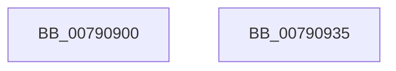

# RtlRestoreSystemBootStatusDefaults

- RVA: `0x00790900`–`0x00790936` (길이 `54` bytes)
- VA: `0x0000000140790900`
- 실행 섹션: `PAGE`
- PDB 이름 있음: `예`; PDB Function 태그: `아니요`
- unwind 정보 RVA: `0x0005CC98`
- 디코드: `15`개 명령, `54/54` bytes 표시
- 미해석 바이트: `0` (있으면 어셈블리에 `.byte`로 보존)

> 이 문서는 커널 이미지의 기계어와 PDB 기호를 분석해 생성했습니다. 4번과 5번은 함수 원형과 자료형을 바이너리 사용 방식에서 추정한 C 해석이며 원본 소스 복구 결과는 아닙니다.

## 1. Dependencies

- 직접 호출 지점: **1**; 고유 호출 대상: **1**
- 직접 호출자로 확인된 함수: **0**
- RIP 상대 이미지 참조: **0**

### Outgoing calls
- `0x0079092B` → [ZwPowerInformation](../../text/6A/ZwPowerInformation_function_006ADCB0.md) (function, `0x006ADCB0`)

### Direct callers
- 이 함수 시작 RVA로 연결되는 직접 call은 확인되지 않았습니다. 간접 호출은 완전히 역산할 수 없습니다.

### Static image references
- 디코드된 RIP-relative 메모리 참조가 없습니다.

## 2. Other-region calls and transfers

- 다른 실행 섹션으로 향하는 call: **1**
  - `0x0079092B` → [ZwPowerInformation](../../text/6A/ZwPowerInformation_function_006ADCB0.md) (`PAGE` → `.text`)
- 별도 외부 분기/꼬리 이동을 확인하지 못했습니다.

## 3. Assembly (complete function range)

```asm
00790900  4C 8B DC                        mov r11, rsp
00790903  48 83 EC 58                     sub rsp, 0x58
00790907  33 C0                           xor eax, eax
00790909  49 C7 43 D8 23 00 00 00         mov qword ptr [r11 - 0x28], 0x23
00790911  45 33 C9                        xor r9d, r9d
00790914  49 89 43 E0                     mov qword ptr [r11 - 0x20], rax
00790918  49 8D 53 D8                     lea rdx, [r11 - 0x28]
0079091C  49 89 43 E8                     mov qword ptr [r11 - 0x18], rax
00790920  89 44 24 20                     mov dword ptr [rsp + 0x20], eax
00790924  44 8D 40 18                     lea r8d, [rax + 0x18]
00790928  8D 48 57                        lea ecx, [rax + 0x57]
0079092B  E8 80 D3 F1 FF                  call 0x1406adcb0
00790930  48 83 C4 58                     add rsp, 0x58
00790934  C3                              ret
00790935  CC                              int3
```

## 4. C-style interpretation (structured pseudocode)

```c
__int64 __fastcall RtlRestoreSystemBootStatusDefaults(__int64 a1, __int64 a2, __int64 a3, int a4)
{
    __int64 result;
    __int64 v_rsp;
    unsigned int v_stack_m38;

    v_rsp = (v_rsp) - (88);
    result = 0;
    *(unsigned __int64 *)(v_rsp - 40) = 35;
    a4 = 0;
    *(unsigned __int64 *)(v_rsp - 32) = 0;
    *(unsigned __int64 *)(v_rsp - 24) = 0;
    v_stack_m38 = 0;
    result = ZwPowerInformation(result + 87, v_rsp - 40, result + 24, a4);
    v_rsp = (v_rsp) + (88);
    return result;
}
```

## 5. (Beta) C Style

```c
int64_t RtlRestoreSystemBootStatusDefaults(int64_t Arg1, int64_t Arg2, int64_t Arg3, int32_t Arg4)
{
    int64_t result;
    int64_t local_rsp;
    uint32_t v_stack_m38;

    local_rsp = (local_rsp) - (88);
    result = 0;
    *(uint64_t *)(local_rsp - 0x28) = 35;
    Arg4 = 0;
    *(uint64_t *)(local_rsp - 0x20) = 0;
    *(uint64_t *)(local_rsp - 0x18) = 0;
    v_stack_m38 = 0;
    result = ZwPowerInformation(result + 87, local_rsp - 40, result + 24, Arg4);
    local_rsp = (local_rsp) + (88);
    return result;
}
```

## 6. Execution-region graph

[열기: 2D/3D 그래프와 함수 탐색 컨트롤 패널](../../../control-panel.html?section=page&rva=0x00790900&view=graph)

- 2D 그래프는 위에서 아래로 흐르고, 3D 그래프는 빈 공간을 드래그해 회전합니다. Shift+드래그는 이동, 휠은 확대·축소, 함수 노드 선택은 대상 보고서 이동입니다.

### Static fallback


