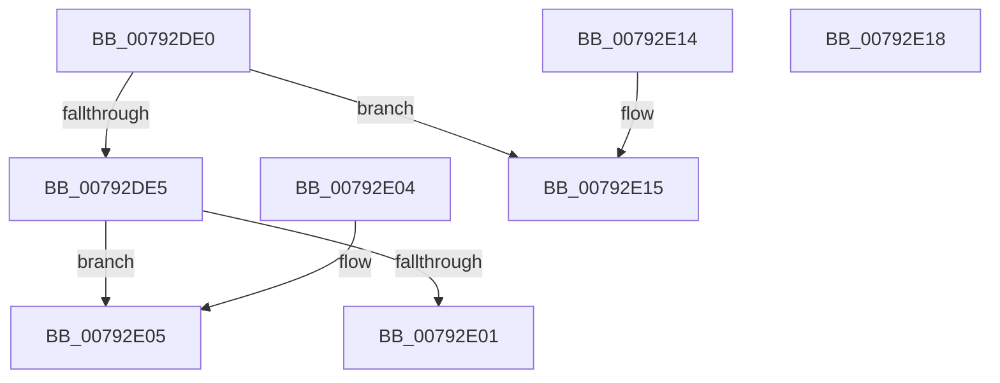

# RtlSetProcessPlaceholderCompatibilityMode

- RVA: `0x00792DE0`–`0x00792E19` (길이 `57` bytes)
- VA: `0x0000000140792DE0`
- 실행 섹션: `PAGE`
- PDB 이름 있음: `예`; PDB Function 태그: `아니요`
- unwind 정보 RVA: `0x000DB714`
- 디코드: `17`개 명령, `57/57` bytes 표시
- 미해석 바이트: `0` (있으면 어셈블리에 `.byte`로 보존)

> 이 문서는 커널 이미지의 기계어와 PDB 기호를 분석해 생성했습니다. 4번과 5번은 함수 원형과 자료형을 바이너리 사용 방식에서 추정한 C 해석이며 원본 소스 복구 결과는 아닙니다.

## 1. Dependencies

- 직접 호출 지점: **0**; 고유 호출 대상: **0**
- 직접 호출자로 확인된 함수: **0**
- RIP 상대 이미지 참조: **0**

### Outgoing calls
- 직접 디코드된 call 명령이 없습니다.

### Direct callers
- 이 함수 시작 RVA로 연결되는 직접 call은 확인되지 않았습니다. 간접 호출은 완전히 역산할 수 없습니다.

### Static image references
- 디코드된 RIP-relative 메모리 참조가 없습니다.

## 2. Other-region calls and transfers

- 다른 실행 섹션으로 향하는 call: **0**
- 별도 외부 분기/꼬리 이동을 확인하지 못했습니다.

## 3. Assembly (complete function range)

```asm
00792DE0  80 F9 03                        cmp cl, 3
00792DE3  77 30                           ja 0x140792e15
00792DE5  65 48 8B 04 25 88 01 00 00      mov rax, qword ptr gs:[0x188]
00792DEE  48 8B 90 B8 00 00 00            mov rdx, qword ptr [rax + 0xb8]
00792DF5  4C 8B 82 E0 02 00 00            mov r8, qword ptr [rdx + 0x2e0]
00792DFC  4D 85 C0                        test r8, r8
00792DFF  75 04                           jne 0x140792e05
00792E01  B0 FD                           mov al, 0xfd
00792E03  C3                              ret
00792E04  CC                              int3
00792E05  41 8A 80 B0 07 00 00            mov al, byte ptr [r8 + 0x7b0]
00792E0C  41 88 88 B0 07 00 00            mov byte ptr [r8 + 0x7b0], cl
00792E13  C3                              ret
00792E14  CC                              int3
00792E15  B0 FF                           mov al, 0xff
00792E17  C3                              ret
00792E18  CC                              int3
```

## 4. C-style interpretation (structured pseudocode)

```c
__int64 __fastcall RtlSetProcessPlaceholderCompatibilityMode(unsigned __int8 a1)
{
    if (a1 > 3) goto loc_00792E15;
    if (*(unsigned __int64 *)(*(unsigned __int64 *)(*(unsigned __int64 *)(gs_base + (0 + 392)) + 184) + 736) != 0) goto loc_00792E05;
    return 253;
loc_00792E05:
    *(unsigned __int8 *)(*(unsigned __int64 *)(*(unsigned __int64 *)(*(unsigned __int64 *)(gs_base + (0 + 392)) + 184) + 736) + 1968) = a1;
    return *(unsigned __int8 *)(*(unsigned __int64 *)(*(unsigned __int64 *)(*(unsigned __int64 *)(gs_base + (0 + 392)) + 184) + 736) + 1968);
loc_00792E15:
    return 255;
}
```

## 5. (Beta) C Style

```c
int64_t RtlSetProcessPlaceholderCompatibilityMode(uint8_t Arg1)
{
    if (Arg1 > 3) goto loc_00792E15;
    if (*(uint64_t *)(*(uint64_t *)(*(uint64_t *)(gs_base + (0 + 0x188)) + 0xB8) + 0x2E0) != 0) goto loc_00792E05;
    return 253;
loc_00792E05:
    *(uint8_t *)(*(uint64_t *)(*(uint64_t *)(*(uint64_t *)(gs_base + (0 + 0x188)) + 0xB8) + 0x2E0) + 0x7B0) = Arg1;
    return *(uint8_t *)(*(uint64_t *)(*(uint64_t *)(*(uint64_t *)(gs_base + (0 + 0x188)) + 0xB8) + 0x2E0) + 0x7B0);
loc_00792E15:
    return 255;
}
```

## 6. Execution-region graph

[열기: 2D/3D 그래프와 함수 탐색 컨트롤 패널](../../../control-panel.html?section=page&rva=0x00792DE0&view=graph)

- 2D 그래프는 위에서 아래로 흐르고, 3D 그래프는 빈 공간을 드래그해 회전합니다. Shift+드래그는 이동, 휠은 확대·축소, 함수 노드 선택은 대상 보고서 이동입니다.

### Static fallback


