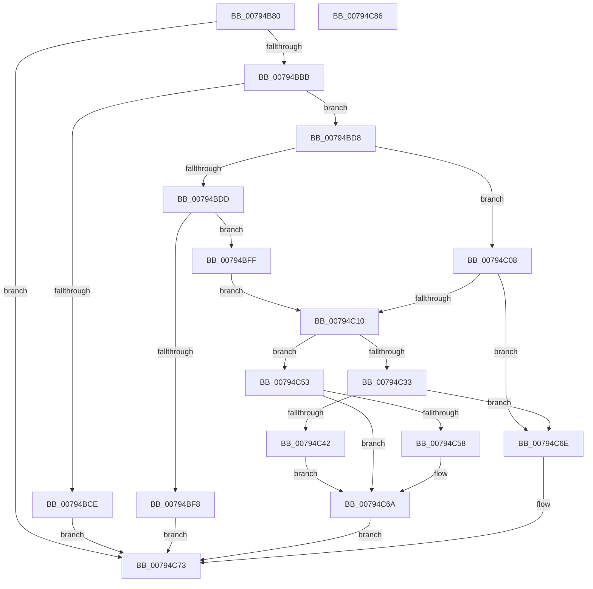

# RtlUTF8StringToUnicodeString

- RVA: `0x00794B80`–`0x00794C87` (길이 `263` bytes)
- VA: `0x0000000140794B80`
- 실행 섹션: `PAGE`
- PDB 이름 있음: `예`; PDB Function 태그: `아니요`
- unwind 정보 RVA: `0x000BEE5C`
- 디코드: `79`개 명령, `263/263` bytes 표시
- 미해석 바이트: `0` (있으면 어셈블리에 `.byte`로 보존)

> 이 문서는 커널 이미지의 기계어와 PDB 기호를 분석해 생성했습니다. 4번과 5번은 함수 원형과 자료형을 바이너리 사용 방식에서 추정한 C 해석이며 원본 소스 복구 결과는 아닙니다.

## 1. Dependencies

- 직접 호출 지점: **4**; 고유 호출 대상: **4**
- 직접 호출자로 확인된 함수: **1**
- RIP 상대 이미지 참조: **0**

### Outgoing calls
- `0x00794BAE` → [CountUTF8ToUnicode](../../text/48/CountUTF8ToUnicode_function_00485D40.md) (function, `0x00485D40`)
- `0x00794BEA` → [ExAllocatePool2](../../poolcode/B8/ExAllocatePool2_function_00B820F0.md) (function, `0x00B820F0`)
- `0x00794C28` → [RtlUTF8ToUnicodeN](../90/RtlUTF8ToUnicodeN_function_0090E060.md) (function, `0x0090E060`)
- `0x00794C5C` → [ExFreePool](../../poolcode/B8/ExFreePool_function_00B82850.md) (function, `0x00B82850`)

### Direct callers
- [sub_00B2CEFC](../B2/Unknown_function_00B2CEFC.md) at `0x00B2CF1B`

### Static image references
- 디코드된 RIP-relative 메모리 참조가 없습니다.

## 2. Other-region calls and transfers

- 다른 실행 섹션으로 향하는 call: **3**
  - `0x00794BAE` → [CountUTF8ToUnicode](../../text/48/CountUTF8ToUnicode_function_00485D40.md) (`PAGE` → `.text`)
  - `0x00794BEA` → [ExAllocatePool2](../../poolcode/B8/ExAllocatePool2_function_00B820F0.md) (`PAGE` → `POOLCODE`)
  - `0x00794C5C` → [ExFreePool](../../poolcode/B8/ExFreePool_function_00B82850.md) (`PAGE` → `POOLCODE`)
- 별도 외부 분기/꼬리 이동을 확인하지 못했습니다.

## 3. Assembly (complete function range)

```asm
00794B80  48 8B C4                        mov rax, rsp
00794B83  48 89 58 08                     mov qword ptr [rax + 8], rbx
00794B87  48 89 68 18                     mov qword ptr [rax + 0x18], rbp
00794B8B  56                              push rsi
00794B8C  57                              push rdi
00794B8D  41 56                           push r14
00794B8F  48 83 EC 30                     sub rsp, 0x30
00794B93  48 8B EA                        mov rbp, rdx
00794B96  41 8A F0                        mov sil, r8b
00794B99  0F B7 12                        movzx edx, word ptr [rdx]
00794B9C  4C 8D 40 10                     lea r8, [rax + 0x10]
00794BA0  48 8B D9                        mov rbx, rcx
00794BA3  45 33 F6                        xor r14d, r14d
00794BA6  44 89 70 10                     mov dword ptr [rax + 0x10], r14d
00794BAA  48 8B 4D 08                     mov rcx, qword ptr [rbp + 8]
00794BAE  E8 8D 11 CF FF                  call 0x140485d40
00794BB3  85 C0                           test eax, eax
00794BB5  0F 88 B8 00 00 00               js 0x140794c73
00794BBB  8B 7C 24 58                     mov edi, dword ptr [rsp + 0x58]
00794BBF  83 C7 02                        add edi, 2
00794BC2  89 7C 24 58                     mov dword ptr [rsp + 0x58], edi
00794BC6  81 FF FE FF 00 00               cmp edi, 0xfffe
00794BCC  76 0A                           jbe 0x140794bd8
00794BCE  B8 F0 00 00 C0                  mov eax, 0xc00000f0
00794BD3  E9 9B 00 00 00                  jmp 0x140794c73
00794BD8  40 84 F6                        test sil, sil
00794BDB  74 2B                           je 0x140794c08
00794BDD  8B D7                           mov edx, edi
00794BDF  B9 00 01 00 00                  mov ecx, 0x100
00794BE4  41 B8 53 74 72 67               mov r8d, 0x67727453
00794BEA  E8 01 D5 3E 00                  call 0x140b820f0
00794BEF  48 89 43 08                     mov qword ptr [rbx + 8], rax
00794BF3  48 85 C0                        test rax, rax
00794BF6  75 07                           jne 0x140794bff
00794BF8  B8 17 00 00 C0                  mov eax, 0xc0000017
00794BFD  EB 74                           jmp 0x140794c73
00794BFF  66 89 7B 02                     mov word ptr [rbx + 2], di
00794C03  0F B7 CF                        movzx ecx, di
00794C06  EB 08                           jmp 0x140794c10
00794C08  0F B7 4B 02                     movzx ecx, word ptr [rbx + 2]
00794C0C  3B F9                           cmp edi, ecx
00794C0E  77 5E                           ja 0x140794c6e
00794C10  0F B7 45 00                     movzx eax, word ptr [rbp]
00794C14  4C 8D 44 24 58                  lea r8, [rsp + 0x58]
00794C19  4C 8B 4D 08                     mov r9, qword ptr [rbp + 8]
00794C1D  0F B7 D1                        movzx edx, cx
00794C20  48 8B 4B 08                     mov rcx, qword ptr [rbx + 8]
00794C24  89 44 24 20                     mov dword ptr [rsp + 0x20], eax
00794C28  E8 33 94 17 00                  call 0x14090e060
00794C2D  8B F8                           mov edi, eax
00794C2F  85 C0                           test eax, eax
00794C31  78 20                           js 0x140794c53
00794C33  8B 4C 24 58                     mov ecx, dword ptr [rsp + 0x58]
00794C37  0F B7 43 02                     movzx eax, word ptr [rbx + 2]
00794C3B  66 89 0B                        mov word ptr [rbx], cx
00794C3E  3B C8                           cmp ecx, eax
00794C40  73 2C                           jae 0x140794c6e
00794C42  48 8B 43 08                     mov rax, qword ptr [rbx + 8]
00794C46  41 8B FE                        mov edi, r14d
00794C49  48 D1 E9                        shr rcx, 1
00794C4C  66 44 89 34 48                  mov word ptr [rax + rcx*2], r14w
00794C51  EB 17                           jmp 0x140794c6a
00794C53  40 84 F6                        test sil, sil
00794C56  74 12                           je 0x140794c6a
00794C58  48 8B 4B 08                     mov rcx, qword ptr [rbx + 8]
00794C5C  E8 EF DB 3E 00                  call 0x140b82850
00794C61  4C 89 73 08                     mov qword ptr [rbx + 8], r14
00794C65  66 44 89 73 02                  mov word ptr [rbx + 2], r14w
00794C6A  8B C7                           mov eax, edi
00794C6C  EB 05                           jmp 0x140794c73
00794C6E  B8 05 00 00 80                  mov eax, 0x80000005
00794C73  48 8B 5C 24 50                  mov rbx, qword ptr [rsp + 0x50]
00794C78  48 8B 6C 24 60                  mov rbp, qword ptr [rsp + 0x60]
00794C7D  48 83 C4 30                     add rsp, 0x30
00794C81  41 5E                           pop r14
00794C83  5F                              pop rdi
00794C84  5E                              pop rsi
00794C85  C3                              ret
00794C86  CC                              int3
```

## 4. C-style interpretation (structured pseudocode)

```c
__int64 __fastcall RtlUTF8StringToUnicodeString(__int64 a1, __int64 a2, unsigned __int8 a3)
{
    __int64 result;
    __int64 v_r14;
    __int64 v_rdi;
    __int64 v_rsp;
    unsigned int v_stack_m28;
    unsigned int v_stack_p10;
    unsigned __int64 v_stack_p18;
    unsigned __int64 v_stack_p8;

    *(unsigned __int64 *)(v_rsp + 8) = v_rbx;
    *(unsigned __int64 *)(v_rsp + 24) = v_rbp;
    v_rsp = (v_rsp) - (48);
    v_r14 = 0;
    *(unsigned int *)(v_rsp + 16) = 0;
    result = CountUTF8ToUnicode(*(unsigned __int64 *)(a2 + 8), *(unsigned __int16 *)(a2), v_rsp + 16, a4);
    if (sign_flag) goto loc_00794C73;
    v_rdi = (unsigned int)(((unsigned int)(v_stack_p10)) + (2));
    v_stack_p10 = (unsigned int)(v_rdi);
    if (((unsigned int)(v_rdi)) <= 0xFFFEULL) goto loc_00794BD8;
    goto loc_00794C73;
loc_00794BD8:
    if (a3 == 0) goto loc_00794C08;
    result = ExAllocatePool2(256, (unsigned int)((unsigned int)(v_rdi)), (unsigned int)(0x67727453ULL), a4);
    *(unsigned __int64 *)(a1 + 8) = result;
    if (result != 0) goto loc_00794BFF;
    goto loc_00794C73;
loc_00794BFF:
    *(unsigned __int16 *)(a1 + 2) = (unsigned __int16)(v_rdi);
    goto loc_00794C10;
loc_00794C08:
    if (((unsigned int)(v_rdi)) > ((unsigned int)(*(unsigned __int16 *)(a1 + 2)))) goto loc_00794C6E;
loc_00794C10:
    v_stack_m28 = (unsigned int)(*(unsigned __int16 *)(a2));
    result = RtlUTF8ToUnicodeN(*(unsigned __int64 *)(a1 + 8), (unsigned __int16)(*(unsigned __int16 *)(a1 + 2)), v_stack_p10, *(unsigned __int64 *)(a2 + 8));
    if (sign_flag) goto loc_00794C53;
    *(unsigned __int16 *)(a1) = (unsigned __int16)((unsigned int)(v_stack_p10));
    if (((unsigned int)((unsigned int)(v_stack_p10))) >= ((unsigned int)(*(unsigned __int16 *)(a1 + 2)))) goto loc_00794C6E;
    a1 = ((unsigned int)(v_stack_p10)) >> (1);
    *(unsigned __int16 *)(*(unsigned __int64 *)(a1 + 8) + a1 * 2) = 0;
    goto loc_00794C6A;
loc_00794C53:
    result = *(unsigned __int64 *)(a1 + 8);
    if (a3 != 0) {
        a1 = *(unsigned __int64 *)(a1 + 8);
        result = ExFreePool(a1, (unsigned __int16)(*(unsigned __int16 *)(a1 + 2)), v_stack_p10, *(unsigned __int64 *)(a2 + 8));
        *(unsigned __int64 *)(a1 + 8) = 0;
        *(unsigned __int16 *)(a1 + 2) = 0;
    }
    goto loc_00794C73;
loc_00794C6E:
loc_00794C73:
    v_rsp = (v_rsp) + (48);
    return (unsigned int)(0x80000005ULL);
}
```

## 5. (Beta) C Style

```c
int64_t RtlUTF8StringToUnicodeString(void *Arg1, void *Arg2, uint8_t Arg3)
{
    uint8_t *arg1 = (uint8_t *)Arg1;
    uint8_t *arg2 = (uint8_t *)Arg2;

    int64_t result;
    int64_t local_r14;
    int64_t local_rdi;
    int64_t local_rsp;
    uint32_t v_stack_m28;
    uint32_t v_stack_p10;
    uint64_t v_stack_p18;
    uint64_t v_stack_p8;

    *(uint64_t *)(local_rsp + 0x8) = local_rbx;
    *(uint64_t *)(local_rsp + 0x18) = local_rbp;
    local_rsp = (local_rsp) - (48);
    local_r14 = 0;
    *(uint32_t *)(local_rsp + 0x10) = 0;
    result = CountUTF8ToUnicode(*(uint64_t *)(arg2 + 0x8), *(uint16_t *)(arg2), local_rsp + 16, a4);
    if (sign_flag) goto loc_00794C73;
    local_rdi = (uint32_t)(((uint32_t)(v_stack_p10)) + (2));
    v_stack_p10 = (uint32_t)(local_rdi);
    if (((uint32_t)(local_rdi)) <= 0xFFFEULL) goto loc_00794BD8;
    goto loc_00794C73;
loc_00794BD8:
    if (Arg3 == 0) goto loc_00794C08;
    result = ExAllocatePool2(256, (uint32_t)((uint32_t)(local_rdi)), (uint32_t)(0x67727453ULL), a4);
    *(uint64_t *)(arg1 + 0x8) = result;
    if (result != 0) goto loc_00794BFF;
    goto loc_00794C73;
loc_00794BFF:
    *(uint16_t *)(arg1 + 0x2) = (uint16_t)(local_rdi);
    goto loc_00794C10;
loc_00794C08:
    if (((uint32_t)(local_rdi)) > ((uint32_t)(*(uint16_t *)(arg1 + 0x2)))) goto loc_00794C6E;
loc_00794C10:
    v_stack_m28 = (uint32_t)(*(uint16_t *)(arg2));
    result = RtlUTF8ToUnicodeN(*(uint64_t *)(arg1 + 0x8), (uint16_t)(*(uint16_t *)(arg1 + 0x2)), v_stack_p10, *(uint64_t *)(arg2 + 0x8));
    if (sign_flag) goto loc_00794C53;
    *(uint16_t *)(arg1) = (uint16_t)((uint32_t)(v_stack_p10));
    if (((uint32_t)((uint32_t)(v_stack_p10))) >= ((uint32_t)(*(uint16_t *)(arg1 + 0x2)))) goto loc_00794C6E;
    Arg1 = ((uint32_t)(v_stack_p10)) >> (1);
    *(uint16_t *)(*(uint64_t *)(arg1 + 0x8) + arg1 * 2) = 0;
    goto loc_00794C6A;
loc_00794C53:
    result = *(uint64_t *)(arg1 + 0x8);
    if (Arg3 != 0) {
        Arg1 = *(uint64_t *)(arg1 + 0x8);
        result = ExFreePool(Arg1, (uint16_t)(*(uint16_t *)(arg1 + 0x2)), v_stack_p10, *(uint64_t *)(arg2 + 0x8));
        *(uint64_t *)(arg1 + 0x8) = 0;
        *(uint16_t *)(arg1 + 0x2) = 0;
    }
    goto loc_00794C73;
loc_00794C6E:
loc_00794C73:
    local_rsp = (local_rsp) + (48);
    return (uint32_t)(0x80000005ULL);
}
```

### 관측된 메모리 오프셋

구조체 형식이 확인되지 않은 접근은 인자 기준의 오프셋으로만 기록했습니다.

| 기준 인자 | 오프셋 표현 | 폭 (bit) | 접근 |
|---|---:|---:|---|
| `Arg1` | `+ 0x0` | `16` | `W` |
| `Arg1` | `+ 0x2` | `16` | `R` |
| `Arg1` | `+ 0x2` | `16` | `W` |
| `Arg1` | `+ 0x8` | `64` | `R` |
| `Arg1` | `+ 0x8` | `64` | `W` |
| `Arg2` | `+ 0x0` | `16` | `R` |
| `Arg2` | `+ 0x8` | `64` | `R` |

## 6. Execution-region graph

[열기: 2D/3D 그래프와 함수 탐색 컨트롤 패널](../../../control-panel.html?section=page&rva=0x00794B80&view=graph)

- 2D 그래프는 위에서 아래로 흐르고, 3D 그래프는 빈 공간을 드래그해 회전합니다. Shift+드래그는 이동, 휠은 확대·축소, 함수 노드 선택은 대상 보고서 이동입니다.

### Static fallback


