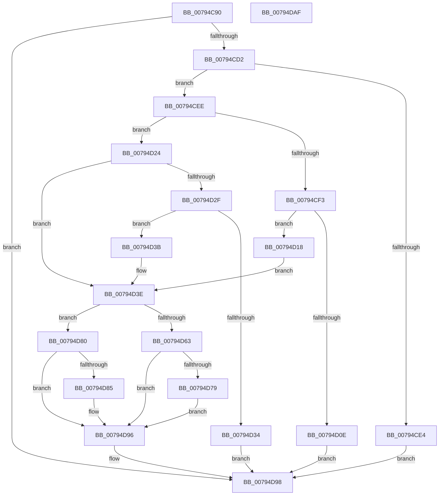

# RtlUnicodeStringToUTF8String

- RVA: `0x00794C90`–`0x00794DB0` (길이 `288` bytes)
- VA: `0x0000000140794C90`
- 실행 섹션: `PAGE`
- PDB 이름 있음: `예`; PDB Function 태그: `아니요`
- unwind 정보 RVA: `0x000C3AC8`
- 디코드: `88`개 명령, `288/288` bytes 표시
- 미해석 바이트: `0` (있으면 어셈블리에 `.byte`로 보존)

> 이 문서는 커널 이미지의 기계어와 PDB 기호를 분석해 생성했습니다. 4번과 5번은 함수 원형과 자료형을 바이너리 사용 방식에서 추정한 C 해석이며 원본 소스 복구 결과는 아닙니다.

## 1. Dependencies

- 직접 호출 지점: **4**; 고유 호출 대상: **4**
- 직접 호출자로 확인된 함수: **0**
- RIP 상대 이미지 참조: **0**

### Outgoing calls
- `0x00794CC5` → [CountUnicodeToUTF8](../../text/45/CountUnicodeToUTF8_function_00457C1C.md) (function, `0x00457C1C`)
- `0x00794D00` → [ExAllocatePool2](../../poolcode/B8/ExAllocatePool2_function_00B820F0.md) (function, `0x00B820F0`)
- `0x00794D58` → [RtlUnicodeToUTF8N](../90/RtlUnicodeToUTF8N_function_0090DBF0.md) (function, `0x0090DBF0`)
- `0x00794D89` → [ExFreePool](../../poolcode/B8/ExFreePool_function_00B82850.md) (function, `0x00B82850`)

### Direct callers
- 이 함수 시작 RVA로 연결되는 직접 call은 확인되지 않았습니다. 간접 호출은 완전히 역산할 수 없습니다.

### Static image references
- 디코드된 RIP-relative 메모리 참조가 없습니다.

## 2. Other-region calls and transfers

- 다른 실행 섹션으로 향하는 call: **3**
  - `0x00794CC5` → [CountUnicodeToUTF8](../../text/45/CountUnicodeToUTF8_function_00457C1C.md) (`PAGE` → `.text`)
  - `0x00794D00` → [ExAllocatePool2](../../poolcode/B8/ExAllocatePool2_function_00B820F0.md) (`PAGE` → `POOLCODE`)
  - `0x00794D89` → [ExFreePool](../../poolcode/B8/ExFreePool_function_00B82850.md) (`PAGE` → `POOLCODE`)
- 별도 외부 분기/꼬리 이동을 확인하지 못했습니다.

## 3. Assembly (complete function range)

```asm
00794C90  48 8B C4                        mov rax, rsp
00794C93  48 89 58 08                     mov qword ptr [rax + 8], rbx
00794C97  48 89 68 18                     mov qword ptr [rax + 0x18], rbp
00794C9B  56                              push rsi
00794C9C  57                              push rdi
00794C9D  41 54                           push r12
00794C9F  41 56                           push r14
00794CA1  41 57                           push r15
00794CA3  48 83 EC 30                     sub rsp, 0x30
00794CA7  4C 8B FA                        mov r15, rdx
00794CAA  41 8A E8                        mov bpl, r8b
00794CAD  0F B7 12                        movzx edx, word ptr [rdx]
00794CB0  4C 8D 40 10                     lea r8, [rax + 0x10]
00794CB4  48 8B F9                        mov rdi, rcx
00794CB7  45 33 E4                        xor r12d, r12d
00794CBA  44 89 60 10                     mov dword ptr [rax + 0x10], r12d
00794CBE  45 8A F4                        mov r14b, r12b
00794CC1  49 8B 4F 08                     mov rcx, qword ptr [r15 + 8]
00794CC5  E8 52 2F CC FF                  call 0x140457c1c
00794CCA  85 C0                           test eax, eax
00794CCC  0F 88 C6 00 00 00               js 0x140794d98
00794CD2  8B 5C 24 68                     mov ebx, dword ptr [rsp + 0x68]
00794CD6  FF C3                           inc ebx
00794CD8  89 5C 24 68                     mov dword ptr [rsp + 0x68], ebx
00794CDC  81 FB FF FF 00 00               cmp ebx, 0xffff
00794CE2  76 0A                           jbe 0x140794cee
00794CE4  B8 F0 00 00 C0                  mov eax, 0xc00000f0
00794CE9  E9 AA 00 00 00                  jmp 0x140794d98
00794CEE  40 84 ED                        test bpl, bpl
00794CF1  74 31                           je 0x140794d24
00794CF3  8B D3                           mov edx, ebx
00794CF5  B9 00 01 00 00                  mov ecx, 0x100
00794CFA  41 B8 53 74 72 67               mov r8d, 0x67727453
00794D00  E8 EB D3 3E 00                  call 0x140b820f0
00794D05  48 89 47 08                     mov qword ptr [rdi + 8], rax
00794D09  48 85 C0                        test rax, rax
00794D0C  75 0A                           jne 0x140794d18
00794D0E  B8 17 00 00 C0                  mov eax, 0xc0000017
00794D13  E9 80 00 00 00                  jmp 0x140794d98
00794D18  48 8D 77 02                     lea rsi, [rdi + 2]
00794D1C  0F B7 CB                        movzx ecx, bx
00794D1F  66 89 1E                        mov word ptr [rsi], bx
00794D22  EB 1A                           jmp 0x140794d3e
00794D24  48 8D 77 02                     lea rsi, [rdi + 2]
00794D28  0F B7 0E                        movzx ecx, word ptr [rsi]
00794D2B  3B D9                           cmp ebx, ecx
00794D2D  76 0F                           jbe 0x140794d3e
00794D2F  66 85 C9                        test cx, cx
00794D32  75 07                           jne 0x140794d3b
00794D34  B8 05 00 00 80                  mov eax, 0x80000005
00794D39  EB 5D                           jmp 0x140794d98
00794D3B  41 B6 01                        mov r14b, 1
00794D3E  41 0F B7 07                     movzx eax, word ptr [r15]
00794D42  4C 8D 44 24 68                  lea r8, [rsp + 0x68]
00794D47  4D 8B 4F 08                     mov r9, qword ptr [r15 + 8]
00794D4B  0F B7 D1                        movzx edx, cx
00794D4E  48 8B 4F 08                     mov rcx, qword ptr [rdi + 8]
00794D52  FF CA                           dec edx
00794D54  89 44 24 20                     mov dword ptr [rsp + 0x20], eax
00794D58  E8 93 8E 17 00                  call 0x14090dbf0
00794D5D  8B D8                           mov ebx, eax
00794D5F  85 C0                           test eax, eax
00794D61  78 1D                           js 0x140794d80
00794D63  44 8B 44 24 68                  mov r8d, dword ptr [rsp + 0x68]
00794D68  48 8B 4F 08                     mov rcx, qword ptr [rdi + 8]
00794D6C  45 88 24 08                     mov byte ptr [r8 + rcx], r12b
00794D70  66 44 89 07                     mov word ptr [rdi], r8w
00794D74  45 84 F6                        test r14b, r14b
00794D77  74 1D                           je 0x140794d96
00794D79  BB 05 00 00 80                  mov ebx, 0x80000005
00794D7E  EB 16                           jmp 0x140794d96
00794D80  40 84 ED                        test bpl, bpl
00794D83  74 11                           je 0x140794d96
00794D85  48 8B 4F 08                     mov rcx, qword ptr [rdi + 8]
00794D89  E8 C2 DA 3E 00                  call 0x140b82850
00794D8E  4C 89 67 08                     mov qword ptr [rdi + 8], r12
00794D92  66 44 89 26                     mov word ptr [rsi], r12w
00794D96  8B C3                           mov eax, ebx
00794D98  48 8B 5C 24 60                  mov rbx, qword ptr [rsp + 0x60]
00794D9D  48 8B 6C 24 70                  mov rbp, qword ptr [rsp + 0x70]
00794DA2  48 83 C4 30                     add rsp, 0x30
00794DA6  41 5F                           pop r15
00794DA8  41 5E                           pop r14
00794DAA  41 5C                           pop r12
00794DAC  5F                              pop rdi
00794DAD  5E                              pop rsi
00794DAE  C3                              ret
00794DAF  CC                              int3
```

## 4. C-style interpretation (structured pseudocode)

```c
__int64 __fastcall RtlUnicodeStringToUTF8String(__int64 a1, __int64 a2, unsigned __int8 a3)
{
    __int64 result;
    __int64 v_r12;
    __int64 v_rbx;
    __int64 v_rsp;
    unsigned int v_stack_m38;
    unsigned int v_stack_p10;
    unsigned __int64 v_stack_p18;
    unsigned __int64 v_stack_p8;

    *(unsigned __int64 *)(v_rsp + 8) = v_rbx;
    *(unsigned __int64 *)(v_rsp + 24) = v_rbp;
    v_rsp = (v_rsp) - (48);
    v_r12 = 0;
    *(unsigned int *)(v_rsp + 16) = 0;
    result = CountUnicodeToUTF8(*(unsigned __int64 *)(a2 + 8), *(unsigned __int16 *)(a2), v_rsp + 16, a4);
    if (sign_flag) goto loc_00794D98;
    v_rbx = (unsigned int)(((unsigned int)(v_stack_p10)) + 1);
    v_stack_p10 = (unsigned int)(v_rbx);
    if (((unsigned int)(v_rbx)) <= 0xFFFFULL) goto loc_00794CEE;
    goto loc_00794D98;
loc_00794CEE:
    if (a3 == 0) goto loc_00794D24;
    result = ExAllocatePool2(256, (unsigned int)((unsigned int)(v_rbx)), (unsigned int)(0x67727453ULL), a4);
    *(unsigned __int64 *)(a1 + 8) = result;
    if (result != 0) goto loc_00794D18;
    goto loc_00794D98;
loc_00794D18:
    *(unsigned __int16 *)(a1 + 2) = (unsigned __int16)(v_rbx);
    goto loc_00794D3E;
loc_00794D24:
    if (((unsigned int)(v_rbx)) <= ((unsigned int)(*(unsigned __int16 *)(a1 + 2)))) goto loc_00794D3E;
    if ((unsigned __int16)(*(unsigned __int16 *)(a1 + 2)) != 0) goto loc_00794D3B;
    goto loc_00794D98;
loc_00794D3B:
loc_00794D3E:
    a2 = (unsigned int)(((unsigned __int16)(*(unsigned __int16 *)(a1 + 2))) - 1);
    v_stack_m38 = (unsigned int)(*(unsigned __int16 *)(a2));
    result = RtlUnicodeToUTF8N(*(unsigned __int64 *)(a1 + 8), a2, v_stack_p10, *(unsigned __int64 *)(a2 + 8));
    if (sign_flag) goto loc_00794D80;
    *(unsigned __int8 *)((unsigned int)(v_stack_p10) + *(unsigned __int64 *)(a1 + 8) * 1) = 0;
    *(unsigned __int16 *)(a1) = (unsigned __int16)((unsigned int)(v_stack_p10));
    if (1 == 0) goto loc_00794D96;
    goto loc_00794D96;
loc_00794D80:
    if (a3 != 0) {
        a1 = *(unsigned __int64 *)(a1 + 8);
        result = ExFreePool(a1, a2, (unsigned int)(v_stack_p10), *(unsigned __int64 *)(a2 + 8));
        *(unsigned __int64 *)(a1 + 8) = 0;
        *(unsigned __int16 *)(a1 + 2) = 0;
    }
loc_00794D98:
    v_rsp = (v_rsp) + (48);
    return (unsigned int)((unsigned int)((unsigned int)(0x80000005ULL)));
}
```

## 5. (Beta) C Style

```c
int64_t RtlUnicodeStringToUTF8String(void *Arg1, void *Arg2, uint8_t Arg3)
{
    uint8_t *arg1 = (uint8_t *)Arg1;
    uint8_t *arg2 = (uint8_t *)Arg2;

    int64_t result;
    int64_t local_r12;
    int64_t local_rbx;
    int64_t local_rsp;
    uint32_t v_stack_m38;
    uint32_t v_stack_p10;
    uint64_t v_stack_p18;
    uint64_t v_stack_p8;

    *(uint64_t *)(local_rsp + 0x8) = local_rbx;
    *(uint64_t *)(local_rsp + 0x18) = local_rbp;
    local_rsp = (local_rsp) - (48);
    local_r12 = 0;
    *(uint32_t *)(local_rsp + 0x10) = 0;
    result = CountUnicodeToUTF8(*(uint64_t *)(arg2 + 0x8), *(uint16_t *)(arg2), local_rsp + 16, a4);
    if (sign_flag) goto loc_00794D98;
    local_rbx = (uint32_t)(((uint32_t)(v_stack_p10)) + 1);
    v_stack_p10 = (uint32_t)(local_rbx);
    if (((uint32_t)(local_rbx)) <= 0xFFFFULL) goto loc_00794CEE;
    goto loc_00794D98;
loc_00794CEE:
    if (Arg3 == 0) goto loc_00794D24;
    result = ExAllocatePool2(256, (uint32_t)((uint32_t)(local_rbx)), (uint32_t)(0x67727453ULL), a4);
    *(uint64_t *)(arg1 + 0x8) = result;
    if (result != 0) goto loc_00794D18;
    goto loc_00794D98;
loc_00794D18:
    *(uint16_t *)(arg1 + 0x2) = (uint16_t)(local_rbx);
    goto loc_00794D3E;
loc_00794D24:
    if (((uint32_t)(local_rbx)) <= ((uint32_t)(*(uint16_t *)(arg1 + 0x2)))) goto loc_00794D3E;
    if ((uint16_t)(*(uint16_t *)(arg1 + 0x2)) != 0) goto loc_00794D3B;
    goto loc_00794D98;
loc_00794D3B:
loc_00794D3E:
    Arg2 = (uint32_t)(((uint16_t)(*(uint16_t *)(arg1 + 0x2))) - 1);
    v_stack_m38 = (uint32_t)(*(uint16_t *)(arg2));
    result = RtlUnicodeToUTF8N(*(uint64_t *)(arg1 + 0x8), Arg2, v_stack_p10, *(uint64_t *)(arg2 + 0x8));
    if (sign_flag) goto loc_00794D80;
    *(uint8_t *)((uint32_t)(v_stack_p10) + *(uint64_t *)(arg1 + 0x8) * 1) = 0;
    *(uint16_t *)(arg1) = (uint16_t)((uint32_t)(v_stack_p10));
    if (1 == 0) goto loc_00794D96;
    goto loc_00794D96;
loc_00794D80:
    if (Arg3 != 0) {
        Arg1 = *(uint64_t *)(arg1 + 0x8);
        result = ExFreePool(Arg1, Arg2, (uint32_t)(v_stack_p10), *(uint64_t *)(arg2 + 0x8));
        *(uint64_t *)(arg1 + 0x8) = 0;
        *(uint16_t *)(arg1 + 0x2) = 0;
    }
loc_00794D98:
    local_rsp = (local_rsp) + (48);
    return (uint32_t)((uint32_t)((uint32_t)(0x80000005ULL)));
}
```

### 관측된 메모리 오프셋

구조체 형식이 확인되지 않은 접근은 인자 기준의 오프셋으로만 기록했습니다.

| 기준 인자 | 오프셋 표현 | 폭 (bit) | 접근 |
|---|---:|---:|---|
| `Arg1` | `+ 0x0` | `16` | `R` |
| `Arg1` | `+ 0x0` | `16` | `W` |
| `Arg1` | `+ 0x2` | `64` | `R` |
| `Arg1` | `+ 0x8` | `64` | `R` |
| `Arg1` | `+ 0x8` | `64` | `W` |
| `Arg2` | `+ 0x0` | `16` | `R` |
| `Arg2` | `+ 0x8` | `64` | `R` |

## 6. Execution-region graph

[열기: 2D/3D 그래프와 함수 탐색 컨트롤 패널](../../../control-panel.html?section=page&rva=0x00794C90&view=graph)

- 2D 그래프는 위에서 아래로 흐르고, 3D 그래프는 빈 공간을 드래그해 회전합니다. Shift+드래그는 이동, 휠은 확대·축소, 함수 노드 선택은 대상 보고서 이동입니다.

### Static fallback


