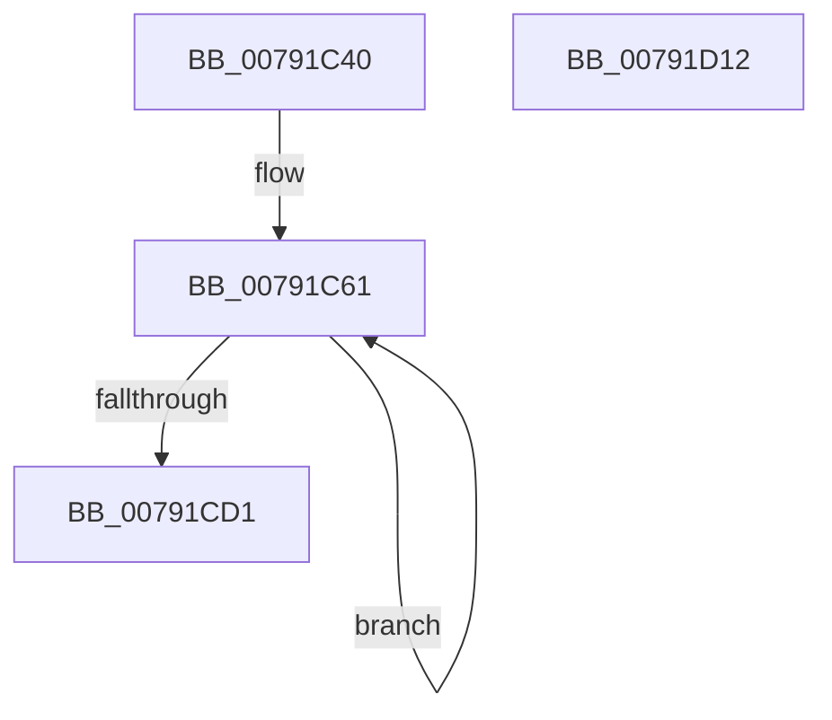

# RtlpBase64Encode

- RVA: `0x00791C40`–`0x00791D13` (길이 `211` bytes)
- VA: `0x0000000140791C40`
- 실행 섹션: `PAGE`
- PDB 이름 있음: `예`; PDB Function 태그: `예`
- unwind 정보 RVA: `0x000C5104`
- 디코드: `58`개 명령, `211/211` bytes 표시
- 미해석 바이트: `0` (있으면 어셈블리에 `.byte`로 보존)

> 이 문서는 커널 이미지의 기계어와 PDB 기호를 분석해 생성했습니다. 4번과 5번은 함수 원형과 자료형을 바이너리 사용 방식에서 추정한 C 해석이며 원본 소스 복구 결과는 아닙니다.

## 1. Dependencies

- 직접 호출 지점: **0**; 고유 호출 대상: **0**
- 직접 호출자로 확인된 함수: **1**
- RIP 상대 이미지 참조: **1**

### Outgoing calls
- 직접 디코드된 call 명령이 없습니다.

### Direct callers
- [RtlInitializeCorrelationVector](RtlInitializeCorrelationVector_function_00791BC0.md) at `0x00791BFD`

### Static image references
- `0x00791C52` → RVA `0x00031450` (`.rdata`; read)

## 2. Other-region calls and transfers

- 다른 실행 섹션으로 향하는 call: **0**
- 별도 외부 분기/꼬리 이동을 확인하지 못했습니다.

## 3. Assembly (complete function range)

```asm
00791C40  48 89 5C 24 08                  mov qword ptr [rsp + 8], rbx
00791C45  48 89 6C 24 10                  mov qword ptr [rsp + 0x10], rbp
00791C4A  48 89 7C 24 18                  mov qword ptr [rsp + 0x18], rdi
00791C4F  45 33 D2                        xor r10d, r10d
00791C52  48 8D 2D F7 F7 89 FF            lea rbp, [rip - 0x760809]
00791C59  33 FF                           xor edi, edi
00791C5B  4D 8B D8                        mov r11, r8
00791C5E  48 8B D9                        mov rbx, rcx
00791C61  0F B6 13                        movzx edx, byte ptr [rbx]
00791C64  FF C7                           inc edi
00791C66  44 0F B6 4B 01                  movzx r9d, byte ptr [rbx + 1]
00791C6B  8B C2                           mov eax, edx
00791C6D  44 0F B6 43 02                  movzx r8d, byte ptr [rbx + 2]
00791C72  48 8D 5B 03                     lea rbx, [rbx + 3]
00791C76  48 C1 E8 02                     shr rax, 2
00791C7A  80 E2 03                        and dl, 3
00791C7D  C0 E2 04                        shl dl, 4
00791C80  0F B6 CA                        movzx ecx, dl
00791C83  41 8B D0                        mov edx, r8d
00791C86  83 E2 3F                        and edx, 0x3f
00791C89  8A 04 28                        mov al, byte ptr [rax + rbp]
00791C8C  43 88 04 1A                     mov byte ptr [r10 + r11], al
00791C90  41 8B C1                        mov eax, r9d
00791C93  48 C1 E8 04                     shr rax, 4
00791C97  4D 8D 52 04                     lea r10, [r10 + 4]
00791C9B  48 0B C8                        or rcx, rax
00791C9E  41 80 E1 0F                     and r9b, 0xf
00791CA2  41 C0 E1 02                     shl r9b, 2
00791CA6  8A 04 29                        mov al, byte ptr [rcx + rbp]
00791CA9  43 88 44 1A FD                  mov byte ptr [r10 + r11 - 3], al
00791CAE  41 8B C0                        mov eax, r8d
00791CB1  48 C1 E8 06                     shr rax, 6
00791CB5  41 0F B6 C9                     movzx ecx, r9b
00791CB9  48 0B C8                        or rcx, rax
00791CBC  8A 04 29                        mov al, byte ptr [rcx + rbp]
00791CBF  43 88 44 1A FE                  mov byte ptr [r10 + r11 - 2], al
00791CC4  8A 04 2A                        mov al, byte ptr [rdx + rbp]
00791CC7  43 88 44 1A FF                  mov byte ptr [r10 + r11 - 1], al
00791CCC  83 FF 05                        cmp edi, 5
00791CCF  72 90                           jb 0x140791c61
00791CD1  0F B6 0B                        movzx ecx, byte ptr [rbx]
00791CD4  8B C1                           mov eax, ecx
00791CD6  80 E1 03                        and cl, 3
00791CD9  48 C1 E8 02                     shr rax, 2
00791CDD  C0 E1 04                        shl cl, 4
00791CE0  8A 04 28                        mov al, byte ptr [rax + rbp]
00791CE3  43 88 04 1A                     mov byte ptr [r10 + r11], al
00791CE7  0F B6 C1                        movzx eax, cl
00791CEA  8A 04 28                        mov al, byte ptr [rax + rbp]
00791CED  43 88 44 1A 01                  mov byte ptr [r10 + r11 + 1], al
00791CF2  66 43 C7 44 1A 02 3D 3D         mov word ptr [r10 + r11 + 2], 0x3d3d
00791CFA  43 C6 44 1A 04 00               mov byte ptr [r10 + r11 + 4], 0
00791D00  48 8B 5C 24 08                  mov rbx, qword ptr [rsp + 8]
00791D05  33 C0                           xor eax, eax
00791D07  48 8B 6C 24 10                  mov rbp, qword ptr [rsp + 0x10]
00791D0C  48 8B 7C 24 18                  mov rdi, qword ptr [rsp + 0x18]
00791D11  C3                              ret
00791D12  CC                              int3
```

## 4. C-style interpretation (structured pseudocode)

```c
__int64 __fastcall RtlpBase64Encode(__int64 a1, __int64 a2, __int64 a3)
{
    __int64 result;
    __int64 v_r10;
    __int64 v_rdi;
    unsigned __int64 v_stack_p10;
    unsigned __int64 v_stack_p18;
    unsigned __int64 v_stack_p8;

    v_stack_p8 = v_rbx;
    v_stack_p10 = v_rbp;
    v_stack_p18 = v_rdi;
    v_r10 = 0;
    v_rdi = 0;
loc_00791C61:
    v_rdi = (unsigned int)((v_rdi) + 1);
    result = ((unsigned int)((unsigned int)(*(unsigned __int8 *)(a1)))) >> (2);
    a2 = (unsigned __int8)((*(unsigned __int8 *)(a1)) & (3));
    a2 = (unsigned __int8)((a2) << (4));
    a2 = (unsigned int)(((unsigned int)((unsigned int)(*(unsigned __int8 *)(a1 + 2)))) & (63));
    *(unsigned __int8 *)(v_r10 + a3 * 1) = (unsigned __int8)(*(unsigned __int8 *)(result + v_rip - 7735305 * 1));
    result = ((unsigned int)((unsigned int)(*(unsigned __int8 *)(a1 + 1)))) >> (4);
    a1 = ((unsigned __int8)(a2)) | (result);
    a4 = (unsigned __int8)((*(unsigned __int8 *)(a1 + 1)) & (15));
    a4 = (unsigned __int8)((a4) << (2));
    *(unsigned __int8 *)(v_r10 + 4 + a3 * 1 - 3) = (unsigned __int8)(*(unsigned __int8 *)(a1 + v_rip - 7735305 * 1));
    result = ((unsigned int)((unsigned int)(*(unsigned __int8 *)(a1 + 2)))) >> (6);
    a1 = ((unsigned __int8)(a4)) | (result);
    *(unsigned __int8 *)(v_r10 + 4 + a3 * 1 - 2) = (unsigned __int8)(*(unsigned __int8 *)(a1 + v_rip - 7735305 * 1));
    *(unsigned __int8 *)(v_r10 + 4 + a3 * 1 - 1) = (unsigned __int8)(*(unsigned __int8 *)(a2 + v_rip - 7735305 * 1));
    if (((unsigned int)(v_rdi)) < 5) goto loc_00791C61;
    a1 = (unsigned __int8)((*(unsigned __int8 *)(a1 + 3)) & (3));
    result = ((unsigned int)((unsigned int)(*(unsigned __int8 *)(a1 + 3)))) >> (2);
    a1 = (unsigned __int8)((a1) << (4));
    *(unsigned __int8 *)(v_r10 + 4 + a3 * 1) = (unsigned __int8)(*(unsigned __int8 *)(result + v_rip - 7735305 * 1));
    *(unsigned __int8 *)(v_r10 + 4 + a3 * 1 + 1) = (unsigned __int8)(*(unsigned __int8 *)((unsigned __int8)(a1) + v_rip - 7735305 * 1));
    *(unsigned __int16 *)(v_r10 + 4 + a3 * 1 + 2) = 0x3D3DULL;
    *(unsigned __int8 *)(v_r10 + 4 + a3 * 1 + 4) = 0;
    result = 0;
    return result;
}
```

## 5. (Beta) C Style

```c
int64_t RtlpBase64Encode(void *Arg1, int64_t Arg2, int64_t Arg3)
{
    uint8_t *arg1 = (uint8_t *)Arg1;

    int64_t result;
    int64_t local_r10;
    int64_t local_rdi;
    uint64_t v_stack_p10;
    uint64_t v_stack_p18;
    uint64_t v_stack_p8;

    v_stack_p8 = local_rbx;
    v_stack_p10 = local_rbp;
    v_stack_p18 = local_rdi;
    local_r10 = 0;
    local_rdi = 0;
loc_00791C61:
    local_rdi = (uint32_t)((local_rdi) + 1);
    result = ((uint32_t)((uint32_t)(*(uint8_t *)(arg1)))) >> (2);
    Arg2 = (uint8_t)((*(uint8_t *)(arg1)) & (3));
    Arg2 = (uint8_t)((Arg2) << (4));
    Arg2 = (uint32_t)(((uint32_t)((uint32_t)(*(uint8_t *)(arg1 + 0x2)))) & (63));
    *(uint8_t *)(local_r10 + Arg3 * 1) = (uint8_t)(*(uint8_t *)(result + v_rip - 0x760809 * 1));
    result = ((uint32_t)((uint32_t)(*(uint8_t *)(arg1 + 0x1)))) >> (4);
    Arg1 = ((uint8_t)(Arg2)) | (result);
    a4 = (uint8_t)((*(uint8_t *)(arg1 + 0x1)) & (15));
    a4 = (uint8_t)((a4) << (2));
    *(uint8_t *)(local_r10 + 0x4 + Arg3 * 1 - 0x3) = (uint8_t)(*(uint8_t *)(arg1 + v_rip - 0x760809 * 1));
    result = ((uint32_t)((uint32_t)(*(uint8_t *)(arg1 + 0x2)))) >> (6);
    Arg1 = ((uint8_t)(a4)) | (result);
    *(uint8_t *)(local_r10 + 0x4 + Arg3 * 1 - 0x2) = (uint8_t)(*(uint8_t *)(arg1 + v_rip - 0x760809 * 1));
    *(uint8_t *)(local_r10 + 0x4 + Arg3 * 1 - 0x1) = (uint8_t)(*(uint8_t *)(Arg2 + v_rip - 0x760809 * 1));
    if (((uint32_t)(local_rdi)) < 5) goto loc_00791C61;
    Arg1 = (uint8_t)((*(uint8_t *)(arg1 + 0x3)) & (3));
    result = ((uint32_t)((uint32_t)(*(uint8_t *)(arg1 + 0x3)))) >> (2);
    Arg1 = (uint8_t)((Arg1) << (4));
    *(uint8_t *)(local_r10 + 0x4 + Arg3 * 1) = (uint8_t)(*(uint8_t *)(result + v_rip - 0x760809 * 1));
    *(uint8_t *)(local_r10 + 0x4 + Arg3 * 1 + 0x1) = (uint8_t)(*(uint8_t *)((uint8_t)(arg1) + v_rip - 0x760809 * 1));
    *(uint16_t *)(local_r10 + 0x4 + Arg3 * 1 + 0x2) = 0x3D3DULL;
    *(uint8_t *)(local_r10 + 0x4 + Arg3 * 1 + 0x4) = 0;
    result = 0;
    return result;
}
```

### 관측된 메모리 오프셋

구조체 형식이 확인되지 않은 접근은 인자 기준의 오프셋으로만 기록했습니다.

| 기준 인자 | 오프셋 표현 | 폭 (bit) | 접근 |
|---|---:|---:|---|
| `Arg1` | `+ 0x0` | `8` | `R` |
| `Arg1` | `+ 0x1` | `8` | `R` |
| `Arg1` | `+ 0x2` | `8` | `R` |
| `Arg1` | `+ 0x3` | `64` | `R` |

## 6. Execution-region graph

[열기: 2D/3D 그래프와 함수 탐색 컨트롤 패널](../../../control-panel.html?section=page&rva=0x00791C40&view=graph)

- 2D 그래프는 위에서 아래로 흐르고, 3D 그래프는 빈 공간을 드래그해 회전합니다. Shift+드래그는 이동, 휠은 확대·축소, 함수 노드 선택은 대상 보고서 이동입니다.

### Static fallback


