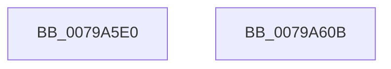

# RtlpCapChkTelemetryRunOnce

- RVA: `0x0079A5E0`–`0x0079A60C` (길이 `44` bytes)
- VA: `0x000000014079A5E0`
- 실행 섹션: `PAGE`
- PDB 이름 있음: `예`; PDB Function 태그: `아니요`
- unwind 정보 RVA: `0x0005C788`
- 디코드: `11`개 명령, `44/44` bytes 표시
- 미해석 바이트: `0` (있으면 어셈블리에 `.byte`로 보존)

> 이 문서는 커널 이미지의 기계어와 PDB 기호를 분석해 생성했습니다. 4번과 5번은 함수 원형과 자료형을 바이너리 사용 방식에서 추정한 C 해석이며 원본 소스 복구 결과는 아닙니다.

## 1. Dependencies

- 직접 호출 지점: **2**; 고유 호출 대상: **2**
- 직접 호출자로 확인된 함수: **0**
- RIP 상대 이미지 참조: **2**

### Outgoing calls
- `0x0079A5F0` → [TraceLoggingRegisterEx_EtwRegister_EtwSetInformation](../92/TraceLoggingRegisterEx_EtwRegister_EtwSetInformation_function_009208A0.md) (function, `0x009208A0`)
- `0x0079A5FC` → [KeQueryPerformanceCounter](../../text/37/KeQueryPerformanceCounter_function_0037E7E0.md) (function, `0x0037E7E0`)

### Direct callers
- 이 함수 시작 RVA로 연결되는 직접 call은 확인되지 않았습니다. 간접 호출은 완전히 역산할 수 없습니다.

### Static image references
- `0x0079A5E7` → RVA `0x00E08820` (`.data`; read)
- `0x0079A5F5` → RVA `0x00E67B50` (`.data`; read)

## 2. Other-region calls and transfers

- 다른 실행 섹션으로 향하는 call: **1**
  - `0x0079A5FC` → [KeQueryPerformanceCounter](../../text/37/KeQueryPerformanceCounter_function_0037E7E0.md) (`PAGE` → `.text`)
- 별도 외부 분기/꼬리 이동을 확인하지 못했습니다.

## 3. Assembly (complete function range)

```asm
0079A5E0  48 83 EC 28                     sub rsp, 0x28
0079A5E4  45 33 C0                        xor r8d, r8d
0079A5E7  48 8D 0D 32 E2 66 00            lea rcx, [rip + 0x66e232]
0079A5EE  33 D2                           xor edx, edx
0079A5F0  E8 AB 62 18 00                  call 0x1409208a0
0079A5F5  48 8D 0D 54 D5 6C 00            lea rcx, [rip + 0x6cd554]
0079A5FC  E8 DF 41 BE FF                  call 0x14037e7e0
0079A601  B8 01 00 00 00                  mov eax, 1
0079A606  48 83 C4 28                     add rsp, 0x28
0079A60A  C3                              ret
0079A60B  CC                              int3
```

## 4. C-style interpretation (structured pseudocode)

```c
__int64 __fastcall RtlpCapChkTelemetryRunOnce(__int64 a1, int a2, int a3)
{
    __int64 result;
    __int64 v_rsp;

    v_rsp = (v_rsp) - (40);
    a3 = 0;
    a2 = 0;
    result = TraceLoggingRegisterEx_EtwRegister_EtwSetInformation(v_rip + 6742578, a2, a3, a4);
    result = KeQueryPerformanceCounter(v_rip + 7132500, a2, a3, a4);
    v_rsp = (v_rsp) + (40);
    return 1;
}
```

## 5. (Beta) C Style

```c
int64_t RtlpCapChkTelemetryRunOnce(int64_t Arg1, int32_t Arg2, int32_t Arg3)
{
    int64_t result;
    int64_t local_rsp;

    local_rsp = (local_rsp) - (40);
    Arg3 = 0;
    Arg2 = 0;
    result = TraceLoggingRegisterEx_EtwRegister_EtwSetInformation(v_rip + 6742578, Arg2, Arg3, a4);
    result = KeQueryPerformanceCounter(v_rip + 7132500, Arg2, Arg3, a4);
    local_rsp = (local_rsp) + (40);
    return 1;
}
```

## 6. Execution-region graph

[열기: 2D/3D 그래프와 함수 탐색 컨트롤 패널](../../../control-panel.html?section=page&rva=0x0079A5E0&view=graph)

- 2D 그래프는 위에서 아래로 흐르고, 3D 그래프는 빈 공간을 드래그해 회전합니다. Shift+드래그는 이동, 휠은 확대·축소, 함수 노드 선택은 대상 보고서 이동입니다.

### Static fallback


