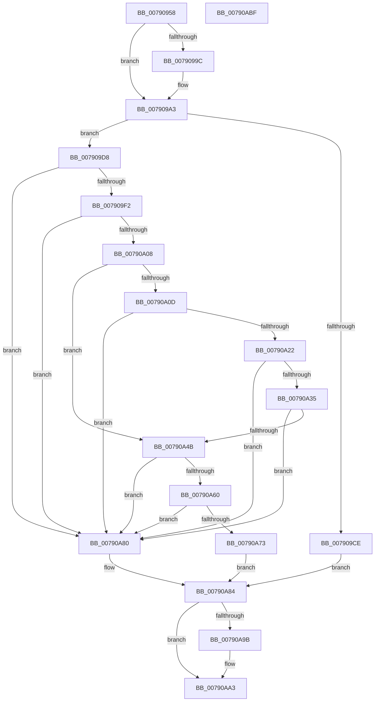

# RtlpConstructCrossVmObjectPath

- RVA: `0x00790958`–`0x00790AC0` (길이 `360` bytes)
- VA: `0x0000000140790958`
- 실행 섹션: `PAGE`
- PDB 이름 있음: `예`; PDB Function 태그: `아니요`
- unwind 정보 RVA: `0x0006F120`
- 디코드: `106`개 명령, `360/360` bytes 표시
- 미해석 바이트: `0` (있으면 어셈블리에 `.byte`로 보존)

> 이 문서는 커널 이미지의 기계어와 PDB 기호를 분석해 생성했습니다. 4번과 5번은 함수 원형과 자료형을 바이너리 사용 방식에서 추정한 C 해석이며 원본 소스 복구 결과는 아닙니다.

## 1. Dependencies

- 직접 호출 지점: **11**; 고유 호출 대상: **6**
- 직접 호출자로 확인된 함수: **1**
- RIP 상대 이미지 참조: **2**

### Outgoing calls
- `0x007909BD` → [ExAllocatePool2](../../poolcode/B8/ExAllocatePool2_function_00B820F0.md) (function, `0x00B820F0`)
- `0x007909E3` → [RtlAppendUnicodeStringToString](../../text/40/RtlAppendUnicodeStringToString_function_0040FA50.md) (function, `0x0040FA50`)
- `0x007909FD` → [RtlAppendUnicodeToString](../../text/40/RtlAppendUnicodeToString_function_0040F990.md) (function, `0x0040F990`)
- `0x00790A17` → [RtlStringFromGUIDEx](../91/RtlStringFromGUIDEx_function_00915450.md) (function, `0x00915450`)
- `0x00790A2A` → [RtlAppendUnicodeStringToString](../../text/40/RtlAppendUnicodeStringToString_function_0040FA50.md) (function, `0x0040FA50`)
- `0x00790A40` → [RtlAppendUnicodeToString](../../text/40/RtlAppendUnicodeToString_function_0040F990.md) (function, `0x0040F990`)
- `0x00790A55` → [RtlStringFromGUIDEx](../91/RtlStringFromGUIDEx_function_00915450.md) (function, `0x00915450`)
- `0x00790A68` → [RtlAppendUnicodeStringToString](../../text/40/RtlAppendUnicodeStringToString_function_0040FA50.md) (function, `0x0040FA50`)
- `0x00790A88` → [RtlFreeAnsiString](../9C/RtlFreeAnsiString_function_009C0800.md) (function, `0x009C0800`)
- `0x00790A91` → [RtlFreeAnsiString](../9C/RtlFreeAnsiString_function_009C0800.md) (function, `0x009C0800`)
- `0x00790A9E` → [ExFreePool](../../poolcode/B8/ExFreePool_function_00B82850.md) (function, `0x00B82850`)

### Direct callers
- [RtlConstructCrossVmEventPath](RtlConstructCrossVmEventPath_function_00790940.md) at `0x00790944`

### Static image references
- `0x007909D8` → RVA `0x0000B630` (`.rdata`; read)
- `0x007909F2` → RVA `0x00AFC990` (` ?? ::NNGAKEGL::`string'`; read)

## 2. Other-region calls and transfers

- 다른 실행 섹션으로 향하는 call: **7**
  - `0x007909BD` → [ExAllocatePool2](../../poolcode/B8/ExAllocatePool2_function_00B820F0.md) (`PAGE` → `POOLCODE`)
  - `0x007909E3` → [RtlAppendUnicodeStringToString](../../text/40/RtlAppendUnicodeStringToString_function_0040FA50.md) (`PAGE` → `.text`)
  - `0x007909FD` → [RtlAppendUnicodeToString](../../text/40/RtlAppendUnicodeToString_function_0040F990.md) (`PAGE` → `.text`)
  - `0x00790A2A` → [RtlAppendUnicodeStringToString](../../text/40/RtlAppendUnicodeStringToString_function_0040FA50.md) (`PAGE` → `.text`)
  - `0x00790A40` → [RtlAppendUnicodeToString](../../text/40/RtlAppendUnicodeToString_function_0040F990.md) (`PAGE` → `.text`)
  - `0x00790A68` → [RtlAppendUnicodeStringToString](../../text/40/RtlAppendUnicodeStringToString_function_0040FA50.md) (`PAGE` → `.text`)
  - `0x00790A9E` → [ExFreePool](../../poolcode/B8/ExFreePool_function_00B82850.md) (`PAGE` → `POOLCODE`)
- 별도 외부 분기/꼬리 이동을 확인하지 못했습니다.

## 3. Assembly (complete function range)

```asm
00790958  48 89 5C 24 08                  mov qword ptr [rsp + 8], rbx
0079095D  48 89 74 24 10                  mov qword ptr [rsp + 0x10], rsi
00790962  48 89 7C 24 18                  mov qword ptr [rsp + 0x18], rdi
00790967  55                              push rbp
00790968  41 56                           push r14
0079096A  41 57                           push r15
0079096C  48 8B EC                        mov rbp, rsp
0079096F  48 83 EC 50                     sub rsp, 0x50
00790973  0F 57 C0                        xorps xmm0, xmm0
00790976  4C 8B F1                        mov r14, rcx
00790979  B9 70 00 00 00                  mov ecx, 0x70
0079097E  0F 57 C9                        xorps xmm1, xmm1
00790981  49 8B F0                        mov rsi, r8
00790984  4C 8B FA                        mov r15, rdx
00790987  0F 11 45 D0                     movups xmmword ptr [rbp - 0x30], xmm0
0079098B  66 89 4D D2                     mov word ptr [rbp - 0x2e], cx
0079098F  0F 11 45 E0                     movups xmmword ptr [rbp - 0x20], xmm0
00790993  0F 11 4D F0                     movups xmmword ptr [rbp - 0x10], xmm1
00790997  4D 85 C0                        test r8, r8
0079099A  74 07                           je 0x1407909a3
0079099C  8D 41 4E                        lea eax, [rcx + 0x4e]
0079099F  66 89 45 D2                     mov word ptr [rbp - 0x2e], ax
007909A3  48 8B C6                        mov rax, rsi
007909A6  41 B8 53 74 72 67               mov r8d, 0x67727453
007909AC  48 F7 D8                        neg rax
007909AF  48 1B D2                        sbb rdx, rdx
007909B2  83 E2 4E                        and edx, 0x4e
007909B5  48 03 D1                        add rdx, rcx
007909B8  B9 00 01 00 00                  mov ecx, 0x100
007909BD  E8 2E 17 3F 00                  call 0x140b820f0
007909C2  48 89 45 D8                     mov qword ptr [rbp - 0x28], rax
007909C6  48 8B F8                        mov rdi, rax
007909C9  48 85 C0                        test rax, rax
007909CC  75 0A                           jne 0x1407909d8
007909CE  BB 17 00 00 C0                  mov ebx, 0xc0000017
007909D3  E9 AC 00 00 00                  jmp 0x140790a84
007909D8  48 8D 15 51 AC 87 FF            lea rdx, [rip - 0x7853af]
007909DF  48 8D 4D D0                     lea rcx, [rbp - 0x30]
007909E3  E8 68 F0 C7 FF                  call 0x14040fa50
007909E8  8B D8                           mov ebx, eax
007909EA  85 C0                           test eax, eax
007909EC  0F 88 8E 00 00 00               js 0x140790a80
007909F2  48 8D 15 97 BF 36 00            lea rdx, [rip + 0x36bf97]
007909F9  48 8D 4D D0                     lea rcx, [rbp - 0x30]
007909FD  E8 8E EF C7 FF                  call 0x14040f990
00790A02  8B D8                           mov ebx, eax
00790A04  85 C0                           test eax, eax
00790A06  78 78                           js 0x140790a80
00790A08  48 85 F6                        test rsi, rsi
00790A0B  74 3E                           je 0x140790a4b
00790A0D  41 B0 01                        mov r8b, 1
00790A10  48 8D 55 E0                     lea rdx, [rbp - 0x20]
00790A14  48 8B CE                        mov rcx, rsi
00790A17  E8 34 4A 18 00                  call 0x140915450
00790A1C  8B D8                           mov ebx, eax
00790A1E  85 C0                           test eax, eax
00790A20  78 5E                           js 0x140790a80
00790A22  48 8D 55 E0                     lea rdx, [rbp - 0x20]
00790A26  48 8D 4D D0                     lea rcx, [rbp - 0x30]
00790A2A  E8 21 F0 C7 FF                  call 0x14040fa50
00790A2F  8B D8                           mov ebx, eax
00790A31  85 C0                           test eax, eax
00790A33  78 4B                           js 0x140790a80
00790A35  48 8D 15 54 BF 36 00            lea rdx, [rip + 0x36bf54]
00790A3C  48 8D 4D D0                     lea rcx, [rbp - 0x30]
00790A40  E8 4B EF C7 FF                  call 0x14040f990
00790A45  8B D8                           mov ebx, eax
00790A47  85 C0                           test eax, eax
00790A49  78 35                           js 0x140790a80
00790A4B  41 B0 01                        mov r8b, 1
00790A4E  48 8D 55 F0                     lea rdx, [rbp - 0x10]
00790A52  49 8B CF                        mov rcx, r15
00790A55  E8 F6 49 18 00                  call 0x140915450
00790A5A  8B D8                           mov ebx, eax
00790A5C  85 C0                           test eax, eax
00790A5E  78 20                           js 0x140790a80
00790A60  48 8D 55 F0                     lea rdx, [rbp - 0x10]
00790A64  48 8D 4D D0                     lea rcx, [rbp - 0x30]
00790A68  E8 E3 EF C7 FF                  call 0x14040fa50
00790A6D  8B D8                           mov ebx, eax
00790A6F  85 C0                           test eax, eax
00790A71  78 0D                           js 0x140790a80
00790A73  0F 10 45 D0                     movups xmm0, xmmword ptr [rbp - 0x30]
00790A77  33 FF                           xor edi, edi
00790A79  F3 41 0F 7F 06                  movdqu xmmword ptr [r14], xmm0
00790A7E  EB 04                           jmp 0x140790a84
00790A80  48 8B 7D D8                     mov rdi, qword ptr [rbp - 0x28]
00790A84  48 8D 4D E0                     lea rcx, [rbp - 0x20]
00790A88  E8 73 FD 22 00                  call 0x1409c0800
00790A8D  48 8D 4D F0                     lea rcx, [rbp - 0x10]
00790A91  E8 6A FD 22 00                  call 0x1409c0800
00790A96  48 85 FF                        test rdi, rdi
00790A99  74 08                           je 0x140790aa3
00790A9B  48 8B CF                        mov rcx, rdi
00790A9E  E8 AD 1D 3F 00                  call 0x140b82850
00790AA3  4C 8D 5C 24 50                  lea r11, [rsp + 0x50]
00790AA8  8B C3                           mov eax, ebx
00790AAA  49 8B 5B 20                     mov rbx, qword ptr [r11 + 0x20]
00790AAE  49 8B 73 28                     mov rsi, qword ptr [r11 + 0x28]
00790AB2  49 8B 7B 30                     mov rdi, qword ptr [r11 + 0x30]
00790AB6  49 8B E3                        mov rsp, r11
00790AB9  41 5F                           pop r15
00790ABB  41 5E                           pop r14
00790ABD  5D                              pop rbp
00790ABE  C3                              ret
00790ABF  CC                              int3
```

## 4. C-style interpretation (structured pseudocode)

```c
__int64 __fastcall RtlpConstructCrossVmObjectPath(__int64 a1, __int64 a2, __int64 a3)
{
    __int64 result;
    __int64 v_rdi;
    __int64 v_rsp;
    unsigned __int64 v_stack_m18;
    unsigned __int64 v_stack_m28;
    unsigned __int64 v_stack_m38;
    unsigned __int64 v_stack_m40;
    unsigned __int16 v_stack_m46;
    unsigned __int64 v_stack_m48;
    unsigned __int64 v_stack_p10;
    unsigned __int64 v_stack_p18;
    unsigned __int64 v_stack_p8;

    v_stack_p8 = v_rbx;
    v_stack_p10 = v_rsi;
    v_stack_p18 = v_rdi;
    v_rsp = (v_rsp) - (80);
    v_stack_m48 = v_xmm0;
    v_stack_m46 = 112;
    v_stack_m38 = v_xmm0;
    v_stack_m28 = v_xmm1;
    if (a3 != 0) {
        result = 112 + 78;
        v_stack_m46 = (unsigned __int16)(result);
    }
    result = -(a3);
    a2 = (unsigned int)((a2) & (78));
    a2 = (a2) + (112);
    result = ExAllocatePool2(256, a2, (unsigned int)(0x67727453ULL), a4);
    v_stack_m40 = result;
    if (result != 0) goto loc_007909D8;
    goto loc_00790A84;
loc_007909D8:
    result = RtlAppendUnicodeStringToString(v_stack_m48, v_rip - 7885743, (unsigned int)(0x67727453ULL), a4);
    if (sign_flag) goto loc_00790A80;
    result = RtlAppendUnicodeToString(v_stack_m48, v_rip + 3587991, (unsigned int)(0x67727453ULL), a4);
    if (sign_flag) goto loc_00790A80;
    if (a3 == 0) goto loc_00790A4B;
    result = RtlStringFromGUIDEx(a3, v_stack_m38, 1, a4);
    if (sign_flag) goto loc_00790A80;
    result = RtlAppendUnicodeStringToString(v_stack_m48, v_stack_m38, 1, a4);
    if (sign_flag) goto loc_00790A80;
    result = RtlAppendUnicodeToString(v_stack_m48, v_rip + 3587924, 1, a4);
    if (sign_flag) goto loc_00790A80;
loc_00790A4B:
    result = RtlStringFromGUIDEx(a2, v_stack_m28, 1, a4);
    if (sign_flag) goto loc_00790A80;
    result = RtlAppendUnicodeStringToString(v_stack_m48, v_stack_m28, 1, a4);
    if (sign_flag) goto loc_00790A80;
    v_rdi = 0;
    *(unsigned __int64 *)(a1) = v_xmm0;
    goto loc_00790A84;
loc_00790A80:
loc_00790A84:
    result = RtlFreeAnsiString(v_stack_m38, v_stack_m28, 1, a4);
    result = RtlFreeAnsiString(v_stack_m28, v_stack_m28, 1, a4);
    if (v_stack_m40 != 0) {
        a1 = v_stack_m40;
        result = ExFreePool(a1, v_stack_m28, 1, a4);
    }
    return (unsigned int)((unsigned int)((unsigned int)((unsigned int)(result))));
}
```

## 5. (Beta) C Style

```c
int64_t RtlpConstructCrossVmObjectPath(void *Arg1, int64_t Arg2, int64_t Arg3)
{
    uint8_t *arg1 = (uint8_t *)Arg1;

    int64_t result;
    int64_t local_rdi;
    int64_t local_rsp;
    uint64_t v_stack_m18;
    uint64_t v_stack_m28;
    uint64_t v_stack_m38;
    uint64_t v_stack_m40;
    uint16_t v_stack_m46;
    uint64_t v_stack_m48;
    uint64_t v_stack_p10;
    uint64_t v_stack_p18;
    uint64_t v_stack_p8;

    v_stack_p8 = local_rbx;
    v_stack_p10 = local_rsi;
    v_stack_p18 = local_rdi;
    local_rsp = (local_rsp) - (80);
    v_stack_m48 = v_xmm0;
    v_stack_m46 = 112;
    v_stack_m38 = v_xmm0;
    v_stack_m28 = v_xmm1;
    if (Arg3 != 0) {
        result = 112 + 78;
        v_stack_m46 = (uint16_t)(result);
    }
    result = -(Arg3);
    Arg2 = (uint32_t)((Arg2) & (78));
    Arg2 = (Arg2) + (112);
    result = ExAllocatePool2(256, Arg2, (uint32_t)(0x67727453ULL), a4);
    v_stack_m40 = result;
    if (result != 0) goto loc_007909D8;
    goto loc_00790A84;
loc_007909D8:
    result = RtlAppendUnicodeStringToString(v_stack_m48, v_rip - 7885743, (uint32_t)(0x67727453ULL), a4);
    if (sign_flag) goto loc_00790A80;
    result = RtlAppendUnicodeToString(v_stack_m48, v_rip + 3587991, (uint32_t)(0x67727453ULL), a4);
    if (sign_flag) goto loc_00790A80;
    if (Arg3 == 0) goto loc_00790A4B;
    result = RtlStringFromGUIDEx(Arg3, v_stack_m38, 1, a4);
    if (sign_flag) goto loc_00790A80;
    result = RtlAppendUnicodeStringToString(v_stack_m48, v_stack_m38, 1, a4);
    if (sign_flag) goto loc_00790A80;
    result = RtlAppendUnicodeToString(v_stack_m48, v_rip + 3587924, 1, a4);
    if (sign_flag) goto loc_00790A80;
loc_00790A4B:
    result = RtlStringFromGUIDEx(Arg2, v_stack_m28, 1, a4);
    if (sign_flag) goto loc_00790A80;
    result = RtlAppendUnicodeStringToString(v_stack_m48, v_stack_m28, 1, a4);
    if (sign_flag) goto loc_00790A80;
    local_rdi = 0;
    *(uint64_t *)(arg1) = v_xmm0;
    goto loc_00790A84;
loc_00790A80:
loc_00790A84:
    result = RtlFreeAnsiString(v_stack_m38, v_stack_m28, 1, a4);
    result = RtlFreeAnsiString(v_stack_m28, v_stack_m28, 1, a4);
    if (v_stack_m40 != 0) {
        Arg1 = v_stack_m40;
        result = ExFreePool(Arg1, v_stack_m28, 1, a4);
    }
    return (uint32_t)((uint32_t)((uint32_t)((uint32_t)(result))));
}
```

### 관측된 메모리 오프셋

구조체 형식이 확인되지 않은 접근은 인자 기준의 오프셋으로만 기록했습니다.

| 기준 인자 | 오프셋 표현 | 폭 (bit) | 접근 |
|---|---:|---:|---|
| `Arg1` | `+ 0x0` | `128` | `W` |

## 6. Execution-region graph

[열기: 2D/3D 그래프와 함수 탐색 컨트롤 패널](../../../control-panel.html?section=page&rva=0x00790958&view=graph)

- 2D 그래프는 위에서 아래로 흐르고, 3D 그래프는 빈 공간을 드래그해 회전합니다. Shift+드래그는 이동, 휠은 확대·축소, 함수 노드 선택은 대상 보고서 이동입니다.

### Static fallback


