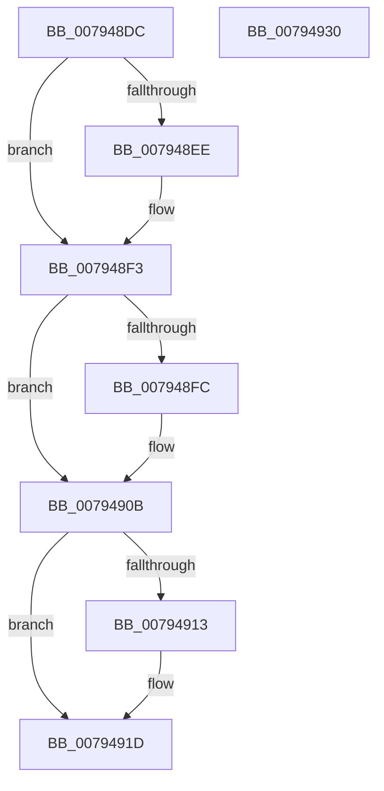

# RtlpCtContextFree

- RVA: `0x007948DC`–`0x00794931` (길이 `85` bytes)
- VA: `0x00000001407948DC`
- 실행 섹션: `PAGE`
- PDB 이름 있음: `예`; PDB Function 태그: `아니요`
- unwind 정보 RVA: `0x0005CF00`
- 디코드: `25`개 명령, `85/85` bytes 표시
- 미해석 바이트: `0` (있으면 어셈블리에 `.byte`로 보존)

> 이 문서는 커널 이미지의 기계어와 PDB 기호를 분석해 생성했습니다. 4번과 5번은 함수 원형과 자료형을 바이너리 사용 방식에서 추정한 C 해석이며 원본 소스 복구 결과는 아닙니다.

## 1. Dependencies

- 직접 호출 지점: **4**; 고유 호출 대상: **2**
- 직접 호출자로 확인된 함수: **3**
- RIP 상대 이미지 참조: **0**

### Outgoing calls
- `0x007948EE` → [ExUnsubscribeWnfStateChange](../A7/ExUnsubscribeWnfStateChange_function_00A7BE50.md) (function, `0x00A7BE50`)
- `0x00794901` → [ExFreePoolWithTag](../../poolcode/B8/ExFreePoolWithTag_function_00B82870.md) (function, `0x00B82870`)
- `0x00794918` → [ExFreePoolWithTag](../../poolcode/B8/ExFreePoolWithTag_function_00B82870.md) (function, `0x00B82870`)
- `0x00794925` → [ExFreePoolWithTag](../../poolcode/B8/ExFreePoolWithTag_function_00B82870.md) (function, `0x00B82870`)

### Direct callers
- [RtlRaiseCustomSystemEventTrigger](../../text/5E/RtlRaiseCustomSystemEventTrigger_function_005EE300.md) at `0x005EE4FA`
- [RtlpCtContextInit](RtlpCtContextInit_function_00794938.md) at `0x007949B0`
- [RtlpRtlpCtWaitForWnfQuiescentWorker](RtlpRtlpCtWaitForWnfQuiescentWorker_function_00794AB0.md) at `0x00794AD8`

### Static image references
- 디코드된 RIP-relative 메모리 참조가 없습니다.

## 2. Other-region calls and transfers

- 다른 실행 섹션으로 향하는 call: **3**
  - `0x00794901` → [ExFreePoolWithTag](../../poolcode/B8/ExFreePoolWithTag_function_00B82870.md) (`PAGE` → `POOLCODE`)
  - `0x00794918` → [ExFreePoolWithTag](../../poolcode/B8/ExFreePoolWithTag_function_00B82870.md) (`PAGE` → `POOLCODE`)
  - `0x00794925` → [ExFreePoolWithTag](../../poolcode/B8/ExFreePoolWithTag_function_00B82870.md) (`PAGE` → `POOLCODE`)
- 별도 외부 분기/꼬리 이동을 확인하지 못했습니다.

## 3. Assembly (complete function range)

```asm
007948DC  40 53                           push rbx
007948DE  48 83 EC 20                     sub rsp, 0x20
007948E2  48 8B D9                        mov rbx, rcx
007948E5  48 8B 49 08                     mov rcx, qword ptr [rcx + 8]
007948E9  48 85 C9                        test rcx, rcx
007948EC  74 05                           je 0x1407948f3
007948EE  E8 5D 75 2E 00                  call 0x140a7be50
007948F3  48 8B 4B 10                     mov rcx, qword ptr [rbx + 0x10]
007948F7  48 85 C9                        test rcx, rcx
007948FA  74 0F                           je 0x14079490b
007948FC  BA 64 43 74 67                  mov edx, 0x67744364
00794901  E8 6A DF 3E 00                  call 0x140b82870
00794906  48 83 63 10 00                  and qword ptr [rbx + 0x10], 0
0079490B  48 8B 0B                        mov rcx, qword ptr [rbx]
0079490E  48 85 C9                        test rcx, rcx
00794911  74 0A                           je 0x14079491d
00794913  BA 64 43 74 67                  mov edx, 0x67744364
00794918  E8 53 DF 3E 00                  call 0x140b82870
0079491D  BA 64 43 74 67                  mov edx, 0x67744364
00794922  48 8B CB                        mov rcx, rbx
00794925  E8 46 DF 3E 00                  call 0x140b82870
0079492A  48 83 C4 20                     add rsp, 0x20
0079492E  5B                              pop rbx
0079492F  C3                              ret
00794930  CC                              int3
```

## 4. C-style interpretation (structured pseudocode)

```c
__int64 __fastcall RtlpCtContextFree(__int64 a1)
{
    __int64 result;
    __int64 v_rsp;

    v_rsp = (v_rsp) - (32);
    if (*(unsigned __int64 *)(a1 + 8) != 0) {
        result = ExUnsubscribeWnfStateChange(*(unsigned __int64 *)(a1 + 8), a2, a3, a4);
    }
    if (*(unsigned __int64 *)(a1 + 16) != 0) {
        a2 = 0x67744364ULL;
        result = ExFreePoolWithTag(*(unsigned __int64 *)(a1 + 16), a2, a3, a4);
    }
    if (*(unsigned __int64 *)(a1) != 0) {
        a2 = 0x67744364ULL;
        result = ExFreePoolWithTag(*(unsigned __int64 *)(a1), a2, a3, a4);
    }
    result = ExFreePoolWithTag(a1, (unsigned int)(0x67744364ULL), a3, a4);
    v_rsp = (v_rsp) + (32);
    return result;
}
```

## 5. (Beta) C Style

```c
int64_t RtlpCtContextFree(void *Arg1)
{
    uint8_t *arg1 = (uint8_t *)Arg1;

    int64_t result;
    int64_t local_rsp;

    local_rsp = (local_rsp) - (32);
    if (*(uint64_t *)(arg1 + 0x8) != 0) {
        result = ExUnsubscribeWnfStateChange(*(uint64_t *)(arg1 + 0x8), a2, a3, a4);
    }
    if (*(uint64_t *)(arg1 + 0x10) != 0) {
        a2 = 0x67744364ULL;
        result = ExFreePoolWithTag(*(uint64_t *)(arg1 + 0x10), a2, a3, a4);
    }
    if (*(uint64_t *)(arg1) != 0) {
        a2 = 0x67744364ULL;
        result = ExFreePoolWithTag(*(uint64_t *)(arg1), a2, a3, a4);
    }
    result = ExFreePoolWithTag(Arg1, (uint32_t)(0x67744364ULL), a3, a4);
    local_rsp = (local_rsp) + (32);
    return result;
}
```

### 관측된 메모리 오프셋

구조체 형식이 확인되지 않은 접근은 인자 기준의 오프셋으로만 기록했습니다.

| 기준 인자 | 오프셋 표현 | 폭 (bit) | 접근 |
|---|---:|---:|---|
| `Arg1` | `+ 0x0` | `64` | `R` |
| `Arg1` | `+ 0x8` | `64` | `R` |
| `Arg1` | `+ 0x10` | `64` | `R` |
| `Arg1` | `+ 0x10` | `64` | `R/W` |

## 6. Execution-region graph

[열기: 2D/3D 그래프와 함수 탐색 컨트롤 패널](../../../control-panel.html?section=page&rva=0x007948DC&view=graph)

- 2D 그래프는 위에서 아래로 흐르고, 3D 그래프는 빈 공간을 드래그해 회전합니다. Shift+드래그는 이동, 휠은 확대·축소, 함수 노드 선택은 대상 보고서 이동입니다.

### Static fallback


