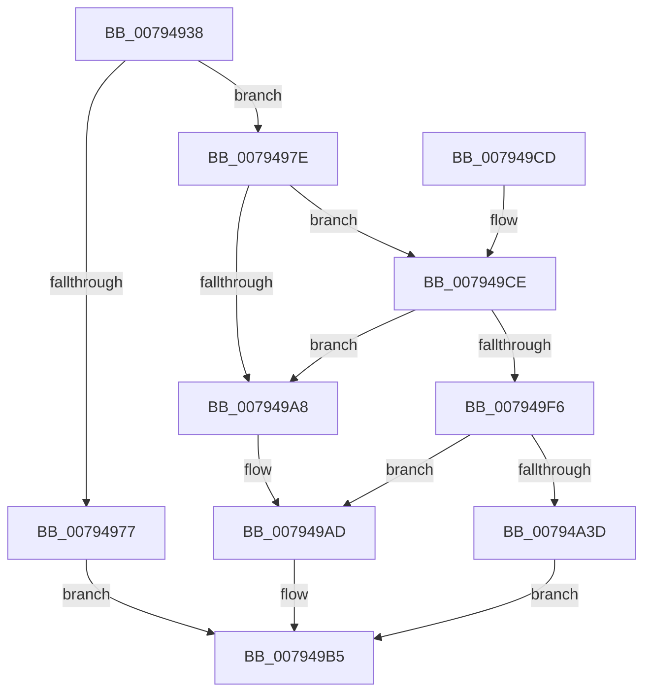

# RtlpCtContextInit

- RVA: `0x00794938`–`0x00794A45` (길이 `269` bytes)
- VA: `0x0000000140794938`
- 실행 섹션: `PAGE`
- PDB 이름 있음: `예`; PDB Function 태그: `아니요`
- unwind 정보 RVA: `0x000CFF38`
- 디코드: `69`개 명령, `269/269` bytes 표시
- 미해석 바이트: `0` (있으면 어셈블리에 `.byte`로 보존)

> 이 문서는 커널 이미지의 기계어와 PDB 기호를 분석해 생성했습니다. 4번과 5번은 함수 원형과 자료형을 바이너리 사용 방식에서 추정한 C 해석이며 원본 소스 복구 결과는 아닙니다.

## 1. Dependencies

- 직접 호출 지점: **6**; 고유 호출 대상: **4**
- 직접 호출자로 확인된 함수: **1**
- RIP 상대 이미지 참조: **3**

### Outgoing calls
- `0x0079496A` → [ExAllocatePool2](../../poolcode/B8/ExAllocatePool2_function_00B820F0.md) (function, `0x00B820F0`)
- `0x0079499A` → [ExAllocatePool2](../../poolcode/B8/ExAllocatePool2_function_00B820F0.md) (function, `0x00B820F0`)
- `0x007949B0` → [RtlpCtContextFree](RtlpCtContextFree_function_007948DC.md) (function, `0x007948DC`)
- `0x007949D6` → [KeInitializeEvent](../../text/40/KeInitializeEvent_function_0040DD10.md) (function, `0x0040DD10`)
- `0x007949E9` → [ExAllocatePool2](../../poolcode/B8/ExAllocatePool2_function_00B820F0.md) (function, `0x00B820F0`)
- `0x00794A2E` → [ExSubscribeWnfStateChange](../9D/ExSubscribeWnfStateChange_function_009D4BC0.md) (function, `0x009D4BC0`)

### Direct callers
- [RtlRaiseCustomSystemEventTrigger](../../text/5E/RtlRaiseCustomSystemEventTrigger_function_005EE300.md) at `0x005EE4A6`

### Static image references
- `0x007949FA` → RVA `0x00794AB0` (`RtlpRtlpCtWaitForWnfQuiescentWorker`; read)
- `0x00794A05` → RVA `0x000208A8` (`.rdata`; read)
- `0x00794A14` → RVA `0x005EE550` (`RtlpRtlpCtSelfSubscribeCallback`; read)

## 2. Other-region calls and transfers

- 다른 실행 섹션으로 향하는 call: **4**
  - `0x0079496A` → [ExAllocatePool2](../../poolcode/B8/ExAllocatePool2_function_00B820F0.md) (`PAGE` → `POOLCODE`)
  - `0x0079499A` → [ExAllocatePool2](../../poolcode/B8/ExAllocatePool2_function_00B820F0.md) (`PAGE` → `POOLCODE`)
  - `0x007949D6` → [KeInitializeEvent](../../text/40/KeInitializeEvent_function_0040DD10.md) (`PAGE` → `.text`)
  - `0x007949E9` → [ExAllocatePool2](../../poolcode/B8/ExAllocatePool2_function_00B820F0.md) (`PAGE` → `POOLCODE`)
- 별도 외부 분기/꼬리 이동을 확인하지 못했습니다.

## 3. Assembly (complete function range)

```asm
00794938  48 89 5C 24 08                  mov qword ptr [rsp + 8], rbx
0079493D  48 89 74 24 10                  mov qword ptr [rsp + 0x10], rsi
00794942  48 89 7C 24 18                  mov qword ptr [rsp + 0x18], rdi
00794947  41 56                           push r14
00794949  48 83 EC 30                     sub rsp, 0x30
0079494D  48 83 21 00                     and qword ptr [rcx], 0
00794951  8B DA                           mov ebx, edx
00794953  48 8B F1                        mov rsi, rcx
00794956  41 BE 18 00 00 00               mov r14d, 0x18
0079495C  41 8B D6                        mov edx, r14d
0079495F  41 B8 64 43 74 67               mov r8d, 0x67744364
00794965  B9 00 01 00 00                  mov ecx, 0x100
0079496A  E8 81 D7 3E 00                  call 0x140b820f0
0079496F  48 8B F8                        mov rdi, rax
00794972  48 85 C0                        test rax, rax
00794975  75 07                           jne 0x14079497e
00794977  BB 9A 00 00 C0                  mov ebx, 0xc000009a
0079497C  EB 37                           jmp 0x1407949b5
0079497E  33 C0                           xor eax, eax
00794980  49 8B D6                        mov rdx, r14
00794983  0F 57 C0                        xorps xmm0, xmm0
00794986  41 B8 64 43 74 67               mov r8d, 0x67744364
0079498C  0F 11 07                        movups xmmword ptr [rdi], xmm0
0079498F  48 89 47 10                     mov qword ptr [rdi + 0x10], rax
00794993  44 8D 70 40                     lea r14d, [rax + 0x40]
00794997  41 8B CE                        mov ecx, r14d
0079499A  E8 51 D7 3E 00                  call 0x140b820f0
0079499F  48 89 47 10                     mov qword ptr [rdi + 0x10], rax
007949A3  48 85 C0                        test rax, rax
007949A6  75 26                           jne 0x1407949ce
007949A8  BB 9A 00 00 C0                  mov ebx, 0xc000009a
007949AD  48 8B CF                        mov rcx, rdi
007949B0  E8 27 FF FF FF                  call 0x1407948dc
007949B5  48 8B 74 24 48                  mov rsi, qword ptr [rsp + 0x48]
007949BA  8B C3                           mov eax, ebx
007949BC  48 8B 5C 24 40                  mov rbx, qword ptr [rsp + 0x40]
007949C1  48 8B 7C 24 50                  mov rdi, qword ptr [rsp + 0x50]
007949C6  48 83 C4 30                     add rsp, 0x30
007949CA  41 5E                           pop r14
007949CC  C3                              ret
007949CD  CC                              int3
007949CE  45 33 C0                        xor r8d, r8d
007949D1  33 D2                           xor edx, edx
007949D3  48 8B C8                        mov rcx, rax
007949D6  E8 35 93 C7 FF                  call 0x14040dd10
007949DB  BA 20 00 00 00                  mov edx, 0x20
007949E0  41 B8 64 43 74 67               mov r8d, 0x67744364
007949E6  49 8B CE                        mov rcx, r14
007949E9  E8 02 D7 3E 00                  call 0x140b820f0
007949EE  48 89 07                        mov qword ptr [rdi], rax
007949F1  48 85 C0                        test rax, rax
007949F4  74 B2                           je 0x1407949a8
007949F6  48 83 20 00                     and qword ptr [rax], 0
007949FA  48 8D 0D AF 00 00 00            lea rcx, [rip + 0xaf]
00794A01  48 89 48 10                     mov qword ptr [rax + 0x10], rcx
00794A05  48 8D 15 9C BE 88 FF            lea rdx, [rip - 0x774164]
00794A0C  48 89 78 18                     mov qword ptr [rax + 0x18], rdi
00794A10  48 8D 4F 08                     lea rcx, [rdi + 8]
00794A14  48 8D 05 35 9B E5 FF            lea rax, [rip - 0x1a64cb]
00794A1B  48 89 7C 24 28                  mov qword ptr [rsp + 0x28], rdi
00794A20  44 8B CB                        mov r9d, ebx
00794A23  48 89 44 24 20                  mov qword ptr [rsp + 0x20], rax
00794A28  41 B8 08 00 00 00               mov r8d, 8
00794A2E  E8 8D 01 24 00                  call 0x1409d4bc0
00794A33  8B D8                           mov ebx, eax
00794A35  85 C0                           test eax, eax
00794A37  0F 88 70 FF FF FF               js 0x1407949ad
00794A3D  48 89 3E                        mov qword ptr [rsi], rdi
00794A40  E9 70 FF FF FF                  jmp 0x1407949b5
```

## 4. C-style interpretation (structured pseudocode)

```c
__int64 __fastcall RtlpCtContextInit(__int64 a1, int a2)
{
    __int64 result;
    __int64 v_rsp;
    unsigned __int64 v_stack_p10;
    unsigned __int64 v_stack_p18;
    unsigned __int64 v_stack_p20;
    unsigned __int64 v_stack_p28;
    unsigned __int64 v_stack_p8;

    v_stack_p8 = v_rbx;
    v_stack_p10 = v_rsi;
    v_stack_p18 = v_rdi;
    v_rsp = (v_rsp) - (48);
    result = ExAllocatePool2(256, 24, (unsigned int)(0x67744364ULL), a4);
    if (result != 0) goto loc_0079497E;
    goto loc_007949B5;
loc_0079497E:
    result = 0;
    *(unsigned __int64 *)(result) = v_xmm0;
    *(unsigned __int64 *)(result + 16) = 0;
    result = ExAllocatePool2((unsigned int)((unsigned int)(result + 64)), 24, (unsigned int)(0x67744364ULL), a4);
    *(unsigned __int64 *)(result + 16) = result;
    if (result != 0) goto loc_007949CE;
loc_007949A8:
loc_007949AD:
    result = RtlpCtContextFree(result, 24, (unsigned int)(0x67744364ULL), a4);
loc_007949B5:
    v_rsp = (v_rsp) + (48);
    return (unsigned int)((unsigned int)((unsigned int)(0xC000009AULL)));
loc_007949CE:
    a3 = 0;
    a2 = 0;
    result = KeInitializeEvent((unsigned int)((unsigned int)((unsigned int)(0xC000009AULL))), a2, a3, a4);
    result = ExAllocatePool2(result + 64, 32, (unsigned int)(0x67744364ULL), a4);
    *(unsigned __int64 *)(v_stack_p18) = result;
    if (result == 0) goto loc_007949A8;
    *(unsigned __int64 *)(result + 16) = v_rip + 175;
    *(unsigned __int64 *)(result + 24) = v_stack_p18;
    v_stack_p28 = v_stack_p18;
    v_stack_p20 = v_rip - 1729739;
    result = ExSubscribeWnfStateChange(v_stack_p18 + 8, v_rip - 7815524, 8, (unsigned int)((unsigned int)(v_stack_p8)));
    if (sign_flag) goto loc_007949AD;
    *(unsigned __int64 *)(v_stack_p10) = v_stack_p18;
    goto loc_007949B5;
}
```

## 5. (Beta) C Style

```c
int64_t RtlpCtContextInit(void *Arg1, int32_t Arg2)
{
    uint8_t *arg1 = (uint8_t *)Arg1;

    int64_t result;
    int64_t local_rsp;
    uint64_t v_stack_p10;
    uint64_t v_stack_p18;
    uint64_t v_stack_p20;
    uint64_t v_stack_p28;
    uint64_t v_stack_p8;

    v_stack_p8 = local_rbx;
    v_stack_p10 = local_rsi;
    v_stack_p18 = local_rdi;
    local_rsp = (local_rsp) - (48);
    result = ExAllocatePool2(256, 24, (uint32_t)(0x67744364ULL), a4);
    if (result != 0) goto loc_0079497E;
    goto loc_007949B5;
loc_0079497E:
    result = 0;
    *(uint64_t *)(result) = v_xmm0;
    *(uint64_t *)(result + 0x10) = 0;
    result = ExAllocatePool2((uint32_t)((uint32_t)(result + 64)), 24, (uint32_t)(0x67744364ULL), a4);
    *(uint64_t *)(result + 0x10) = result;
    if (result != 0) goto loc_007949CE;
loc_007949A8:
loc_007949AD:
    result = RtlpCtContextFree(result, 24, (uint32_t)(0x67744364ULL), a4);
loc_007949B5:
    local_rsp = (local_rsp) + (48);
    return (uint32_t)((uint32_t)((uint32_t)(0xC000009AULL)));
loc_007949CE:
    a3 = 0;
    Arg2 = 0;
    result = KeInitializeEvent((uint32_t)((uint32_t)((uint32_t)(0xC000009AULL))), Arg2, a3, a4);
    result = ExAllocatePool2(result + 64, 32, (uint32_t)(0x67744364ULL), a4);
    *(uint64_t *)(v_stack_p18) = result;
    if (result == 0) goto loc_007949A8;
    *(uint64_t *)(result + 0x10) = v_rip + 175;
    *(uint64_t *)(result + 0x18) = v_stack_p18;
    v_stack_p28 = v_stack_p18;
    v_stack_p20 = v_rip - 1729739;
    result = ExSubscribeWnfStateChange(v_stack_p18 + 8, v_rip - 7815524, 8, (uint32_t)((uint32_t)(v_stack_p8)));
    if (sign_flag) goto loc_007949AD;
    *(uint64_t *)(v_stack_p10) = v_stack_p18;
    goto loc_007949B5;
}
```

### 관측된 메모리 오프셋

구조체 형식이 확인되지 않은 접근은 인자 기준의 오프셋으로만 기록했습니다.

| 기준 인자 | 오프셋 표현 | 폭 (bit) | 접근 |
|---|---:|---:|---|
| `Arg1` | `+ 0x0` | `64` | `R/W` |
| `Arg1` | `+ 0x0` | `64` | `W` |

## 6. Execution-region graph

[열기: 2D/3D 그래프와 함수 탐색 컨트롤 패널](../../../control-panel.html?section=page&rva=0x00794938&view=graph)

- 2D 그래프는 위에서 아래로 흐르고, 3D 그래프는 빈 공간을 드래그해 회전합니다. Shift+드래그는 이동, 휠은 확대·축소, 함수 노드 선택은 대상 보고서 이동입니다.

### Static fallback


