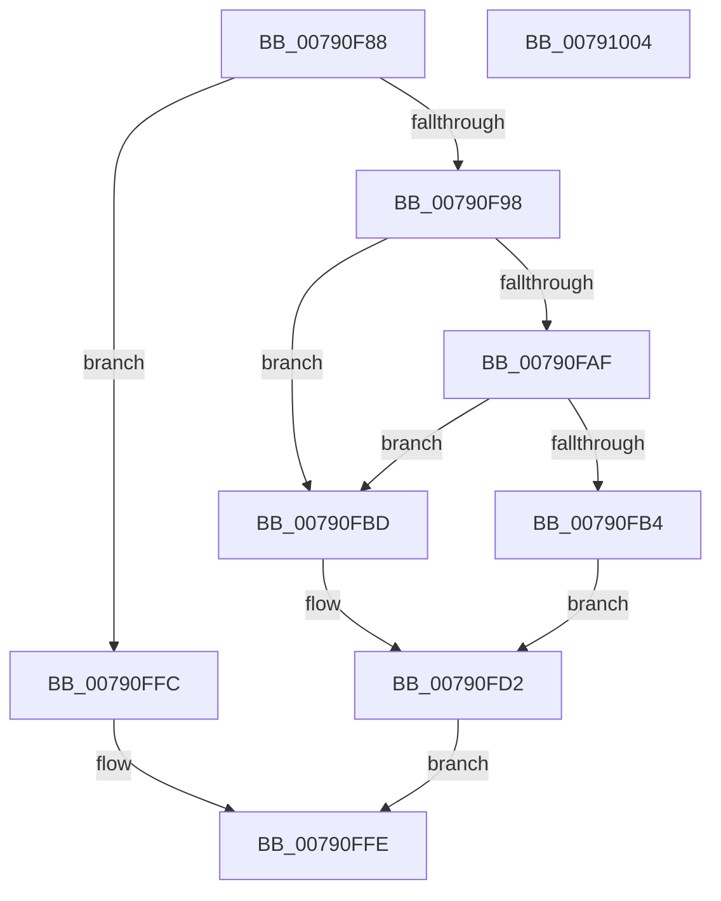

# RtlpDestroyHeapSegment

- RVA: `0x00790F88`–`0x00791005` (길이 `125` bytes)
- VA: `0x0000000140790F88`
- 실행 섹션: `PAGE`
- PDB 이름 있음: `예`; PDB Function 태그: `아니요`
- unwind 정보 RVA: `0x00064C80`
- 디코드: `37`개 명령, `125/125` bytes 표시
- 미해석 바이트: `0` (있으면 어셈블리에 `.byte`로 보존)

> 이 문서는 커널 이미지의 기계어와 PDB 기호를 분석해 생성했습니다. 4번과 5번은 함수 원형과 자료형을 바이너리 사용 방식에서 추정한 C 해석이며 원본 소스 복구 결과는 아닙니다.

## 1. Dependencies

- 직접 호출 지점: **2**; 고유 호출 대상: **2**
- 직접 호출자로 확인된 함수: **1**
- RIP 상대 이미지 참조: **0**

### Outgoing calls
- `0x00790FCD` → [RtlpLogHeapFailure](../../text/35/RtlpLogHeapFailure_function_0035B7BC.md) (function, `0x0035B7BC`)
- `0x00790FF5` → [ZwFreeVirtualMemory](../../text/6A/ZwFreeVirtualMemory_function_006AD490.md) (function, `0x006AD490`)

### Direct callers
- [sub_00B4A4E4](../B4/Unknown_function_00B4A4E4.md) at `0x00B4A552`

### Static image references
- 디코드된 RIP-relative 메모리 참조가 없습니다.

## 2. Other-region calls and transfers

- 다른 실행 섹션으로 향하는 call: **2**
  - `0x00790FCD` → [RtlpLogHeapFailure](../../text/35/RtlpLogHeapFailure_function_0035B7BC.md) (`PAGE` → `.text`)
  - `0x00790FF5` → [ZwFreeVirtualMemory](../../text/6A/ZwFreeVirtualMemory_function_006AD490.md) (`PAGE` → `.text`)
- 별도 외부 분기/꼬리 이동을 확인하지 못했습니다.

## 3. Assembly (complete function range)

```asm
00790F88  40 53                           push rbx
00790F8A  48 83 EC 30                     sub rsp, 0x30
00790F8E  8B 41 14                        mov eax, dword ptr [rcx + 0x14]
00790F91  48 8B D9                        mov rbx, rcx
00790F94  A8 01                           test al, 1
00790F96  75 64                           jne 0x140790ffc
00790F98  4C 8D 41 18                     lea r8, [rcx + 0x18]
00790F9C  49 8B 00                        mov rax, qword ptr [r8]
00790F9F  49 8B 48 08                     mov rcx, qword ptr [r8 + 8]
00790FA3  4C 8B 48 08                     mov r9, qword ptr [rax + 8]
00790FA7  48 8B 11                        mov rdx, qword ptr [rcx]
00790FAA  49 3B D1                        cmp rdx, r9
00790FAD  75 0E                           jne 0x140790fbd
00790FAF  49 3B D0                        cmp rdx, r8
00790FB2  75 09                           jne 0x140790fbd
00790FB4  48 89 01                        mov qword ptr [rcx], rax
00790FB7  48 89 48 08                     mov qword ptr [rax + 8], rcx
00790FBB  EB 15                           jmp 0x140790fd2
00790FBD  48 83 64 24 28 00               and qword ptr [rsp + 0x28], 0
00790FC3  48 89 54 24 20                  mov qword ptr [rsp + 0x20], rdx
00790FC8  33 D2                           xor edx, edx
00790FCA  8D 4A 0D                        lea ecx, [rdx + 0xd]
00790FCD  E8 EA A7 BC FF                  call 0x14035b7bc
00790FD2  48 8B 43 30                     mov rax, qword ptr [rbx + 0x30]
00790FD6  4C 8D 44 24 40                  lea r8, [rsp + 0x40]
00790FDB  48 83 64 24 40 00               and qword ptr [rsp + 0x40], 0
00790FE1  48 8D 54 24 48                  lea rdx, [rsp + 0x48]
00790FE6  41 B9 00 80 00 00               mov r9d, 0x8000
00790FEC  48 89 44 24 48                  mov qword ptr [rsp + 0x48], rax
00790FF1  48 83 C9 FF                     or rcx, 0xffffffffffffffff
00790FF5  E8 96 C4 F1 FF                  call 0x1406ad490
00790FFA  EB 02                           jmp 0x140790ffe
00790FFC  33 C0                           xor eax, eax
00790FFE  48 83 C4 30                     add rsp, 0x30
00791002  5B                              pop rbx
00791003  C3                              ret
00791004  CC                              int3
```

## 4. C-style interpretation (structured pseudocode)

```c
__int64 __fastcall RtlpDestroyHeapSegment(__int64 a1)
{
    __int64 result;
    __int64 v_rsp;
    unsigned __int64 v_stack_m10;
    unsigned __int64 v_stack_m18;
    unsigned __int64 v_stack_p10;
    unsigned __int64 v_stack_p8;

    v_rsp = (v_rsp) - (48);
    if ((((unsigned __int8)((unsigned int)(*(unsigned int *)(a1 + 20)))) & (1)) != 0) goto loc_00790FFC;
    if ((*(unsigned __int64 *)(*(unsigned __int64 *)(a1 + 24 + 8))) != (*(unsigned __int64 *)(*(unsigned __int64 *)(a1 + 24) + 8))) goto loc_00790FBD;
    if ((*(unsigned __int64 *)(*(unsigned __int64 *)(a1 + 24 + 8))) != (a1 + 24)) goto loc_00790FBD;
    *(unsigned __int64 *)(*(unsigned __int64 *)(a1 + 24 + 8)) = *(unsigned __int64 *)(a1 + 24);
    *(unsigned __int64 *)(*(unsigned __int64 *)(a1 + 24) + 8) = *(unsigned __int64 *)(a1 + 24 + 8);
    goto loc_00790FD2;
loc_00790FBD:
    v_stack_m18 = *(unsigned __int64 *)(*(unsigned __int64 *)(a1 + 24 + 8));
    a2 = 0;
    result = RtlpLogHeapFailure(a2 + 13, a2, a1 + 24, *(unsigned __int64 *)(*(unsigned __int64 *)(a1 + 24) + 8));
loc_00790FD2:
    v_stack_p10 = *(unsigned __int64 *)(a1 + 48);
    a1 = (a2 + 13) | (-1);
    result = ZwFreeVirtualMemory(a1, v_stack_p10, v_stack_p8, (unsigned int)(0x8000ULL));
    goto loc_00790FFE;
loc_00790FFC:
    result = 0;
loc_00790FFE:
    v_rsp = (v_rsp) + (48);
    return result;
}
```

## 5. (Beta) C Style

```c
int64_t RtlpDestroyHeapSegment(void *Arg1)
{
    uint8_t *arg1 = (uint8_t *)Arg1;

    int64_t result;
    int64_t local_rsp;
    uint64_t v_stack_m10;
    uint64_t v_stack_m18;
    uint64_t v_stack_p10;
    uint64_t v_stack_p8;

    local_rsp = (local_rsp) - (48);
    if ((((uint8_t)((uint32_t)(*(uint32_t *)(arg1 + 0x14)))) & (1)) != 0) goto loc_00790FFC;
    if ((*(uint64_t *)(*(uint64_t *)(arg1 + 0x18 + 0x8))) != (*(uint64_t *)(*(uint64_t *)(arg1 + 0x18) + 0x8))) goto loc_00790FBD;
    if ((*(uint64_t *)(*(uint64_t *)(arg1 + 0x18 + 0x8))) != (Arg1 + 24)) goto loc_00790FBD;
    *(uint64_t *)(*(uint64_t *)(arg1 + 0x18 + 0x8)) = *(uint64_t *)(arg1 + 0x18);
    *(uint64_t *)(*(uint64_t *)(arg1 + 0x18) + 0x8) = *(uint64_t *)(arg1 + 0x18 + 0x8);
    goto loc_00790FD2;
loc_00790FBD:
    v_stack_m18 = *(uint64_t *)(*(uint64_t *)(arg1 + 0x18 + 0x8));
    a2 = 0;
    result = RtlpLogHeapFailure(a2 + 13, a2, Arg1 + 24, *(uint64_t *)(*(uint64_t *)(arg1 + 0x18) + 0x8));
loc_00790FD2:
    v_stack_p10 = *(uint64_t *)(arg1 + 0x30);
    Arg1 = (a2 + 13) | (-1);
    result = ZwFreeVirtualMemory(Arg1, v_stack_p10, v_stack_p8, (uint32_t)(0x8000ULL));
    goto loc_00790FFE;
loc_00790FFC:
    result = 0;
loc_00790FFE:
    local_rsp = (local_rsp) + (48);
    return result;
}
```

### 관측된 메모리 오프셋

구조체 형식이 확인되지 않은 접근은 인자 기준의 오프셋으로만 기록했습니다.

| 기준 인자 | 오프셋 표현 | 폭 (bit) | 접근 |
|---|---:|---:|---|
| `Arg1` | `+ 0x0` | `64` | `R` |
| `Arg1` | `+ 0x8` | `64` | `R` |
| `Arg1` | `+ 0x14` | `32` | `R` |
| `Arg1` | `+ 0x18` | `64` | `R` |
| `Arg1` | `+ 0x30` | `64` | `R` |

## 6. Execution-region graph

[열기: 2D/3D 그래프와 함수 탐색 컨트롤 패널](../../../control-panel.html?section=page&rva=0x00790F88&view=graph)

- 2D 그래프는 위에서 아래로 흐르고, 3D 그래프는 빈 공간을 드래그해 회전합니다. Shift+드래그는 이동, 휠은 확대·축소, 함수 노드 선택은 대상 보고서 이동입니다.

### Static fallback


