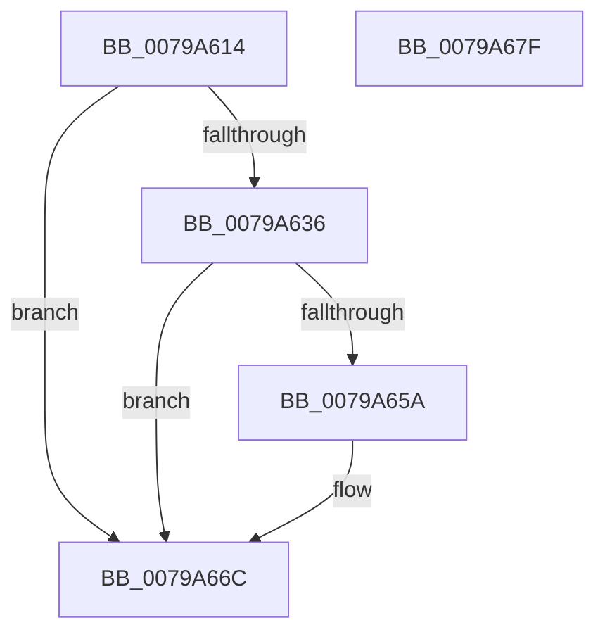

# RtlpFcApplyUpdateAndAddFeature

- RVA: `0x0079A614`–`0x0079A680` (길이 `108` bytes)
- VA: `0x000000014079A614`
- 실행 섹션: `PAGE`
- PDB 이름 있음: `예`; PDB Function 태그: `아니요`
- unwind 정보 RVA: `0x000AB2E4`
- 디코드: `31`개 명령, `108/108` bytes 표시
- 미해석 바이트: `0` (있으면 어셈블리에 `.byte`로 보존)

> 이 문서는 커널 이미지의 기계어와 PDB 기호를 분석해 생성했습니다. 4번과 5번은 함수 원형과 자료형을 바이너리 사용 방식에서 추정한 C 해석이며 원본 소스 복구 결과는 아닙니다.

## 1. Dependencies

- 직접 호출 지점: **3**; 고유 호출 대상: **3**
- 직접 호출자로 확인된 함수: **1**
- RIP 상대 이미지 참조: **1**

### Outgoing calls
- `0x0079A647` → [RtlpFcUpdateFeature](RtlpFcUpdateFeature_function_0079AAAC.md) (function, `0x0079AAAC`)
- `0x0079A651` → [RtlpFcDoesFeatureHaveUniqueState](RtlpFcDoesFeatureHaveUniqueState_function_0079A6F4.md) (function, `0x0079A6F4`)
- `0x0079A674` → [_security_check_cookie](../../text/6A/_security_check_cookie_function_006AC640.md) (function, `0x006AC640`)

### Direct callers
- [RtlpFcUpdateFeatureConfiguration](../AB/RtlpFcUpdateFeatureConfiguration_function_00ABD7A0.md) at `0x00ABD90D`

### Static image references
- `0x0079A61A` → RVA `0x00E0A740` (`.data`; read)

## 2. Other-region calls and transfers

- 다른 실행 섹션으로 향하는 call: **1**
  - `0x0079A674` → [_security_check_cookie](../../text/6A/_security_check_cookie_function_006AC640.md) (`PAGE` → `.text`)
- 별도 외부 분기/꼬리 이동을 확인하지 못했습니다.

## 3. Assembly (complete function range)

```asm
0079A614  40 53                           push rbx
0079A616  48 83 EC 40                     sub rsp, 0x40
0079A61A  48 8B 05 1F 01 67 00            mov rax, qword ptr [rip + 0x67011f]
0079A621  48 33 C4                        xor rax, rsp
0079A624  48 89 44 24 30                  mov qword ptr [rsp + 0x30], rax
0079A629  8B 41 1C                        mov eax, dword ptr [rcx + 0x1c]
0079A62C  49 8B D9                        mov rbx, r9
0079A62F  4D 8B D8                        mov r11, r8
0079A632  A8 04                           test al, 4
0079A634  75 36                           jne 0x14079a66c
0079A636  0F 10 02                        movups xmm0, xmmword ptr [rdx]
0079A639  48 8B D1                        mov rdx, rcx
0079A63C  48 8D 4C 24 20                  lea rcx, [rsp + 0x20]
0079A641  F3 0F 7F 44 24 20               movdqu xmmword ptr [rsp + 0x20], xmm0
0079A647  E8 60 04 00 00                  call 0x14079aaac
0079A64C  48 8D 4C 24 20                  lea rcx, [rsp + 0x20]
0079A651  E8 9E 00 00 00                  call 0x14079a6f4
0079A656  84 C0                           test al, al
0079A658  74 12                           je 0x14079a66c
0079A65A  49 8B 03                        mov rax, qword ptr [r11]
0079A65D  0F 10 44 24 20                  movups xmm0, xmmword ptr [rsp + 0x20]
0079A662  F3 0F 7F 00                     movdqu xmmword ptr [rax], xmm0
0079A666  49 83 03 10                     add qword ptr [r11], 0x10
0079A66A  FF 03                           inc dword ptr [rbx]
0079A66C  48 8B 4C 24 30                  mov rcx, qword ptr [rsp + 0x30]
0079A671  48 33 CC                        xor rcx, rsp
0079A674  E8 C7 1F F1 FF                  call 0x1406ac640
0079A679  48 83 C4 40                     add rsp, 0x40
0079A67D  5B                              pop rbx
0079A67E  C3                              ret
0079A67F  CC                              int3
```

## 4. C-style interpretation (structured pseudocode)

```c
__int64 __fastcall RtlpFcApplyUpdateAndAddFeature(__int64 a1, __int64 a2, __int64 a3, __int64 a4)
{
    __int64 result;
    __int64 v_rsp;
    unsigned __int64 v_stack_m18;
    unsigned __int64 v_stack_m28;

    v_rsp = (v_rsp) - (64);
    result = (*(unsigned __int64 *)(v_rip + 6750495)) ^ (v_rsp);
    v_stack_m18 = result;
    if ((((unsigned __int8)((unsigned int)(*(unsigned int *)(a1 + 28)))) & (4)) != 0) goto loc_0079A66C;
    v_stack_m28 = v_xmm0;
    result = RtlpFcUpdateFeature(v_stack_m28, a1, a3, a4);
    result = RtlpFcDoesFeatureHaveUniqueState(v_stack_m28, a1, a3, a4);
    if ((unsigned __int8)(result) != 0) {
        result = *(unsigned __int64 *)(a3);
        *(unsigned __int64 *)(result) = v_xmm0;
    }
    a1 = (v_stack_m18) ^ (v_rsp);
    result = _security_check_cookie(a1, a1, a3, a4);
    v_rsp = (v_rsp) + (64);
    return result;
}
```

## 5. (Beta) C Style

```c
int64_t RtlpFcApplyUpdateAndAddFeature(void *Arg1, void *Arg2, int64_t Arg3, void *Arg4)
{
    uint8_t *arg1 = (uint8_t *)Arg1;
    uint8_t *arg2 = (uint8_t *)Arg2;
    uint8_t *arg4 = (uint8_t *)Arg4;

    int64_t result;
    int64_t local_rsp;
    uint64_t v_stack_m18;
    uint64_t v_stack_m28;

    local_rsp = (local_rsp) - (64);
    result = (*(uint64_t *)(v_rip + 0x67011F)) ^ (local_rsp);
    v_stack_m18 = result;
    if ((((uint8_t)((uint32_t)(*(uint32_t *)(arg1 + 0x1C)))) & (4)) != 0) goto loc_0079A66C;
    v_stack_m28 = v_xmm0;
    result = RtlpFcUpdateFeature(v_stack_m28, Arg1, Arg3, Arg4);
    result = RtlpFcDoesFeatureHaveUniqueState(v_stack_m28, Arg1, Arg3, Arg4);
    if ((uint8_t)(result) != 0) {
        result = *(uint64_t *)(Arg3);
        *(uint64_t *)(result) = v_xmm0;
    }
    Arg1 = (v_stack_m18) ^ (local_rsp);
    result = _security_check_cookie(Arg1, Arg1, Arg3, Arg4);
    local_rsp = (local_rsp) + (64);
    return result;
}
```

### 관측된 메모리 오프셋

구조체 형식이 확인되지 않은 접근은 인자 기준의 오프셋으로만 기록했습니다.

| 기준 인자 | 오프셋 표현 | 폭 (bit) | 접근 |
|---|---:|---:|---|
| `Arg1` | `+ 0x1C` | `32` | `R` |
| `Arg2` | `+ 0x0` | `128` | `R` |
| `Arg4` | `+ 0x0` | `32` | `R/W` |

## 6. Execution-region graph

[열기: 2D/3D 그래프와 함수 탐색 컨트롤 패널](../../../control-panel.html?section=page&rva=0x0079A614&view=graph)

- 2D 그래프는 위에서 아래로 흐르고, 3D 그래프는 빈 공간을 드래그해 회전합니다. Shift+드래그는 이동, 휠은 확대·축소, 함수 노드 선택은 대상 보고서 이동입니다.

### Static fallback


