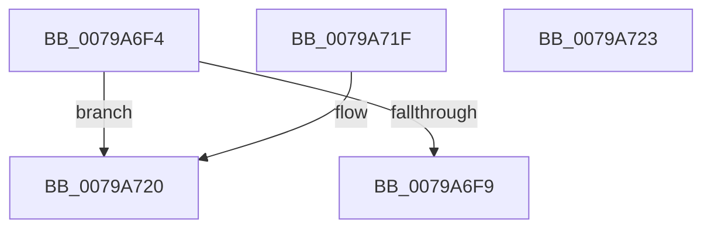

# RtlpFcDoesFeatureHaveUniqueState

- RVA: `0x0079A6F4`–`0x0079A724` (길이 `48` bytes)
- VA: `0x000000014079A6F4`
- 실행 섹션: `PAGE`
- PDB 이름 있음: `예`; PDB Function 태그: `아니요`
- unwind 정보 RVA: `0x000DB714`
- 디코드: `20`개 명령, `48/48` bytes 표시
- 미해석 바이트: `0` (있으면 어셈블리에 `.byte`로 보존)

> 이 문서는 커널 이미지의 기계어와 PDB 기호를 분석해 생성했습니다. 4번과 5번은 함수 원형과 자료형을 바이너리 사용 방식에서 추정한 C 해석이며 원본 소스 복구 결과는 아닙니다.

## 1. Dependencies

- 직접 호출 지점: **0**; 고유 호출 대상: **0**
- 직접 호출자로 확인된 함수: **3**
- RIP 상대 이미지 참조: **0**

### Outgoing calls
- 직접 디코드된 call 명령이 없습니다.

### Direct callers
- [RtlpFcApplyUpdateAndAddFeature](RtlpFcApplyUpdateAndAddFeature_function_0079A614.md) at `0x0079A651`
- [RtlpFcCreateAndAddFeatureFromUpdate](RtlpFcCreateAndAddFeatureFromUpdate_function_0079A688.md) at `0x0079A6D1`
- [RtlpFcCalculateRequiredSizeForNewFeatureTable](../AA/RtlpFcCalculateRequiredSizeForNewFeatureTable_function_00AAF250.md) at `0x00AAF2D9`

### Static image references
- 디코드된 RIP-relative 메모리 참조가 없습니다.

## 2. Other-region calls and transfers

- 다른 실행 섹션으로 향하는 call: **0**
- 별도 외부 분기/꼬리 이동을 확인하지 못했습니다.

## 3. Assembly (complete function range)

```asm
0079A6F4  83 39 00                        cmp dword ptr [rcx], 0
0079A6F7  74 27                           je 0x14079a720
0079A6F9  8B 51 04                        mov edx, dword ptr [rcx + 4]
0079A6FC  8B C2                           mov eax, edx
0079A6FE  C1 E8 0A                        shr eax, 0xa
0079A701  0B C2                           or eax, edx
0079A703  A8 30                           test al, 0x30
0079A705  0F 94 C1                        sete cl
0079A708  F7 C2 00 3F 00 00               test edx, 0x3f00
0079A70E  0F 94 C0                        sete al
0079A711  22 C8                           and cl, al
0079A713  F6 C2 40                        test dl, 0x40
0079A716  0F 94 C0                        sete al
0079A719  84 C8                           test al, cl
0079A71B  0F 94 C0                        sete al
0079A71E  C3                              ret
0079A71F  CC                              int3
0079A720  32 C0                           xor al, al
0079A722  C3                              ret
0079A723  CC                              int3
```

## 4. C-style interpretation (structured pseudocode)

```c
__int64 __fastcall RtlpFcDoesFeatureHaveUniqueState(__int64 a1)
{
    __int64 result;

    if ((*(unsigned int *)(a1)) == 0) goto loc_0079A720;
    result = (unsigned int)(((unsigned int)((unsigned int)((unsigned int)(*(unsigned int *)(a1 + 4))))) >> (10));
    result = (unsigned int)((result) | ((unsigned int)((unsigned int)(*(unsigned int *)(a1 + 4)))));
    a1 = ((((unsigned __int8)(result)) & (48)) == 0) ? 1 : 0;
    result = ((((unsigned int)((unsigned int)(*(unsigned int *)(a1 + 4)))) & (0x3F00ULL)) == 0) ? 1 : 0;
    a1 = (unsigned __int8)((a1) & ((unsigned __int8)(result)));
    result = ((((unsigned __int8)((unsigned int)(*(unsigned int *)(a1 + 4)))) & (64)) == 0) ? 1 : 0;
    result = ((((unsigned __int8)(result)) & ((unsigned __int8)(a1))) == 0) ? 1 : 0;
    return result;
loc_0079A720:
    result = 0;
    return result;
}
```

## 5. (Beta) C Style

```c
int64_t RtlpFcDoesFeatureHaveUniqueState(void *Arg1)
{
    uint8_t *arg1 = (uint8_t *)Arg1;

    int64_t result;

    if ((*(uint32_t *)(arg1)) == 0) goto loc_0079A720;
    result = (uint32_t)(((uint32_t)((uint32_t)((uint32_t)(*(uint32_t *)(arg1 + 0x4))))) >> (10));
    result = (uint32_t)((result) | ((uint32_t)((uint32_t)(*(uint32_t *)(arg1 + 0x4)))));
    Arg1 = ((((uint8_t)(result)) & (48)) == 0) ? 1 : 0;
    result = ((((uint32_t)((uint32_t)(*(uint32_t *)(arg1 + 0x4)))) & (0x3F00ULL)) == 0) ? 1 : 0;
    Arg1 = (uint8_t)((Arg1) & ((uint8_t)(result)));
    result = ((((uint8_t)((uint32_t)(*(uint32_t *)(arg1 + 0x4)))) & (64)) == 0) ? 1 : 0;
    result = ((((uint8_t)(result)) & ((uint8_t)(Arg1))) == 0) ? 1 : 0;
    return result;
loc_0079A720:
    result = 0;
    return result;
}
```

### 관측된 메모리 오프셋

구조체 형식이 확인되지 않은 접근은 인자 기준의 오프셋으로만 기록했습니다.

| 기준 인자 | 오프셋 표현 | 폭 (bit) | 접근 |
|---|---:|---:|---|
| `Arg1` | `+ 0x0` | `32` | `R` |
| `Arg1` | `+ 0x4` | `32` | `R` |

## 6. Execution-region graph

[열기: 2D/3D 그래프와 함수 탐색 컨트롤 패널](../../../control-panel.html?section=page&rva=0x0079A6F4&view=graph)

- 2D 그래프는 위에서 아래로 흐르고, 3D 그래프는 빈 공간을 드래그해 회전합니다. Shift+드래그는 이동, 휠은 확대·축소, 함수 노드 선택은 대상 보고서 이동입니다.

### Static fallback


