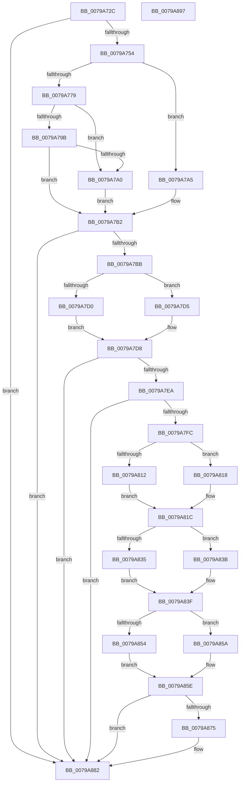

# RtlpFcHasEffectiveStateInGovernedFeatureInfoTable

- RVA: `0x0079A72C`–`0x0079A898` (길이 `364` bytes)
- VA: `0x000000014079A72C`
- 실행 섹션: `PAGE`
- PDB 이름 있음: `예`; PDB Function 태그: `아니요`
- unwind 정보 RVA: `0x000D038C`
- 디코드: `116`개 명령, `364/364` bytes 표시
- 미해석 바이트: `0` (있으면 어셈블리에 `.byte`로 보존)

> 이 문서는 커널 이미지의 기계어와 PDB 기호를 분석해 생성했습니다. 4번과 5번은 함수 원형과 자료형을 바이너리 사용 방식에서 추정한 C 해석이며 원본 소스 복구 결과는 아닙니다.

## 1. Dependencies

- 직접 호출 지점: **3**; 고유 호출 대상: **3**
- 직접 호출자로 확인된 함수: **2**
- RIP 상대 이미지 참조: **1**

### Outgoing calls
- `0x0079A77D` → [RtlFindLowerBoundInSortedArray](../9B/RtlFindLowerBoundInSortedArray_function_009BCB00.md) (function, `0x009BCB00`)
- `0x0079A7A5` → [RtlpFcLinearSearchInSortedArray](../AD/RtlpFcLinearSearchInSortedArray_function_00AD16F8.md) (function, `0x00AD16F8`)
- `0x0079A87D` → [RtlpFcGetFeatureHasSubscriptionsFromBuffer](../9B/RtlpFcGetFeatureHasSubscriptionsFromBuffer_function_009BCA30.md) (function, `0x009BCA30`)

### Direct callers
- [RtlQueryFeatureConfigurationFromBuffers](../../text/5E/RtlQueryFeatureConfigurationFromBuffers_function_005E7414.md) at `0x005E74A4`
- [RtlpFcQueryFeatureConfigurationFromBufferSet](../70/RtlpFcQueryFeatureConfigurationFromBufferSet_function_007035C4.md) at `0x0070363B`

### Static image references
- `0x0079A760` → RVA `0x00A99210` (`RtlFcpCompareFeatureIdToFeatureUsageSubscription`; read)

## 2. Other-region calls and transfers

- 다른 실행 섹션으로 향하는 call: **0**
- 별도 외부 분기/꼬리 이동을 확인하지 못했습니다.

## 3. Assembly (complete function range)

```asm
0079A72C  4C 8B DC                        mov r11, rsp
0079A72F  49 89 5B 10                     mov qword ptr [r11 + 0x10], rbx
0079A733  49 89 6B 18                     mov qword ptr [r11 + 0x18], rbp
0079A737  89 4C 24 08                     mov dword ptr [rsp + 8], ecx
0079A73B  56                              push rsi
0079A73C  57                              push rdi
0079A73D  41 56                           push r14
0079A73F  48 83 EC 30                     sub rsp, 0x30
0079A743  33 DB                           xor ebx, ebx
0079A745  41 8B E9                        mov ebp, r9d
0079A748  48 8B FA                        mov rdi, rdx
0079A74B  48 85 D2                        test rdx, rdx
0079A74E  0F 84 2E 01 00 00               je 0x14079a882
0079A754  8B 02                           mov eax, dword ptr [rdx]
0079A756  4C 8B 72 08                     mov r14, qword ptr [rdx + 8]
0079A75A  0F B7 C8                        movzx ecx, ax
0079A75D  4C 03 F2                        add r14, rdx
0079A760  48 8D 05 A9 EA 2F 00            lea rax, [rip + 0x2feaa9]
0079A767  44 8B C1                        mov r8d, ecx
0079A76A  85 C9                           test ecx, ecx
0079A76C  49 89 43 D8                     mov qword ptr [r11 - 0x28], rax
0079A770  49 8D 4B 08                     lea rcx, [r11 + 8]
0079A774  49 8B D6                        mov rdx, r14
0079A777  74 2C                           je 0x14079a7a5
0079A779  44 8D 4B 10                     lea r9d, [rbx + 0x10]
0079A77D  E8 7E 23 22 00                  call 0x1409bcb00
0079A782  44 8B 5C 24 50                  mov r11d, dword ptr [rsp + 0x50]
0079A787  48 8B D0                        mov rdx, rax
0079A78A  8B 07                           mov eax, dword ptr [rdi]
0079A78C  0F B7 C8                        movzx ecx, ax
0079A78F  48 C1 E1 04                     shl rcx, 4
0079A793  49 03 CE                        add rcx, r14
0079A796  48 3B D1                        cmp rdx, rcx
0079A799  74 05                           je 0x14079a7a0
0079A79B  44 39 1A                        cmp dword ptr [rdx], r11d
0079A79E  74 12                           je 0x14079a7b2
0079A7A0  48 8B D3                        mov rdx, rbx
0079A7A3  EB 0D                           jmp 0x14079a7b2
0079A7A5  E8 4E 6F 33 00                  call 0x140ad16f8
0079A7AA  44 8B 5C 24 50                  mov r11d, dword ptr [rsp + 0x50]
0079A7AF  48 8B D0                        mov rdx, rax
0079A7B2  48 85 D2                        test rdx, rdx
0079A7B5  0F 84 C7 00 00 00               je 0x14079a882
0079A7BB  41 B9 0C 00 00 00               mov r9d, 0xc
0079A7C1  48 8B FA                        mov rdi, rdx
0079A7C4  48 8B F2                        mov rsi, rdx
0079A7C7  45 8D 51 FC                     lea r10d, [r9 - 4]
0079A7CB  83 FD 01                        cmp ebp, 1
0079A7CE  75 05                           jne 0x14079a7d5
0079A7D0  8B 4A 0C                        mov ecx, dword ptr [rdx + 0xc]
0079A7D3  EB 03                           jmp 0x14079a7d8
0079A7D5  8B 4A 08                        mov ecx, dword ptr [rdx + 8]
0079A7D8  8B C1                           mov eax, ecx
0079A7DA  C1 E8 07                        shr eax, 7
0079A7DD  44 0F B7 C0                     movzx r8d, ax
0079A7E1  F6 C1 01                        test cl, 1
0079A7E4  0F 84 98 00 00 00               je 0x14079a882
0079A7EA  8B 02                           mov eax, dword ptr [rdx]
0079A7EC  41 8B C8                        mov ecx, r8d
0079A7EF  48 03 C9                        add rcx, rcx
0079A7F2  41 39 04 CE                     cmp dword ptr [r14 + rcx*8], eax
0079A7F6  0F 84 86 00 00 00               je 0x14079a882
0079A7FC  4C 8B 44 24 78                  mov r8, qword ptr [rsp + 0x78]
0079A801  0F 57 C0                        xorps xmm0, xmm0
0079A804  B3 01                           mov bl, 1
0079A806  41 0F 11 00                     movups xmmword ptr [r8], xmm0
0079A80A  45 89 18                        mov dword ptr [r8], r11d
0079A80D  83 FD 01                        cmp ebp, 1
0079A810  75 06                           jne 0x14079a818
0079A812  41 8B 0C 39                     mov ecx, dword ptr [r9 + rdi]
0079A816  EB 04                           jmp 0x14079a81c
0079A818  42 8B 0C 16                     mov ecx, dword ptr [rsi + r10]
0079A81C  41 8B 40 04                     mov eax, dword ptr [r8 + 4]
0079A820  D1 E9                           shr ecx, 1
0079A822  C1 E1 04                        shl ecx, 4
0079A825  33 C8                           xor ecx, eax
0079A827  83 E1 30                        and ecx, 0x30
0079A82A  33 C8                           xor ecx, eax
0079A82C  41 89 48 04                     mov dword ptr [r8 + 4], ecx
0079A830  83 FD 01                        cmp ebp, 1
0079A833  75 06                           jne 0x14079a83b
0079A835  41 8B 04 39                     mov eax, dword ptr [r9 + rdi]
0079A839  EB 04                           jmp 0x14079a83f
0079A83B  42 8B 04 16                     mov eax, dword ptr [rsi + r10]
0079A83F  C1 E8 03                        shr eax, 3
0079A842  8B D1                           mov edx, ecx
0079A844  33 D0                           xor edx, eax
0079A846  83 E2 0F                        and edx, 0xf
0079A849  33 D1                           xor edx, ecx
0079A84B  41 89 50 04                     mov dword ptr [r8 + 4], edx
0079A84F  83 FD 01                        cmp ebp, 1
0079A852  75 06                           jne 0x14079a85a
0079A854  41 8B 04 39                     mov eax, dword ptr [r9 + rdi]
0079A858  EB 04                           jmp 0x14079a85e
0079A85A  42 8B 04 16                     mov eax, dword ptr [rsi + r10]
0079A85E  C1 E8 17                        shr eax, 0x17
0079A861  C1 E0 06                        shl eax, 6
0079A864  33 C2                           xor eax, edx
0079A866  83 E0 40                        and eax, 0x40
0079A869  33 C2                           xor eax, edx
0079A86B  41 89 40 04                     mov dword ptr [r8 + 4], eax
0079A86F  24 30                           and al, 0x30
0079A871  3C 10                           cmp al, 0x10
0079A873  74 0D                           je 0x14079a882
0079A875  48 8B 54 24 70                  mov rdx, qword ptr [rsp + 0x70]
0079A87A  41 8B CB                        mov ecx, r11d
0079A87D  E8 AE 21 22 00                  call 0x1409bca30
0079A882  48 8B 6C 24 60                  mov rbp, qword ptr [rsp + 0x60]
0079A887  8A C3                           mov al, bl
0079A889  48 8B 5C 24 58                  mov rbx, qword ptr [rsp + 0x58]
0079A88E  48 83 C4 30                     add rsp, 0x30
0079A892  41 5E                           pop r14
0079A894  5F                              pop rdi
0079A895  5E                              pop rsi
0079A896  C3                              ret
0079A897  CC                              int3
```

## 4. C-style interpretation (structured pseudocode)

```c
__int64 __fastcall RtlpFcHasEffectiveStateInGovernedFeatureInfoTable(int a1, __int64 a2, __int64 a3, int a4, __int64 a5, __int64 a6)
{
    __int64 result;
    __int64 v_r14;
    __int64 v_rbx;
    __int64 v_rsp;
    unsigned __int64 v_stack_p10;
    unsigned __int64 v_stack_p18;
    unsigned int v_stack_p8;

    *(unsigned __int64 *)(v_rsp + 16) = v_rbx;
    *(unsigned __int64 *)(v_rsp + 24) = v_rbp;
    v_stack_p8 = a1;
    v_rsp = (v_rsp) - (48);
    v_rbx = 0;
    if (a2 == 0) goto loc_0079A882;
    v_r14 = (*(unsigned __int64 *)(a2 + 8)) + (a2);
    *(unsigned __int64 *)(v_rsp - 40) = v_rip + 3140265;
    if ((unsigned int)((unsigned __int16)((unsigned int)(*(unsigned int *)(a2)))) == 0) goto loc_0079A7A5;
    result = RtlFindLowerBoundInSortedArray(v_rsp + 8, v_r14, (unsigned int)((unsigned int)((unsigned __int16)((unsigned int)(*(unsigned int *)(a2))))), v_rbx + 16);
    a1 = ((unsigned __int16)((unsigned int)(*(unsigned int *)(a2)))) << (4);
    a1 = (a1) + (v_r14);
    if (result == a1) goto loc_0079A7A0;
    if ((*(unsigned int *)(result)) == ((unsigned int)((unsigned int)(v_stack_p8)))) goto loc_0079A7B2;
loc_0079A7A0:
    goto loc_0079A7B2;
loc_0079A7A5:
    result = RtlpFcLinearSearchInSortedArray(a1, 0, (unsigned int)((unsigned int)((unsigned __int16)((unsigned int)(*(unsigned int *)(a2))))), v_rbx + 16);
loc_0079A7B2:
    if (result == 0) goto loc_0079A882;
    if (((unsigned int)((unsigned int)(a4))) != 1) goto loc_0079A7D5;
    goto loc_0079A7D8;
loc_0079A7D5:
loc_0079A7D8:
    result = (unsigned int)(((unsigned int)((unsigned int)((unsigned int)(*(unsigned int *)(result + 8))))) >> (7));
    if ((((unsigned __int8)((unsigned int)(*(unsigned int *)(result + 8)))) & (1)) == 0) goto loc_0079A882;
    a1 = ((unsigned int)((unsigned int)((unsigned __int16)(result)))) + ((unsigned int)((unsigned int)((unsigned __int16)(result))));
    if ((*(unsigned int *)(v_r14 + a1 * 8)) == ((unsigned int)((unsigned int)(*(unsigned int *)(result))))) goto loc_0079A882;
    *(unsigned __int64 *)(a6) = v_xmm0;
    *(unsigned int *)(a6) = (unsigned int)((unsigned int)(v_stack_p8));
    if (((unsigned int)((unsigned int)(a4))) != 1) goto loc_0079A818;
    goto loc_0079A81C;
loc_0079A818:
loc_0079A81C:
    a1 = (unsigned int)(((unsigned int)(*(unsigned int *)(result + 12 - 4 * 1))) >> (1));
    a1 = (unsigned int)((a1) << (4));
    a1 = (unsigned int)((a1) ^ ((unsigned int)((unsigned int)(*(unsigned int *)(a6 + 4)))));
    a1 = (unsigned int)((a1) & (48));
    a1 = (unsigned int)((a1) ^ ((unsigned int)((unsigned int)(*(unsigned int *)(a6 + 4)))));
    *(unsigned int *)(a6 + 4) = a1;
    if (((unsigned int)((unsigned int)(a4))) != 1) goto loc_0079A83B;
    goto loc_0079A83F;
loc_0079A83B:
loc_0079A83F:
    result = (unsigned int)(((unsigned int)(*(unsigned int *)(result + 12 - 4 * 1))) >> (3));
    a2 = (unsigned int)(((unsigned int)(a1)) ^ ((unsigned int)(result)));
    a2 = (unsigned int)((a2) & (15));
    a2 = (unsigned int)((a2) ^ (a1));
    *(unsigned int *)(a6 + 4) = (unsigned int)(a2);
    if (((unsigned int)((unsigned int)(a4))) != 1) goto loc_0079A85A;
    goto loc_0079A85E;
loc_0079A85A:
loc_0079A85E:
    result = (unsigned int)(((unsigned int)(*(unsigned int *)(result + 12 - 4 * 1))) >> (23));
    result = (unsigned int)((result) << (6));
    result = (unsigned int)((result) ^ ((unsigned int)(a2)));
    result = (unsigned int)((result) & (64));
    result = (unsigned int)((result) ^ ((unsigned int)(a2)));
    *(unsigned int *)(a6 + 4) = (unsigned int)(result);
    result = (unsigned __int8)((result) & (48));
    if (((unsigned __int8)(result)) != 16) {
        a2 = a5;
        a1 = (unsigned int)((unsigned int)(v_stack_p8));
        result = RtlpFcGetFeatureHasSubscriptionsFromBuffer(a1, a2, a6, 12);
    }
    v_rsp = (v_rsp) + (48);
    return 1;
}
```

## 5. (Beta) C Style

```c
int64_t RtlpFcHasEffectiveStateInGovernedFeatureInfoTable(int32_t Arg1, void *Arg2, int64_t Arg3, int32_t Arg4, int64_t Arg5, void *Arg6)
{
    uint8_t *arg2 = (uint8_t *)Arg2;
    uint8_t *arg6 = (uint8_t *)Arg6;

    int64_t result;
    int64_t local_r14;
    int64_t local_rbx;
    int64_t local_rsp;
    uint64_t v_stack_p10;
    uint64_t v_stack_p18;
    uint32_t v_stack_p8;

    *(uint64_t *)(local_rsp + 0x10) = local_rbx;
    *(uint64_t *)(local_rsp + 0x18) = local_rbp;
    v_stack_p8 = Arg1;
    local_rsp = (local_rsp) - (48);
    local_rbx = 0;
    if (Arg2 == NULL) goto loc_0079A882;
    local_r14 = (*(uint64_t *)(arg2 + 0x8)) + (Arg2);
    *(uint64_t *)(local_rsp - 0x28) = v_rip + 3140265;
    if ((uint32_t)((uint16_t)((uint32_t)(*(uint32_t *)(arg2)))) == 0) goto loc_0079A7A5;
    result = RtlFindLowerBoundInSortedArray(local_rsp + 8, local_r14, (uint32_t)((uint32_t)((uint16_t)((uint32_t)(*(uint32_t *)(arg2))))), local_rbx + 16);
    Arg1 = ((uint16_t)((uint32_t)(*(uint32_t *)(arg2)))) << (4);
    Arg1 = (Arg1) + (local_r14);
    if (result == Arg1) goto loc_0079A7A0;
    if ((*(uint32_t *)(result)) == ((uint32_t)((uint32_t)(v_stack_p8)))) goto loc_0079A7B2;
loc_0079A7A0:
    goto loc_0079A7B2;
loc_0079A7A5:
    result = RtlpFcLinearSearchInSortedArray(Arg1, 0, (uint32_t)((uint32_t)((uint16_t)((uint32_t)(*(uint32_t *)(arg2))))), local_rbx + 16);
loc_0079A7B2:
    if (result == 0) goto loc_0079A882;
    if (((uint32_t)((uint32_t)(Arg4))) != 1) goto loc_0079A7D5;
    goto loc_0079A7D8;
loc_0079A7D5:
loc_0079A7D8:
    result = (uint32_t)(((uint32_t)((uint32_t)((uint32_t)(*(uint32_t *)(result + 0x8))))) >> (7));
    if ((((uint8_t)((uint32_t)(*(uint32_t *)(result + 0x8)))) & (1)) == 0) goto loc_0079A882;
    Arg1 = ((uint32_t)((uint32_t)((uint16_t)(result)))) + ((uint32_t)((uint32_t)((uint16_t)(result))));
    if ((*(uint32_t *)(local_r14 + Arg1 * 8)) == ((uint32_t)((uint32_t)(*(uint32_t *)(result))))) goto loc_0079A882;
    *(uint64_t *)(arg6) = v_xmm0;
    *(uint32_t *)(arg6) = (uint32_t)((uint32_t)(v_stack_p8));
    if (((uint32_t)((uint32_t)(Arg4))) != 1) goto loc_0079A818;
    goto loc_0079A81C;
loc_0079A818:
loc_0079A81C:
    Arg1 = (uint32_t)(((uint32_t)(*(uint32_t *)(result + 0xC - 0x4 * 1))) >> (1));
    Arg1 = (uint32_t)((Arg1) << (4));
    Arg1 = (uint32_t)((Arg1) ^ ((uint32_t)((uint32_t)(*(uint32_t *)(arg6 + 0x4)))));
    Arg1 = (uint32_t)((Arg1) & (48));
    Arg1 = (uint32_t)((Arg1) ^ ((uint32_t)((uint32_t)(*(uint32_t *)(arg6 + 0x4)))));
    *(uint32_t *)(arg6 + 0x4) = Arg1;
    if (((uint32_t)((uint32_t)(Arg4))) != 1) goto loc_0079A83B;
    goto loc_0079A83F;
loc_0079A83B:
loc_0079A83F:
    result = (uint32_t)(((uint32_t)(*(uint32_t *)(result + 0xC - 0x4 * 1))) >> (3));
    Arg2 = (uint32_t)(((uint32_t)(Arg1)) ^ ((uint32_t)(result)));
    Arg2 = (uint32_t)((Arg2) & (15));
    Arg2 = (uint32_t)((Arg2) ^ (Arg1));
    *(uint32_t *)(arg6 + 0x4) = (uint32_t)(Arg2);
    if (((uint32_t)((uint32_t)(Arg4))) != 1) goto loc_0079A85A;
    goto loc_0079A85E;
loc_0079A85A:
loc_0079A85E:
    result = (uint32_t)(((uint32_t)(*(uint32_t *)(result + 0xC - 0x4 * 1))) >> (23));
    result = (uint32_t)((result) << (6));
    result = (uint32_t)((result) ^ ((uint32_t)(Arg2)));
    result = (uint32_t)((result) & (64));
    result = (uint32_t)((result) ^ ((uint32_t)(Arg2)));
    *(uint32_t *)(arg6 + 0x4) = (uint32_t)(result);
    result = (uint8_t)((result) & (48));
    if (((uint8_t)(result)) != 16) {
        Arg2 = Arg5;
        Arg1 = (uint32_t)((uint32_t)(v_stack_p8));
        result = RtlpFcGetFeatureHasSubscriptionsFromBuffer(Arg1, Arg2, Arg6, 12);
    }
    local_rsp = (local_rsp) + (48);
    return 1;
}
```

### 관측된 메모리 오프셋

구조체 형식이 확인되지 않은 접근은 인자 기준의 오프셋으로만 기록했습니다.

| 기준 인자 | 오프셋 표현 | 폭 (bit) | 접근 |
|---|---:|---:|---|
| `Arg2` | `+ 0x0` | `32` | `R` |
| `Arg6` | `+ 0x0` | `32` | `W` |
| `Arg6` | `+ 0x0` | `128` | `R` |
| `Arg6` | `+ 0x4` | `32` | `R` |
| `Arg6` | `+ 0x4` | `32` | `W` |

## 6. Execution-region graph

[열기: 2D/3D 그래프와 함수 탐색 컨트롤 패널](../../../control-panel.html?section=page&rva=0x0079A72C&view=graph)

- 2D 그래프는 위에서 아래로 흐르고, 3D 그래프는 빈 공간을 드래그해 회전합니다. Shift+드래그는 이동, 휠은 확대·축소, 함수 노드 선택은 대상 보고서 이동입니다.

### Static fallback


