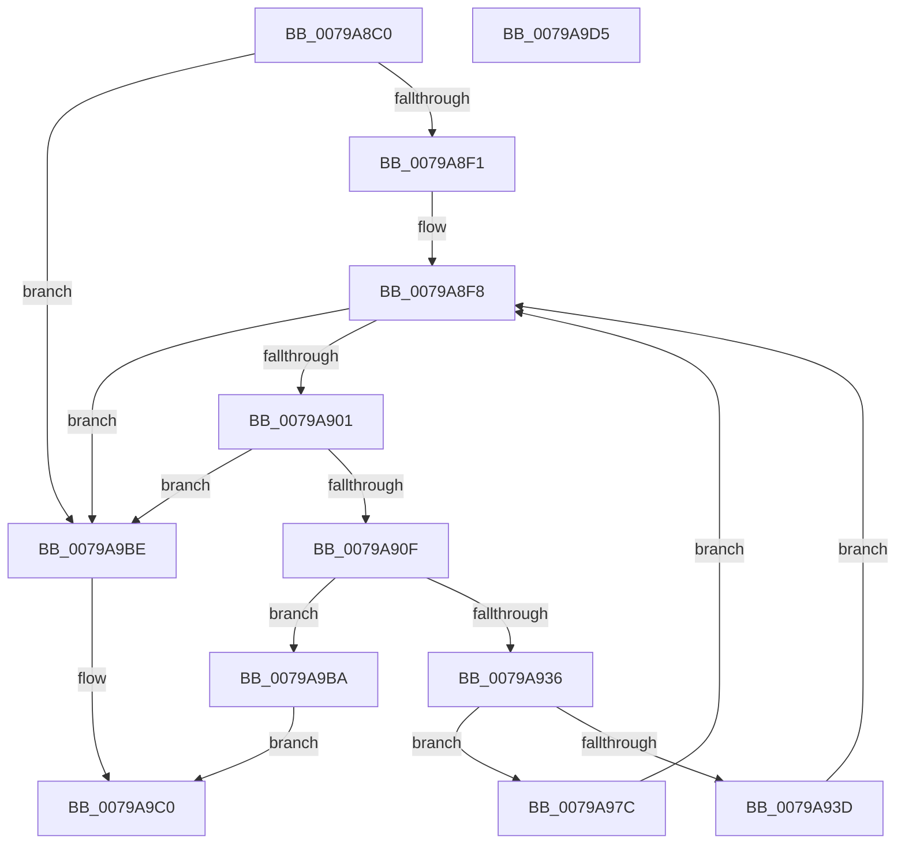

# RtlpFcIsGovernedFeatureTableUpdateNeeded

- RVA: `0x0079A8C0`–`0x0079A9D6` (길이 `278` bytes)
- VA: `0x000000014079A8C0`
- 실행 섹션: `PAGE`
- PDB 이름 있음: `예`; PDB Function 태그: `아니요`
- unwind 정보 RVA: `0x00095AEC`
- 디코드: `80`개 명령, `278/278` bytes 표시
- 미해석 바이트: `0` (있으면 어셈블리에 `.byte`로 보존)

> 이 문서는 커널 이미지의 기계어와 PDB 기호를 분석해 생성했습니다. 4번과 5번은 함수 원형과 자료형을 바이너리 사용 방식에서 추정한 C 해석이며 원본 소스 복구 결과는 아닙니다.

## 1. Dependencies

- 직접 호출 지점: **3**; 고유 호출 대상: **2**
- 직접 호출자로 확인된 함수: **1**
- RIP 상대 이미지 참조: **1**

### Outgoing calls
- `0x0079A929` → [RtlFcpCompareFeatureIdToFeatureUsageSubscription](../A9/RtlFcpCompareFeatureIdToFeatureUsageSubscription_function_00A99210.md) (function, `0x00A99210`)
- `0x0079A960` → [RtlFindLowerBoundInSortedArray](../9B/RtlFindLowerBoundInSortedArray_function_009BCB00.md) (function, `0x009BCB00`)
- `0x0079A99E` → [RtlFindLowerBoundInSortedArray](../9B/RtlFindLowerBoundInSortedArray_function_009BCB00.md) (function, `0x009BCB00`)

### Direct callers
- [RtlpFcUpdateGovernedFeaturesEffectiveStates](../78/RtlpFcUpdateGovernedFeaturesEffectiveStates_function_0078F658.md) at `0x0078F6FD`

### Static image references
- `0x0079A94E` → RVA `0x00A99210` (`RtlFcpCompareFeatureIdToFeatureUsageSubscription`; read)

## 2. Other-region calls and transfers

- 다른 실행 섹션으로 향하는 call: **0**
- 별도 외부 분기/꼬리 이동을 확인하지 못했습니다.

## 3. Assembly (complete function range)

```asm
0079A8C0  48 89 5C 24 08                  mov qword ptr [rsp + 8], rbx
0079A8C5  4C 89 44 24 18                  mov qword ptr [rsp + 0x18], r8
0079A8CA  48 89 54 24 10                  mov qword ptr [rsp + 0x10], rdx
0079A8CF  55                              push rbp
0079A8D0  56                              push rsi
0079A8D1  57                              push rdi
0079A8D2  41 54                           push r12
0079A8D4  41 55                           push r13
0079A8D6  41 56                           push r14
0079A8D8  41 57                           push r15
0079A8DA  48 83 EC 30                     sub rsp, 0x30
0079A8DE  33 FF                           xor edi, edi
0079A8E0  33 F6                           xor esi, esi
0079A8E2  4D 8B F1                        mov r14, r9
0079A8E5  48 8B D9                        mov rbx, rcx
0079A8E8  48 85 C9                        test rcx, rcx
0079A8EB  0F 84 CD 00 00 00               je 0x14079a9be
0079A8F1  4C 8B 69 08                     mov r13, qword ptr [rcx + 8]
0079A8F5  4C 03 E9                        add r13, rcx
0079A8F8  49 3B FE                        cmp rdi, r14
0079A8FB  0F 83 BD 00 00 00               jae 0x14079a9be
0079A901  8B 03                           mov eax, dword ptr [rbx]
0079A903  0F B7 E8                        movzx ebp, ax
0079A906  48 3B F5                        cmp rsi, rbp
0079A909  0F 83 AF 00 00 00               jae 0x14079a9be
0079A90F  4C 8B FE                        mov r15, rsi
0079A912  4C 8B E7                        mov r12, rdi
0079A915  49 C1 E7 04                     shl r15, 4
0079A919  49 C1 E4 05                     shl r12, 5
0079A91D  4D 03 FD                        add r15, r13
0079A920  4D 03 E0                        add r12, r8
0079A923  49 8B D7                        mov rdx, r15
0079A926  49 8B CC                        mov rcx, r12
0079A929  E8 E2 E8 2F 00                  call 0x140a99210
0079A92E  85 C0                           test eax, eax
0079A930  0F 84 84 00 00 00               je 0x14079a9ba
0079A936  48 8D 4C 24 78                  lea rcx, [rsp + 0x78]
0079A93B  7E 3F                           jle 0x14079a97c
0079A93D  41 8B 04 24                     mov eax, dword ptr [r12]
0079A941  48 2B EE                        sub rbp, rsi
0079A944  89 44 24 78                     mov dword ptr [rsp + 0x78], eax
0079A948  41 B9 10 00 00 00               mov r9d, 0x10
0079A94E  48 8D 05 BB E8 2F 00            lea rax, [rip + 0x2fe8bb]
0079A955  4C 8B C5                        mov r8, rbp
0079A958  49 8B D7                        mov rdx, r15
0079A95B  48 89 44 24 20                  mov qword ptr [rsp + 0x20], rax
0079A960  E8 9B 21 22 00                  call 0x1409bcb00
0079A965  4C 8B 84 24 80 00 00 00         mov r8, qword ptr [rsp + 0x80]
0079A96D  48 8B F0                        mov rsi, rax
0079A970  49 2B F5                        sub rsi, r13
0079A973  48 C1 FE 04                     sar rsi, 4
0079A977  E9 7C FF FF FF                  jmp 0x14079a8f8
0079A97C  41 8B 07                        mov eax, dword ptr [r15]
0079A97F  4D 8B C6                        mov r8, r14
0079A982  89 44 24 78                     mov dword ptr [rsp + 0x78], eax
0079A986  4C 2B C7                        sub r8, rdi
0079A989  48 8D 05 80 E8 2F 00            lea rax, [rip + 0x2fe880]
0079A990  41 B9 20 00 00 00               mov r9d, 0x20
0079A996  49 8B D4                        mov rdx, r12
0079A999  48 89 44 24 20                  mov qword ptr [rsp + 0x20], rax
0079A99E  E8 5D 21 22 00                  call 0x1409bcb00
0079A9A3  4C 8B 84 24 80 00 00 00         mov r8, qword ptr [rsp + 0x80]
0079A9AB  48 8B F8                        mov rdi, rax
0079A9AE  49 2B F8                        sub rdi, r8
0079A9B1  48 C1 FF 05                     sar rdi, 5
0079A9B5  E9 3E FF FF FF                  jmp 0x14079a8f8
0079A9BA  B0 01                           mov al, 1
0079A9BC  EB 02                           jmp 0x14079a9c0
0079A9BE  32 C0                           xor al, al
0079A9C0  48 8B 5C 24 70                  mov rbx, qword ptr [rsp + 0x70]
0079A9C5  48 83 C4 30                     add rsp, 0x30
0079A9C9  41 5F                           pop r15
0079A9CB  41 5E                           pop r14
0079A9CD  41 5D                           pop r13
0079A9CF  41 5C                           pop r12
0079A9D1  5F                              pop rdi
0079A9D2  5E                              pop rsi
0079A9D3  5D                              pop rbp
0079A9D4  C3                              ret
0079A9D5  CC                              int3
```

## 4. C-style interpretation (structured pseudocode)

```c
__int64 __fastcall RtlpFcIsGovernedFeatureTableUpdateNeeded(__int64 a1, __int64 a2, __int64 a3, __int64 a4)
{
    __int64 result;
    __int64 v_r12;
    __int64 v_r13;
    __int64 v_r15;
    __int64 v_rbp;
    __int64 v_rdi;
    __int64 v_rsi;
    __int64 v_rsp;
    unsigned __int64 v_stack_m48;
    unsigned __int64 v_stack_p10;
    unsigned __int64 v_stack_p18;
    unsigned __int64 v_stack_p8;

    v_stack_p8 = v_rbx;
    v_stack_p18 = a3;
    v_stack_p10 = a2;
    v_rsp = (v_rsp) - (48);
    v_rdi = 0;
    v_rsi = 0;
    if (a1 == 0) goto loc_0079A9BE;
    v_r13 = (*(unsigned __int64 *)(a1 + 8)) + (a1);
loc_0079A8F8:
    if (0 >= a4) goto loc_0079A9BE;
    if (0 >= ((unsigned __int16)((unsigned int)(*(unsigned int *)(a1))))) goto loc_0079A9BE;
    v_r15 = (0) << (4);
    v_r12 = (0) << (5);
    v_r15 = (v_r15) + (v_r13);
    v_r12 = (v_r12) + (a3);
    result = RtlFcpCompareFeatureIdToFeatureUsageSubscription(v_r12, v_r15, a3, a4);
    if ((unsigned int)(result) == 0) goto loc_0079A9BA;
    if (condition_is_less_or_equal) goto loc_0079A97C;
    v_rbp = ((unsigned __int16)((unsigned int)(*(unsigned int *)(a1)))) - (0);
    v_stack_p10 = (unsigned int)((unsigned int)(*(unsigned int *)(v_r12)));
    v_stack_m48 = v_rip + 3139771;
    result = RtlFindLowerBoundInSortedArray(v_stack_p10, v_r15, v_rbp, 16);
    v_rsi = (result) - (v_r13);
    v_rsi = (v_rsi) >> (4);
    goto loc_0079A8F8;
loc_0079A97C:
    v_stack_p10 = (unsigned int)((unsigned int)(*(unsigned int *)(v_r15)));
    a3 = (a4) - (0);
    v_stack_m48 = v_rip + 3139712;
    result = RtlFindLowerBoundInSortedArray(v_stack_p10, v_r12, a3, 32);
    v_rdi = (result) - (v_stack_p18);
    v_rdi = (v_rdi) >> (5);
    goto loc_0079A8F8;
loc_0079A9BA:
    goto loc_0079A9C0;
loc_0079A9BE:
    result = 0;
loc_0079A9C0:
    v_rsp = (v_rsp) + (48);
    return result;
}
```

## 5. (Beta) C Style

```c
int64_t RtlpFcIsGovernedFeatureTableUpdateNeeded(void *Arg1, int64_t Arg2, int64_t Arg3, int64_t Arg4)
{
    uint8_t *arg1 = (uint8_t *)Arg1;

    int64_t result;
    int64_t local_r12;
    int64_t local_r13;
    int64_t local_r15;
    int64_t local_rbp;
    int64_t local_rdi;
    int64_t local_rsi;
    int64_t local_rsp;
    uint64_t v_stack_m48;
    uint64_t v_stack_p10;
    uint64_t v_stack_p18;
    uint64_t v_stack_p8;

    v_stack_p8 = local_rbx;
    v_stack_p18 = Arg3;
    v_stack_p10 = Arg2;
    local_rsp = (local_rsp) - (48);
    local_rdi = 0;
    local_rsi = 0;
    if (Arg1 == NULL) goto loc_0079A9BE;
    local_r13 = (*(uint64_t *)(arg1 + 0x8)) + (Arg1);
loc_0079A8F8:
    if (0 >= Arg4) goto loc_0079A9BE;
    if (0 >= ((uint16_t)((uint32_t)(*(uint32_t *)(arg1))))) goto loc_0079A9BE;
    local_r15 = (0) << (4);
    local_r12 = (0) << (5);
    local_r15 = (local_r15) + (local_r13);
    local_r12 = (local_r12) + (Arg3);
    result = RtlFcpCompareFeatureIdToFeatureUsageSubscription(local_r12, local_r15, Arg3, Arg4);
    if ((uint32_t)(result) == 0) goto loc_0079A9BA;
    if (condition_is_less_or_equal) goto loc_0079A97C;
    local_rbp = ((uint16_t)((uint32_t)(*(uint32_t *)(arg1)))) - (0);
    v_stack_p10 = (uint32_t)((uint32_t)(*(uint32_t *)(local_r12)));
    v_stack_m48 = v_rip + 3139771;
    result = RtlFindLowerBoundInSortedArray(v_stack_p10, local_r15, local_rbp, 16);
    local_rsi = (result) - (local_r13);
    local_rsi = (local_rsi) >> (4);
    goto loc_0079A8F8;
loc_0079A97C:
    v_stack_p10 = (uint32_t)((uint32_t)(*(uint32_t *)(local_r15)));
    Arg3 = (Arg4) - (0);
    v_stack_m48 = v_rip + 3139712;
    result = RtlFindLowerBoundInSortedArray(v_stack_p10, local_r12, Arg3, 32);
    local_rdi = (result) - (v_stack_p18);
    local_rdi = (local_rdi) >> (5);
    goto loc_0079A8F8;
loc_0079A9BA:
    goto loc_0079A9C0;
loc_0079A9BE:
    result = 0;
loc_0079A9C0:
    local_rsp = (local_rsp) + (48);
    return result;
}
```

### 관측된 메모리 오프셋

구조체 형식이 확인되지 않은 접근은 인자 기준의 오프셋으로만 기록했습니다.

| 기준 인자 | 오프셋 표현 | 폭 (bit) | 접근 |
|---|---:|---:|---|
| `Arg1` | `+ 0x0` | `32` | `R` |

## 6. Execution-region graph

[열기: 2D/3D 그래프와 함수 탐색 컨트롤 패널](../../../control-panel.html?section=page&rva=0x0079A8C0&view=graph)

- 2D 그래프는 위에서 아래로 흐르고, 3D 그래프는 빈 공간을 드래그해 회전합니다. Shift+드래그는 이동, 휠은 확대·축소, 함수 노드 선택은 대상 보고서 이동입니다.

### Static fallback


