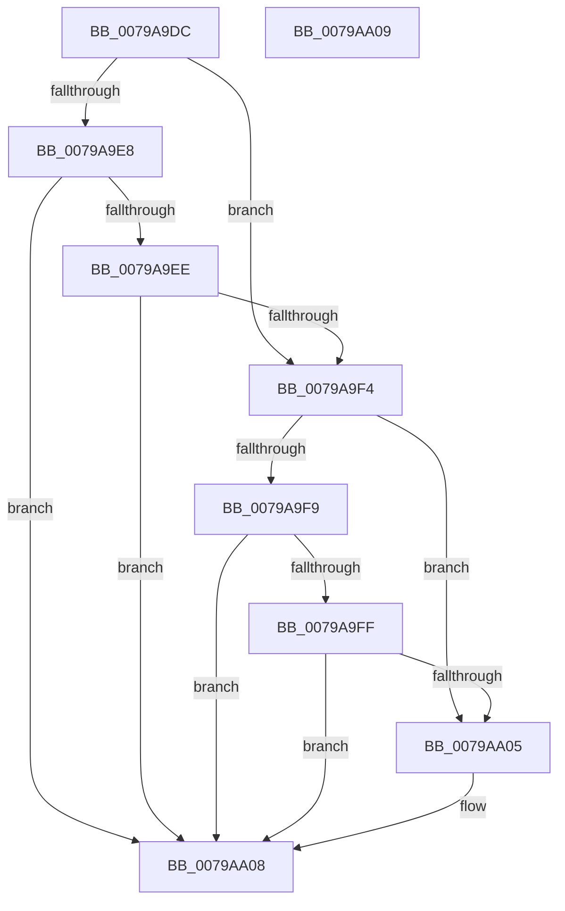

# RtlpFcIsUpdateModifyingOrAddingFeature

- RVA: `0x0079A9DC`–`0x0079AA0A` (길이 `46` bytes)
- VA: `0x000000014079A9DC`
- 실행 섹션: `PAGE`
- PDB 이름 있음: `예`; PDB Function 태그: `아니요`
- unwind 정보 RVA: `0x000DB714`
- 디코드: `18`개 명령, `46/46` bytes 표시
- 미해석 바이트: `0` (있으면 어셈블리에 `.byte`로 보존)

> 이 문서는 커널 이미지의 기계어와 PDB 기호를 분석해 생성했습니다. 4번과 5번은 함수 원형과 자료형을 바이너리 사용 방식에서 추정한 C 해석이며 원본 소스 복구 결과는 아닙니다.

## 1. Dependencies

- 직접 호출 지점: **0**; 고유 호출 대상: **0**
- 직접 호출자로 확인된 함수: **2**
- RIP 상대 이미지 참조: **0**

### Outgoing calls
- 직접 디코드된 call 명령이 없습니다.

### Direct callers
- [RtlpFcCreateAndAddFeatureFromUpdate](RtlpFcCreateAndAddFeatureFromUpdate_function_0079A688.md) at `0x0079A697`
- [RtlpFcCalculateRequiredSizeForNewFeatureTable](../AA/RtlpFcCalculateRequiredSizeForNewFeatureTable_function_00AAF250.md) at `0x00AAF2F6`
- [RtlpFcCalculateRequiredSizeForNewFeatureTable](../AA/RtlpFcCalculateRequiredSizeForNewFeatureTable_function_00AAF250.md) at `0x00AAF32E`

### Static image references
- 디코드된 RIP-relative 메모리 참조가 없습니다.

## 2. Other-region calls and transfers

- 다른 실행 섹션으로 향하는 call: **0**
- 별도 외부 분기/꼬리 이동을 확인하지 못했습니다.

## 3. Assembly (complete function range)

```asm
0079A9DC  8B 51 1C                        mov edx, dword ptr [rcx + 0x1c]
0079A9DF  45 33 C0                        xor r8d, r8d
0079A9E2  B0 01                           mov al, 1
0079A9E4  84 D0                           test al, dl
0079A9E6  74 0C                           je 0x14079a9f4
0079A9E8  44 39 41 08                     cmp dword ptr [rcx + 8], r8d
0079A9EC  75 1A                           jne 0x14079aa08
0079A9EE  44 39 41 0C                     cmp dword ptr [rcx + 0xc], r8d
0079A9F2  75 14                           jne 0x14079aa08
0079A9F4  F6 C2 02                        test dl, 2
0079A9F7  74 0C                           je 0x14079aa05
0079A9F9  44 38 41 10                     cmp byte ptr [rcx + 0x10], r8b
0079A9FD  75 09                           jne 0x14079aa08
0079A9FF  44 39 41 14                     cmp dword ptr [rcx + 0x14], r8d
0079AA03  75 03                           jne 0x14079aa08
0079AA05  41 8A C0                        mov al, r8b
0079AA08  C3                              ret
0079AA09  CC                              int3
```

## 4. C-style interpretation (structured pseudocode)

```c
__int64 __fastcall RtlpFcIsUpdateModifyingOrAddingFeature(__int64 a1, __int64 a2, int a3)
{
    __int64 result;

    a3 = 0;
    if (((1) & ((unsigned __int8)((unsigned int)(*(unsigned int *)(a1 + 28))))) == 0) goto loc_0079A9F4;
    if ((*(unsigned int *)(a1 + 8)) != 0) goto loc_0079AA08;
    if ((*(unsigned int *)(a1 + 12)) != 0) goto loc_0079AA08;
loc_0079A9F4:
    if ((((unsigned __int8)((unsigned int)(*(unsigned int *)(a1 + 28)))) & (2)) == 0) goto loc_0079AA05;
    if ((*(unsigned __int8 *)(a1 + 16)) != 0) goto loc_0079AA08;
    result = 1;
    if ((*(unsigned int *)(a1 + 20)) == 0) {
        result = 0;
    }
    return result;
}
```

## 5. (Beta) C Style

```c
int64_t RtlpFcIsUpdateModifyingOrAddingFeature(void *Arg1, int64_t Arg2, int32_t Arg3)
{
    uint8_t *arg1 = (uint8_t *)Arg1;

    int64_t result;

    Arg3 = 0;
    if (((1) & ((uint8_t)((uint32_t)(*(uint32_t *)(arg1 + 0x1C))))) == 0) goto loc_0079A9F4;
    if ((*(uint32_t *)(arg1 + 0x8)) != 0) goto loc_0079AA08;
    if ((*(uint32_t *)(arg1 + 0xC)) != 0) goto loc_0079AA08;
loc_0079A9F4:
    if ((((uint8_t)((uint32_t)(*(uint32_t *)(arg1 + 0x1C)))) & (2)) == 0) goto loc_0079AA05;
    if ((*(uint8_t *)(arg1 + 0x10)) != 0) goto loc_0079AA08;
    result = 1;
    if ((*(uint32_t *)(arg1 + 0x14)) == 0) {
        result = 0;
    }
    return result;
}
```

### 관측된 메모리 오프셋

구조체 형식이 확인되지 않은 접근은 인자 기준의 오프셋으로만 기록했습니다.

| 기준 인자 | 오프셋 표현 | 폭 (bit) | 접근 |
|---|---:|---:|---|
| `Arg1` | `+ 0x8` | `32` | `R` |
| `Arg1` | `+ 0xC` | `32` | `R` |
| `Arg1` | `+ 0x10` | `8` | `R` |
| `Arg1` | `+ 0x14` | `32` | `R` |
| `Arg1` | `+ 0x1C` | `32` | `R` |

## 6. Execution-region graph

[열기: 2D/3D 그래프와 함수 탐색 컨트롤 패널](../../../control-panel.html?section=page&rva=0x0079A9DC&view=graph)

- 2D 그래프는 위에서 아래로 흐르고, 3D 그래프는 빈 공간을 드래그해 회전합니다. Shift+드래그는 이동, 휠은 확대·축소, 함수 노드 선택은 대상 보고서 이동입니다.

### Static fallback


