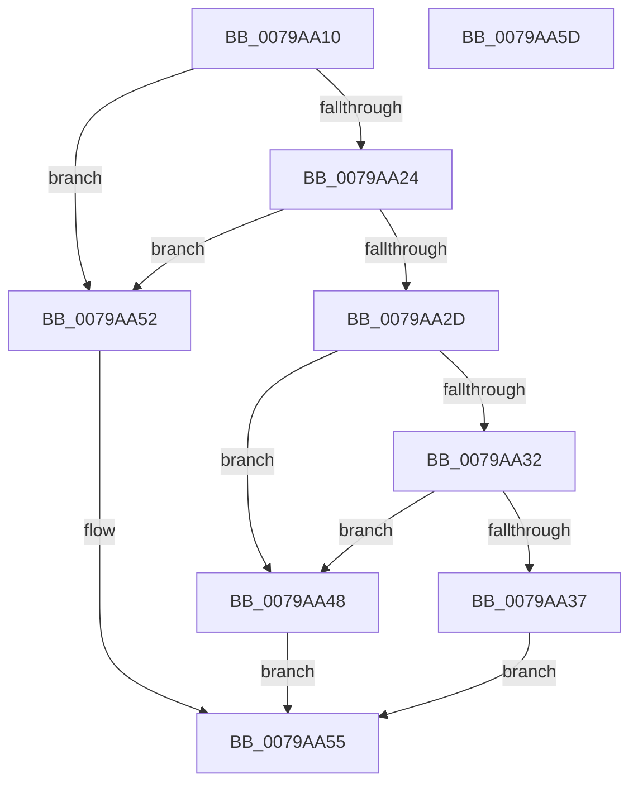

# RtlpFcQueryAllGovernedFeaturesFromBufferSet

- RVA: `0x0079AA10`–`0x0079AA5E` (길이 `78` bytes)
- VA: `0x000000014079AA10`
- 실행 섹션: `PAGE`
- PDB 이름 있음: `예`; PDB Function 태그: `아니요`
- unwind 정보 RVA: `0x0005CF00`
- 디코드: `28`개 명령, `78/78` bytes 표시
- 미해석 바이트: `0` (있으면 어셈블리에 `.byte`로 보존)

> 이 문서는 커널 이미지의 기계어와 PDB 기호를 분석해 생성했습니다. 4번과 5번은 함수 원형과 자료형을 바이너리 사용 방식에서 추정한 C 해석이며 원본 소스 복구 결과는 아닙니다.

## 1. Dependencies

- 직접 호출 지점: **1**; 고유 호출 대상: **1**
- 직접 호출자로 확인된 함수: **1**
- RIP 상대 이미지 참조: **0**

### Outgoing calls
- `0x0079AA41` → [memcpy](../../text/6C/memcpy_function_006C6840.md) (function, `0x006C6840`)

### Direct callers
- [RtlQueryAllInternalRuntimeFeatureConfigurations](../../text/5E/RtlQueryAllInternalRuntimeFeatureConfigurations_function_005E7320.md) at `0x005E73AC`

### Static image references
- 디코드된 RIP-relative 메모리 참조가 없습니다.

## 2. Other-region calls and transfers

- 다른 실행 섹션으로 향하는 call: **1**
  - `0x0079AA41` → [memcpy](../../text/6C/memcpy_function_006C6840.md) (`PAGE` → `.text`)
- 별도 외부 분기/꼬리 이동을 확인하지 못했습니다.

## 3. Assembly (complete function range)

```asm
0079AA10  40 53                           push rbx
0079AA12  48 83 EC 20                     sub rsp, 0x20
0079AA16  4C 8B CA                        mov r9, rdx
0079AA19  33 DB                           xor ebx, ebx
0079AA1B  48 8B 51 50                     mov rdx, qword ptr [rcx + 0x50]
0079AA1F  48 85 D2                        test rdx, rdx
0079AA22  74 2E                           je 0x14079aa52
0079AA24  48 8B 41 58                     mov rax, qword ptr [rcx + 0x58]
0079AA28  48 85 C0                        test rax, rax
0079AA2B  74 25                           je 0x14079aa52
0079AA2D  49 39 00                        cmp qword ptr [r8], rax
0079AA30  72 16                           jb 0x14079aa48
0079AA32  4D 85 C9                        test r9, r9
0079AA35  74 11                           je 0x14079aa48
0079AA37  49 89 00                        mov qword ptr [r8], rax
0079AA3A  4C 8B 41 58                     mov r8, qword ptr [rcx + 0x58]
0079AA3E  49 8B C9                        mov rcx, r9
0079AA41  E8 FA BD F2 FF                  call 0x1406c6840
0079AA46  EB 0D                           jmp 0x14079aa55
0079AA48  49 89 00                        mov qword ptr [r8], rax
0079AA4B  BB 05 00 00 80                  mov ebx, 0x80000005
0079AA50  EB 03                           jmp 0x14079aa55
0079AA52  49 89 18                        mov qword ptr [r8], rbx
0079AA55  8B C3                           mov eax, ebx
0079AA57  48 83 C4 20                     add rsp, 0x20
0079AA5B  5B                              pop rbx
0079AA5C  C3                              ret
0079AA5D  CC                              int3
```

## 4. C-style interpretation (structured pseudocode)

```c
__int64 __fastcall RtlpFcQueryAllGovernedFeaturesFromBufferSet(__int64 a1, __int64 a2, __int64 a3)
{
    __int64 result;
    __int64 v_rbx;
    __int64 v_rsp;

    v_rsp = (v_rsp) - (32);
    v_rbx = 0;
    if (*(unsigned __int64 *)(a1 + 80) == 0) goto loc_0079AA52;
    if (*(unsigned __int64 *)(a1 + 88) == 0) goto loc_0079AA52;
    if ((*(unsigned __int64 *)(a3)) < (*(unsigned __int64 *)(a1 + 88))) goto loc_0079AA48;
    if (a2 == 0) goto loc_0079AA48;
    *(unsigned __int64 *)(a3) = *(unsigned __int64 *)(a1 + 88);
    result = memcpy(a2, *(unsigned __int64 *)(a1 + 80), *(unsigned __int64 *)(a1 + 88), a2);
    goto loc_0079AA55;
loc_0079AA48:
    *(unsigned __int64 *)(*(unsigned __int64 *)(a1 + 88)) = result;
    goto loc_0079AA55;
loc_0079AA52:
    *(unsigned __int64 *)(*(unsigned __int64 *)(a1 + 88)) = (unsigned int)(0x80000005ULL);
loc_0079AA55:
    v_rsp = (v_rsp) + (32);
    return (unsigned int)((unsigned int)((unsigned int)(0x80000005ULL)));
}
```

## 5. (Beta) C Style

```c
int64_t RtlpFcQueryAllGovernedFeaturesFromBufferSet(void *Arg1, int64_t Arg2, void *Arg3)
{
    uint8_t *arg1 = (uint8_t *)Arg1;
    uint8_t *arg3 = (uint8_t *)Arg3;

    int64_t result;
    int64_t local_rbx;
    int64_t local_rsp;

    local_rsp = (local_rsp) - (32);
    local_rbx = 0;
    if (*(uint64_t *)(arg1 + 0x50) == 0) goto loc_0079AA52;
    if (*(uint64_t *)(arg1 + 0x58) == 0) goto loc_0079AA52;
    if ((*(uint64_t *)(arg3)) < (*(uint64_t *)(arg1 + 0x58))) goto loc_0079AA48;
    if (Arg2 == 0) goto loc_0079AA48;
    *(uint64_t *)(arg3) = *(uint64_t *)(arg1 + 0x58);
    result = memcpy(Arg2, *(uint64_t *)(arg1 + 0x50), *(uint64_t *)(arg1 + 0x58), Arg2);
    goto loc_0079AA55;
loc_0079AA48:
    *(uint64_t *)(*(uint64_t *)(arg1 + 0x58)) = result;
    goto loc_0079AA55;
loc_0079AA52:
    *(uint64_t *)(*(uint64_t *)(arg1 + 0x58)) = (uint32_t)(0x80000005ULL);
loc_0079AA55:
    local_rsp = (local_rsp) + (32);
    return (uint32_t)((uint32_t)((uint32_t)(0x80000005ULL)));
}
```

### 관측된 메모리 오프셋

구조체 형식이 확인되지 않은 접근은 인자 기준의 오프셋으로만 기록했습니다.

| 기준 인자 | 오프셋 표현 | 폭 (bit) | 접근 |
|---|---:|---:|---|
| `Arg1` | `+ 0x50` | `64` | `R` |
| `Arg1` | `+ 0x58` | `64` | `R` |
| `Arg3` | `+ 0x0` | `64` | `R` |
| `Arg3` | `+ 0x0` | `64` | `W` |

## 6. Execution-region graph

[열기: 2D/3D 그래프와 함수 탐색 컨트롤 패널](../../../control-panel.html?section=page&rva=0x0079AA10&view=graph)

- 2D 그래프는 위에서 아래로 흐르고, 3D 그래프는 빈 공간을 드래그해 회전합니다. Shift+드래그는 이동, 휠은 확대·축소, 함수 노드 선택은 대상 보고서 이동입니다.

### Static fallback


