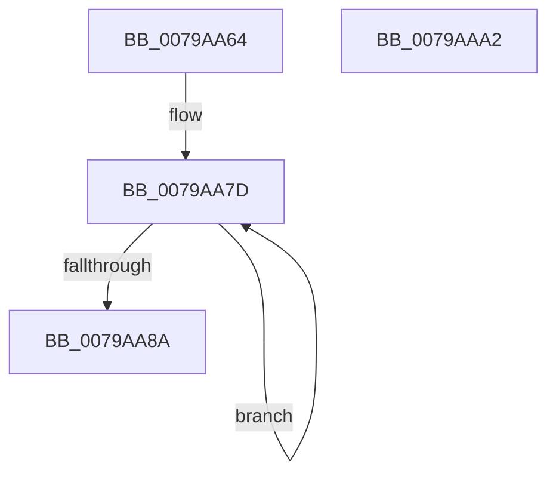

# RtlpFcSectionTypeToBufferType

- RVA: `0x0079AA64`–`0x0079AAA3` (길이 `63` bytes)
- VA: `0x000000014079AA64`
- 실행 섹션: `PAGE`
- PDB 이름 있음: `예`; PDB Function 태그: `아니요`
- unwind 정보 RVA: `0x000BA354`
- 디코드: `19`개 명령, `63/63` bytes 표시
- 미해석 바이트: `0` (있으면 어셈블리에 `.byte`로 보존)

> 이 문서는 커널 이미지의 기계어와 PDB 기호를 분석해 생성했습니다. 4번과 5번은 함수 원형과 자료형을 바이너리 사용 방식에서 추정한 C 해석이며 원본 소스 복구 결과는 아닙니다.

## 1. Dependencies

- 직접 호출 지점: **1**; 고유 호출 대상: **1**
- 직접 호출자로 확인된 함수: **1**
- RIP 상대 이미지 참조: **1**

### Outgoing calls
- `0x0079AA98` → [_security_check_cookie](../../text/6A/_security_check_cookie_function_006AC640.md) (function, `0x006AC640`)

### Direct callers
- [CmFcManagerStartRuntimePhase](../../init/C5/CmFcManagerStartRuntimePhase_function_00C5DC70.md) at `0x00C5DE19`

### Static image references
- `0x0079AA68` → RVA `0x00E0A740` (`.data`; read)

## 2. Other-region calls and transfers

- 다른 실행 섹션으로 향하는 call: **1**
  - `0x0079AA98` → [_security_check_cookie](../../text/6A/_security_check_cookie_function_006AC640.md) (`PAGE` → `.text`)
- 별도 외부 분기/꼬리 이동을 확인하지 못했습니다.

## 3. Assembly (complete function range)

```asm
0079AA64  48 83 EC 28                     sub rsp, 0x28
0079AA68  48 8B 05 D1 FC 66 00            mov rax, qword ptr [rip + 0x66fcd1]
0079AA6F  48 33 C4                        xor rax, rsp
0079AA72  48 89 44 24 10                  mov qword ptr [rsp + 0x10], rax
0079AA77  33 C0                           xor eax, eax
0079AA79  48 8D 14 24                     lea rdx, [rsp]
0079AA7D  89 02                           mov dword ptr [rdx], eax
0079AA7F  FF C0                           inc eax
0079AA81  48 8D 52 04                     lea rdx, [rdx + 4]
0079AA85  83 F8 04                        cmp eax, 4
0079AA88  7C F3                           jl 0x14079aa7d
0079AA8A  48 63 C1                        movsxd rax, ecx
0079AA8D  8B 04 84                        mov eax, dword ptr [rsp + rax*4]
0079AA90  48 8B 4C 24 10                  mov rcx, qword ptr [rsp + 0x10]
0079AA95  48 33 CC                        xor rcx, rsp
0079AA98  E8 A3 1B F1 FF                  call 0x1406ac640
0079AA9D  48 83 C4 28                     add rsp, 0x28
0079AAA1  C3                              ret
0079AAA2  CC                              int3
```

## 4. C-style interpretation (structured pseudocode)

```c
__int64 __fastcall RtlpFcSectionTypeToBufferType(int a1)
{
    __int64 result;
    __int64 v_rsp;
    unsigned __int64 v_stack_m18;
    unsigned __int64 v_stack_m28;

    v_rsp = (v_rsp) - (40);
    result = (*(unsigned __int64 *)(v_rip + 6749393)) ^ (v_rsp);
    v_stack_m18 = result;
    result = 0;
loc_0079AA7D:
    *(unsigned int *)(v_stack_m28) = 0;
    result = (unsigned int)((result) + 1);
    if (((unsigned int)(result)) < 4) goto loc_0079AA7D;
    a1 = (v_stack_m18) ^ (v_rsp);
    result = _security_check_cookie(a1, v_stack_m28 + 4, a3, a4);
    v_rsp = (v_rsp) + (40);
    return result;
}
```

## 5. (Beta) C Style

```c
int64_t RtlpFcSectionTypeToBufferType(int32_t Arg1)
{
    int64_t result;
    int64_t local_rsp;
    uint64_t v_stack_m18;
    uint64_t v_stack_m28;

    local_rsp = (local_rsp) - (40);
    result = (*(uint64_t *)(v_rip + 0x66FCD1)) ^ (local_rsp);
    v_stack_m18 = result;
    result = 0;
loc_0079AA7D:
    *(uint32_t *)(v_stack_m28) = 0;
    result = (uint32_t)((result) + 1);
    if (((uint32_t)(result)) < 4) goto loc_0079AA7D;
    Arg1 = (v_stack_m18) ^ (local_rsp);
    result = _security_check_cookie(Arg1, v_stack_m28 + 4, a3, a4);
    local_rsp = (local_rsp) + (40);
    return result;
}
```

## 6. Execution-region graph

[열기: 2D/3D 그래프와 함수 탐색 컨트롤 패널](../../../control-panel.html?section=page&rva=0x0079AA64&view=graph)

- 2D 그래프는 위에서 아래로 흐르고, 3D 그래프는 빈 공간을 드래그해 회전합니다. Shift+드래그는 이동, 휠은 확대·축소, 함수 노드 선택은 대상 보고서 이동입니다.

### Static fallback


