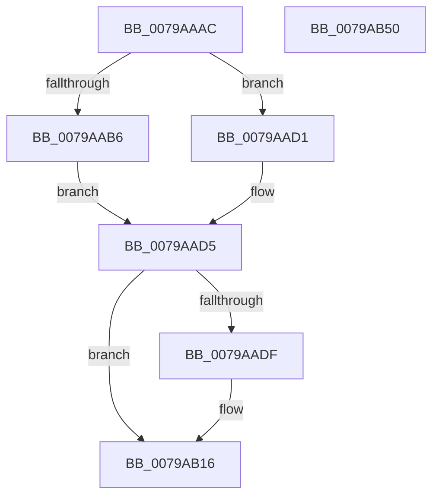

# RtlpFcUpdateFeature

- RVA: `0x0079AAAC`–`0x0079AB51` (길이 `165` bytes)
- VA: `0x000000014079AAAC`
- 실행 섹션: `PAGE`
- PDB 이름 있음: `예`; PDB Function 태그: `아니요`
- unwind 정보 RVA: `0x000DB714`
- 디코드: `52`개 명령, `165/165` bytes 표시
- 미해석 바이트: `0` (있으면 어셈블리에 `.byte`로 보존)

> 이 문서는 커널 이미지의 기계어와 PDB 기호를 분석해 생성했습니다. 4번과 5번은 함수 원형과 자료형을 바이너리 사용 방식에서 추정한 C 해석이며 원본 소스 복구 결과는 아닙니다.

## 1. Dependencies

- 직접 호출 지점: **0**; 고유 호출 대상: **0**
- 직접 호출자로 확인된 함수: **3**
- RIP 상대 이미지 참조: **0**

### Outgoing calls
- 직접 디코드된 call 명령이 없습니다.

### Direct callers
- [RtlpFcApplyUpdateAndAddFeature](RtlpFcApplyUpdateAndAddFeature_function_0079A614.md) at `0x0079A647`
- [RtlpFcCreateAndAddFeatureFromUpdate](RtlpFcCreateAndAddFeatureFromUpdate_function_0079A688.md) at `0x0079A6C6`
- [RtlpFcCalculateRequiredSizeForNewFeatureTable](../AA/RtlpFcCalculateRequiredSizeForNewFeatureTable_function_00AAF250.md) at `0x00AAF2CF`

### Static image references
- 디코드된 RIP-relative 메모리 참조가 없습니다.

## 2. Other-region calls and transfers

- 다른 실행 섹션으로 향하는 call: **0**
- 별도 외부 분기/꼬리 이동을 확인하지 못했습니다.

## 3. Assembly (complete function range)

```asm
0079AAAC  8B 42 1C                        mov eax, dword ptr [rdx + 0x1c]
0079AAAF  4C 8B C9                        mov r9, rcx
0079AAB2  A8 01                           test al, 1
0079AAB4  74 1B                           je 0x14079aad1
0079AAB6  8B 41 04                        mov eax, dword ptr [rcx + 4]
0079AAB9  44 8B 42 08                     mov r8d, dword ptr [rdx + 8]
0079AABD  41 C1 E0 04                     shl r8d, 4
0079AAC1  44 33 C0                        xor r8d, eax
0079AAC4  41 83 E0 30                     and r8d, 0x30
0079AAC8  44 33 C0                        xor r8d, eax
0079AACB  44 89 41 04                     mov dword ptr [rcx + 4], r8d
0079AACF  EB 04                           jmp 0x14079aad5
0079AAD1  44 8B 41 04                     mov r8d, dword ptr [rcx + 4]
0079AAD5  8B 42 1C                        mov eax, dword ptr [rdx + 0x1c]
0079AAD8  45 8B D0                        mov r10d, r8d
0079AADB  A8 02                           test al, 2
0079AADD  74 37                           je 0x14079ab16
0079AADF  0F B6 4A 10                     movzx ecx, byte ptr [rdx + 0x10]
0079AAE3  C1 E1 08                        shl ecx, 8
0079AAE6  41 33 C8                        xor ecx, r8d
0079AAE9  81 E1 00 3F 00 00               and ecx, 0x3f00
0079AAEF  41 33 C8                        xor ecx, r8d
0079AAF2  41 89 49 04                     mov dword ptr [r9 + 4], ecx
0079AAF6  8B 42 18                        mov eax, dword ptr [rdx + 0x18]
0079AAF9  41 89 41 08                     mov dword ptr [r9 + 8], eax
0079AAFD  44 8B 42 14                     mov r8d, dword ptr [rdx + 0x14]
0079AB01  41 C1 E0 0E                     shl r8d, 0xe
0079AB05  44 33 C1                        xor r8d, ecx
0079AB08  41 81 E0 00 C0 00 00            and r8d, 0xc000
0079AB0F  44 33 C1                        xor r8d, ecx
0079AB12  45 89 41 04                     mov dword ptr [r9 + 4], r8d
0079AB16  8B 42 0C                        mov eax, dword ptr [rdx + 0xc]
0079AB19  C1 E0 06                        shl eax, 6
0079AB1C  41 33 C0                        xor eax, r8d
0079AB1F  83 E0 40                        and eax, 0x40
0079AB22  41 33 C0                        xor eax, r8d
0079AB25  41 89 41 04                     mov dword ptr [r9 + 4], eax
0079AB29  41 8B 41 0C                     mov eax, dword ptr [r9 + 0xc]
0079AB2D  8B 4A 10                        mov ecx, dword ptr [rdx + 0x10]
0079AB30  C1 E9 08                        shr ecx, 8
0079AB33  33 C8                           xor ecx, eax
0079AB35  83 E1 01                        and ecx, 1
0079AB38  33 C8                           xor ecx, eax
0079AB3A  41 89 49 0C                     mov dword ptr [r9 + 0xc], ecx
0079AB3E  8B 42 10                        mov eax, dword ptr [rdx + 0x10]
0079AB41  C1 E8 08                        shr eax, 8
0079AB44  33 C1                           xor eax, ecx
0079AB46  83 E0 02                        and eax, 2
0079AB49  33 C1                           xor eax, ecx
0079AB4B  41 89 41 0C                     mov dword ptr [r9 + 0xc], eax
0079AB4F  C3                              ret
0079AB50  CC                              int3
```

## 4. C-style interpretation (structured pseudocode)

```c
__int64 __fastcall RtlpFcUpdateFeature(__int64 a1, __int64 a2)
{
    __int64 result;

    if ((((unsigned __int8)((unsigned int)(*(unsigned int *)(a2 + 28)))) & (1)) == 0) goto loc_0079AAD1;
    a3 = (unsigned int)(((unsigned int)(*(unsigned int *)(a2 + 8))) << (4));
    a3 = (unsigned int)((a3) ^ ((unsigned int)((unsigned int)(*(unsigned int *)(a1 + 4)))));
    a3 = (unsigned int)((a3) & (48));
    a3 = (unsigned int)((a3) ^ ((unsigned int)((unsigned int)(*(unsigned int *)(a1 + 4)))));
    *(unsigned int *)(a1 + 4) = (unsigned int)(a3);
    goto loc_0079AAD5;
loc_0079AAD1:
loc_0079AAD5:
    result = (unsigned int)(*(unsigned int *)(a2 + 28));
    if ((((unsigned __int8)((unsigned int)(*(unsigned int *)(a2 + 28)))) & (2)) != 0) {
        a1 = *(unsigned __int8 *)(a2 + 16);
        a1 = (unsigned int)((a1) << (8));
        a1 = (unsigned int)((a1) ^ ((unsigned int)((unsigned int)(*(unsigned int *)(a1 + 4)))));
        a1 = (unsigned int)((a1) & (0x3F00ULL));
        a1 = (unsigned int)((a1) ^ ((unsigned int)((unsigned int)(*(unsigned int *)(a1 + 4)))));
        *(unsigned int *)(a1 + 4) = (unsigned int)(a1);
        result = *(unsigned int *)(a2 + 24);
        *(unsigned int *)(a1 + 8) = (unsigned int)(result);
        a3 = *(unsigned int *)(a2 + 20);
        a3 = (unsigned int)((a3) << (14));
        a3 = (unsigned int)((a3) ^ ((unsigned int)(a1)));
        a3 = (unsigned int)((a3) & (0xC000ULL));
        a3 = (unsigned int)((a3) ^ ((unsigned int)(a1)));
        *(unsigned int *)(a1 + 4) = (unsigned int)(a3);
    }
    result = (unsigned int)(((unsigned int)(*(unsigned int *)(a2 + 12))) << (6));
    result = (unsigned int)((result) ^ ((unsigned int)(a3)));
    result = (unsigned int)((result) & (64));
    result = (unsigned int)((result) ^ ((unsigned int)(a3)));
    *(unsigned int *)(a1 + 4) = (unsigned int)(result);
    a1 = (unsigned int)(((unsigned int)(*(unsigned int *)(a2 + 16))) >> (8));
    a1 = (unsigned int)((a1) ^ ((unsigned int)((unsigned int)(*(unsigned int *)(a1 + 12)))));
    a1 = (unsigned int)((a1) & (1));
    a1 = (unsigned int)((a1) ^ ((unsigned int)((unsigned int)(*(unsigned int *)(a1 + 12)))));
    *(unsigned int *)(a1 + 12) = (unsigned int)(a1);
    result = (unsigned int)(((unsigned int)(*(unsigned int *)(a2 + 16))) >> (8));
    result = (unsigned int)((result) ^ ((unsigned int)(a1)));
    result = (unsigned int)((result) & (2));
    result = (unsigned int)((result) ^ ((unsigned int)(a1)));
    *(unsigned int *)(a1 + 12) = (unsigned int)(result);
    return result;
}
```

## 5. (Beta) C Style

```c
int64_t RtlpFcUpdateFeature(void *Arg1, void *Arg2)
{
    uint8_t *arg1 = (uint8_t *)Arg1;
    uint8_t *arg2 = (uint8_t *)Arg2;

    int64_t result;

    if ((((uint8_t)((uint32_t)(*(uint32_t *)(arg2 + 0x1C)))) & (1)) == 0) goto loc_0079AAD1;
    a3 = (uint32_t)(((uint32_t)(*(uint32_t *)(arg2 + 0x8))) << (4));
    a3 = (uint32_t)((a3) ^ ((uint32_t)((uint32_t)(*(uint32_t *)(arg1 + 0x4)))));
    a3 = (uint32_t)((a3) & (48));
    a3 = (uint32_t)((a3) ^ ((uint32_t)((uint32_t)(*(uint32_t *)(arg1 + 0x4)))));
    *(uint32_t *)(arg1 + 0x4) = (uint32_t)(a3);
    goto loc_0079AAD5;
loc_0079AAD1:
loc_0079AAD5:
    result = (uint32_t)(*(uint32_t *)(arg2 + 0x1C));
    if ((((uint8_t)((uint32_t)(*(uint32_t *)(arg2 + 0x1C)))) & (2)) != 0) {
        Arg1 = *(uint8_t *)(arg2 + 0x10);
        Arg1 = (uint32_t)((Arg1) << (8));
        Arg1 = (uint32_t)((Arg1) ^ ((uint32_t)((uint32_t)(*(uint32_t *)(arg1 + 0x4)))));
        Arg1 = (uint32_t)((Arg1) & (0x3F00ULL));
        Arg1 = (uint32_t)((Arg1) ^ ((uint32_t)((uint32_t)(*(uint32_t *)(arg1 + 0x4)))));
        *(uint32_t *)(arg1 + 0x4) = (uint32_t)(Arg1);
        result = *(uint32_t *)(arg2 + 0x18);
        *(uint32_t *)(arg1 + 0x8) = (uint32_t)(result);
        a3 = *(uint32_t *)(arg2 + 0x14);
        a3 = (uint32_t)((a3) << (14));
        a3 = (uint32_t)((a3) ^ ((uint32_t)(Arg1)));
        a3 = (uint32_t)((a3) & (0xC000ULL));
        a3 = (uint32_t)((a3) ^ ((uint32_t)(Arg1)));
        *(uint32_t *)(arg1 + 0x4) = (uint32_t)(a3);
    }
    result = (uint32_t)(((uint32_t)(*(uint32_t *)(arg2 + 0xC))) << (6));
    result = (uint32_t)((result) ^ ((uint32_t)(a3)));
    result = (uint32_t)((result) & (64));
    result = (uint32_t)((result) ^ ((uint32_t)(a3)));
    *(uint32_t *)(arg1 + 0x4) = (uint32_t)(result);
    Arg1 = (uint32_t)(((uint32_t)(*(uint32_t *)(arg2 + 0x10))) >> (8));
    Arg1 = (uint32_t)((Arg1) ^ ((uint32_t)((uint32_t)(*(uint32_t *)(arg1 + 0xC)))));
    Arg1 = (uint32_t)((Arg1) & (1));
    Arg1 = (uint32_t)((Arg1) ^ ((uint32_t)((uint32_t)(*(uint32_t *)(arg1 + 0xC)))));
    *(uint32_t *)(arg1 + 0xC) = (uint32_t)(Arg1);
    result = (uint32_t)(((uint32_t)(*(uint32_t *)(arg2 + 0x10))) >> (8));
    result = (uint32_t)((result) ^ ((uint32_t)(Arg1)));
    result = (uint32_t)((result) & (2));
    result = (uint32_t)((result) ^ ((uint32_t)(Arg1)));
    *(uint32_t *)(arg1 + 0xC) = (uint32_t)(result);
    return result;
}
```

### 관측된 메모리 오프셋

구조체 형식이 확인되지 않은 접근은 인자 기준의 오프셋으로만 기록했습니다.

| 기준 인자 | 오프셋 표현 | 폭 (bit) | 접근 |
|---|---:|---:|---|
| `Arg1` | `+ 0x4` | `32` | `R` |
| `Arg1` | `+ 0x4` | `32` | `W` |
| `Arg1` | `+ 0x8` | `32` | `W` |
| `Arg1` | `+ 0xC` | `32` | `R` |
| `Arg1` | `+ 0xC` | `32` | `W` |
| `Arg2` | `+ 0x8` | `32` | `R` |
| `Arg2` | `+ 0xC` | `32` | `R` |
| `Arg2` | `+ 0x10` | `8` | `R` |
| `Arg2` | `+ 0x10` | `32` | `R` |
| `Arg2` | `+ 0x14` | `32` | `R` |
| `Arg2` | `+ 0x18` | `32` | `R` |
| `Arg2` | `+ 0x1C` | `32` | `R` |

## 6. Execution-region graph

[열기: 2D/3D 그래프와 함수 탐색 컨트롤 패널](../../../control-panel.html?section=page&rva=0x0079AAAC&view=graph)

- 2D 그래프는 위에서 아래로 흐르고, 3D 그래프는 빈 공간을 드래그해 회전합니다. Shift+드래그는 이동, 휠은 확대·축소, 함수 노드 선택은 대상 보고서 이동입니다.

### Static fallback


