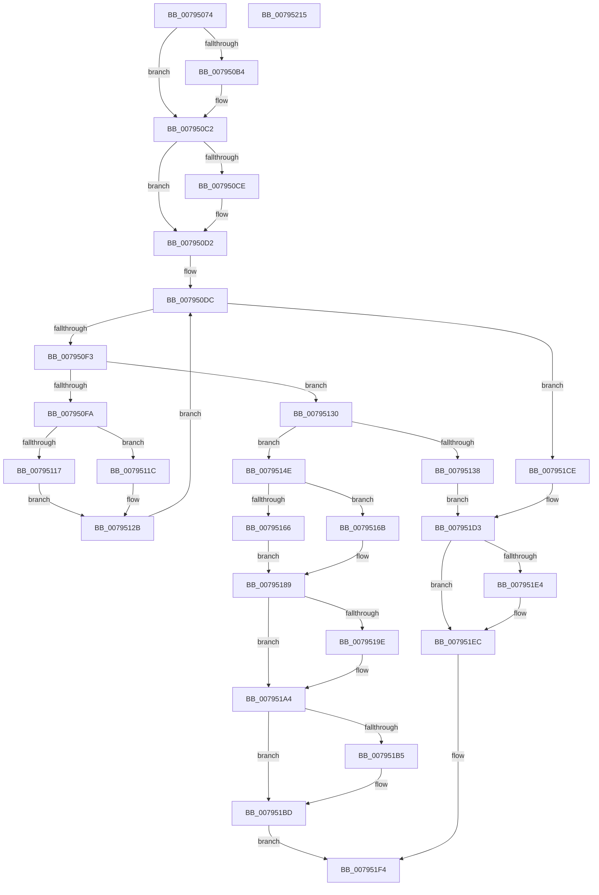

# RtlpFlsAlloc

- RVA: `0x00795074`–`0x00795216` (길이 `418` bytes)
- VA: `0x0000000140795074`
- 실행 섹션: `PAGE`
- PDB 이름 있음: `예`; PDB Function 태그: `아니요`
- unwind 정보 RVA: `0x000847EC`
- 디코드: `114`개 명령, `418/418` bytes 표시
- 미해석 바이트: `0` (있으면 어셈블리에 `.byte`로 보존)

> 이 문서는 커널 이미지의 기계어와 PDB 기호를 분석해 생성했습니다. 4번과 5번은 함수 원형과 자료형을 바이너리 사용 방식에서 추정한 C 해석이며 원본 소스 복구 결과는 아닙니다.

## 1. Dependencies

- 직접 호출 지점: **8**; 고유 호출 대상: **6**
- 직접 호출자로 확인된 함수: **1**
- RIP 상대 이미지 참조: **5**

### Outgoing calls
- `0x007950A3` → [KeAbPreAcquire](../../text/21/KeAbPreAcquire_function_00210230.md) (function, `0x00210230`)
- `0x007950BD` → [ExfAcquirePushLockExclusiveEx](../../text/20/ExfAcquirePushLockExclusiveEx_function_0020FC90.md) (function, `0x0020FC90`)
- `0x007950E3` → [RTL_BINARY_ARRAY<RTLP_FLS_CALLBACK_ENTRY,4,4>::SlotAllocate](../../text/5F/RTL_BINARY_ARRAY_RTLP_FLS_CALLBACK_ENTRY_4_4_SlotAllocate_function_005F0588.md) (function, `0x005F0588`)
- `0x00795144` → [RTL_BINARY_ARRAY<RTLP_FLS_CALLBACK_ENTRY,4,4>::SlotFree](../../text/5F/RTL_BINARY_ARRAY_RTLP_FLS_CALLBACK_ENTRY_4_4_SlotFree_function_005F0660.md) (function, `0x005F0660`)
- `0x007951B8` → [ExfTryToWakePushLock](../../text/26/ExfTryToWakePushLock_function_00265DD0.md) (function, `0x00265DD0`)
- `0x007951C0` → [KeAbPostRelease](../../text/2E/KeAbPostRelease_function_002E1600.md) (function, `0x002E1600`)
- `0x007951E7` → [ExfTryToWakePushLock](../../text/26/ExfTryToWakePushLock_function_00265DD0.md) (function, `0x00265DD0`)
- `0x007951EF` → [KeAbPostRelease](../../text/2E/KeAbPostRelease_function_002E1600.md) (function, `0x002E1600`)

### Direct callers
- [PspTlsAlloc](../78/PspTlsAlloc_function_00787BD8.md) at `0x00787C0D`

### Static image references
- `0x00795094` → RVA `0x00E281C8` (`.data`; read)
- `0x007950DC` → RVA `0x00E281D0` (`.data`; read)
- `0x00795196` → RVA `0x00E281F0` (`.data`; read)
- `0x0079519E` → RVA `0x00E281F0` (`.data`; write)
- `0x007951A4` → RVA `0x00E281C8` (`.data`; read/write)

## 2. Other-region calls and transfers

- 다른 실행 섹션으로 향하는 call: **8**
  - `0x007950A3` → [KeAbPreAcquire](../../text/21/KeAbPreAcquire_function_00210230.md) (`PAGE` → `.text`)
  - `0x007950BD` → [ExfAcquirePushLockExclusiveEx](../../text/20/ExfAcquirePushLockExclusiveEx_function_0020FC90.md) (`PAGE` → `.text`)
  - `0x007950E3` → [RTL_BINARY_ARRAY<RTLP_FLS_CALLBACK_ENTRY,4,4>::SlotAllocate](../../text/5F/RTL_BINARY_ARRAY_RTLP_FLS_CALLBACK_ENTRY_4_4_SlotAllocate_function_005F0588.md) (`PAGE` → `.text`)
  - `0x00795144` → [RTL_BINARY_ARRAY<RTLP_FLS_CALLBACK_ENTRY,4,4>::SlotFree](../../text/5F/RTL_BINARY_ARRAY_RTLP_FLS_CALLBACK_ENTRY_4_4_SlotFree_function_005F0660.md) (`PAGE` → `.text`)
  - `0x007951B8` → [ExfTryToWakePushLock](../../text/26/ExfTryToWakePushLock_function_00265DD0.md) (`PAGE` → `.text`)
  - `0x007951C0` → [KeAbPostRelease](../../text/2E/KeAbPostRelease_function_002E1600.md) (`PAGE` → `.text`)
  - `0x007951E7` → [ExfTryToWakePushLock](../../text/26/ExfTryToWakePushLock_function_00265DD0.md) (`PAGE` → `.text`)
  - `0x007951EF` → [KeAbPostRelease](../../text/2E/KeAbPostRelease_function_002E1600.md) (`PAGE` → `.text`)
- 별도 외부 분기/꼬리 이동을 확인하지 못했습니다.

## 3. Assembly (complete function range)

```asm
00795074  48 8B C4                        mov rax, rsp
00795077  48 89 58 08                     mov qword ptr [rax + 8], rbx
0079507B  48 89 68 10                     mov qword ptr [rax + 0x10], rbp
0079507F  48 89 70 18                     mov qword ptr [rax + 0x18], rsi
00795083  48 89 78 20                     mov qword ptr [rax + 0x20], rdi
00795087  41 54                           push r12
00795089  41 56                           push r14
0079508B  41 57                           push r15
0079508D  48 83 EC 30                     sub rsp, 0x30
00795091  4D 8B F0                        mov r14, r8
00795094  4C 8D 25 2D 31 69 00            lea r12, [rip + 0x69312d]
0079509B  49 8B CC                        mov rcx, r12
0079509E  45 33 C0                        xor r8d, r8d
007950A1  33 D2                           xor edx, edx
007950A3  E8 88 B1 A7 FF                  call 0x140210230
007950A8  F0 49 0F BA 2C 24 00            lock bts qword ptr [r12], 0
007950AF  48 8B D8                        mov rbx, rax
007950B2  73 0E                           jae 0x1407950c2
007950B4  4D 8B C4                        mov r8, r12
007950B7  48 8B D0                        mov rdx, rax
007950BA  49 8B CC                        mov rcx, r12
007950BD  E8 CE AB A7 FF                  call 0x14020fc90
007950C2  33 FF                           xor edi, edi
007950C4  BD 01 00 00 00                  mov ebp, 1
007950C9  48 85 DB                        test rbx, rbx
007950CC  74 04                           je 0x1407950d2
007950CE  40 88 6B 0A                     mov byte ptr [rbx + 0xa], bpl
007950D2  41 BF 08 00 00 00               mov r15d, 8
007950D8  48 83 CB FF                     or rbx, 0xffffffffffffffff
007950DC  48 8D 0D ED 30 69 00            lea rcx, [rip + 0x6930ed]
007950E3  E8 A0 B4 E5 FF                  call 0x1405f0588
007950E8  8B D0                           mov edx, eax
007950EA  83 F8 FF                        cmp eax, -1
007950ED  0F 84 DB 00 00 00               je 0x1407951ce
007950F3  8D 70 F0                        lea esi, [rax - 0x10]
007950F6  85 F6                           test esi, esi
007950F8  75 36                           jne 0x140795130
007950FA  0F BD C8                        bsr ecx, eax
007950FD  44 8B C5                        mov r8d, ebp
00795100  41 D3 E0                        shl r8d, cl
00795103  83 C1 FC                        add ecx, -4
00795106  44 33 C0                        xor r8d, eax
00795109  89 4C 24 20                     mov dword ptr [rsp + 0x20], ecx
0079510D  49 8B 54 CC 08                  mov rdx, qword ptr [r12 + rcx*8 + 8]
00795112  48 85 D2                        test rdx, rdx
00795115  75 05                           jne 0x14079511c
00795117  49 8B C7                        mov rax, r15
0079511A  EB 0F                           jmp 0x14079512b
0079511C  4A 8D 04 85 02 00 00 00         lea rax, [r8*4 + 2]
00795124  49 03 C0                        add rax, r8
00795127  48 8D 04 C2                     lea rax, [rdx + rax*8]
0079512B  48 89 18                        mov qword ptr [rax], rbx
0079512E  EB AC                           jmp 0x1407950dc
00795130  81 FE F0 00 00 00               cmp esi, 0xf0
00795136  72 16                           jb 0x14079514e
00795138  48 8D 0D 91 30 69 00            lea rcx, [rip + 0x693091]
0079513F  BF 17 00 00 C0                  mov edi, 0xc0000017
00795144  E8 17 B5 E5 FF                  call 0x1405f0660
00795149  E9 85 00 00 00                  jmp 0x1407951d3
0079514E  0F BD CA                        bsr ecx, edx
00795151  D3 E5                           shl ebp, cl
00795153  33 EA                           xor ebp, edx
00795155  89 4C 24 24                     mov dword ptr [rsp + 0x24], ecx
00795159  8D 41 FC                        lea eax, [rcx - 4]
0079515C  49 8B 54 C4 08                  mov rdx, qword ptr [r12 + rax*8 + 8]
00795161  48 85 D2                        test rdx, rdx
00795164  75 05                           jne 0x14079516b
00795166  8D 42 10                        lea eax, [rdx + 0x10]
00795169  EB 1E                           jmp 0x140795189
0079516B  48 8D 0C AD 00 00 00 00         lea rcx, [rbp*4]
00795173  48 8D 41 03                     lea rax, [rcx + 3]
00795177  48 03 C5                        add rax, rbp
0079517A  4C 8D 79 02                     lea r15, [rcx + 2]
0079517E  4C 03 FD                        add r15, rbp
00795181  48 8D 04 C2                     lea rax, [rdx + rax*8]
00795185  4E 8D 3C FA                     lea r15, [rdx + r15*8]
00795189  4D 85 F6                        test r14, r14
0079518C  4C 0F 44 F3                     cmove r14, rbx
00795190  4D 89 37                        mov qword ptr [r15], r14
00795193  48 89 38                        mov qword ptr [rax], rdi
00795196  3B 35 54 30 69 00               cmp esi, dword ptr [rip + 0x693054]
0079519C  76 06                           jbe 0x1407951a4
0079519E  89 35 4C 30 69 00               mov dword ptr [rip + 0x69304c], esi
007951A4  F0 48 0F C1 1D 1B 30 69 00      lock xadd qword ptr [rip + 0x69301b], rbx
007951AD  80 E3 06                        and bl, 6
007951B0  80 FB 02                        cmp bl, 2
007951B3  75 08                           jne 0x1407951bd
007951B5  49 8B CC                        mov rcx, r12
007951B8  E8 13 0C AD FF                  call 0x140265dd0
007951BD  49 8B CC                        mov rcx, r12
007951C0  E8 3B C4 B4 FF                  call 0x1402e1600
007951C5  48 8B 44 24 70                  mov rax, qword ptr [rsp + 0x70]
007951CA  89 30                           mov dword ptr [rax], esi
007951CC  EB 26                           jmp 0x1407951f4
007951CE  BF 17 00 00 C0                  mov edi, 0xc0000017
007951D3  F0 48 0F C1 1D EC 2F 69 00      lock xadd qword ptr [rip + 0x692fec], rbx
007951DC  80 E3 06                        and bl, 6
007951DF  80 FB 02                        cmp bl, 2
007951E2  75 08                           jne 0x1407951ec
007951E4  49 8B CC                        mov rcx, r12
007951E7  E8 E4 0B AD FF                  call 0x140265dd0
007951EC  49 8B CC                        mov rcx, r12
007951EF  E8 0C C4 B4 FF                  call 0x1402e1600
007951F4  48 8B 5C 24 50                  mov rbx, qword ptr [rsp + 0x50]
007951F9  8B C7                           mov eax, edi
007951FB  48 8B 7C 24 68                  mov rdi, qword ptr [rsp + 0x68]
00795200  48 8B 6C 24 58                  mov rbp, qword ptr [rsp + 0x58]
00795205  48 8B 74 24 60                  mov rsi, qword ptr [rsp + 0x60]
0079520A  48 83 C4 30                     add rsp, 0x30
0079520E  41 5F                           pop r15
00795210  41 5E                           pop r14
00795212  41 5C                           pop r12
00795214  C3                              ret
00795215  CC                              int3
```

## 4. C-style interpretation (structured pseudocode)

```c
__int64 __fastcall RtlpFlsAlloc(__int64 a1, int a2, __int64 a3, __int64 a4, __int64 a5)
{
    __int64 result;
    __int64 v_r15;
    __int64 v_rbp;
    __int64 v_rbx;
    __int64 v_rdi;
    __int64 v_rsp;
    unsigned int v_stack_m24;
    unsigned int v_stack_m28;
    unsigned __int64 v_stack_p10;
    unsigned __int64 v_stack_p18;
    unsigned __int64 v_stack_p20;
    unsigned __int64 v_stack_p8;

    *(unsigned __int64 *)(v_rsp + 8) = v_rbx;
    *(unsigned __int64 *)(v_rsp + 16) = v_rbp;
    *(unsigned __int64 *)(v_rsp + 24) = v_rsi;
    *(unsigned __int64 *)(v_rsp + 32) = v_rdi;
    v_rsp = (v_rsp) - (48);
    a3 = 0;
    a2 = 0;
    result = KeAbPreAcquire(v_rip + 6893869, a2, a3, a4);
    if (!(condition_is_above_or_equal)) {
        a3 = v_rip + 6893869;
        a2 = result;
        a1 = v_rip + 6893869;
        result = ExfAcquirePushLockExclusiveEx(a1, a2, a3, a4);
    }
    v_rdi = 0;
    if (result != 0) {
        *(unsigned __int8 *)(result + 10) = 1;
    }
    v_rbx = (result) | (-1);
loc_007950DC:
    result = RTL_BINARY_ARRAY_RTLP_FLS_CALLBACK_ENTRY_4_4___SlotAllocate(v_rip + 6893805, a2, a3, a4);
    if (((unsigned int)(result)) == -1) goto loc_007951CE;
    if ((unsigned int)(result - 16) != 0) goto loc_00795130;
    a3 = (unsigned int)((1) << ((unsigned __int8)(v_rip + 6893805)));
    a1 = (unsigned int)((v_rip + 6893805) + (-4));
    a3 = (unsigned int)((a3) ^ ((unsigned int)(result)));
    v_stack_m28 = (unsigned int)(a1);
    if (*(unsigned __int64 *)(v_rip + 6893869 + a1 * 8 + 8) != 0) goto loc_0079511C;
    goto loc_0079512B;
loc_0079511C:
    result = (a3 * 4 + 2) + (a3);
loc_0079512B:
    *(unsigned __int64 *)(*(unsigned __int64 *)(v_rip + 6893869 + a1 * 8 + 8) + result * 8) = v_rbx;
    goto loc_007950DC;
loc_00795130:
    if (((unsigned int)(result - 16)) < 240) goto loc_0079514E;
    result = RTL_BINARY_ARRAY_RTLP_FLS_CALLBACK_ENTRY_4_4___SlotFree(v_rip + 6893713, *(unsigned __int64 *)(v_rip + 6893869 + a1 * 8 + 8), a3, a4);
    goto loc_007951D3;
loc_0079514E:
    v_rbp = (unsigned int)((1) << ((unsigned __int8)(v_rip + 6893713)));
    v_rbp = (unsigned int)((v_rbp) ^ ((unsigned int)(*(unsigned __int64 *)(v_rip + 6893869 + a1 * 8 + 8))));
    v_stack_m24 = (unsigned int)(v_rip + 6893713);
    if (*(unsigned __int64 *)(v_rip + 6893869 + v_rip + 6893713 - 4 * 8 + 8) != 0) goto loc_0079516B;
    goto loc_00795189;
loc_0079516B:
    result = (v_rbp * 4 + 3) + (v_rbp);
    v_r15 = (v_rbp * 4 + 2) + (v_rbp);
loc_00795189:
    if (a3 == 0) { a3 = v_rbx; }
    *(unsigned __int64 *)(*(unsigned __int64 *)(v_rip + 6893869 + v_rip + 6893713 - 4 * 8 + 8) + v_r15 * 8) = a3;
    *(unsigned __int64 *)(*(unsigned __int64 *)(v_rip + 6893869 + v_rip + 6893713 - 4 * 8 + 8) + result * 8) = (unsigned int)(0xC0000017ULL);
    if (((unsigned int)(result - 16)) >= = (*(unsigned int *)(v_rip + 6893652))) {
        *(unsigned int *)(v_rip + 6893644) = (unsigned int)(result - 16);
    }
    v_rbx = (unsigned __int8)((v_rbx) & (6));
    result = *(unsigned __int64 *)(v_rip + 6893869 + v_rip + 6893713 - 4 * 8 + 8) + result * 8;
    if (((unsigned __int8)(v_rbx)) == 2) {
        a1 = v_rip + 6893869;
        result = ExfTryToWakePushLock(a1, *(unsigned __int64 *)(v_rip + 6893869 + v_rip + 6893713 - 4 * 8 + 8), a3, a4);
    }
    result = KeAbPostRelease(v_rip + 6893869, *(unsigned __int64 *)(v_rip + 6893869 + v_rip + 6893713 - 4 * 8 + 8), a3, a4);
    *(unsigned int *)(a5) = (unsigned int)(result - 16);
    goto loc_007951F4;
loc_007951CE:
loc_007951D3:
    v_rbx = (unsigned __int8)((v_rbx) & (6));
    result = a5;
    if (((unsigned __int8)(v_rbx)) == 2) {
        a1 = v_rip + 6893869;
        result = ExfTryToWakePushLock(a1, *(unsigned __int64 *)(v_rip + 6893869 + v_rip + 6893713 - 4 * 8 + 8), a3, a4);
    }
    result = KeAbPostRelease(v_rip + 6893869, *(unsigned __int64 *)(v_rip + 6893869 + v_rip + 6893713 - 4 * 8 + 8), a3, a4);
loc_007951F4:
    v_rsp = (v_rsp) + (48);
    return (unsigned int)((unsigned int)((unsigned int)(0xC0000017ULL)));
}
```

## 5. (Beta) C Style

```c
int64_t RtlpFlsAlloc(int64_t Arg1, int32_t Arg2, int64_t Arg3, int64_t Arg4, void *Arg5)
{
    uint8_t *arg5 = (uint8_t *)Arg5;

    int64_t result;
    int64_t local_r15;
    int64_t local_rbp;
    int64_t local_rbx;
    int64_t local_rdi;
    int64_t local_rsp;
    uint32_t v_stack_m24;
    uint32_t v_stack_m28;
    uint64_t v_stack_p10;
    uint64_t v_stack_p18;
    uint64_t v_stack_p20;
    uint64_t v_stack_p8;

    *(uint64_t *)(local_rsp + 0x8) = local_rbx;
    *(uint64_t *)(local_rsp + 0x10) = local_rbp;
    *(uint64_t *)(local_rsp + 0x18) = local_rsi;
    *(uint64_t *)(local_rsp + 0x20) = local_rdi;
    local_rsp = (local_rsp) - (48);
    Arg3 = 0;
    Arg2 = 0;
    result = KeAbPreAcquire(v_rip + 6893869, Arg2, Arg3, Arg4);
    if (!(condition_is_above_or_equal)) {
        Arg3 = v_rip + 6893869;
        Arg2 = result;
        Arg1 = v_rip + 6893869;
        result = ExfAcquirePushLockExclusiveEx(Arg1, Arg2, Arg3, Arg4);
    }
    local_rdi = 0;
    if (result != 0) {
        *(uint8_t *)(result + 0xA) = 1;
    }
    local_rbx = (result) | (-1);
loc_007950DC:
    result = RTL_BINARY_ARRAY_RTLP_FLS_CALLBACK_ENTRY_4_4___SlotAllocate(v_rip + 6893805, Arg2, Arg3, Arg4);
    if (((uint32_t)(result)) == -1) goto loc_007951CE;
    if ((uint32_t)(result - 16) != 0) goto loc_00795130;
    Arg3 = (uint32_t)((1) << ((uint8_t)(v_rip + 6893805)));
    Arg1 = (uint32_t)((v_rip + 6893805) + (-4));
    Arg3 = (uint32_t)((Arg3) ^ ((uint32_t)(result)));
    v_stack_m28 = (uint32_t)(Arg1);
    if (*(uint64_t *)(v_rip + 0x69312D + Arg1 * 8 + 0x8) != 0) goto loc_0079511C;
    goto loc_0079512B;
loc_0079511C:
    result = (Arg3 * 4 + 2) + (Arg3);
loc_0079512B:
    *(uint64_t *)(*(uint64_t *)(v_rip + 0x69312D + Arg1 * 8 + 0x8) + result * 8) = local_rbx;
    goto loc_007950DC;
loc_00795130:
    if (((uint32_t)(result - 16)) < 240) goto loc_0079514E;
    result = RTL_BINARY_ARRAY_RTLP_FLS_CALLBACK_ENTRY_4_4___SlotFree(v_rip + 6893713, *(uint64_t *)(v_rip + 0x69312D + Arg1 * 8 + 0x8), Arg3, Arg4);
    goto loc_007951D3;
loc_0079514E:
    local_rbp = (uint32_t)((1) << ((uint8_t)(v_rip + 6893713)));
    local_rbp = (uint32_t)((local_rbp) ^ ((uint32_t)(*(uint64_t *)(v_rip + 0x69312D + Arg1 * 8 + 0x8))));
    v_stack_m24 = (uint32_t)(v_rip + 6893713);
    if (*(uint64_t *)(v_rip + 0x69312D + v_rip + 0x693091 - 0x4 * 8 + 0x8) != 0) goto loc_0079516B;
    goto loc_00795189;
loc_0079516B:
    result = (local_rbp * 4 + 3) + (local_rbp);
    local_r15 = (local_rbp * 4 + 2) + (local_rbp);
loc_00795189:
    if (Arg3 == 0) { Arg3 = local_rbx; }
    *(uint64_t *)(*(uint64_t *)(v_rip + 0x69312D + v_rip + 0x693091 - 0x4 * 8 + 0x8) + local_r15 * 8) = Arg3;
    *(uint64_t *)(*(uint64_t *)(v_rip + 0x69312D + v_rip + 0x693091 - 0x4 * 8 + 0x8) + result * 8) = (uint32_t)(0xC0000017ULL);
    if (((uint32_t)(result - 16)) >= = (*(uint32_t *)(v_rip + 0x693054))) {
        *(uint32_t *)(v_rip + 0x69304C) = (uint32_t)(result - 16);
    }
    local_rbx = (uint8_t)((local_rbx) & (6));
    result = *(uint64_t *)(v_rip + 0x69312D + v_rip + 0x693091 - 0x4 * 8 + 0x8) + result * 8;
    if (((uint8_t)(local_rbx)) == 2) {
        Arg1 = v_rip + 6893869;
        result = ExfTryToWakePushLock(Arg1, *(uint64_t *)(v_rip + 0x69312D + v_rip + 0x693091 - 0x4 * 8 + 0x8), Arg3, Arg4);
    }
    result = KeAbPostRelease(v_rip + 6893869, *(uint64_t *)(v_rip + 0x69312D + v_rip + 0x693091 - 0x4 * 8 + 0x8), Arg3, Arg4);
    *(uint32_t *)(arg5) = (uint32_t)(result - 16);
    goto loc_007951F4;
loc_007951CE:
loc_007951D3:
    local_rbx = (uint8_t)((local_rbx) & (6));
    result = Arg5;
    if (((uint8_t)(local_rbx)) == 2) {
        Arg1 = v_rip + 6893869;
        result = ExfTryToWakePushLock(Arg1, *(uint64_t *)(v_rip + 0x69312D + v_rip + 0x693091 - 0x4 * 8 + 0x8), Arg3, Arg4);
    }
    result = KeAbPostRelease(v_rip + 6893869, *(uint64_t *)(v_rip + 0x69312D + v_rip + 0x693091 - 0x4 * 8 + 0x8), Arg3, Arg4);
loc_007951F4:
    local_rsp = (local_rsp) + (48);
    return (uint32_t)((uint32_t)((uint32_t)(0xC0000017ULL)));
}
```

### 관측된 메모리 오프셋

구조체 형식이 확인되지 않은 접근은 인자 기준의 오프셋으로만 기록했습니다.

| 기준 인자 | 오프셋 표현 | 폭 (bit) | 접근 |
|---|---:|---:|---|
| `Arg5` | `+ 0x0` | `32` | `W` |

## 6. Execution-region graph

[열기: 2D/3D 그래프와 함수 탐색 컨트롤 패널](../../../control-panel.html?section=page&rva=0x00795074&view=graph)

- 2D 그래프는 위에서 아래로 흐르고, 3D 그래프는 빈 공간을 드래그해 회전합니다. Shift+드래그는 이동, 휠은 확대·축소, 함수 노드 선택은 대상 보고서 이동입니다.

### Static fallback


