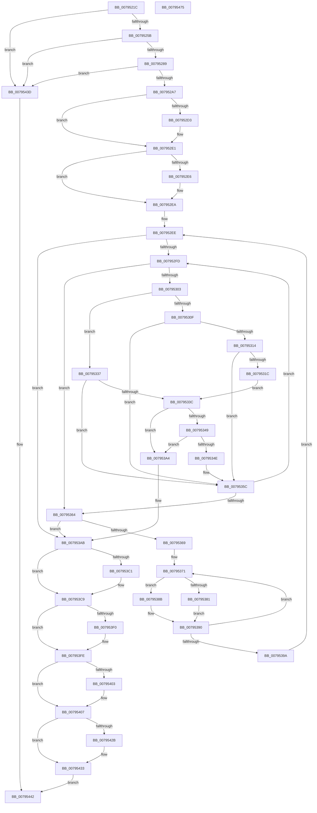

# RtlpFlsFree

- RVA: `0x0079521C`–`0x00795476` (길이 `602` bytes)
- VA: `0x000000014079521C`
- 실행 섹션: `PAGE`
- PDB 이름 있음: `예`; PDB Function 태그: `아니요`
- unwind 정보 RVA: `0x000D01A4`
- 디코드: `166`개 명령, `602/602` bytes 표시
- 미해석 바이트: `0` (있으면 어셈블리에 `.byte`로 보존)

> 이 문서는 커널 이미지의 기계어와 PDB 기호를 분석해 생성했습니다. 4번과 5번은 함수 원형과 자료형을 바이너리 사용 방식에서 추정한 C 해석이며 원본 소스 복구 결과는 아닙니다.

## 1. Dependencies

- 직접 호출 지점: **12**; 고유 호출 대상: **7**
- 직접 호출자로 확인된 함수: **1**
- RIP 상대 이미지 참조: **4**

### Outgoing calls
- `0x007952C3` → [KeAbPreAcquire](../../text/21/KeAbPreAcquire_function_00210230.md) (function, `0x00210230`)
- `0x007952DC` → [ExfAcquirePushLockExclusiveEx](../../text/20/ExfAcquirePushLockExclusiveEx_function_0020FC90.md) (function, `0x0020FC90`)
- `0x00795384` → [guard_dispatch_icall](../../text/6B/guard_dispatch_icall_function_006BAAD0.md) (function, `0x006BAAD0`)
- `0x0079538B` → [guard_dispatch_icall](../../text/6B/guard_dispatch_icall_function_006BAAD0.md) (function, `0x006BAAD0`)
- `0x007953C4` → [ExfTryToWakePushLock](../../text/26/ExfTryToWakePushLock_function_00265DD0.md) (function, `0x00265DD0`)
- `0x007953CC` → [KeAbPostRelease](../../text/2E/KeAbPostRelease_function_002E1600.md) (function, `0x002E1600`)
- `0x007953E0` → [KeAbPreAcquire](../../text/21/KeAbPreAcquire_function_00210230.md) (function, `0x00210230`)
- `0x007953F9` → [ExfAcquirePushLockExclusiveEx](../../text/20/ExfAcquirePushLockExclusiveEx_function_0020FC90.md) (function, `0x0020FC90`)
- `0x00795415` → [RTL_BINARY_ARRAY<RTLP_FLS_CALLBACK_ENTRY,4,4>::SlotFree](../../text/5F/RTL_BINARY_ARRAY_RTLP_FLS_CALLBACK_ENTRY_4_4_SlotFree_function_005F0660.md) (function, `0x005F0660`)
- `0x0079542E` → [ExfTryToWakePushLock](../../text/26/ExfTryToWakePushLock_function_00265DD0.md) (function, `0x00265DD0`)
- `0x00795436` → [KeAbPostRelease](../../text/2E/KeAbPostRelease_function_002E1600.md) (function, `0x002E1600`)
- `0x0079544F` → [_security_check_cookie](../../text/6A/_security_check_cookie_function_006AC640.md) (function, `0x006AC640`)

### Direct callers
- [PsTlsFree](../78/PsTlsFree_function_00787BA0.md) at `0x00787BB7`

### Static image references
- `0x0079523B` → RVA `0x00E0A740` (`.data`; read)
- `0x0079526A` → RVA `0x00E281C8` (`.data`; read)
- `0x0079540E` → RVA `0x00E281D0` (`.data`; read)
- `0x0079541A` → RVA `0x00E281C8` (`.data`; read/write)

## 2. Other-region calls and transfers

- 다른 실행 섹션으로 향하는 call: **12**
  - `0x007952C3` → [KeAbPreAcquire](../../text/21/KeAbPreAcquire_function_00210230.md) (`PAGE` → `.text`)
  - `0x007952DC` → [ExfAcquirePushLockExclusiveEx](../../text/20/ExfAcquirePushLockExclusiveEx_function_0020FC90.md) (`PAGE` → `.text`)
  - `0x00795384` → [guard_dispatch_icall](../../text/6B/guard_dispatch_icall_function_006BAAD0.md) (`PAGE` → `.text`)
  - `0x0079538B` → [guard_dispatch_icall](../../text/6B/guard_dispatch_icall_function_006BAAD0.md) (`PAGE` → `.text`)
  - `0x007953C4` → [ExfTryToWakePushLock](../../text/26/ExfTryToWakePushLock_function_00265DD0.md) (`PAGE` → `.text`)
  - `0x007953CC` → [KeAbPostRelease](../../text/2E/KeAbPostRelease_function_002E1600.md) (`PAGE` → `.text`)
  - `0x007953E0` → [KeAbPreAcquire](../../text/21/KeAbPreAcquire_function_00210230.md) (`PAGE` → `.text`)
  - `0x007953F9` → [ExfAcquirePushLockExclusiveEx](../../text/20/ExfAcquirePushLockExclusiveEx_function_0020FC90.md) (`PAGE` → `.text`)
  - `0x00795415` → [RTL_BINARY_ARRAY<RTLP_FLS_CALLBACK_ENTRY,4,4>::SlotFree](../../text/5F/RTL_BINARY_ARRAY_RTLP_FLS_CALLBACK_ENTRY_4_4_SlotFree_function_005F0660.md) (`PAGE` → `.text`)
  - `0x0079542E` → [ExfTryToWakePushLock](../../text/26/ExfTryToWakePushLock_function_00265DD0.md) (`PAGE` → `.text`)
  - `0x00795436` → [KeAbPostRelease](../../text/2E/KeAbPostRelease_function_002E1600.md) (`PAGE` → `.text`)
  - `0x0079544F` → [_security_check_cookie](../../text/6A/_security_check_cookie_function_006AC640.md) (`PAGE` → `.text`)
- 별도 외부 분기/꼬리 이동을 확인하지 못했습니다.

## 3. Assembly (complete function range)

```asm
0079521C  48 89 5C 24 08                  mov qword ptr [rsp + 8], rbx
00795221  48 89 6C 24 18                  mov qword ptr [rsp + 0x18], rbp
00795226  48 89 74 24 20                  mov qword ptr [rsp + 0x20], rsi
0079522B  57                              push rdi
0079522C  41 54                           push r12
0079522E  41 55                           push r13
00795230  41 56                           push r14
00795232  41 57                           push r15
00795234  48 81 EC C0 01 00 00            sub rsp, 0x1c0
0079523B  48 8B 05 FE 54 67 00            mov rax, qword ptr [rip + 0x6754fe]
00795242  48 33 C4                        xor rax, rsp
00795245  48 89 84 24 B0 01 00 00         mov qword ptr [rsp + 0x1b0], rax
0079524D  8D 42 FF                        lea eax, [rdx - 1]
00795250  3D EE 00 00 00                  cmp eax, 0xee
00795255  0F 87 E2 01 00 00               ja 0x14079543d
0079525B  44 8D 6A 10                     lea r13d, [rdx + 0x10]
0079525F  33 FF                           xor edi, edi
00795261  41 0F BD CD                     bsr ecx, r13d
00795265  8D 57 01                        lea edx, [rdi + 1]
00795268  D3 E2                           shl edx, cl
0079526A  4C 8D 05 57 2F 69 00            lea r8, [rip + 0x692f57]
00795271  41 33 D5                        xor edx, r13d
00795274  89 4C 24 20                     mov dword ptr [rsp + 0x20], ecx
00795278  8D 41 FC                        lea eax, [rcx - 4]
0079527B  4D 8B 44 C0 08                  mov r8, qword ptr [r8 + rax*8 + 8]
00795280  4D 85 C0                        test r8, r8
00795283  0F 84 B4 01 00 00               je 0x14079543d
00795289  8B C2                           mov eax, edx
0079528B  48 8D 34 95 01 00 00 00         lea rsi, [rdx*4 + 1]
00795293  48 03 F0                        add rsi, rax
00795296  49 8D 34 F0                     lea rsi, [r8 + rsi*8]
0079529A  4C 8B 66 08                     mov r12, qword ptr [rsi + 8]
0079529E  4D 85 E4                        test r12, r12
007952A1  0F 84 96 01 00 00               je 0x14079543d
007952A7  4C 8B 76 10                     mov r14, qword ptr [rsi + 0x10]
007952AB  48 83 CB FF                     or rbx, 0xffffffffffffffff
007952AF  4C 3B E3                        cmp r12, rbx
007952B2  4C 89 74 24 28                  mov qword ptr [rsp + 0x28], r14
007952B7  48 8B CE                        mov rcx, rsi
007952BA  4C 0F 44 E7                     cmove r12, rdi
007952BE  45 33 C0                        xor r8d, r8d
007952C1  33 D2                           xor edx, edx
007952C3  E8 68 AF A7 FF                  call 0x140210230
007952C8  F0 48 0F BA 2E 00               lock bts qword ptr [rsi], 0
007952CE  48 8B E8                        mov rbp, rax
007952D1  73 0E                           jae 0x1407952e1
007952D3  4C 8B C6                        mov r8, rsi
007952D6  48 8B D0                        mov rdx, rax
007952D9  48 8B CE                        mov rcx, rsi
007952DC  E8 AF A9 A7 FF                  call 0x14020fc90
007952E1  48 85 ED                        test rbp, rbp
007952E4  74 04                           je 0x1407952ea
007952E6  C6 45 0A 01                     mov byte ptr [rbp + 0xa], 1
007952EA  4C 8D 7E 18                     lea r15, [rsi + 0x18]
007952EE  49 8B 17                        mov rdx, qword ptr [r15]
007952F1  44 8B C7                        mov r8d, edi
007952F4  49 3B D7                        cmp rdx, r15
007952F7  0F 84 AE 00 00 00               je 0x1407953ab
007952FD  41 83 F8 10                     cmp r8d, 0x10
00795301  73 61                           jae 0x140795364
00795303  4C 8B 0A                        mov r9, qword ptr [rdx]
00795306  4C 8D 52 F8                     lea r10, [rdx - 8]
0079530A  4D 85 E4                        test r12, r12
0079530D  74 28                           je 0x140795337
0079530F  4D 85 D2                        test r10, r10
00795312  74 48                           je 0x14079535c
00795314  4D 8B 1A                        mov r11, qword ptr [r10]
00795317  4D 85 DB                        test r11, r11
0079531A  74 40                           je 0x14079535c
0079531C  41 8B C0                        mov eax, r8d
0079531F  41 FF C0                        inc r8d
00795322  48 8D 0C 40                     lea rcx, [rax + rax*2]
00795326  4C 89 64 CC 30                  mov qword ptr [rsp + rcx*8 + 0x30], r12
0079532B  4C 89 74 CC 38                  mov qword ptr [rsp + rcx*8 + 0x38], r14
00795330  4C 89 5C CC 40                  mov qword ptr [rsp + rcx*8 + 0x40], r11
00795335  EB 05                           jmp 0x14079533c
00795337  4D 85 D2                        test r10, r10
0079533A  74 20                           je 0x14079535c
0079533C  49 89 3A                        mov qword ptr [r10], rdi
0079533F  48 8B 42 08                     mov rax, qword ptr [rdx + 8]
00795343  49 39 51 08                     cmp qword ptr [r9 + 8], rdx
00795347  75 5B                           jne 0x1407953a4
00795349  48 39 10                        cmp qword ptr [rax], rdx
0079534C  75 56                           jne 0x1407953a4
0079534E  4C 89 08                        mov qword ptr [rax], r9
00795351  49 89 41 08                     mov qword ptr [r9 + 8], rax
00795355  48 89 52 08                     mov qword ptr [rdx + 8], rdx
00795359  48 89 12                        mov qword ptr [rdx], rdx
0079535C  49 8B D1                        mov rdx, r9
0079535F  4D 3B CF                        cmp r9, r15
00795362  75 99                           jne 0x1407952fd
00795364  45 85 C0                        test r8d, r8d
00795367  74 42                           je 0x1407953ab
00795369  4C 8D 74 24 38                  lea r14, [rsp + 0x38]
0079536E  41 8B E8                        mov ebp, r8d
00795371  49 8B 0E                        mov rcx, qword ptr [r14]
00795374  49 8B 56 08                     mov rdx, qword ptr [r14 + 8]
00795378  49 8B 46 F8                     mov rax, qword ptr [r14 - 8]
0079537C  48 85 C9                        test rcx, rcx
0079537F  75 0A                           jne 0x14079538b
00795381  48 8B CA                        mov rcx, rdx
00795384  E8 47 57 F2 FF                  call 0x1406baad0
00795389  EB 05                           jmp 0x140795390
0079538B  E8 40 57 F2 FF                  call 0x1406baad0
00795390  49 83 C6 18                     add r14, 0x18
00795394  48 83 ED 01                     sub rbp, 1
00795398  75 D7                           jne 0x140795371
0079539A  4C 8B 74 24 28                  mov r14, qword ptr [rsp + 0x28]
0079539F  E9 4A FF FF FF                  jmp 0x1407952ee
007953A4  B9 03 00 00 00                  mov ecx, 3
007953A9  CD 29                           int 0x29
007953AB  48 C7 46 08 FE FF FF FF         mov qword ptr [rsi + 8], 0xfffffffffffffffe
007953B3  48 8B C3                        mov rax, rbx
007953B6  F0 48 0F C1 06                  lock xadd qword ptr [rsi], rax
007953BB  24 06                           and al, 6
007953BD  3C 02                           cmp al, 2
007953BF  75 08                           jne 0x1407953c9
007953C1  48 8B CE                        mov rcx, rsi
007953C4  E8 07 0A AD FF                  call 0x140265dd0
007953C9  48 8B CE                        mov rcx, rsi
007953CC  E8 2F C2 B4 FF                  call 0x1402e1600
007953D1  4C 8D 35 F0 2D 69 00            lea r14, [rip + 0x692df0]
007953D8  45 33 C0                        xor r8d, r8d
007953DB  49 8B CE                        mov rcx, r14
007953DE  33 D2                           xor edx, edx
007953E0  E8 4B AE A7 FF                  call 0x140210230
007953E5  F0 49 0F BA 2E 00               lock bts qword ptr [r14], 0
007953EB  48 8B E8                        mov rbp, rax
007953EE  73 0E                           jae 0x1407953fe
007953F0  4D 8B C6                        mov r8, r14
007953F3  48 8B D0                        mov rdx, rax
007953F6  49 8B CE                        mov rcx, r14
007953F9  E8 92 A8 A7 FF                  call 0x14020fc90
007953FE  48 85 ED                        test rbp, rbp
00795401  74 04                           je 0x140795407
00795403  C6 45 0A 01                     mov byte ptr [rbp + 0xa], 1
00795407  41 8B D5                        mov edx, r13d
0079540A  48 89 7E 08                     mov qword ptr [rsi + 8], rdi
0079540E  48 8D 0D BB 2D 69 00            lea rcx, [rip + 0x692dbb]
00795415  E8 46 B2 E5 FF                  call 0x1405f0660
0079541A  F0 48 0F C1 1D A5 2D 69 00      lock xadd qword ptr [rip + 0x692da5], rbx
00795423  80 E3 06                        and bl, 6
00795426  80 FB 02                        cmp bl, 2
00795429  75 08                           jne 0x140795433
0079542B  49 8B CE                        mov rcx, r14
0079542E  E8 9D 09 AD FF                  call 0x140265dd0
00795433  49 8B CE                        mov rcx, r14
00795436  E8 C5 C1 B4 FF                  call 0x1402e1600
0079543B  EB 05                           jmp 0x140795442
0079543D  BF 0D 00 00 C0                  mov edi, 0xc000000d
00795442  8B C7                           mov eax, edi
00795444  48 8B 8C 24 B0 01 00 00         mov rcx, qword ptr [rsp + 0x1b0]
0079544C  48 33 CC                        xor rcx, rsp
0079544F  E8 EC 71 F1 FF                  call 0x1406ac640
00795454  4C 8D 9C 24 C0 01 00 00         lea r11, [rsp + 0x1c0]
0079545C  49 8B 5B 30                     mov rbx, qword ptr [r11 + 0x30]
00795460  49 8B 6B 40                     mov rbp, qword ptr [r11 + 0x40]
00795464  49 8B 73 48                     mov rsi, qword ptr [r11 + 0x48]
00795468  49 8B E3                        mov rsp, r11
0079546B  41 5F                           pop r15
0079546D  41 5E                           pop r14
0079546F  41 5D                           pop r13
00795471  41 5C                           pop r12
00795473  5F                              pop rdi
00795474  C3                              ret
00795475  CC                              int3
```

## 4. C-style interpretation (structured pseudocode)

```c
__int64 __fastcall RtlpFlsFree(__int64 a1, __int64 a2)
{
    __int64 result;
    __int64 v_r12;
    __int64 v_r14;
    __int64 v_rbp;
    __int64 v_rbx;
    __int64 v_rdi;
    __int64 v_rsi;
    __int64 v_rsp;
    unsigned __int64 v_stack_m1B0;
    unsigned __int64 v_stack_m1C0;
    unsigned int v_stack_m1C8;
    unsigned __int64 v_stack_m28;
    unsigned __int64 v_stack_m38;
    unsigned __int64 v_stack_p18;
    unsigned __int64 v_stack_p20;
    unsigned __int64 v_stack_p8;

    v_stack_p8 = v_rbx;
    v_stack_p18 = v_rbp;
    v_stack_p20 = v_rsi;
    v_rsp = (v_rsp) - (448);
    result = (*(unsigned __int64 *)(v_rip + 6771966)) ^ (v_rsp);
    v_stack_m38 = result;
    if (((unsigned int)(a2 - 1)) > 238) goto loc_0079543D;
    v_rdi = 0;
    a2 = (unsigned int)((v_rdi + 1) << ((unsigned __int8)(a1)));
    a2 = (unsigned int)((a2) ^ ((unsigned int)(a2 + 16)));
    v_stack_m1C8 = (unsigned int)(a1);
    if (*(unsigned __int64 *)(v_rip + 6893399 + a1 - 4 * 8 + 8) == 0) goto loc_0079543D;
    v_rsi = (a2 * 4 + 1) + ((unsigned int)((unsigned int)(a2)));
    if (*(unsigned __int64 *)(*(unsigned __int64 *)(v_rip + 6893399 + a1 - 4 * 8 + 8) + v_rsi * 8 + 8) == 0) goto loc_0079543D;
    v_rbx = (v_rbx) | (-1);
    v_stack_m1C0 = *(unsigned __int64 *)(*(unsigned __int64 *)(v_rip + 6893399 + a1 - 4 * 8 + 8) + v_rsi * 8 + 16);
    v_r12 = *(unsigned __int64 *)(*(unsigned __int64 *)(v_rip + 6893399 + a1 - 4 * 8 + 8) + v_rsi * 8 + 8);
    if ((*(unsigned __int64 *)(*(unsigned __int64 *)(v_rip + 6893399 + a1 - 4 * 8 + 8) + v_rsi * 8 + 8)) == v_rbx) { v_r12 = 0; }
    a3 = 0;
    a2 = 0;
    result = KeAbPreAcquire(*(unsigned __int64 *)(v_rip + 6893399 + a1 - 4 * 8 + 8) + v_rsi * 8, a2, a3, a4);
    if (!(condition_is_above_or_equal)) {
        a3 = *(unsigned __int64 *)(v_rip + 6893399 + a1 - 4 * 8 + 8) + v_rsi * 8;
        a2 = result;
        a1 = *(unsigned __int64 *)(v_rip + 6893399 + a1 - 4 * 8 + 8) + v_rsi * 8;
        result = ExfAcquirePushLockExclusiveEx(a1, a2, a3, a4);
    }
    if (result != 0) {
        *(unsigned __int8 *)(result + 10) = 1;
    }
loc_007952EE:
    if ((*(unsigned __int64 *)(*(unsigned __int64 *)(v_rip + 6893399 + a1 - 4 * 8 + 8) + v_rsi * 8 + 24)) == (*(unsigned __int64 *)(v_rip + 6893399 + a1 - 4 * 8 + 8) + v_rsi * 8 + 24)) goto loc_007953AB;
loc_007952FD:
    if (0 >= 16) goto loc_00795364;
    if (v_r12 == 0) goto loc_00795337;
    if (*(unsigned __int64 *)(*(unsigned __int64 *)(v_rip + 6893399 + a1 - 4 * 8 + 8) + v_rsi * 8 + 24) - 8 == 0) goto loc_0079535C;
    if (*(unsigned __int64 *)(*(unsigned __int64 *)(*(unsigned __int64 *)(v_rip + 6893399 + a1 - 4 * 8 + 8) + v_rsi * 8 + 24) - 8) == 0) goto loc_0079535C;
    a3 = (unsigned int)((0) + 1);
    *(unsigned __int64 *)(v_rsp + 0 + 0 * 2 * 8 + 48) = v_r12;
    *(unsigned __int64 *)(v_rsp + 0 + 0 * 2 * 8 + 56) = *(unsigned __int64 *)(*(unsigned __int64 *)(v_rip + 6893399 + a1 - 4 * 8 + 8) + v_rsi * 8 + 16);
    *(unsigned __int64 *)(v_rsp + 0 + 0 * 2 * 8 + 64) = *(unsigned __int64 *)(*(unsigned __int64 *)(*(unsigned __int64 *)(v_rip + 6893399 + a1 - 4 * 8 + 8) + v_rsi * 8 + 24) - 8);
    goto loc_0079533C;
loc_00795337:
    if (*(unsigned __int64 *)(*(unsigned __int64 *)(v_rip + 6893399 + a1 - 4 * 8 + 8) + v_rsi * 8 + 24) - 8 == 0) goto loc_0079535C;
loc_0079533C:
    *(unsigned __int64 *)(*(unsigned __int64 *)(*(unsigned __int64 *)(v_rip + 6893399 + a1 - 4 * 8 + 8) + v_rsi * 8 + 24) - 8) = 0;
    if ((*(unsigned __int64 *)(*(unsigned __int64 *)(*(unsigned __int64 *)(*(unsigned __int64 *)(v_rip + 6893399 + a1 - 4 * 8 + 8) + v_rsi * 8 + 24)) + 8)) != (*(unsigned __int64 *)(*(unsigned __int64 *)(v_rip + 6893399 + a1 - 4 * 8 + 8) + v_rsi * 8 + 24))) goto loc_007953A4;
    if ((*(unsigned __int64 *)(*(unsigned __int64 *)(*(unsigned __int64 *)(*(unsigned __int64 *)(v_rip + 6893399 + a1 - 4 * 8 + 8) + v_rsi * 8 + 24) + 8))) != (*(unsigned __int64 *)(*(unsigned __int64 *)(v_rip + 6893399 + a1 - 4 * 8 + 8) + v_rsi * 8 + 24))) goto loc_007953A4;
    *(unsigned __int64 *)(*(unsigned __int64 *)(*(unsigned __int64 *)(*(unsigned __int64 *)(v_rip + 6893399 + a1 - 4 * 8 + 8) + v_rsi * 8 + 24) + 8)) = *(unsigned __int64 *)(*(unsigned __int64 *)(*(unsigned __int64 *)(v_rip + 6893399 + a1 - 4 * 8 + 8) + v_rsi * 8 + 24));
    *(unsigned __int64 *)(*(unsigned __int64 *)(*(unsigned __int64 *)(*(unsigned __int64 *)(v_rip + 6893399 + a1 - 4 * 8 + 8) + v_rsi * 8 + 24)) + 8) = *(unsigned __int64 *)(*(unsigned __int64 *)(*(unsigned __int64 *)(v_rip + 6893399 + a1 - 4 * 8 + 8) + v_rsi * 8 + 24) + 8);
    *(unsigned __int64 *)(*(unsigned __int64 *)(*(unsigned __int64 *)(v_rip + 6893399 + a1 - 4 * 8 + 8) + v_rsi * 8 + 24) + 8) = *(unsigned __int64 *)(*(unsigned __int64 *)(v_rip + 6893399 + a1 - 4 * 8 + 8) + v_rsi * 8 + 24);
    *(unsigned __int64 *)(*(unsigned __int64 *)(*(unsigned __int64 *)(v_rip + 6893399 + a1 - 4 * 8 + 8) + v_rsi * 8 + 24)) = *(unsigned __int64 *)(*(unsigned __int64 *)(v_rip + 6893399 + a1 - 4 * 8 + 8) + v_rsi * 8 + 24);
loc_0079535C:
    if ((*(unsigned __int64 *)(*(unsigned __int64 *)(*(unsigned __int64 *)(v_rip + 6893399 + a1 - 4 * 8 + 8) + v_rsi * 8 + 24))) != (*(unsigned __int64 *)(v_rip + 6893399 + a1 - 4 * 8 + 8) + v_rsi * 8 + 24)) goto loc_007952FD;
loc_00795364:
    if ((unsigned int)(a3) == 0) goto loc_007953AB;
loc_00795371:
    if (*(unsigned __int64 *)(v_stack_m1B0) != 0) goto loc_0079538B;
    result = guard_dispatch_icall(*(unsigned __int64 *)(v_stack_m1B0 + 8), *(unsigned __int64 *)(v_stack_m1B0 + 8), a3, *(unsigned __int64 *)(*(unsigned __int64 *)(*(unsigned __int64 *)(v_rip + 6893399 + a1 - 4 * 8 + 8) + v_rsi * 8 + 24)));
    goto loc_00795390;
loc_0079538B:
    result = guard_dispatch_icall(*(unsigned __int64 *)(v_stack_m1B0 + 8), *(unsigned __int64 *)(v_stack_m1B0 + 8), a3, *(unsigned __int64 *)(*(unsigned __int64 *)(*(unsigned __int64 *)(v_rip + 6893399 + a1 - 4 * 8 + 8) + v_rsi * 8 + 24)));
loc_00795390:
    v_r14 = (v_stack_m1B0) + (24);
    v_rbp = ((unsigned int)((unsigned int)(a3))) - (1);
    if (condition_is_not_equal) goto loc_00795371;
    goto loc_007952EE;
loc_007953A4:
loc_007953AB:
    *(unsigned __int64 *)(*(unsigned __int64 *)(v_rip + 6893399 + a1 - 4 * 8 + 8) + v_rsi * 8 + 8) = -2;
    result = (unsigned __int8)((v_rbx) & (6));
    if (((unsigned __int8)(result)) == 2) {
        a1 = *(unsigned __int64 *)(v_rip + 6893399 + a1 - 4 * 8 + 8) + v_rsi * 8;
        result = ExfTryToWakePushLock(a1, *(unsigned __int64 *)(v_stack_m1B0 + 8), a3, *(unsigned __int64 *)(*(unsigned __int64 *)(*(unsigned __int64 *)(v_rip + 6893399 + a1 - 4 * 8 + 8) + v_rsi * 8 + 24)));
    }
    result = KeAbPostRelease(*(unsigned __int64 *)(v_rip + 6893399 + a1 - 4 * 8 + 8) + v_rsi * 8, *(unsigned __int64 *)(v_stack_m1B0 + 8), a3, *(unsigned __int64 *)(*(unsigned __int64 *)(*(unsigned __int64 *)(v_rip + 6893399 + a1 - 4 * 8 + 8) + v_rsi * 8 + 24)));
    a3 = 0;
    a2 = 0;
    result = KeAbPreAcquire(v_rip + 6893040, a2, a3, *(unsigned __int64 *)(*(unsigned __int64 *)(*(unsigned __int64 *)(v_rip + 6893399 + a1 - 4 * 8 + 8) + v_rsi * 8 + 24)));
    if (!(condition_is_above_or_equal)) {
        a3 = v_rip + 6893040;
        a2 = result;
        a1 = v_rip + 6893040;
        result = ExfAcquirePushLockExclusiveEx(a1, a2, a3, *(unsigned __int64 *)(*(unsigned __int64 *)(*(unsigned __int64 *)(v_rip + 6893399 + a1 - 4 * 8 + 8) + v_rsi * 8 + 24)));
    }
    if (result != 0) {
        *(unsigned __int8 *)(result + 10) = 1;
    }
    *(unsigned __int64 *)(*(unsigned __int64 *)(v_rip + 6893399 + a1 - 4 * 8 + 8) + v_rsi * 8 + 8) = 0;
    result = RTL_BINARY_ARRAY_RTLP_FLS_CALLBACK_ENTRY_4_4___SlotFree(v_rip + 6892987, (unsigned int)((unsigned int)(a2 + 16)), a3, *(unsigned __int64 *)(*(unsigned __int64 *)(*(unsigned __int64 *)(v_rip + 6893399 + a1 - 4 * 8 + 8) + v_rsi * 8 + 24)));
    v_rbx = (unsigned __int8)((v_rbx) & (6));
    if (((unsigned __int8)(v_rbx)) == 2) {
        a1 = v_rip + 6893040;
        result = ExfTryToWakePushLock(a1, (unsigned int)((unsigned int)(a2 + 16)), a3, *(unsigned __int64 *)(*(unsigned __int64 *)(*(unsigned __int64 *)(v_rip + 6893399 + a1 - 4 * 8 + 8) + v_rsi * 8 + 24)));
    }
    result = KeAbPostRelease(v_rip + 6893040, (unsigned int)((unsigned int)(a2 + 16)), a3, *(unsigned __int64 *)(*(unsigned __int64 *)(*(unsigned __int64 *)(v_rip + 6893399 + a1 - 4 * 8 + 8) + v_rsi * 8 + 24)));
    goto loc_00795442;
loc_0079543D:
loc_00795442:
    a1 = (v_stack_m38) ^ (v_rsp);
    result = _security_check_cookie(a1, (unsigned int)((unsigned int)(a2 + 16)), a3, *(unsigned __int64 *)(*(unsigned __int64 *)(*(unsigned __int64 *)(v_rip + 6893399 + a1 - 4 * 8 + 8) + v_rsi * 8 + 24)));
    return result;
}
```

## 5. (Beta) C Style

```c
int64_t RtlpFlsFree(int64_t Arg1, void *Arg2)
{
    uint8_t *arg2 = (uint8_t *)Arg2;

    int64_t result;
    int64_t local_r12;
    int64_t local_r14;
    int64_t local_rbp;
    int64_t local_rbx;
    int64_t local_rdi;
    int64_t local_rsi;
    int64_t local_rsp;
    uint64_t v_stack_m1B0;
    uint64_t v_stack_m1C0;
    uint32_t v_stack_m1C8;
    uint64_t v_stack_m28;
    uint64_t v_stack_m38;
    uint64_t v_stack_p18;
    uint64_t v_stack_p20;
    uint64_t v_stack_p8;

    v_stack_p8 = local_rbx;
    v_stack_p18 = local_rbp;
    v_stack_p20 = local_rsi;
    local_rsp = (local_rsp) - (448);
    result = (*(uint64_t *)(v_rip + 0x6754FE)) ^ (local_rsp);
    v_stack_m38 = result;
    if (((uint32_t)(Arg2 - 1)) > 238) goto loc_0079543D;
    local_rdi = 0;
    Arg2 = (uint32_t)((local_rdi + 1) << ((uint8_t)(Arg1)));
    Arg2 = (uint32_t)((Arg2) ^ ((uint32_t)(Arg2 + 16)));
    v_stack_m1C8 = (uint32_t)(Arg1);
    if (*(uint64_t *)(v_rip + 0x692F57 + Arg1 - 0x4 * 8 + 0x8) == 0) goto loc_0079543D;
    local_rsi = (Arg2 * 4 + 1) + ((uint32_t)((uint32_t)(Arg2)));
    if (*(uint64_t *)(*(uint64_t *)(v_rip + 0x692F57 + Arg1 - 0x4 * 8 + 0x8) + local_rsi * 8 + 0x8) == 0) goto loc_0079543D;
    local_rbx = (local_rbx) | (-1);
    v_stack_m1C0 = *(uint64_t *)(*(uint64_t *)(v_rip + 0x692F57 + Arg1 - 0x4 * 8 + 0x8) + local_rsi * 8 + 0x10);
    local_r12 = *(uint64_t *)(*(uint64_t *)(v_rip + 0x692F57 + Arg1 - 0x4 * 8 + 0x8) + local_rsi * 8 + 0x8);
    if ((*(uint64_t *)(*(uint64_t *)(v_rip + 0x692F57 + Arg1 - 0x4 * 8 + 0x8) + local_rsi * 8 + 0x8)) == local_rbx) { local_r12 = 0; }
    a3 = 0;
    Arg2 = 0;
    result = KeAbPreAcquire(*(uint64_t *)(v_rip + 0x692F57 + Arg1 - 0x4 * 8 + 0x8) + local_rsi * 8, Arg2, a3, a4);
    if (!(condition_is_above_or_equal)) {
        a3 = *(uint64_t *)(v_rip + 0x692F57 + Arg1 - 0x4 * 8 + 0x8) + local_rsi * 8;
        Arg2 = result;
        Arg1 = *(uint64_t *)(v_rip + 0x692F57 + Arg1 - 0x4 * 8 + 0x8) + local_rsi * 8;
        result = ExfAcquirePushLockExclusiveEx(Arg1, Arg2, a3, a4);
    }
    if (result != 0) {
        *(uint8_t *)(result + 0xA) = 1;
    }
loc_007952EE:
    if ((*(uint64_t *)(*(uint64_t *)(v_rip + 0x692F57 + Arg1 - 0x4 * 8 + 0x8) + local_rsi * 8 + 0x18)) == (*(uint64_t *)(v_rip + 0x692F57 + Arg1 - 0x4 * 8 + 0x8) + local_rsi * 8 + 24)) goto loc_007953AB;
loc_007952FD:
    if (0 >= 16) goto loc_00795364;
    if (local_r12 == 0) goto loc_00795337;
    if (*(uint64_t *)(*(uint64_t *)(v_rip + 0x692F57 + Arg1 - 0x4 * 8 + 0x8) + local_rsi * 8 + 0x18) - 8 == 0) goto loc_0079535C;
    if (*(uint64_t *)(*(uint64_t *)(*(uint64_t *)(v_rip + 0x692F57 + Arg1 - 0x4 * 8 + 0x8) + local_rsi * 8 + 0x18) - 0x8) == 0) goto loc_0079535C;
    a3 = (uint32_t)((0) + 1);
    *(uint64_t *)(local_rsp + 0x0 + 0x0 * 2 * 8 + 0x30) = local_r12;
    *(uint64_t *)(local_rsp + 0x0 + 0x0 * 2 * 8 + 0x38) = *(uint64_t *)(*(uint64_t *)(v_rip + 0x692F57 + Arg1 - 0x4 * 8 + 0x8) + local_rsi * 8 + 0x10);
    *(uint64_t *)(local_rsp + 0x0 + 0x0 * 2 * 8 + 0x40) = *(uint64_t *)(*(uint64_t *)(*(uint64_t *)(v_rip + 0x692F57 + Arg1 - 0x4 * 8 + 0x8) + local_rsi * 8 + 0x18) - 0x8);
    goto loc_0079533C;
loc_00795337:
    if (*(uint64_t *)(*(uint64_t *)(v_rip + 0x692F57 + Arg1 - 0x4 * 8 + 0x8) + local_rsi * 8 + 0x18) - 8 == 0) goto loc_0079535C;
loc_0079533C:
    *(uint64_t *)(*(uint64_t *)(*(uint64_t *)(v_rip + 0x692F57 + Arg1 - 0x4 * 8 + 0x8) + local_rsi * 8 + 0x18) - 0x8) = 0;
    if ((*(uint64_t *)(*(uint64_t *)(*(uint64_t *)(*(uint64_t *)(v_rip + 0x692F57 + Arg1 - 0x4 * 8 + 0x8) + local_rsi * 8 + 0x18)) + 0x8)) != (*(uint64_t *)(*(uint64_t *)(v_rip + 0x692F57 + Arg1 - 0x4 * 8 + 0x8) + local_rsi * 8 + 0x18))) goto loc_007953A4;
    if ((*(uint64_t *)(*(uint64_t *)(*(uint64_t *)(*(uint64_t *)(v_rip + 0x692F57 + Arg1 - 0x4 * 8 + 0x8) + local_rsi * 8 + 0x18) + 0x8))) != (*(uint64_t *)(*(uint64_t *)(v_rip + 0x692F57 + Arg1 - 0x4 * 8 + 0x8) + local_rsi * 8 + 0x18))) goto loc_007953A4;
    *(uint64_t *)(*(uint64_t *)(*(uint64_t *)(*(uint64_t *)(v_rip + 0x692F57 + Arg1 - 0x4 * 8 + 0x8) + local_rsi * 8 + 0x18) + 0x8)) = *(uint64_t *)(*(uint64_t *)(*(uint64_t *)(v_rip + 0x692F57 + Arg1 - 0x4 * 8 + 0x8) + local_rsi * 8 + 0x18));
    *(uint64_t *)(*(uint64_t *)(*(uint64_t *)(*(uint64_t *)(v_rip + 0x692F57 + Arg1 - 0x4 * 8 + 0x8) + local_rsi * 8 + 0x18)) + 0x8) = *(uint64_t *)(*(uint64_t *)(*(uint64_t *)(v_rip + 0x692F57 + Arg1 - 0x4 * 8 + 0x8) + local_rsi * 8 + 0x18) + 0x8);
    *(uint64_t *)(*(uint64_t *)(*(uint64_t *)(v_rip + 0x692F57 + Arg1 - 0x4 * 8 + 0x8) + local_rsi * 8 + 0x18) + 0x8) = *(uint64_t *)(*(uint64_t *)(v_rip + 0x692F57 + Arg1 - 0x4 * 8 + 0x8) + local_rsi * 8 + 0x18);
    *(uint64_t *)(*(uint64_t *)(*(uint64_t *)(v_rip + 0x692F57 + Arg1 - 0x4 * 8 + 0x8) + local_rsi * 8 + 0x18)) = *(uint64_t *)(*(uint64_t *)(v_rip + 0x692F57 + Arg1 - 0x4 * 8 + 0x8) + local_rsi * 8 + 0x18);
loc_0079535C:
    if ((*(uint64_t *)(*(uint64_t *)(*(uint64_t *)(v_rip + 0x692F57 + Arg1 - 0x4 * 8 + 0x8) + local_rsi * 8 + 0x18))) != (*(uint64_t *)(v_rip + 0x692F57 + Arg1 - 0x4 * 8 + 0x8) + local_rsi * 8 + 24)) goto loc_007952FD;
loc_00795364:
    if ((uint32_t)(a3) == 0) goto loc_007953AB;
loc_00795371:
    if (*(uint64_t *)(v_stack_m1B0) != 0) goto loc_0079538B;
    result = guard_dispatch_icall(*(uint64_t *)(v_stack_m1B0 + 0x8), *(uint64_t *)(v_stack_m1B0 + 0x8), a3, *(uint64_t *)(*(uint64_t *)(*(uint64_t *)(v_rip + 0x692F57 + Arg1 - 0x4 * 8 + 0x8) + local_rsi * 8 + 0x18)));
    goto loc_00795390;
loc_0079538B:
    result = guard_dispatch_icall(*(uint64_t *)(v_stack_m1B0 + 0x8), *(uint64_t *)(v_stack_m1B0 + 0x8), a3, *(uint64_t *)(*(uint64_t *)(*(uint64_t *)(v_rip + 0x692F57 + Arg1 - 0x4 * 8 + 0x8) + local_rsi * 8 + 0x18)));
loc_00795390:
    local_r14 = (v_stack_m1B0) + (24);
    local_rbp = ((uint32_t)((uint32_t)(a3))) - (1);
    if (condition_is_not_equal) goto loc_00795371;
    goto loc_007952EE;
loc_007953A4:
loc_007953AB:
    *(uint64_t *)(*(uint64_t *)(v_rip + 0x692F57 + Arg1 - 0x4 * 8 + 0x8) + local_rsi * 8 + 0x8) = -2;
    result = (uint8_t)((local_rbx) & (6));
    if (((uint8_t)(result)) == 2) {
        Arg1 = *(uint64_t *)(v_rip + 0x692F57 + Arg1 - 0x4 * 8 + 0x8) + local_rsi * 8;
        result = ExfTryToWakePushLock(Arg1, *(uint64_t *)(v_stack_m1B0 + 0x8), a3, *(uint64_t *)(*(uint64_t *)(*(uint64_t *)(v_rip + 0x692F57 + Arg1 - 0x4 * 8 + 0x8) + local_rsi * 8 + 0x18)));
    }
    result = KeAbPostRelease(*(uint64_t *)(v_rip + 0x692F57 + Arg1 - 0x4 * 8 + 0x8) + local_rsi * 8, *(uint64_t *)(v_stack_m1B0 + 0x8), a3, *(uint64_t *)(*(uint64_t *)(*(uint64_t *)(v_rip + 0x692F57 + Arg1 - 0x4 * 8 + 0x8) + local_rsi * 8 + 0x18)));
    a3 = 0;
    Arg2 = 0;
    result = KeAbPreAcquire(v_rip + 6893040, Arg2, a3, *(uint64_t *)(*(uint64_t *)(*(uint64_t *)(v_rip + 0x692F57 + Arg1 - 0x4 * 8 + 0x8) + local_rsi * 8 + 0x18)));
    if (!(condition_is_above_or_equal)) {
        a3 = v_rip + 6893040;
        Arg2 = result;
        Arg1 = v_rip + 6893040;
        result = ExfAcquirePushLockExclusiveEx(Arg1, Arg2, a3, *(uint64_t *)(*(uint64_t *)(*(uint64_t *)(v_rip + 0x692F57 + Arg1 - 0x4 * 8 + 0x8) + local_rsi * 8 + 0x18)));
    }
    if (result != 0) {
        *(uint8_t *)(result + 0xA) = 1;
    }
    *(uint64_t *)(*(uint64_t *)(v_rip + 0x692F57 + Arg1 - 0x4 * 8 + 0x8) + local_rsi * 8 + 0x8) = 0;
    result = RTL_BINARY_ARRAY_RTLP_FLS_CALLBACK_ENTRY_4_4___SlotFree(v_rip + 6892987, (uint32_t)((uint32_t)(Arg2 + 16)), a3, *(uint64_t *)(*(uint64_t *)(*(uint64_t *)(v_rip + 0x692F57 + Arg1 - 0x4 * 8 + 0x8) + local_rsi * 8 + 0x18)));
    local_rbx = (uint8_t)((local_rbx) & (6));
    if (((uint8_t)(local_rbx)) == 2) {
        Arg1 = v_rip + 6893040;
        result = ExfTryToWakePushLock(Arg1, (uint32_t)((uint32_t)(Arg2 + 16)), a3, *(uint64_t *)(*(uint64_t *)(*(uint64_t *)(v_rip + 0x692F57 + Arg1 - 0x4 * 8 + 0x8) + local_rsi * 8 + 0x18)));
    }
    result = KeAbPostRelease(v_rip + 6893040, (uint32_t)((uint32_t)(Arg2 + 16)), a3, *(uint64_t *)(*(uint64_t *)(*(uint64_t *)(v_rip + 0x692F57 + Arg1 - 0x4 * 8 + 0x8) + local_rsi * 8 + 0x18)));
    goto loc_00795442;
loc_0079543D:
loc_00795442:
    Arg1 = (v_stack_m38) ^ (local_rsp);
    result = _security_check_cookie(Arg1, (uint32_t)((uint32_t)(Arg2 + 16)), a3, *(uint64_t *)(*(uint64_t *)(*(uint64_t *)(v_rip + 0x692F57 + Arg1 - 0x4 * 8 + 0x8) + local_rsi * 8 + 0x18)));
    return result;
}
```

### 관측된 메모리 오프셋

구조체 형식이 확인되지 않은 접근은 인자 기준의 오프셋으로만 기록했습니다.

| 기준 인자 | 오프셋 표현 | 폭 (bit) | 접근 |
|---|---:|---:|---|
| `Arg2` | `- 0x1` | `32` | `R` |
| `Arg2` | `+ 0x10` | `32` | `R` |

## 6. Execution-region graph

[열기: 2D/3D 그래프와 함수 탐색 컨트롤 패널](../../../control-panel.html?section=page&rva=0x0079521C&view=graph)

- 2D 그래프는 위에서 아래로 흐르고, 3D 그래프는 빈 공간을 드래그해 회전합니다. Shift+드래그는 이동, 휠은 확대·축소, 함수 노드 선택은 대상 보고서 이동입니다.

### Static fallback


