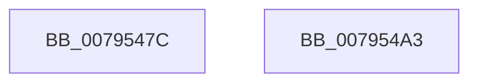

# RtlpFlsInitialize

- RVA: `0x0079547C`–`0x007954A4` (길이 `40` bytes)
- VA: `0x000000014079547C`
- 실행 섹션: `PAGE`
- PDB 이름 있음: `예`; PDB Function 태그: `아니요`
- unwind 정보 RVA: `0x000DB714`
- 디코드: `8`개 명령, `40/40` bytes 표시
- 미해석 바이트: `0` (있으면 어셈블리에 `.byte`로 보존)

> 이 문서는 커널 이미지의 기계어와 PDB 기호를 분석해 생성했습니다. 4번과 5번은 함수 원형과 자료형을 바이너리 사용 방식에서 추정한 C 해석이며 원본 소스 복구 결과는 아닙니다.

## 1. Dependencies

- 직접 호출 지점: **0**; 고유 호출 대상: **0**
- 직접 호출자로 확인된 함수: **1**
- RIP 상대 이미지 참조: **5**

### Outgoing calls
- 직접 디코드된 call 명령이 없습니다.

### Direct callers
- [PspTlsInitialize](../../init/C4/PspTlsInitialize_function_00C46754.md) at `0x00C4675A`

### Static image references
- `0x0079547F` → RVA `0x00E281D8` (`.data`; read)
- `0x00795486` → RVA `0x00E281C8` (`.data`; read)
- `0x0079548D` → RVA `0x00E281E8` (`.data`; read)
- `0x00795494` → RVA `0x00E281D0` (`.data`; read)
- `0x0079549B` → RVA `0x00E281E0` (`.data`; read)

## 2. Other-region calls and transfers

- 다른 실행 섹션으로 향하는 call: **0**
- 별도 외부 분기/꼬리 이동을 확인하지 못했습니다.

## 3. Assembly (complete function range)

```asm
0079547C  0F 57 C0                        xorps xmm0, xmm0
0079547F  0F 11 05 52 2D 69 00            movups xmmword ptr [rip + 0x692d52], xmm0
00795486  0F 11 05 3B 2D 69 00            movups xmmword ptr [rip + 0x692d3b], xmm0
0079548D  0F 11 05 54 2D 69 00            movups xmmword ptr [rip + 0x692d54], xmm0
00795494  0F 11 05 35 2D 69 00            movups xmmword ptr [rip + 0x692d35], xmm0
0079549B  0F 11 05 3E 2D 69 00            movups xmmword ptr [rip + 0x692d3e], xmm0
007954A2  C3                              ret
007954A3  CC                              int3
```

## 4. C-style interpretation (structured pseudocode)

```c
void __fastcall RtlpFlsInitialize(void)
{
    *(unsigned __int64 *)(v_rip + 6892882) = v_xmm0;
    *(unsigned __int64 *)(v_rip + 6892859) = v_xmm0;
    *(unsigned __int64 *)(v_rip + 6892884) = v_xmm0;
    *(unsigned __int64 *)(v_rip + 6892853) = v_xmm0;
    *(unsigned __int64 *)(v_rip + 6892862) = v_xmm0;
    return;
}
```

## 5. (Beta) C Style

```c
void RtlpFlsInitialize(void)
{
    *(uint64_t *)(v_rip + 0x692D52) = v_xmm0;
    *(uint64_t *)(v_rip + 0x692D3B) = v_xmm0;
    *(uint64_t *)(v_rip + 0x692D54) = v_xmm0;
    *(uint64_t *)(v_rip + 0x692D35) = v_xmm0;
    *(uint64_t *)(v_rip + 0x692D3E) = v_xmm0;
    return;
}
```

## 6. Execution-region graph

[열기: 2D/3D 그래프와 함수 탐색 컨트롤 패널](../../../control-panel.html?section=page&rva=0x0079547C&view=graph)

- 2D 그래프는 위에서 아래로 흐르고, 3D 그래프는 빈 공간을 드래그해 회전합니다. Shift+드래그는 이동, 휠은 확대·축소, 함수 노드 선택은 대상 보고서 이동입니다.

### Static fallback


