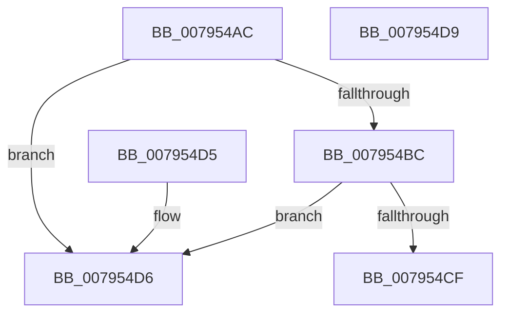

# RtlpGetCapabilityBitmap&lt;_RTL_FUNCTION_OVERRIDE_CAPABILITIES,unsigned char&gt;

- RVA: `0x007954AC`–`0x007954DA` (길이 `46` bytes)
- VA: `0x00000001407954AC`
- 실행 섹션: `PAGE`
- PDB 이름 있음: `예`; PDB Function 태그: `아니요`
- unwind 정보 RVA: `0x000DB714`
- 디코드: `17`개 명령, `46/46` bytes 표시
- 미해석 바이트: `0` (있으면 어셈블리에 `.byte`로 보존)

> 이 문서는 커널 이미지의 기계어와 PDB 기호를 분석해 생성했습니다. 4번과 5번은 함수 원형과 자료형을 바이너리 사용 방식에서 추정한 C 해석이며 원본 소스 복구 결과는 아닙니다.

## 1. Dependencies

- 직접 호출 지점: **0**; 고유 호출 대상: **0**
- 직접 호출자로 확인된 함수: **1**
- RIP 상대 이미지 참조: **0**

### Outgoing calls
- 직접 디코드된 call 명령이 없습니다.

### Direct callers
- [RtlpSetFunctionOverrideCapability](RtlpSetFunctionOverrideCapability_function_00795658.md) at `0x0079566F`

### Static image references
- 디코드된 RIP-relative 메모리 참조가 없습니다.

## 2. Other-region calls and transfers

- 다른 실행 섹션으로 향하는 call: **0**
- 별도 외부 분기/꼬리 이동을 확인하지 못했습니다.

## 3. Assembly (complete function range)

```asm
007954AC  49 83 21 00                     and qword ptr [r9], 0
007954B0  44 8B 11                        mov r10d, dword ptr [rcx]
007954B3  41 81 FA 61 01 00 00            cmp r10d, 0x161
007954BA  73 1A                           jae 0x1407954d6
007954BC  45 84 C0                        test r8b, r8b
007954BF  48 8D 42 2D                     lea rax, [rdx + 0x2d]
007954C3  48 0F 44 C2                     cmove rax, rdx
007954C7  49 89 01                        mov qword ptr [r9], rax
007954CA  48 85 C0                        test rax, rax
007954CD  74 07                           je 0x1407954d6
007954CF  44 89 11                        mov dword ptr [rcx], r10d
007954D2  B0 01                           mov al, 1
007954D4  C3                              ret
007954D5  CC                              int3
007954D6  32 C0                           xor al, al
007954D8  C3                              ret
007954D9  CC                              int3
```

## 4. C-style interpretation (structured pseudocode)

```c
__int64 __fastcall RtlpGetCapabilityBitmap__RTL_FUNCTION_OVERRIDE_CAPABILITIES_unsigned_char_(__int64 a1, __int64 a2, unsigned __int8 a3, __int64 a4)
{
    __int64 result;

    if (((unsigned int)((unsigned int)(*(unsigned int *)(a1)))) >= 353) goto loc_007954D6;
    result = a2 + 45;
    if (a3 == 0) { result = a2; }
    *(unsigned __int64 *)(a4) = result;
    if (result == 0) goto loc_007954D6;
    *(unsigned int *)(a1) = (unsigned int)((unsigned int)(*(unsigned int *)(a1)));
    return 1;
loc_007954D6:
    result = 0;
    return result;
}
```

## 5. (Beta) C Style

```c
int64_t RtlpGetCapabilityBitmap__RTL_FUNCTION_OVERRIDE_CAPABILITIES_unsigned_char_(void *Arg1, void *Arg2, uint8_t Arg3, void *Arg4)
{
    uint8_t *arg1 = (uint8_t *)Arg1;
    uint8_t *arg2 = (uint8_t *)Arg2;
    uint8_t *arg4 = (uint8_t *)Arg4;

    int64_t result;

    if (((uint32_t)((uint32_t)(*(uint32_t *)(arg1)))) >= 353) goto loc_007954D6;
    result = Arg2 + 45;
    if (Arg3 == 0) { result = Arg2; }
    *(uint64_t *)(arg4) = result;
    if (result == 0) goto loc_007954D6;
    *(uint32_t *)(arg1) = (uint32_t)((uint32_t)(*(uint32_t *)(arg1)));
    return 1;
loc_007954D6:
    result = 0;
    return result;
}
```

### 관측된 메모리 오프셋

구조체 형식이 확인되지 않은 접근은 인자 기준의 오프셋으로만 기록했습니다.

| 기준 인자 | 오프셋 표현 | 폭 (bit) | 접근 |
|---|---:|---:|---|
| `Arg1` | `+ 0x0` | `32` | `R` |
| `Arg1` | `+ 0x0` | `32` | `W` |
| `Arg2` | `+ 0x2D` | `64` | `R` |
| `Arg4` | `+ 0x0` | `64` | `R/W` |
| `Arg4` | `+ 0x0` | `64` | `W` |

## 6. Execution-region graph

[열기: 2D/3D 그래프와 함수 탐색 컨트롤 패널](../../../control-panel.html?section=page&rva=0x007954AC&view=graph)

- 2D 그래프는 위에서 아래로 흐르고, 3D 그래프는 빈 공간을 드래그해 회전합니다. Shift+드래그는 이동, 휠은 확대·축소, 함수 노드 선택은 대상 보고서 이동입니다.

### Static fallback


