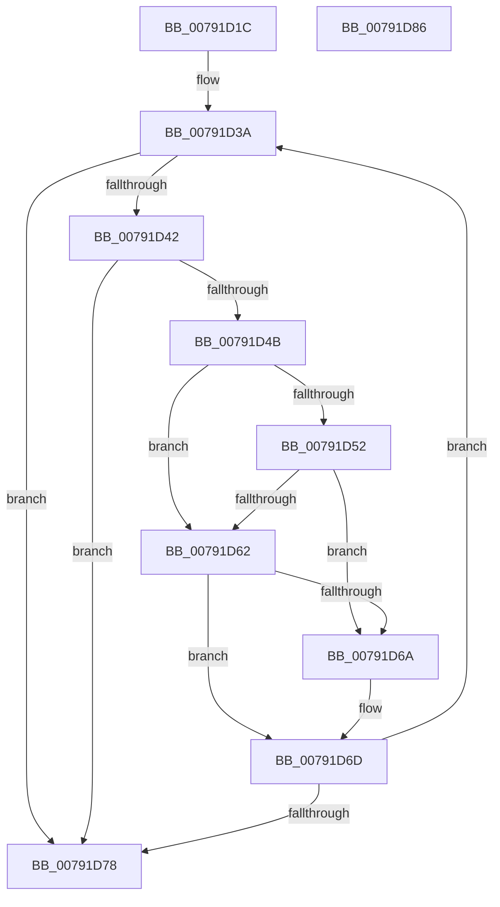

# RtlpGetLastContiguosBase64Position

- RVA: `0x00791D1C`–`0x00791D87` (길이 `107` bytes)
- VA: `0x0000000140791D1C`
- 실행 섹션: `PAGE`
- PDB 이름 있음: `예`; PDB Function 태그: `예`
- unwind 정보 RVA: `0x0005CAAC`
- 디코드: `35`개 명령, `107/107` bytes 표시
- 미해석 바이트: `0` (있으면 어셈블리에 `.byte`로 보존)

> 이 문서는 커널 이미지의 기계어와 PDB 기호를 분석해 생성했습니다. 4번과 5번은 함수 원형과 자료형을 바이너리 사용 방식에서 추정한 C 해석이며 원본 소스 복구 결과는 아닙니다.

## 1. Dependencies

- 직접 호출 지점: **1**; 고유 호출 대상: **1**
- 직접 호출자로 확인된 함수: **1**
- RIP 상대 이미지 참조: **0**

### Outgoing calls
- `0x00791D30` → [RtlpGetCorrelationVectorBufferLength](../AB/RtlpGetCorrelationVectorBufferLength_function_00AB9518.md) (function, `0x00AB9518`)

### Direct callers
- [RtlValidateCorrelationVector](../70/RtlValidateCorrelationVector_function_007052E0.md) at `0x00705310`

### Static image references
- 디코드된 RIP-relative 메모리 참조가 없습니다.

## 2. Other-region calls and transfers

- 다른 실행 섹션으로 향하는 call: **0**
- 별도 외부 분기/꼬리 이동을 확인하지 못했습니다.

## 3. Assembly (complete function range)

```asm
00791D1C  48 89 5C 24 08                  mov qword ptr [rsp + 8], rbx
00791D21  57                              push rdi
00791D22  48 83 EC 20                     sub rsp, 0x20
00791D26  4C 8B D9                        mov r11, rcx
00791D29  41 83 C9 FF                     or r9d, 0xffffffff
00791D2D  45 33 C0                        xor r8d, r8d
00791D30  E8 E3 77 32 00                  call 0x140ab9518
00791D35  48 63 D8                        movsxd rbx, eax
00791D38  33 D2                           xor edx, edx
00791D3A  45 8B D0                        mov r10d, r8d
00791D3D  48 3B D3                        cmp rdx, rbx
00791D40  7D 36                           jge 0x140791d78
00791D42  41 8A 4C 13 01                  mov cl, byte ptr [r11 + rdx + 1]
00791D47  84 C9                           test cl, cl
00791D49  74 2D                           je 0x140791d78
00791D4B  8D 41 D5                        lea eax, [rcx - 0x2b]
00791D4E  3C 2F                           cmp al, 0x2f
00791D50  77 10                           ja 0x140791d62
00791D52  48 BF F1 7F C0 FF FF FF 00 00   movabs rdi, 0xffffffc07ff1
00791D5C  48 0F A3 C7                     bt rdi, rax
00791D60  72 08                           jb 0x140791d6a
00791D62  80 E9 61                        sub cl, 0x61
00791D65  80 F9 19                        cmp cl, 0x19
00791D68  77 03                           ja 0x140791d6d
00791D6A  45 8B C8                        mov r9d, r8d
00791D6D  41 FF C0                        inc r8d
00791D70  48 FF C2                        inc rdx
00791D73  45 3B CA                        cmp r9d, r10d
00791D76  74 C2                           je 0x140791d3a
00791D78  48 8B 5C 24 30                  mov rbx, qword ptr [rsp + 0x30]
00791D7D  41 8B C1                        mov eax, r9d
00791D80  48 83 C4 20                     add rsp, 0x20
00791D84  5F                              pop rdi
00791D85  C3                              ret
00791D86  CC                              int3
```

## 4. C-style interpretation (structured pseudocode)

```c
__int64 __fastcall RtlpGetLastContiguosBase64Position(__int64 a1, int a2, int a3, int a4)
{
    __int64 result;
    __int64 v_rsp;
    unsigned __int64 v_stack_p8;

    v_stack_p8 = v_rbx;
    v_rsp = (v_rsp) - (32);
    a4 = (unsigned int)((a4) | (0xFFFFFFFFULL));
    a3 = 0;
    result = RtlpGetCorrelationVectorBufferLength(a1, a2, a3, a4);
    a2 = 0;
loc_00791D3A:
    if (0 >= ((int)((unsigned int)(result)))) goto loc_00791D78;
    if ((unsigned __int8)(*(unsigned __int8 *)(a1 + a2 * 1 + 1)) == 0) goto loc_00791D78;
    if (((unsigned __int8)(*(unsigned __int8 *)(a1 + a2 * 1 + 1) - 43)) > 47) goto loc_00791D62;
    if (((unsigned __int8)(*(unsigned __int8 *)(a1 + a2 * 1 + 1) - 43)) < 47) goto loc_00791D6A;
loc_00791D62:
    a1 = (unsigned __int8)((*(unsigned __int8 *)(a1 + a2 * 1 + 1)) - (97));
    if (((unsigned __int8)(a1)) <= 25) {
        a4 = 0;
    }
    a3 = (unsigned int)((a3) + 1);
    a2 = (a2) + 1;
    if (a4 == 0) goto loc_00791D3A;
loc_00791D78:
    v_rsp = (v_rsp) + (32);
    return (unsigned int)(a4);
}
```

## 5. (Beta) C Style

```c
int64_t RtlpGetLastContiguosBase64Position(int64_t Arg1, int32_t Arg2, int32_t Arg3, int32_t Arg4)
{
    int64_t result;
    int64_t local_rsp;
    uint64_t v_stack_p8;

    v_stack_p8 = local_rbx;
    local_rsp = (local_rsp) - (32);
    Arg4 = (uint32_t)((Arg4) | (0xFFFFFFFFULL));
    Arg3 = 0;
    result = RtlpGetCorrelationVectorBufferLength(Arg1, Arg2, Arg3, Arg4);
    Arg2 = 0;
loc_00791D3A:
    if (0 >= ((int32_t)((uint32_t)(result)))) goto loc_00791D78;
    if ((uint8_t)(*(uint8_t *)(Arg1 + Arg2 * 1 + 0x1)) == 0) goto loc_00791D78;
    if (((uint8_t)(*(uint8_t *)(Arg1 + Arg2 * 1 + 0x1) - 43)) > 47) goto loc_00791D62;
    if (((uint8_t)(*(uint8_t *)(Arg1 + Arg2 * 1 + 0x1) - 43)) < 47) goto loc_00791D6A;
loc_00791D62:
    Arg1 = (uint8_t)((*(uint8_t *)(Arg1 + Arg2 * 1 + 0x1)) - (97));
    if (((uint8_t)(Arg1)) <= 25) {
        Arg4 = 0;
    }
    Arg3 = (uint32_t)((Arg3) + 1);
    Arg2 = (Arg2) + 1;
    if (Arg4 == 0) goto loc_00791D3A;
loc_00791D78:
    local_rsp = (local_rsp) + (32);
    return (uint32_t)(Arg4);
}
```

## 6. Execution-region graph

[열기: 2D/3D 그래프와 함수 탐색 컨트롤 패널](../../../control-panel.html?section=page&rva=0x00791D1C&view=graph)

- 2D 그래프는 위에서 아래로 흐르고, 3D 그래프는 빈 공간을 드래그해 회전합니다. Shift+드래그는 이동, 휠은 확대·축소, 함수 노드 선택은 대상 보고서 이동입니다.

### Static fallback


