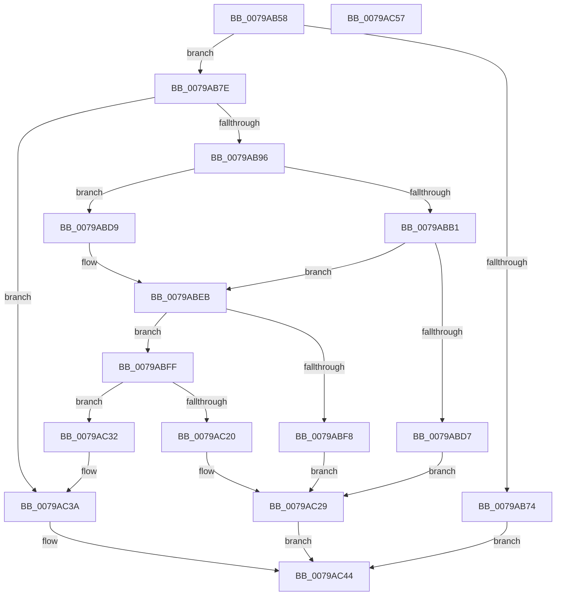

# RtlpGetNormalization

- RVA: `0x0079AB58`–`0x0079AC58` (길이 `256` bytes)
- VA: `0x000000014079AB58`
- 실행 섹션: `PAGE`
- PDB 이름 있음: `예`; PDB Function 태그: `아니요`
- unwind 정보 RVA: `0x000D03F8`
- 디코드: `76`개 명령, `256/256` bytes 표시
- 미해석 바이트: `0` (있으면 어셈블리에 `.byte`로 보존)

> 이 문서는 커널 이미지의 기계어와 PDB 기호를 분석해 생성했습니다. 4번과 5번은 함수 원형과 자료형을 바이너리 사용 방식에서 추정한 C 해석이며 원본 소스 복구 결과는 아닙니다.

## 1. Dependencies

- 직접 호출 지점: **10**; 고유 호출 대상: **8**
- 직접 호출자로 확인된 함수: **2**
- RIP 상대 이미지 참조: **0**

### Outgoing calls
- `0x0079AB7E` → [NormalizationList__Lock](../../text/5F/NormalizationList__Lock_function_005F1E80.md) (function, `0x005F1E80`)
- `0x0079AB85` → [NormalizationList__Lookup](../../text/5F/NormalizationList__Lookup_function_005F1EE4.md) (function, `0x005F1EE4`)
- `0x0079ABA4` → [NormalizationList__Lookup](../../text/5F/NormalizationList__Lookup_function_005F1EE4.md) (function, `0x005F1EE4`)
- `0x0079ABCC` → [ZwGetNlsSectionPtr](../../text/6A/ZwGetNlsSectionPtr_function_006AF110.md) (function, `0x006AF110`)
- `0x0079ABEB` → [NormalizationListEntry_Alloc](../../text/5F/NormalizationListEntry_Alloc_function_005F1E28.md) (function, `0x005F1E28`)
- `0x0079AC12` → [Normalization__LoadTables](Normalization__LoadTables_function_007939AC.md) (function, `0x007939AC`)
- `0x0079AC22` → [ExFreePoolWithTag](../../poolcode/B8/ExFreePoolWithTag_function_00B82870.md) (function, `0x00B82870`)
- `0x0079AC29` → [NormalizationList__Unlock](../../text/5F/NormalizationList__Unlock_function_005F1F18.md) (function, `0x005F1F18`)
- `0x0079AC35` → [NormalizationList__InsertTail](../../text/5F/NormalizationList__InsertTail_function_005F1E4C.md) (function, `0x005F1E4C`)
- `0x0079AC3A` → [NormalizationList__Unlock](../../text/5F/NormalizationList__Unlock_function_005F1F18.md) (function, `0x005F1F18`)

### Direct callers
- [RtlIsNormalizedString](RtlIsNormalizedString_function_007945B0.md) at `0x007945EE`
- [RtlNormalizeString](RtlNormalizeString_function_00794640.md) at `0x0079467F`

### Static image references
- 디코드된 RIP-relative 메모리 참조가 없습니다.

## 2. Other-region calls and transfers

- 다른 실행 섹션으로 향하는 call: **9**
  - `0x0079AB7E` → [NormalizationList__Lock](../../text/5F/NormalizationList__Lock_function_005F1E80.md) (`PAGE` → `.text`)
  - `0x0079AB85` → [NormalizationList__Lookup](../../text/5F/NormalizationList__Lookup_function_005F1EE4.md) (`PAGE` → `.text`)
  - `0x0079ABA4` → [NormalizationList__Lookup](../../text/5F/NormalizationList__Lookup_function_005F1EE4.md) (`PAGE` → `.text`)
  - `0x0079ABCC` → [ZwGetNlsSectionPtr](../../text/6A/ZwGetNlsSectionPtr_function_006AF110.md) (`PAGE` → `.text`)
  - `0x0079ABEB` → [NormalizationListEntry_Alloc](../../text/5F/NormalizationListEntry_Alloc_function_005F1E28.md) (`PAGE` → `.text`)
  - `0x0079AC22` → [ExFreePoolWithTag](../../poolcode/B8/ExFreePoolWithTag_function_00B82870.md) (`PAGE` → `POOLCODE`)
  - `0x0079AC29` → [NormalizationList__Unlock](../../text/5F/NormalizationList__Unlock_function_005F1F18.md) (`PAGE` → `.text`)
  - `0x0079AC35` → [NormalizationList__InsertTail](../../text/5F/NormalizationList__InsertTail_function_005F1E4C.md) (`PAGE` → `.text`)
  - `0x0079AC3A` → [NormalizationList__Unlock](../../text/5F/NormalizationList__Unlock_function_005F1F18.md) (`PAGE` → `.text`)
- 별도 외부 분기/꼬리 이동을 확인하지 못했습니다.

## 3. Assembly (complete function range)

```asm
0079AB58  48 89 5C 24 08                  mov qword ptr [rsp + 8], rbx
0079AB5D  48 89 6C 24 20                  mov qword ptr [rsp + 0x20], rbp
0079AB62  56                              push rsi
0079AB63  57                              push rdi
0079AB64  41 56                           push r14
0079AB66  48 83 EC 30                     sub rsp, 0x30
0079AB6A  4C 8B F2                        mov r14, rdx
0079AB6D  8B F9                           mov edi, ecx
0079AB6F  48 85 D2                        test rdx, rdx
0079AB72  75 0A                           jne 0x14079ab7e
0079AB74  B8 F0 00 00 C0                  mov eax, 0xc00000f0
0079AB79  E9 C6 00 00 00                  jmp 0x14079ac44
0079AB7E  E8 FD 72 E5 FF                  call 0x1405f1e80
0079AB83  8B CF                           mov ecx, edi
0079AB85  E8 5A 73 E5 FF                  call 0x1405f1ee4
0079AB8A  48 8B F0                        mov rsi, rax
0079AB8D  48 85 C0                        test rax, rax
0079AB90  0F 85 A4 00 00 00               jne 0x14079ac3a
0079AB96  48 21 44 24 60                  and qword ptr [rsp + 0x60], rax
0079AB9B  0F BA F9 08                     btc ecx, 8
0079AB9F  48 21 44 24 58                  and qword ptr [rsp + 0x58], rax
0079ABA4  E8 3B 73 E5 FF                  call 0x1405f1ee4
0079ABA9  48 8B C8                        mov rcx, rax
0079ABAC  48 85 C0                        test rax, rax
0079ABAF  75 28                           jne 0x14079abd9
0079ABB1  8B D7                           mov edx, edi
0079ABB3  48 8D 44 24 58                  lea rax, [rsp + 0x58]
0079ABB8  0F BA F2 08                     btr edx, 8
0079ABBC  48 89 44 24 20                  mov qword ptr [rsp + 0x20], rax
0079ABC1  4C 8D 4C 24 60                  lea r9, [rsp + 0x60]
0079ABC6  45 33 C0                        xor r8d, r8d
0079ABC9  8D 4E 0C                        lea ecx, [rsi + 0xc]
0079ABCC  E8 3F 45 F1 FF                  call 0x1406af110
0079ABD1  8B D8                           mov ebx, eax
0079ABD3  85 C0                           test eax, eax
0079ABD5  79 14                           jns 0x14079abeb
0079ABD7  EB 50                           jmp 0x14079ac29
0079ABD9  48 8B 40 08                     mov rax, qword ptr [rax + 8]
0079ABDD  48 89 44 24 60                  mov qword ptr [rsp + 0x60], rax
0079ABE2  48 8B 41 10                     mov rax, qword ptr [rcx + 0x10]
0079ABE6  48 89 44 24 58                  mov qword ptr [rsp + 0x58], rax
0079ABEB  E8 38 72 E5 FF                  call 0x1405f1e28
0079ABF0  48 8B D8                        mov rbx, rax
0079ABF3  48 85 C0                        test rax, rax
0079ABF6  75 07                           jne 0x14079abff
0079ABF8  BB 17 00 00 C0                  mov ebx, 0xc0000017
0079ABFD  EB 2A                           jmp 0x14079ac29
0079ABFF  4C 8B 44 24 58                  mov r8, qword ptr [rsp + 0x58]
0079AC04  48 8D 70 18                     lea rsi, [rax + 0x18]
0079AC08  48 8B 54 24 60                  mov rdx, qword ptr [rsp + 0x60]
0079AC0D  4C 8B CE                        mov r9, rsi
0079AC10  8B CF                           mov ecx, edi
0079AC12  E8 95 8D FF FF                  call 0x1407939ac
0079AC17  8B E8                           mov ebp, eax
0079AC19  48 8B CB                        mov rcx, rbx
0079AC1C  85 C0                           test eax, eax
0079AC1E  79 12                           jns 0x14079ac32
0079AC20  33 D2                           xor edx, edx
0079AC22  E8 49 7C 3E 00                  call 0x140b82870
0079AC27  8B DD                           mov ebx, ebp
0079AC29  E8 EA 72 E5 FF                  call 0x1405f1f18
0079AC2E  8B C3                           mov eax, ebx
0079AC30  EB 12                           jmp 0x14079ac44
0079AC32  89 7B 10                        mov dword ptr [rbx + 0x10], edi
0079AC35  E8 12 72 E5 FF                  call 0x1405f1e4c
0079AC3A  E8 D9 72 E5 FF                  call 0x1405f1f18
0079AC3F  33 C0                           xor eax, eax
0079AC41  49 89 36                        mov qword ptr [r14], rsi
0079AC44  48 8B 5C 24 50                  mov rbx, qword ptr [rsp + 0x50]
0079AC49  48 8B 6C 24 68                  mov rbp, qword ptr [rsp + 0x68]
0079AC4E  48 83 C4 30                     add rsp, 0x30
0079AC52  41 5E                           pop r14
0079AC54  5F                              pop rdi
0079AC55  5E                              pop rsi
0079AC56  C3                              ret
0079AC57  CC                              int3
```

## 4. C-style interpretation (structured pseudocode)

```c
__int64 __fastcall RtlpGetNormalization(int a1, __int64 a2, int a3)
{
    __int64 result;
    __int64 v_rsp;
    unsigned __int64 v_stack_m28;
    unsigned __int64 v_stack_p10;
    unsigned __int64 v_stack_p18;
    unsigned __int64 v_stack_p20;
    unsigned __int64 v_stack_p8;

    v_stack_p8 = v_rbx;
    v_stack_p20 = v_rbp;
    v_rsp = (v_rsp) - (48);
    if (a2 != 0) goto loc_0079AB7E;
    goto loc_0079AC44;
loc_0079AB7E:
    result = NormalizationList__Lock(a1, a2, a3, a4);
    result = NormalizationList__Lookup((unsigned int)((unsigned int)((unsigned int)(a1))), a2, a3, a4);
    if (result != 0) goto loc_0079AC3A;
    result = NormalizationList__Lookup((unsigned int)((unsigned int)((unsigned int)(a1))), a2, a3, a4);
    if (result != 0) goto loc_0079ABD9;
    v_stack_m28 = v_stack_p10;
    a3 = 0;
    result = ZwGetNlsSectionPtr(result + 12, (unsigned int)((unsigned int)((unsigned int)(a1))), a3, v_stack_p18);
    if (!sign_flag) goto loc_0079ABEB;
    goto loc_0079AC29;
loc_0079ABD9:
    v_stack_p18 = *(unsigned __int64 *)(result + 8);
    v_stack_p10 = *(unsigned __int64 *)(result + 12 + 16);
loc_0079ABEB:
    result = NormalizationListEntry_Alloc(result + 12, (unsigned int)((unsigned int)((unsigned int)(a1))), a3, v_stack_p18);
    if (result != 0) goto loc_0079ABFF;
    goto loc_0079AC29;
loc_0079ABFF:
    result = Normalization__LoadTables((unsigned int)((unsigned int)((unsigned int)(a1))), v_stack_p18, v_stack_p10, result + 24);
    if (!sign_flag) goto loc_0079AC32;
    a2 = 0;
    result = ExFreePoolWithTag((unsigned int)(0xC0000017ULL), a2, v_stack_p10, result + 24);
loc_0079AC29:
    result = NormalizationList__Unlock((unsigned int)(0xC0000017ULL), a2, v_stack_p10, result + 24);
    goto loc_0079AC44;
loc_0079AC32:
    *(unsigned int *)((unsigned int)((unsigned int)((unsigned int)((unsigned int)(result)))) + 16) = (unsigned int)((unsigned int)(a1));
    result = NormalizationList__InsertTail((unsigned int)(0xC0000017ULL), a2, v_stack_p10, result + 24);
loc_0079AC3A:
    result = NormalizationList__Unlock((unsigned int)(0xC0000017ULL), a2, v_stack_p10, result + 24);
    result = 0;
    *(unsigned __int64 *)(a2) = result + 24;
loc_0079AC44:
    v_rsp = (v_rsp) + (48);
    return result;
}
```

## 5. (Beta) C Style

```c
int64_t RtlpGetNormalization(int32_t Arg1, void *Arg2, int32_t Arg3)
{
    uint8_t *arg2 = (uint8_t *)Arg2;

    int64_t result;
    int64_t local_rsp;
    uint64_t v_stack_m28;
    uint64_t v_stack_p10;
    uint64_t v_stack_p18;
    uint64_t v_stack_p20;
    uint64_t v_stack_p8;

    v_stack_p8 = local_rbx;
    v_stack_p20 = local_rbp;
    local_rsp = (local_rsp) - (48);
    if (Arg2 != NULL) goto loc_0079AB7E;
    goto loc_0079AC44;
loc_0079AB7E:
    result = NormalizationList__Lock(Arg1, Arg2, Arg3, a4);
    result = NormalizationList__Lookup((uint32_t)((uint32_t)((uint32_t)(Arg1))), Arg2, Arg3, a4);
    if (result != 0) goto loc_0079AC3A;
    result = NormalizationList__Lookup((uint32_t)((uint32_t)((uint32_t)(Arg1))), Arg2, Arg3, a4);
    if (result != 0) goto loc_0079ABD9;
    v_stack_m28 = v_stack_p10;
    Arg3 = 0;
    result = ZwGetNlsSectionPtr(result + 12, (uint32_t)((uint32_t)((uint32_t)(Arg1))), Arg3, v_stack_p18);
    if (!sign_flag) goto loc_0079ABEB;
    goto loc_0079AC29;
loc_0079ABD9:
    v_stack_p18 = *(uint64_t *)(result + 0x8);
    v_stack_p10 = *(uint64_t *)(result + 0xC + 0x10);
loc_0079ABEB:
    result = NormalizationListEntry_Alloc(result + 12, (uint32_t)((uint32_t)((uint32_t)(Arg1))), Arg3, v_stack_p18);
    if (result != 0) goto loc_0079ABFF;
    goto loc_0079AC29;
loc_0079ABFF:
    result = Normalization__LoadTables((uint32_t)((uint32_t)((uint32_t)(Arg1))), v_stack_p18, v_stack_p10, result + 24);
    if (!sign_flag) goto loc_0079AC32;
    Arg2 = 0;
    result = ExFreePoolWithTag((uint32_t)(0xC0000017ULL), Arg2, v_stack_p10, result + 24);
loc_0079AC29:
    result = NormalizationList__Unlock((uint32_t)(0xC0000017ULL), Arg2, v_stack_p10, result + 24);
    goto loc_0079AC44;
loc_0079AC32:
    *(uint32_t *)((uint32_t)((uint32_t)((uint32_t)((uint32_t)(result)))) + 0x10) = (uint32_t)((uint32_t)(Arg1));
    result = NormalizationList__InsertTail((uint32_t)(0xC0000017ULL), Arg2, v_stack_p10, result + 24);
loc_0079AC3A:
    result = NormalizationList__Unlock((uint32_t)(0xC0000017ULL), Arg2, v_stack_p10, result + 24);
    result = 0;
    *(uint64_t *)(arg2) = result + 24;
loc_0079AC44:
    local_rsp = (local_rsp) + (48);
    return result;
}
```

### 관측된 메모리 오프셋

구조체 형식이 확인되지 않은 접근은 인자 기준의 오프셋으로만 기록했습니다.

| 기준 인자 | 오프셋 표현 | 폭 (bit) | 접근 |
|---|---:|---:|---|
| `Arg2` | `+ 0x0` | `64` | `W` |

## 6. Execution-region graph

[열기: 2D/3D 그래프와 함수 탐색 컨트롤 패널](../../../control-panel.html?section=page&rva=0x0079AB58&view=graph)

- 2D 그래프는 위에서 아래로 흐르고, 3D 그래프는 빈 공간을 드래그해 회전합니다. Shift+드래그는 이동, 휠은 확대·축소, 함수 노드 선택은 대상 보고서 이동입니다.

### Static fallback


