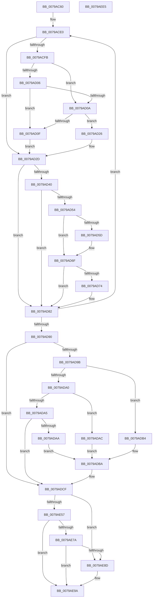

# RtlpInitFunctionOverrideCapabilities

- RVA: `0x0079AC60`–`0x0079AEE6` (길이 `646` bytes)
- VA: `0x000000014079AC60`
- 실행 섹션: `PAGE`
- PDB 이름 있음: `예`; PDB Function 태그: `아니요`
- unwind 정보 RVA: `0x000D0410`
- 디코드: `187`개 명령, `646/646` bytes 표시
- 미해석 바이트: `0` (있으면 어셈블리에 `.byte`로 보존)

> 이 문서는 커널 이미지의 기계어와 PDB 기호를 분석해 생성했습니다. 4번과 5번은 함수 원형과 자료형을 바이너리 사용 방식에서 추정한 C 해석이며 원본 소스 복구 결과는 아닙니다.

## 1. Dependencies

- 직접 호출 지점: **22**; 고유 호출 대상: **7**
- 직접 호출자로 확인된 함수: **1**
- RIP 상대 이미지 참조: **2**

### Outgoing calls
- `0x0079ACA7` → [RtlGetProcessorSignature](../../pagelk/B7/RtlGetProcessorSignature_function_00B7225C.md) (function, `0x00B7225C`)
- `0x0079AD6A` → [RtlpSetFunctionOverrideCapability](RtlpSetFunctionOverrideCapability_function_00795658.md) (function, `0x00795658`)
- `0x0079AD7D` → [RtlpSetFunctionOverrideCapability](RtlpSetFunctionOverrideCapability_function_00795658.md) (function, `0x00795658`)
- `0x0079ADC0` → [RtlpSetUserKernelFunctionOverrideCapability](RtlpSetUserKernelFunctionOverrideCapability_function_00795698.md) (function, `0x00795698`)
- `0x0079ADCA` → [RtlpSetUserKernelFunctionOverrideCapability](RtlpSetUserKernelFunctionOverrideCapability_function_00795698.md) (function, `0x00795698`)
- `0x0079ADDD` → [RtlpSetUserKernelFunctionOverrideCapability](RtlpSetUserKernelFunctionOverrideCapability_function_00795698.md) (function, `0x00795698`)
- `0x0079ADED` → [RtlpSetUserKernelFunctionOverrideCapability](RtlpSetUserKernelFunctionOverrideCapability_function_00795698.md) (function, `0x00795698`)
- `0x0079ADFD` → [RtlpSetUserKernelFunctionOverrideCapability](RtlpSetUserKernelFunctionOverrideCapability_function_00795698.md) (function, `0x00795698`)
- `0x0079AE0C` → [RtlpSetUserKernelFunctionOverrideCapability](RtlpSetUserKernelFunctionOverrideCapability_function_00795698.md) (function, `0x00795698`)
- `0x0079AE18` → [RtlpSetFunctionOverrideCapability](RtlpSetFunctionOverrideCapability_function_00795658.md) (function, `0x00795658`)
- `0x0079AE25` → [RtlpSetFunctionOverrideCapability](RtlpSetFunctionOverrideCapability_function_00795658.md) (function, `0x00795658`)
- `0x0079AE32` → [RtlpSetFunctionOverrideCapability](RtlpSetFunctionOverrideCapability_function_00795658.md) (function, `0x00795658`)
- `0x0079AE3C` → [RtlpSetUserKernelFunctionOverrideCapability](RtlpSetUserKernelFunctionOverrideCapability_function_00795698.md) (function, `0x00795698`)
- `0x0079AE49` → [RtlpSetFunctionOverrideCapability](RtlpSetFunctionOverrideCapability_function_00795658.md) (function, `0x00795658`)
- `0x0079AE4E` → [HviIsAnyHypervisorPresent](../../text/4A/HviIsAnyHypervisorPresent_function_004ADC50.md) (function, `0x004ADC50`)
- `0x0079AE69` → [HviGetHypervisorFeatures](../../text/66/HviGetHypervisorFeatures_function_00666630.md) (function, `0x00666630`)
- `0x0079AE7E` → [HviGetEnlightenmentInformation](../../text/66/HviGetEnlightenmentInformation_function_006665E4.md) (function, `0x006665E4`)
- `0x0079AE95` → [RtlpSetUserKernelFunctionOverrideCapability](RtlpSetUserKernelFunctionOverrideCapability_function_00795698.md) (function, `0x00795698`)
- `0x0079AEA2` → [RtlpSetUserKernelFunctionOverrideCapability](RtlpSetUserKernelFunctionOverrideCapability_function_00795698.md) (function, `0x00795698`)
- `0x0079AEAC` → [RtlpSetUserKernelFunctionOverrideCapability](RtlpSetUserKernelFunctionOverrideCapability_function_00795698.md) (function, `0x00795698`)
- `0x0079AEB6` → [RtlpSetUserKernelFunctionOverrideCapability](RtlpSetUserKernelFunctionOverrideCapability_function_00795698.md) (function, `0x00795698`)
- `0x0079AEC2` → [_security_check_cookie](../../text/6A/_security_check_cookie_function_006AC640.md) (function, `0x006AC640`)

### Direct callers
- [RtlInitFunctionOverrideCapabilities](RtlInitFunctionOverrideCapabilities_function_00795614.md) at `0x00795624`

### Static image references
- `0x0079AC7F` → RVA `0x00E0A740` (`.data`; read)
- `0x0079ACAF` → RVA `0x00035950` (`.rdata`; read)

## 2. Other-region calls and transfers

- 다른 실행 섹션으로 향하는 call: **5**
  - `0x0079ACA7` → [RtlGetProcessorSignature](../../pagelk/B7/RtlGetProcessorSignature_function_00B7225C.md) (`PAGE` → `PAGELK`)
  - `0x0079AE4E` → [HviIsAnyHypervisorPresent](../../text/4A/HviIsAnyHypervisorPresent_function_004ADC50.md) (`PAGE` → `.text`)
  - `0x0079AE69` → [HviGetHypervisorFeatures](../../text/66/HviGetHypervisorFeatures_function_00666630.md) (`PAGE` → `.text`)
  - `0x0079AE7E` → [HviGetEnlightenmentInformation](../../text/66/HviGetEnlightenmentInformation_function_006665E4.md) (`PAGE` → `.text`)
  - `0x0079AEC2` → [_security_check_cookie](../../text/6A/_security_check_cookie_function_006AC640.md) (`PAGE` → `.text`)
- 별도 외부 분기/꼬리 이동을 확인하지 못했습니다.

## 3. Assembly (complete function range)

```asm
0079AC60  48 89 5C 24 10                  mov qword ptr [rsp + 0x10], rbx
0079AC65  48 89 74 24 18                  mov qword ptr [rsp + 0x18], rsi
0079AC6A  48 89 7C 24 20                  mov qword ptr [rsp + 0x20], rdi
0079AC6F  55                              push rbp
0079AC70  41 54                           push r12
0079AC72  41 55                           push r13
0079AC74  41 56                           push r14
0079AC76  41 57                           push r15
0079AC78  48 8B EC                        mov rbp, rsp
0079AC7B  48 83 EC 60                     sub rsp, 0x60
0079AC7F  48 8B 05 BA FA 66 00            mov rax, qword ptr [rip + 0x66faba]
0079AC86  48 33 C4                        xor rax, rsp
0079AC89  48 89 45 F8                     mov qword ptr [rbp - 8], rax
0079AC8D  48 8B F1                        mov rsi, rcx
0079AC90  C6 45 C0 00                     mov byte ptr [rbp - 0x40], 0
0079AC94  0F 57 C0                        xorps xmm0, xmm0
0079AC97  48 8D 4D C0                     lea rcx, [rbp - 0x40]
0079AC9B  45 33 C9                        xor r9d, r9d
0079AC9E  45 33 C0                        xor r8d, r8d
0079ACA1  33 D2                           xor edx, edx
0079ACA3  0F 11 45 C8                     movups xmmword ptr [rbp - 0x38], xmm0
0079ACA7  E8 B0 75 3D 00                  call 0x140b7225c
0079ACAC  89 45 C4                        mov dword ptr [rbp - 0x3c], eax
0079ACAF  4C 8D 35 9A AC 89 FF            lea r14, [rip - 0x765366]
0079ACB6  33 C9                           xor ecx, ecx
0079ACB8  B8 00 00 00 80                  mov eax, 0x80000000
0079ACBD  0F A2                           cpuid
0079ACBF  8B F8                           mov edi, eax
0079ACC1  33 C9                           xor ecx, ecx
0079ACC3  33 C0                           xor eax, eax
0079ACC5  0F A2                           cpuid
0079ACC7  45 33 DB                        xor r11d, r11d
0079ACCA  89 45 C8                        mov dword ptr [rbp - 0x38], eax
0079ACCD  44 8B E8                        mov r13d, eax
0079ACD0  89 5D CC                        mov dword ptr [rbp - 0x34], ebx
0079ACD3  89 4D D0                        mov dword ptr [rbp - 0x30], ecx
0079ACD6  89 55 D4                        mov dword ptr [rbp - 0x2c], edx
0079ACD9  45 8D 7B 0A                     lea r15d, [r11 + 0xa]
0079ACDD  45 8B E7                        mov r12d, r15d
0079ACE0  41 0F 10 0E                     movups xmm1, xmmword ptr [r14]
0079ACE4  41 0F 10 46 10                  movups xmm0, xmmword ptr [r14 + 0x10]
0079ACE9  66 48 0F 7E C9                  movq rcx, xmm1
0079ACEE  0F 11 4D D8                     movups xmmword ptr [rbp - 0x28], xmm1
0079ACF2  0F 11 45 E8                     movups xmmword ptr [rbp - 0x18], xmm0
0079ACF6  41 3B CB                        cmp ecx, r11d
0079ACF9  74 32                           je 0x14079ad2d
0079ACFB  44 8B D9                        mov r11d, ecx
0079ACFE  81 F9 00 00 00 80               cmp ecx, 0x80000000
0079AD04  72 04                           jb 0x14079ad0a
0079AD06  3B CF                           cmp ecx, edi
0079AD08  76 05                           jbe 0x14079ad0f
0079AD0A  45 3B DD                        cmp r11d, r13d
0079AD0D  77 17                           ja 0x14079ad26
0079AD0F  48 C1 E9 20                     shr rcx, 0x20
0079AD13  41 8B C3                        mov eax, r11d
0079AD16  0F A2                           cpuid
0079AD18  89 45 C8                        mov dword ptr [rbp - 0x38], eax
0079AD1B  89 5D CC                        mov dword ptr [rbp - 0x34], ebx
0079AD1E  89 4D D0                        mov dword ptr [rbp - 0x30], ecx
0079AD21  89 55 D4                        mov dword ptr [rbp - 0x2c], edx
0079AD24  EB 07                           jmp 0x14079ad2d
0079AD26  0F 57 C0                        xorps xmm0, xmm0
0079AD29  0F 11 45 C8                     movups xmmword ptr [rbp - 0x38], xmm0
0079AD2D  48 8B 55 E8                     mov rdx, qword ptr [rbp - 0x18]
0079AD31  48 8B C2                        mov rax, rdx
0079AD34  48 C1 E8 20                     shr rax, 0x20
0079AD38  48 98                           cdqe
0079AD3A  85 54 85 C8                     test dword ptr [rbp + rax*4 - 0x38], edx
0079AD3E  74 42                           je 0x14079ad82
0079AD40  48 A1 D8 03 00 00 80 F7 FF FF   movabs rax, qword ptr [0xfffff780000003d8]
0079AD4A  48 23 45 E0                     and rax, qword ptr [rbp - 0x20]
0079AD4E  48 3B 45 E0                     cmp rax, qword ptr [rbp - 0x20]
0079AD52  75 2E                           jne 0x14079ad82
0079AD54  48 8B 5D F0                     mov rbx, qword ptr [rbp - 0x10]
0079AD58  F6 C3 01                        test bl, 1
0079AD5B  74 12                           je 0x14079ad6f
0079AD5D  48 8B CB                        mov rcx, rbx
0079AD60  45 33 C0                        xor r8d, r8d
0079AD63  48 C1 E9 20                     shr rcx, 0x20
0079AD67  48 8B D6                        mov rdx, rsi
0079AD6A  E8 E9 A8 FF FF                  call 0x140795658
0079AD6F  F6 C3 02                        test bl, 2
0079AD72  74 0E                           je 0x14079ad82
0079AD74  8B 4D F4                        mov ecx, dword ptr [rbp - 0xc]
0079AD77  41 B0 01                        mov r8b, 1
0079AD7A  48 8B D6                        mov rdx, rsi
0079AD7D  E8 D6 A8 FF FF                  call 0x140795658
0079AD82  49 83 C6 20                     add r14, 0x20
0079AD86  49 83 EC 01                     sub r12, 1
0079AD8A  0F 85 50 FF FF FF               jne 0x14079ace0
0079AD90  0F B6 4D C0                     movzx ecx, byte ptr [rbp - 0x40]
0079AD94  8B 7D C4                        mov edi, dword ptr [rbp - 0x3c]
0079AD97  85 C9                           test ecx, ecx
0079AD99  74 34                           je 0x14079adcf
0079AD9B  83 E9 01                        sub ecx, 1
0079AD9E  74 14                           je 0x14079adb4
0079ADA0  83 E9 01                        sub ecx, 1
0079ADA3  74 07                           je 0x14079adac
0079ADA5  83 F9 01                        cmp ecx, 1
0079ADA8  75 25                           jne 0x14079adcf
0079ADAA  EB 0E                           jmp 0x14079adba
0079ADAC  41 BF 08 00 00 00               mov r15d, 8
0079ADB2  EB 06                           jmp 0x14079adba
0079ADB4  41 BF 09 00 00 00               mov r15d, 9
0079ADBA  48 8B D6                        mov rdx, rsi
0079ADBD  41 8B CF                        mov ecx, r15d
0079ADC0  E8 D3 A8 FF FF                  call 0x140795698
0079ADC5  B9 07 00 00 00                  mov ecx, 7
0079ADCA  E8 C9 A8 FF FF                  call 0x140795698
0079ADCF  8B CF                           mov ecx, edi
0079ADD1  48 8B D6                        mov rdx, rsi
0079ADD4  C1 E9 04                        shr ecx, 4
0079ADD7  83 E1 0F                        and ecx, 0xf
0079ADDA  83 C1 0B                        add ecx, 0xb
0079ADDD  E8 B6 A8 FF FF                  call 0x140795698
0079ADE2  8B CF                           mov ecx, edi
0079ADE4  C1 E9 10                        shr ecx, 0x10
0079ADE7  83 E1 0F                        and ecx, 0xf
0079ADEA  83 C1 1B                        add ecx, 0x1b
0079ADED  E8 A6 A8 FF FF                  call 0x140795698
0079ADF2  8B CF                           mov ecx, edi
0079ADF4  C1 E9 08                        shr ecx, 8
0079ADF7  83 E1 0F                        and ecx, 0xf
0079ADFA  83 C1 2B                        add ecx, 0x2b
0079ADFD  E8 96 A8 FF FF                  call 0x140795698
0079AE02  C1 EF 14                        shr edi, 0x14
0079AE05  40 0F B6 CF                     movzx ecx, dil
0079AE09  83 C1 3B                        add ecx, 0x3b
0079AE0C  E8 87 A8 FF FF                  call 0x140795698
0079AE11  45 33 C0                        xor r8d, r8d
0079AE14  41 8D 48 05                     lea ecx, [r8 + 5]
0079AE18  E8 3B A8 FF FF                  call 0x140795658
0079AE1D  B9 06 00 00 00                  mov ecx, 6
0079AE22  41 B0 01                        mov r8b, 1
0079AE25  E8 2E A8 FF FF                  call 0x140795658
0079AE2A  B9 41 01 00 00                  mov ecx, 0x141
0079AE2F  45 33 C0                        xor r8d, r8d
0079AE32  E8 21 A8 FF FF                  call 0x140795658
0079AE37  B9 42 01 00 00                  mov ecx, 0x142
0079AE3C  E8 57 A8 FF FF                  call 0x140795698
0079AE41  41 B0 01                        mov r8b, 1
0079AE44  B9 46 01 00 00                  mov ecx, 0x146
0079AE49  E8 0A A8 FF FF                  call 0x140795658
0079AE4E  E8 FD 2D D1 FF                  call 0x1404adc50
0079AE53  84 C0                           test al, al
0079AE55  74 36                           je 0x14079ae8d
0079AE57  0F 57 C0                        xorps xmm0, xmm0
0079AE5A  48 8D 4D C8                     lea rcx, [rbp - 0x38]
0079AE5E  0F 57 C9                        xorps xmm1, xmm1
0079AE61  0F 11 45 D8                     movups xmmword ptr [rbp - 0x28], xmm0
0079AE65  0F 11 4D C8                     movups xmmword ptr [rbp - 0x38], xmm1
0079AE69  E8 C2 B7 EC FF                  call 0x140666630
0079AE6E  48 8B 45 C8                     mov rax, qword ptr [rbp - 0x38]
0079AE72  48 C1 E8 2C                     shr rax, 0x2c
0079AE76  A8 01                           test al, 1
0079AE78  74 20                           je 0x14079ae9a
0079AE7A  48 8D 4D D8                     lea rcx, [rbp - 0x28]
0079AE7E  E8 61 B7 EC FF                  call 0x1406665e4
0079AE83  8B 45 D8                        mov eax, dword ptr [rbp - 0x28]
0079AE86  C1 E8 0C                        shr eax, 0xc
0079AE89  A8 01                           test al, 1
0079AE8B  75 0D                           jne 0x14079ae9a
0079AE8D  48 8B D6                        mov rdx, rsi
0079AE90  B9 47 01 00 00                  mov ecx, 0x147
0079AE95  E8 FE A7 FF FF                  call 0x140795698
0079AE9A  48 8B D6                        mov rdx, rsi
0079AE9D  B9 3B 01 00 00                  mov ecx, 0x13b
0079AEA2  E8 F1 A7 FF FF                  call 0x140795698
0079AEA7  B9 3F 01 00 00                  mov ecx, 0x13f
0079AEAC  E8 E7 A7 FF FF                  call 0x140795698
0079AEB1  B9 40 01 00 00                  mov ecx, 0x140
0079AEB6  E8 DD A7 FF FF                  call 0x140795698
0079AEBB  48 8B 4D F8                     mov rcx, qword ptr [rbp - 8]
0079AEBF  48 33 CC                        xor rcx, rsp
0079AEC2  E8 79 17 F1 FF                  call 0x1406ac640
0079AEC7  4C 8D 5C 24 60                  lea r11, [rsp + 0x60]
0079AECC  49 8B 5B 38                     mov rbx, qword ptr [r11 + 0x38]
0079AED0  49 8B 73 40                     mov rsi, qword ptr [r11 + 0x40]
0079AED4  49 8B 7B 48                     mov rdi, qword ptr [r11 + 0x48]
0079AED8  49 8B E3                        mov rsp, r11
0079AEDB  41 5F                           pop r15
0079AEDD  41 5E                           pop r14
0079AEDF  41 5D                           pop r13
0079AEE1  41 5C                           pop r12
0079AEE3  5D                              pop rbp
0079AEE4  C3                              ret
0079AEE5  CC                              int3
```

## 4. C-style interpretation (structured pseudocode)

```c
__int64 __fastcall RtlpInitFunctionOverrideCapabilities(__int64 a1, int a2, int a3, int a4)
{
    __int64 result;
    __int64 v_r11;
    __int64 v_r12;
    __int64 v_r14;
    __int64 v_rdi;
    __int64 v_rsp;
    unsigned __int64 v_stack_m28;
    unsigned __int64 v_stack_m30;
    unsigned int v_stack_m34;
    unsigned __int64 v_stack_m38;
    unsigned __int64 v_stack_m40;
    unsigned __int64 v_stack_m48;
    unsigned __int64 v_stack_m50;
    unsigned int v_stack_m54;
    unsigned int v_stack_m58;
    unsigned int v_stack_m5C;
    unsigned __int64 v_stack_m60;
    unsigned int v_stack_m64;
    unsigned __int8 v_stack_m68;
    unsigned __int64 v_stack_p10;
    unsigned __int64 v_stack_p18;
    unsigned __int64 v_stack_p20;

    v_stack_p10 = v_rbx;
    v_stack_p18 = v_rsi;
    v_stack_p20 = v_rdi;
    v_rsp = (v_rsp) - (96);
    result = (*(unsigned __int64 *)(v_rip + 6748858)) ^ (v_rsp);
    v_stack_m30 = result;
    v_stack_m68 = 0;
    a4 = 0;
    a3 = 0;
    a2 = 0;
    v_stack_m60 = v_xmm0;
    result = RtlGetProcessorSignature(v_stack_m68, a2, a3, a4);
    v_stack_m64 = (unsigned int)(result);
    a1 = 0;
    a1 = 0;
    result = 0;
    v_r11 = 0;
    v_stack_m60 = 0;
    v_stack_m5C = (unsigned int)(v_rbx);
    v_stack_m58 = 0;
    v_stack_m54 = 0;
loc_0079ACE0:
    v_stack_m50 = v_xmm1;
    v_stack_m40 = v_xmm0;
    if (0 == 0) goto loc_0079AD2D;
    if (0 < 0x80000000ULL) goto loc_0079AD0A;
    if (0 <= ((unsigned int)((unsigned int)((unsigned int)((unsigned int)(0x80000000ULL)))))) goto loc_0079AD0F;
loc_0079AD0A:
    if (0 > 0) goto loc_0079AD26;
loc_0079AD0F:
    a1 = (a1) >> (32);
    v_stack_m60 = 0;
    v_stack_m5C = (unsigned int)(v_rbx);
    v_stack_m58 = (unsigned int)(a1);
    v_stack_m54 = 0;
    goto loc_0079AD2D;
loc_0079AD26:
    v_stack_m60 = v_xmm0;
loc_0079AD2D:
    result = (v_stack_m40) >> (32);
    if (((*(unsigned int *)(v_rsp + result * 4 - 56)) & ((unsigned int)(v_stack_m40))) == 0) goto loc_0079AD82;
    result = (result) & (v_stack_m48);
    if (result != v_stack_m48) goto loc_0079AD82;
    if ((((unsigned __int8)(v_stack_m38)) & (1)) != 0) {
        a1 = v_stack_m38;
        a3 = 0;
        a1 = (a1) >> (32);
        a2 = a1;
        result = RtlpSetFunctionOverrideCapability(a1, a2, a3, a4);
    }
    if ((((unsigned __int8)(v_stack_m38)) & (2)) != 0) {
        a1 = v_stack_m34;
        a3 = 1;
        a2 = a1;
        result = RtlpSetFunctionOverrideCapability(a1, a2, a3, a4);
    }
    v_r14 = (v_rip - 7754598) + (32);
    v_r12 = ((unsigned int)((unsigned int)(v_r11 + 10))) - (1);
    if (condition_is_not_equal) goto loc_0079ACE0;
    if ((unsigned int)(v_stack_m68) == 0) goto loc_0079ADCF;
    a1 = (unsigned int)((v_stack_m68) - (1));
    if (condition_is_equal) goto loc_0079ADB4;
    a1 = (unsigned int)((a1) - (1));
    if (condition_is_equal) goto loc_0079ADAC;
    if (((unsigned int)(a1)) != 1) goto loc_0079ADCF;
    goto loc_0079ADBA;
loc_0079ADAC:
    goto loc_0079ADBA;
loc_0079ADB4:
loc_0079ADBA:
    result = RtlpSetUserKernelFunctionOverrideCapability(9, a1, a3, a4);
    result = RtlpSetUserKernelFunctionOverrideCapability(7, a1, a3, a4);
loc_0079ADCF:
    a1 = (unsigned int)(((unsigned int)((unsigned int)((unsigned int)(v_stack_m64)))) >> (4));
    a1 = (unsigned int)((a1) & (15));
    a1 = (unsigned int)((a1) + (11));
    result = RtlpSetUserKernelFunctionOverrideCapability(a1, a1, a3, a4);
    a1 = (unsigned int)(((unsigned int)((unsigned int)((unsigned int)(v_stack_m64)))) >> (16));
    a1 = (unsigned int)((a1) & (15));
    a1 = (unsigned int)((a1) + (27));
    result = RtlpSetUserKernelFunctionOverrideCapability(a1, a1, a3, a4);
    a1 = (unsigned int)(((unsigned int)((unsigned int)((unsigned int)(v_stack_m64)))) >> (8));
    a1 = (unsigned int)((a1) & (15));
    a1 = (unsigned int)((a1) + (43));
    result = RtlpSetUserKernelFunctionOverrideCapability(a1, a1, a3, a4);
    v_rdi = (unsigned int)(((unsigned int)(v_stack_m64)) >> (20));
    a1 = (unsigned int)(((unsigned __int8)(v_rdi)) + (59));
    result = RtlpSetUserKernelFunctionOverrideCapability(a1, a1, a3, a4);
    a3 = 0;
    result = RtlpSetFunctionOverrideCapability(a3 + 5, a1, a3, a4);
    result = RtlpSetFunctionOverrideCapability(6, a1, 1, a4);
    a3 = 0;
    result = RtlpSetFunctionOverrideCapability(321, a1, a3, a4);
    result = RtlpSetUserKernelFunctionOverrideCapability(322, a1, a3, a4);
    result = RtlpSetFunctionOverrideCapability(326, a1, 1, a4);
    result = HviIsAnyHypervisorPresent(326, a1, 1, a4);
    if ((unsigned __int8)(result) == 0) goto loc_0079AE8D;
    v_stack_m50 = v_xmm0;
    v_stack_m60 = v_xmm1;
    result = HviGetHypervisorFeatures(v_stack_m60, a1, 1, a4);
    result = (v_stack_m60) >> (44);
    if ((((unsigned __int8)(result)) & (1)) == 0) goto loc_0079AE9A;
    result = HviGetEnlightenmentInformation(v_stack_m50, a1, 1, a4);
    result = (unsigned int)(((unsigned int)(v_stack_m50)) >> (12));
    if ((((unsigned __int8)(result)) & (1)) == 0) {
        a2 = a1;
        a1 = 327;
        result = RtlpSetUserKernelFunctionOverrideCapability(a1, a2, 1, a4);
    }
    result = RtlpSetUserKernelFunctionOverrideCapability(315, a1, 1, a4);
    result = RtlpSetUserKernelFunctionOverrideCapability(319, a1, 1, a4);
    result = RtlpSetUserKernelFunctionOverrideCapability(320, a1, 1, a4);
    a1 = (v_stack_m30) ^ (v_rsp);
    result = _security_check_cookie(a1, a1, 1, a4);
    return result;
}
```

## 5. (Beta) C Style

```c
int64_t RtlpInitFunctionOverrideCapabilities(int64_t Arg1, int32_t Arg2, int32_t Arg3, int32_t Arg4)
{
    int64_t result;
    int64_t local_r11;
    int64_t local_r12;
    int64_t local_r14;
    int64_t local_rdi;
    int64_t local_rsp;
    uint64_t v_stack_m28;
    uint64_t v_stack_m30;
    uint32_t v_stack_m34;
    uint64_t v_stack_m38;
    uint64_t v_stack_m40;
    uint64_t v_stack_m48;
    uint64_t v_stack_m50;
    uint32_t v_stack_m54;
    uint32_t v_stack_m58;
    uint32_t v_stack_m5C;
    uint64_t v_stack_m60;
    uint32_t v_stack_m64;
    uint8_t v_stack_m68;
    uint64_t v_stack_p10;
    uint64_t v_stack_p18;
    uint64_t v_stack_p20;

    v_stack_p10 = local_rbx;
    v_stack_p18 = local_rsi;
    v_stack_p20 = local_rdi;
    local_rsp = (local_rsp) - (96);
    result = (*(uint64_t *)(v_rip + 0x66FABA)) ^ (local_rsp);
    v_stack_m30 = result;
    v_stack_m68 = 0;
    Arg4 = 0;
    Arg3 = 0;
    Arg2 = 0;
    v_stack_m60 = v_xmm0;
    result = RtlGetProcessorSignature(v_stack_m68, Arg2, Arg3, Arg4);
    v_stack_m64 = (uint32_t)(result);
    Arg1 = 0;
    Arg1 = 0;
    result = 0;
    local_r11 = 0;
    v_stack_m60 = 0;
    v_stack_m5C = (uint32_t)(local_rbx);
    v_stack_m58 = 0;
    v_stack_m54 = 0;
loc_0079ACE0:
    v_stack_m50 = v_xmm1;
    v_stack_m40 = v_xmm0;
    if (0 == 0) goto loc_0079AD2D;
    if (0 < 0x80000000ULL) goto loc_0079AD0A;
    if (0 <= ((uint32_t)((uint32_t)((uint32_t)((uint32_t)(0x80000000ULL)))))) goto loc_0079AD0F;
loc_0079AD0A:
    if (0 > 0) goto loc_0079AD26;
loc_0079AD0F:
    Arg1 = (Arg1) >> (32);
    v_stack_m60 = 0;
    v_stack_m5C = (uint32_t)(local_rbx);
    v_stack_m58 = (uint32_t)(Arg1);
    v_stack_m54 = 0;
    goto loc_0079AD2D;
loc_0079AD26:
    v_stack_m60 = v_xmm0;
loc_0079AD2D:
    result = (v_stack_m40) >> (32);
    if (((*(uint32_t *)(local_rsp + result * 4 - 0x38)) & ((uint32_t)(v_stack_m40))) == 0) goto loc_0079AD82;
    result = (result) & (v_stack_m48);
    if (result != v_stack_m48) goto loc_0079AD82;
    if ((((uint8_t)(v_stack_m38)) & (1)) != 0) {
        Arg1 = v_stack_m38;
        Arg3 = 0;
        Arg1 = (Arg1) >> (32);
        Arg2 = Arg1;
        result = RtlpSetFunctionOverrideCapability(Arg1, Arg2, Arg3, Arg4);
    }
    if ((((uint8_t)(v_stack_m38)) & (2)) != 0) {
        Arg1 = v_stack_m34;
        Arg3 = 1;
        Arg2 = Arg1;
        result = RtlpSetFunctionOverrideCapability(Arg1, Arg2, Arg3, Arg4);
    }
    local_r14 = (v_rip - 7754598) + (32);
    local_r12 = ((uint32_t)((uint32_t)(local_r11 + 10))) - (1);
    if (condition_is_not_equal) goto loc_0079ACE0;
    if ((uint32_t)(v_stack_m68) == 0) goto loc_0079ADCF;
    Arg1 = (uint32_t)((v_stack_m68) - (1));
    if (condition_is_equal) goto loc_0079ADB4;
    Arg1 = (uint32_t)((Arg1) - (1));
    if (condition_is_equal) goto loc_0079ADAC;
    if (((uint32_t)(Arg1)) != 1) goto loc_0079ADCF;
    goto loc_0079ADBA;
loc_0079ADAC:
    goto loc_0079ADBA;
loc_0079ADB4:
loc_0079ADBA:
    result = RtlpSetUserKernelFunctionOverrideCapability(9, Arg1, Arg3, Arg4);
    result = RtlpSetUserKernelFunctionOverrideCapability(7, Arg1, Arg3, Arg4);
loc_0079ADCF:
    Arg1 = (uint32_t)(((uint32_t)((uint32_t)((uint32_t)(v_stack_m64)))) >> (4));
    Arg1 = (uint32_t)((Arg1) & (15));
    Arg1 = (uint32_t)((Arg1) + (11));
    result = RtlpSetUserKernelFunctionOverrideCapability(Arg1, Arg1, Arg3, Arg4);
    Arg1 = (uint32_t)(((uint32_t)((uint32_t)((uint32_t)(v_stack_m64)))) >> (16));
    Arg1 = (uint32_t)((Arg1) & (15));
    Arg1 = (uint32_t)((Arg1) + (27));
    result = RtlpSetUserKernelFunctionOverrideCapability(Arg1, Arg1, Arg3, Arg4);
    Arg1 = (uint32_t)(((uint32_t)((uint32_t)((uint32_t)(v_stack_m64)))) >> (8));
    Arg1 = (uint32_t)((Arg1) & (15));
    Arg1 = (uint32_t)((Arg1) + (43));
    result = RtlpSetUserKernelFunctionOverrideCapability(Arg1, Arg1, Arg3, Arg4);
    local_rdi = (uint32_t)(((uint32_t)(v_stack_m64)) >> (20));
    Arg1 = (uint32_t)(((uint8_t)(local_rdi)) + (59));
    result = RtlpSetUserKernelFunctionOverrideCapability(Arg1, Arg1, Arg3, Arg4);
    Arg3 = 0;
    result = RtlpSetFunctionOverrideCapability(Arg3 + 5, Arg1, Arg3, Arg4);
    result = RtlpSetFunctionOverrideCapability(6, Arg1, 1, Arg4);
    Arg3 = 0;
    result = RtlpSetFunctionOverrideCapability(321, Arg1, Arg3, Arg4);
    result = RtlpSetUserKernelFunctionOverrideCapability(322, Arg1, Arg3, Arg4);
    result = RtlpSetFunctionOverrideCapability(326, Arg1, 1, Arg4);
    result = HviIsAnyHypervisorPresent(326, Arg1, 1, Arg4);
    if ((uint8_t)(result) == 0) goto loc_0079AE8D;
    v_stack_m50 = v_xmm0;
    v_stack_m60 = v_xmm1;
    result = HviGetHypervisorFeatures(v_stack_m60, Arg1, 1, Arg4);
    result = (v_stack_m60) >> (44);
    if ((((uint8_t)(result)) & (1)) == 0) goto loc_0079AE9A;
    result = HviGetEnlightenmentInformation(v_stack_m50, Arg1, 1, Arg4);
    result = (uint32_t)(((uint32_t)(v_stack_m50)) >> (12));
    if ((((uint8_t)(result)) & (1)) == 0) {
        Arg2 = Arg1;
        Arg1 = 327;
        result = RtlpSetUserKernelFunctionOverrideCapability(Arg1, Arg2, 1, Arg4);
    }
    result = RtlpSetUserKernelFunctionOverrideCapability(315, Arg1, 1, Arg4);
    result = RtlpSetUserKernelFunctionOverrideCapability(319, Arg1, 1, Arg4);
    result = RtlpSetUserKernelFunctionOverrideCapability(320, Arg1, 1, Arg4);
    Arg1 = (v_stack_m30) ^ (local_rsp);
    result = _security_check_cookie(Arg1, Arg1, 1, Arg4);
    return result;
}
```

## 6. Execution-region graph

[열기: 2D/3D 그래프와 함수 탐색 컨트롤 패널](../../../control-panel.html?section=page&rva=0x0079AC60&view=graph)

- 2D 그래프는 위에서 아래로 흐르고, 3D 그래프는 빈 공간을 드래그해 회전합니다. Shift+드래그는 이동, 휠은 확대·축소, 함수 노드 선택은 대상 보고서 이동입니다.

### Static fallback


