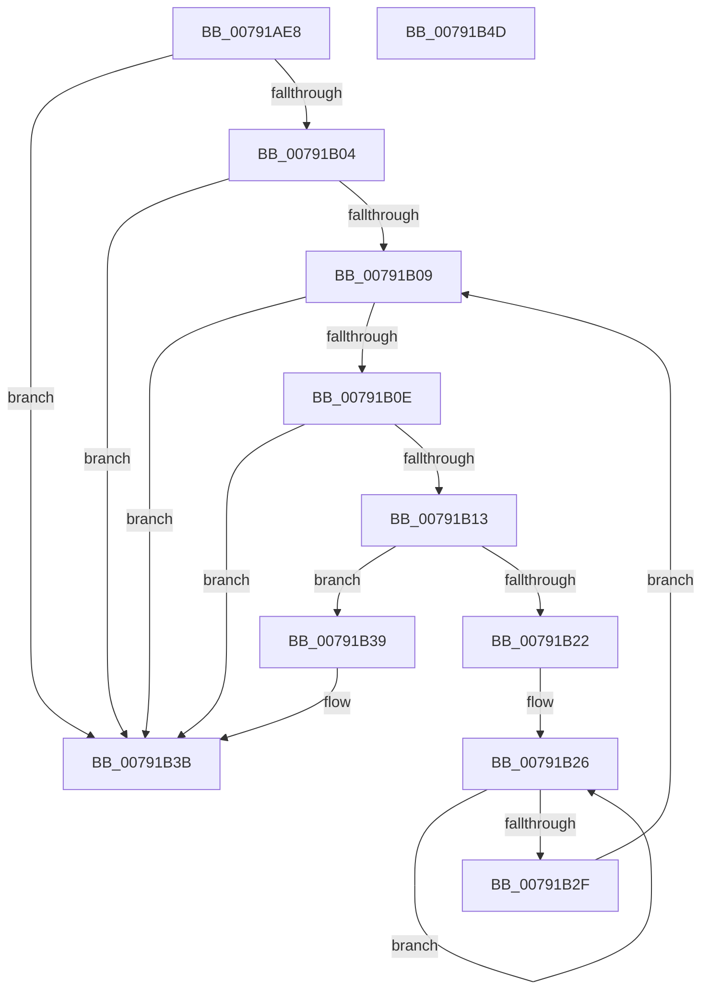

# RtlpLangNameInMultiSzString

- RVA: `0x00791AE8`–`0x00791B4E` (길이 `102` bytes)
- VA: `0x0000000140791AE8`
- 실행 섹션: `PAGE`
- PDB 이름 있음: `예`; PDB Function 태그: `아니요`
- unwind 정보 RVA: `0x00060BC4`
- 디코드: `35`개 명령, `102/102` bytes 표시
- 미해석 바이트: `0` (있으면 어셈블리에 `.byte`로 보존)

> 이 문서는 커널 이미지의 기계어와 PDB 기호를 분석해 생성했습니다. 4번과 5번은 함수 원형과 자료형을 바이너리 사용 방식에서 추정한 C 해석이며 원본 소스 복구 결과는 아닙니다.

## 1. Dependencies

- 직접 호출 지점: **1**; 고유 호출 대상: **1**
- 직접 호출자로 확인된 함수: **4**
- RIP 상대 이미지 참조: **0**

### Outgoing calls
- `0x00791B19` → [wcsicmp](../../text/50/wcsicmp_function_00500080.md) (function, `0x00500080`)

### Direct callers
- [RtlpIsALicensedRegularLanguage](../83/RtlpIsALicensedRegularLanguage_function_0083D1EC.md) at `0x0083D216`
- [RtlpIsALicensedRegularLanguage](../83/RtlpIsALicensedRegularLanguage_function_0083D1EC.md) at `0x0083D23B`
- [RtlpIsALicensedRegularLanguage](../83/RtlpIsALicensedRegularLanguage_function_0083D1EC.md) at `0x0083D257`
- [RtlpMuiRegAddLanguageByName](../83/RtlpMuiRegAddLanguageByName_function_0083D748.md) at `0x0083D82F`
- [RtlpMuiRegAddLanguageByName](../83/RtlpMuiRegAddLanguageByName_function_0083D748.md) at `0x0083D856`
- [RtlpMuiRegAddBaseLanguage](../83/RtlpMuiRegAddBaseLanguage_function_0083F494.md) at `0x0083F5E0`
- [RtlpMuiRegValidateAndGetInstallFallbackBase](../84/RtlpMuiRegValidateAndGetInstallFallbackBase_function_0084042C.md) at `0x0084049F`

### Static image references
- 디코드된 RIP-relative 메모리 참조가 없습니다.

## 2. Other-region calls and transfers

- 다른 실행 섹션으로 향하는 call: **1**
  - `0x00791B19` → [wcsicmp](../../text/50/wcsicmp_function_00500080.md) (`PAGE` → `.text`)
- 별도 외부 분기/꼬리 이동을 확인하지 못했습니다.

## 3. Assembly (complete function range)

```asm
00791AE8  48 89 5C 24 08                  mov qword ptr [rsp + 8], rbx
00791AED  48 89 74 24 10                  mov qword ptr [rsp + 0x10], rsi
00791AF2  57                              push rdi
00791AF3  48 83 EC 20                     sub rsp, 0x20
00791AF7  33 DB                           xor ebx, ebx
00791AF9  48 8B F2                        mov rsi, rdx
00791AFC  48 8B F9                        mov rdi, rcx
00791AFF  48 85 C9                        test rcx, rcx
00791B02  74 37                           je 0x140791b3b
00791B04  48 85 D2                        test rdx, rdx
00791B07  74 32                           je 0x140791b3b
00791B09  48 85 FF                        test rdi, rdi
00791B0C  74 2D                           je 0x140791b3b
00791B0E  66 39 1F                        cmp word ptr [rdi], bx
00791B11  74 28                           je 0x140791b3b
00791B13  48 8B D6                        mov rdx, rsi
00791B16  48 8B CF                        mov rcx, rdi
00791B19  E8 62 E5 D6 FF                  call 0x140500080
00791B1E  85 C0                           test eax, eax
00791B20  74 17                           je 0x140791b39
00791B22  48 83 C8 FF                     or rax, 0xffffffffffffffff
00791B26  48 FF C0                        inc rax
00791B29  66 39 1C 47                     cmp word ptr [rdi + rax*2], bx
00791B2D  75 F7                           jne 0x140791b26
00791B2F  48 8D 3C 47                     lea rdi, [rdi + rax*2]
00791B33  48 83 C7 02                     add rdi, 2
00791B37  EB D0                           jmp 0x140791b09
00791B39  B3 01                           mov bl, 1
00791B3B  48 8B 74 24 38                  mov rsi, qword ptr [rsp + 0x38]
00791B40  8A C3                           mov al, bl
00791B42  48 8B 5C 24 30                  mov rbx, qword ptr [rsp + 0x30]
00791B47  48 83 C4 20                     add rsp, 0x20
00791B4B  5F                              pop rdi
00791B4C  C3                              ret
00791B4D  CC                              int3
```

## 4. C-style interpretation (structured pseudocode)

```c
__int64 __fastcall RtlpLangNameInMultiSzString(__int64 a1, __int64 a2)
{
    __int64 result;
    __int64 v_rbx;
    __int64 v_rdi;
    __int64 v_rsp;
    unsigned __int64 v_stack_p10;
    unsigned __int64 v_stack_p8;

    v_stack_p8 = v_rbx;
    v_stack_p10 = v_rsi;
    v_rsp = (v_rsp) - (32);
    v_rbx = 0;
    if (a1 == 0) goto loc_00791B3B;
    if (a2 == 0) goto loc_00791B3B;
loc_00791B09:
    if (a1 == 0) goto loc_00791B3B;
    if ((*(unsigned __int16 *)(a1)) == 0) goto loc_00791B3B;
    result = wcsicmp(a1, a2, a3, a4);
    if ((unsigned int)(result) == 0) goto loc_00791B39;
    result = (result) | (-1);
loc_00791B26:
    result = (result) + 1;
    if ((*(unsigned __int16 *)(a1 + result * 2)) != 0) goto loc_00791B26;
    v_rdi = (a1 + result * 2) + (2);
    goto loc_00791B09;
loc_00791B39:
loc_00791B3B:
    v_rsp = (v_rsp) + (32);
    return 1;
}
```

## 5. (Beta) C Style

```c
int64_t RtlpLangNameInMultiSzString(int64_t Arg1, int64_t Arg2)
{
    int64_t result;
    int64_t local_rbx;
    int64_t local_rdi;
    int64_t local_rsp;
    uint64_t v_stack_p10;
    uint64_t v_stack_p8;

    v_stack_p8 = local_rbx;
    v_stack_p10 = local_rsi;
    local_rsp = (local_rsp) - (32);
    local_rbx = 0;
    if (Arg1 == 0) goto loc_00791B3B;
    if (Arg2 == 0) goto loc_00791B3B;
loc_00791B09:
    if (Arg1 == 0) goto loc_00791B3B;
    if ((*(uint16_t *)(Arg1)) == 0) goto loc_00791B3B;
    result = wcsicmp(Arg1, Arg2, a3, a4);
    if ((uint32_t)(result) == 0) goto loc_00791B39;
    result = (result) | (-1);
loc_00791B26:
    result = (result) + 1;
    if ((*(uint16_t *)(Arg1 + result * 2)) != 0) goto loc_00791B26;
    local_rdi = (Arg1 + result * 2) + (2);
    goto loc_00791B09;
loc_00791B39:
loc_00791B3B:
    local_rsp = (local_rsp) + (32);
    return 1;
}
```

## 6. Execution-region graph

[열기: 2D/3D 그래프와 함수 탐색 컨트롤 패널](../../../control-panel.html?section=page&rva=0x00791AE8&view=graph)

- 2D 그래프는 위에서 아래로 흐르고, 3D 그래프는 빈 공간을 드래그해 회전합니다. Shift+드래그는 이동, 휠은 확대·축소, 함수 노드 선택은 대상 보고서 이동입니다.

### Static fallback


