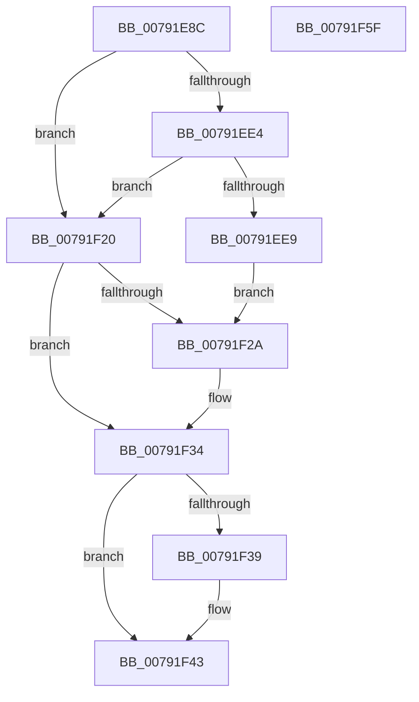

# RtlpNameprepAsciiWorker

- RVA: `0x00791E8C`–`0x00791F60` (길이 `212` bytes)
- VA: `0x0000000140791E8C`
- 실행 섹션: `PAGE`
- PDB 이름 있음: `예`; PDB Function 태그: `아니요`
- unwind 정보 RVA: `0x0008CA40`
- 디코드: `61`개 명령, `212/212` bytes 표시
- 미해석 바이트: `0` (있으면 어셈블리에 `.byte`로 보존)

> 이 문서는 커널 이미지의 기계어와 PDB 기호를 분석해 생성했습니다. 4번과 5번은 함수 원형과 자료형을 바이너리 사용 방식에서 추정한 C 해석이며 원본 소스 복구 결과는 아닙니다.

## 1. Dependencies

- 직접 호출 지점: **5**; 고유 호출 대상: **3**
- 직접 호출자로 확인된 함수: **2**
- RIP 상대 이미지 참조: **0**

### Outgoing calls
- `0x00791EC2` → [ExAllocatePool2](../../poolcode/B8/ExAllocatePool2_function_00B820F0.md) (function, `0x00B820F0`)
- `0x00791ED7` → [ExAllocatePool2](../../poolcode/B8/ExAllocatePool2_function_00B820F0.md) (function, `0x00B820F0`)
- `0x00791F17` → [RtlpNameprepAsciiRealWorker](../../text/5E/RtlpNameprepAsciiRealWorker_function_005ECDF8.md) (function, `0x005ECDF8`)
- `0x00791F2F` → [ExFreePoolWithTag](../../poolcode/B8/ExFreePoolWithTag_function_00B82870.md) (function, `0x00B82870`)
- `0x00791F3E` → [ExFreePoolWithTag](../../poolcode/B8/ExFreePoolWithTag_function_00B82870.md) (function, `0x00B82870`)

### Direct callers
- [RtlIdnToAscii](RtlIdnToAscii_function_00791D90.md) at `0x00791DA3`
- [RtlIdnToNameprepUnicode](RtlIdnToNameprepUnicode_function_00791DC0.md) at `0x00791DD3`

### Static image references
- 디코드된 RIP-relative 메모리 참조가 없습니다.

## 2. Other-region calls and transfers

- 다른 실행 섹션으로 향하는 call: **5**
  - `0x00791EC2` → [ExAllocatePool2](../../poolcode/B8/ExAllocatePool2_function_00B820F0.md) (`PAGE` → `POOLCODE`)
  - `0x00791ED7` → [ExAllocatePool2](../../poolcode/B8/ExAllocatePool2_function_00B820F0.md) (`PAGE` → `POOLCODE`)
  - `0x00791F17` → [RtlpNameprepAsciiRealWorker](../../text/5E/RtlpNameprepAsciiRealWorker_function_005ECDF8.md) (`PAGE` → `.text`)
  - `0x00791F2F` → [ExFreePoolWithTag](../../poolcode/B8/ExFreePoolWithTag_function_00B82870.md) (`PAGE` → `POOLCODE`)
  - `0x00791F3E` → [ExFreePoolWithTag](../../poolcode/B8/ExFreePoolWithTag_function_00B82870.md) (`PAGE` → `POOLCODE`)
- 별도 외부 분기/꼬리 이동을 확인하지 못했습니다.

## 3. Assembly (complete function range)

```asm
00791E8C  48 89 5C 24 08                  mov qword ptr [rsp + 8], rbx
00791E91  48 89 6C 24 10                  mov qword ptr [rsp + 0x10], rbp
00791E96  48 89 74 24 18                  mov qword ptr [rsp + 0x18], rsi
00791E9B  57                              push rdi
00791E9C  41 56                           push r14
00791E9E  41 57                           push r15
00791EA0  48 83 EC 60                     sub rsp, 0x60
00791EA4  41 8B E8                        mov ebp, r8d
00791EA7  4C 8B F2                        mov r14, rdx
00791EAA  44 8B F9                        mov r15d, ecx
00791EAD  BB 00 01 00 00                  mov ebx, 0x100
00791EB2  8B CB                           mov ecx, ebx
00791EB4  BA FE 03 00 00                  mov edx, 0x3fe
00791EB9  41 B8 49 64 6E 45               mov r8d, 0x456e6449
00791EBF  49 8B F9                        mov rdi, r9
00791EC2  E8 29 02 3F 00                  call 0x140b820f0
00791EC7  BA 06 04 00 00                  mov edx, 0x406
00791ECC  41 B8 49 64 6E 45               mov r8d, 0x456e6449
00791ED2  8B CB                           mov ecx, ebx
00791ED4  48 8B F0                        mov rsi, rax
00791ED7  E8 14 02 3F 00                  call 0x140b820f0
00791EDC  48 8B D8                        mov rbx, rax
00791EDF  48 85 F6                        test rsi, rsi
00791EE2  74 3C                           je 0x140791f20
00791EE4  48 85 C0                        test rax, rax
00791EE7  74 37                           je 0x140791f20
00791EE9  8A 8C 24 A8 00 00 00            mov cl, byte ptr [rsp + 0xa8]
00791EF0  4C 8B CF                        mov r9, rdi
00791EF3  48 89 44 24 40                  mov qword ptr [rsp + 0x40], rax
00791EF8  44 8B C5                        mov r8d, ebp
00791EFB  48 89 74 24 30                  mov qword ptr [rsp + 0x30], rsi
00791F00  49 8B D6                        mov rdx, r14
00791F03  88 4C 24 28                     mov byte ptr [rsp + 0x28], cl
00791F07  48 8B 8C 24 A0 00 00 00         mov rcx, qword ptr [rsp + 0xa0]
00791F0F  48 89 4C 24 20                  mov qword ptr [rsp + 0x20], rcx
00791F14  41 8B CF                        mov ecx, r15d
00791F17  E8 DC AE E5 FF                  call 0x1405ecdf8
00791F1C  8B F8                           mov edi, eax
00791F1E  EB 0A                           jmp 0x140791f2a
00791F20  BF 17 00 00 C0                  mov edi, 0xc0000017
00791F25  48 85 F6                        test rsi, rsi
00791F28  74 0A                           je 0x140791f34
00791F2A  33 D2                           xor edx, edx
00791F2C  48 8B CE                        mov rcx, rsi
00791F2F  E8 3C 09 3F 00                  call 0x140b82870
00791F34  48 85 DB                        test rbx, rbx
00791F37  74 0A                           je 0x140791f43
00791F39  33 D2                           xor edx, edx
00791F3B  48 8B CB                        mov rcx, rbx
00791F3E  E8 2D 09 3F 00                  call 0x140b82870
00791F43  4C 8D 5C 24 60                  lea r11, [rsp + 0x60]
00791F48  8B C7                           mov eax, edi
00791F4A  49 8B 5B 20                     mov rbx, qword ptr [r11 + 0x20]
00791F4E  49 8B 6B 28                     mov rbp, qword ptr [r11 + 0x28]
00791F52  49 8B 73 30                     mov rsi, qword ptr [r11 + 0x30]
00791F56  49 8B E3                        mov rsp, r11
00791F59  41 5F                           pop r15
00791F5B  41 5E                           pop r14
00791F5D  5F                              pop rdi
00791F5E  C3                              ret
00791F5F  CC                              int3
```

## 4. C-style interpretation (structured pseudocode)

```c
__int64 __fastcall RtlpNameprepAsciiWorker(int a1, __int64 a2, int a3, __int64 a4, __int64 a5, unsigned __int8 a6)
{
    __int64 result;
    __int64 v_rsp;
    unsigned __int64 v_stack_m18;
    unsigned __int64 v_stack_m38;
    unsigned __int64 v_stack_m48;
    unsigned __int8 v_stack_m50;
    unsigned __int64 v_stack_m58;
    unsigned __int64 v_stack_p10;
    unsigned __int64 v_stack_p18;
    unsigned __int64 v_stack_p8;

    v_stack_p8 = v_rbx;
    v_stack_p10 = v_rbp;
    v_stack_p18 = v_rsi;
    v_rsp = (v_rsp) - (96);
    result = ExAllocatePool2(256, (unsigned int)(0x3FEULL), (unsigned int)(0x456E6449ULL), a4);
    result = ExAllocatePool2(256, (unsigned int)(0x406ULL), (unsigned int)(0x456E6449ULL), a4);
    if (result == 0) goto loc_00791F20;
    if (result == 0) goto loc_00791F20;
    v_stack_m38 = result;
    v_stack_m48 = result;
    v_stack_m50 = a6;
    v_stack_m58 = a5;
    result = RtlpNameprepAsciiRealWorker((unsigned int)((unsigned int)((unsigned int)(a1))), a2, (unsigned int)((unsigned int)((unsigned int)(a3))), a4);
    goto loc_00791F2A;
loc_00791F20:
    if (result != 0) {
        a2 = 0;
        a1 = result;
        result = ExFreePoolWithTag(a1, a2, (unsigned int)((unsigned int)((unsigned int)(a3))), a4);
    }
    if (result != 0) {
        a2 = 0;
        a1 = result;
        result = ExFreePoolWithTag(a1, a2, (unsigned int)((unsigned int)((unsigned int)(a3))), a4);
    }
    return (unsigned int)((unsigned int)((unsigned int)(0xC0000017ULL)));
}
```

## 5. (Beta) C Style

```c
int64_t RtlpNameprepAsciiWorker(int32_t Arg1, int64_t Arg2, int32_t Arg3, int64_t Arg4, int64_t Arg5, uint8_t Arg6)
{
    int64_t result;
    int64_t local_rsp;
    uint64_t v_stack_m18;
    uint64_t v_stack_m38;
    uint64_t v_stack_m48;
    uint8_t v_stack_m50;
    uint64_t v_stack_m58;
    uint64_t v_stack_p10;
    uint64_t v_stack_p18;
    uint64_t v_stack_p8;

    v_stack_p8 = local_rbx;
    v_stack_p10 = local_rbp;
    v_stack_p18 = local_rsi;
    local_rsp = (local_rsp) - (96);
    result = ExAllocatePool2(256, (uint32_t)(0x3FEULL), (uint32_t)(0x456E6449ULL), Arg4);
    result = ExAllocatePool2(256, (uint32_t)(0x406ULL), (uint32_t)(0x456E6449ULL), Arg4);
    if (result == 0) goto loc_00791F20;
    if (result == 0) goto loc_00791F20;
    v_stack_m38 = result;
    v_stack_m48 = result;
    v_stack_m50 = Arg6;
    v_stack_m58 = Arg5;
    result = RtlpNameprepAsciiRealWorker((uint32_t)((uint32_t)((uint32_t)(Arg1))), Arg2, (uint32_t)((uint32_t)((uint32_t)(Arg3))), Arg4);
    goto loc_00791F2A;
loc_00791F20:
    if (result != 0) {
        Arg2 = 0;
        Arg1 = result;
        result = ExFreePoolWithTag(Arg1, Arg2, (uint32_t)((uint32_t)((uint32_t)(Arg3))), Arg4);
    }
    if (result != 0) {
        Arg2 = 0;
        Arg1 = result;
        result = ExFreePoolWithTag(Arg1, Arg2, (uint32_t)((uint32_t)((uint32_t)(Arg3))), Arg4);
    }
    return (uint32_t)((uint32_t)((uint32_t)(0xC0000017ULL)));
}
```

## 6. Execution-region graph

[열기: 2D/3D 그래프와 함수 탐색 컨트롤 패널](../../../control-panel.html?section=page&rva=0x00791E8C&view=graph)

- 2D 그래프는 위에서 아래로 흐르고, 3D 그래프는 빈 공간을 드래그해 회전합니다. Shift+드래그는 이동, 휠은 확대·축소, 함수 노드 선택은 대상 보고서 이동입니다.

### Static fallback


