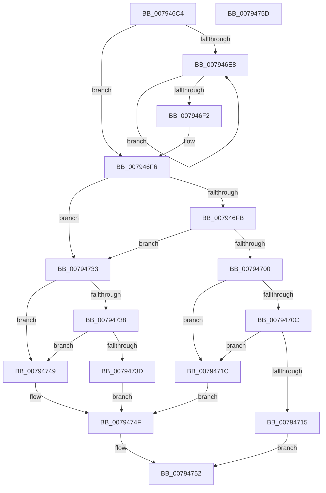

# RtlpNormalizeStringWorker

- RVA: `0x007946C4`–`0x0079475E` (길이 `154` bytes)
- VA: `0x00000001407946C4`
- 실행 섹션: `PAGE`
- PDB 이름 있음: `예`; PDB Function 태그: `아니요`
- unwind 정보 RVA: `0x0006E5F8`
- 디코드: `49`개 명령, `154/154` bytes 표시
- 미해석 바이트: `0` (있으면 어셈블리에 `.byte`로 보존)

> 이 문서는 커널 이미지의 기계어와 PDB 기호를 분석해 생성했습니다. 4번과 5번은 함수 원형과 자료형을 바이너리 사용 방식에서 추정한 C 해석이며 원본 소스 복구 결과는 아닙니다.

## 1. Dependencies

- 직접 호출 지점: **2**; 고유 호출 대상: **2**
- 직접 호출자로 확인된 함수: **1**
- RIP 상대 이미지 참조: **0**

### Outgoing calls
- `0x00794729` → [Normalization__Normalize](Normalization__Normalize_function_00793B70.md) (function, `0x00793B70`)
- `0x00794740` → [Normalization__GuessCharCountBySize](Normalization__GuessCharCountBySize_function_007934A8.md) (function, `0x007934A8`)

### Direct callers
- [RtlNormalizeString](RtlNormalizeString_function_00794640.md) at `0x0079469B`

### Static image references
- 디코드된 RIP-relative 메모리 참조가 없습니다.

## 2. Other-region calls and transfers

- 다른 실행 섹션으로 향하는 call: **0**
- 별도 외부 분기/꼬리 이동을 확인하지 못했습니다.

## 3. Assembly (complete function range)

```asm
007946C4  48 89 5C 24 08                  mov qword ptr [rsp + 8], rbx
007946C9  57                              push rdi
007946CA  48 83 EC 30                     sub rsp, 0x30
007946CE  48 8B 5C 24 60                  mov rbx, qword ptr [rsp + 0x60]
007946D3  45 33 D2                        xor r10d, r10d
007946D6  48 83 C8 FF                     or rax, 0xffffffffffffffff
007946DA  48 8B F9                        mov rdi, rcx
007946DD  4C 63 1B                        movsxd r11, dword ptr [rbx]
007946E0  44 89 13                        mov dword ptr [rbx], r10d
007946E3  44 3B C0                        cmp r8d, eax
007946E6  75 0E                           jne 0x1407946f6
007946E8  48 FF C0                        inc rax
007946EB  66 44 39 14 42                  cmp word ptr [rdx + rax*2], r10w
007946F0  75 F6                           jne 0x1407946e8
007946F2  44 8D 40 01                     lea r8d, [rax + 1]
007946F6  45 85 DB                        test r11d, r11d
007946F9  7E 38                           jle 0x140794733
007946FB  4D 85 C9                        test r9, r9
007946FE  74 33                           je 0x140794733
00794700  49 63 C0                        movsxd rax, r8d
00794703  48 8D 0C 42                     lea rcx, [rdx + rax*2]
00794707  4C 3B C9                        cmp r9, rcx
0079470A  73 10                           jae 0x14079471c
0079470C  4B 8D 0C 59                     lea rcx, [r9 + r11*2]
00794710  48 3B CA                        cmp rcx, rdx
00794713  76 07                           jbe 0x14079471c
00794715  B8 0D 00 00 C0                  mov eax, 0xc000000d
0079471A  EB 36                           jmp 0x140794752
0079471C  48 89 5C 24 28                  mov qword ptr [rsp + 0x28], rbx
00794721  48 8B CF                        mov rcx, rdi
00794724  44 89 5C 24 20                  mov dword ptr [rsp + 0x20], r11d
00794729  E8 42 F4 FF FF                  call 0x140793b70
0079472E  44 8B D0                        mov r10d, eax
00794731  EB 1C                           jmp 0x14079474f
00794733  48 85 D2                        test rdx, rdx
00794736  74 11                           je 0x140794749
00794738  45 85 C0                        test r8d, r8d
0079473B  78 0C                           js 0x140794749
0079473D  41 8B D0                        mov edx, r8d
00794740  E8 63 ED FF FF                  call 0x1407934a8
00794745  89 03                           mov dword ptr [rbx], eax
00794747  EB 06                           jmp 0x14079474f
00794749  41 BA 0D 00 00 C0               mov r10d, 0xc000000d
0079474F  41 8B C2                        mov eax, r10d
00794752  48 8B 5C 24 40                  mov rbx, qword ptr [rsp + 0x40]
00794757  48 83 C4 30                     add rsp, 0x30
0079475B  5F                              pop rdi
0079475C  C3                              ret
0079475D  CC                              int3
```

## 4. C-style interpretation (structured pseudocode)

```c
__int64 __fastcall RtlpNormalizeStringWorker(__int64 a1, __int64 a2, int a3, __int64 a4, __int64 a5)
{
    __int64 result;
    __int64 v_r10;
    __int64 v_rsp;
    unsigned __int64 v_stack_m10;
    unsigned int v_stack_m18;
    unsigned __int64 v_stack_p8;

    v_stack_p8 = v_rbx;
    v_rsp = (v_rsp) - (48);
    v_r10 = 0;
    result = (result) | (-1);
    *(unsigned int *)(a5) = 0;
    if (a3 != ((unsigned int)(result))) goto loc_007946F6;
loc_007946E8:
    result = (result) + 1;
    if ((*(unsigned __int16 *)(a2 + result * 2)) != 0) goto loc_007946E8;
loc_007946F6:
    if (condition_is_less_or_equal) goto loc_00794733;
    if (a4 == 0) goto loc_00794733;
    if (a4 >= (a2 + (int)((unsigned int)(result + 1)) * 2)) goto loc_0079471C;
    if ((a4 + (int)(*(unsigned int *)(a5)) * 2) <= a2) goto loc_0079471C;
    goto loc_00794752;
loc_0079471C:
    v_stack_m10 = a5;
    v_stack_m18 = (unsigned int)((int)(*(unsigned int *)(a5)));
    result = Normalization__Normalize(a1, a2, result + 1, a4);
    goto loc_0079474F;
loc_00794733:
    if (a2 == 0) goto loc_00794749;
    if (sign_flag) goto loc_00794749;
    result = Normalization__GuessCharCountBySize(a1, (unsigned int)((unsigned int)(result + 1)), result + 1, a4);
    *(unsigned int *)(a5) = (unsigned int)(result);
    goto loc_0079474F;
loc_00794749:
loc_0079474F:
loc_00794752:
    v_rsp = (v_rsp) + (48);
    return (unsigned int)((unsigned int)((unsigned int)(0xC000000DULL)));
}
```

## 5. (Beta) C Style

```c
int64_t RtlpNormalizeStringWorker(int64_t Arg1, void *Arg2, int32_t Arg3, int64_t Arg4, void *Arg5)
{
    uint8_t *arg2 = (uint8_t *)Arg2;
    uint8_t *arg5 = (uint8_t *)Arg5;

    int64_t result;
    int64_t local_r10;
    int64_t local_rsp;
    uint64_t v_stack_m10;
    uint32_t v_stack_m18;
    uint64_t v_stack_p8;

    v_stack_p8 = local_rbx;
    local_rsp = (local_rsp) - (48);
    local_r10 = 0;
    result = (result) | (-1);
    *(uint32_t *)(arg5) = 0;
    if (Arg3 != ((uint32_t)(result))) goto loc_007946F6;
loc_007946E8:
    result = (result) + 1;
    if ((*(uint16_t *)(arg2 + result * 2)) != 0) goto loc_007946E8;
loc_007946F6:
    if (condition_is_less_or_equal) goto loc_00794733;
    if (Arg4 == 0) goto loc_00794733;
    if (Arg4 >= (Arg2 + (int32_t)((uint32_t)(result + 1)) * 2)) goto loc_0079471C;
    if ((Arg4 + (int32_t)(*(uint32_t *)(arg5)) * 2) <= Arg2) goto loc_0079471C;
    goto loc_00794752;
loc_0079471C:
    v_stack_m10 = Arg5;
    v_stack_m18 = (uint32_t)((int32_t)(*(uint32_t *)(arg5)));
    result = Normalization__Normalize(Arg1, Arg2, result + 1, Arg4);
    goto loc_0079474F;
loc_00794733:
    if (Arg2 == NULL) goto loc_00794749;
    if (sign_flag) goto loc_00794749;
    result = Normalization__GuessCharCountBySize(Arg1, (uint32_t)((uint32_t)(result + 1)), result + 1, Arg4);
    *(uint32_t *)(arg5) = (uint32_t)(result);
    goto loc_0079474F;
loc_00794749:
loc_0079474F:
loc_00794752:
    local_rsp = (local_rsp) + (48);
    return (uint32_t)((uint32_t)((uint32_t)(0xC000000DULL)));
}
```

### 관측된 메모리 오프셋

구조체 형식이 확인되지 않은 접근은 인자 기준의 오프셋으로만 기록했습니다.

| 기준 인자 | 오프셋 표현 | 폭 (bit) | 접근 |
|---|---:|---:|---|
| `Arg2` | `+ 0x0 + rax*2` | `16` | `R` |
| `Arg2` | `+ 0x0 + rax*2` | `64` | `R` |
| `Arg5` | `+ 0x0` | `32` | `R` |
| `Arg5` | `+ 0x0` | `32` | `W` |

## 6. Execution-region graph

[열기: 2D/3D 그래프와 함수 탐색 컨트롤 패널](../../../control-panel.html?section=page&rva=0x007946C4&view=graph)

- 2D 그래프는 위에서 아래로 흐르고, 3D 그래프는 빈 공간을 드래그해 회전합니다. Shift+드래그는 이동, 휠은 확대·축소, 함수 노드 선택은 대상 보고서 이동입니다.

### Static fallback


