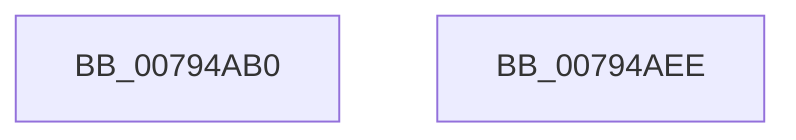

# RtlpRtlpCtWaitForWnfQuiescentWorker

- RVA: `0x00794AB0`–`0x00794AEF` (길이 `63` bytes)
- VA: `0x0000000140794AB0`
- 실행 섹션: `PAGE`
- PDB 이름 있음: `예`; PDB Function 태그: `아니요`
- unwind 정보 RVA: `0x0006E5F8`
- 디코드: `19`개 명령, `63/63` bytes 표시
- 미해석 바이트: `0` (있으면 어셈블리에 `.byte`로 보존)

> 이 문서는 커널 이미지의 기계어와 PDB 기호를 분석해 생성했습니다. 4번과 5번은 함수 원형과 자료형을 바이너리 사용 방식에서 추정한 C 해석이며 원본 소스 복구 결과는 아닙니다.

## 1. Dependencies

- 직접 호출 지점: **2**; 고유 호출 대상: **2**
- 직접 호출자로 확인된 함수: **0**
- RIP 상대 이미지 참조: **1**

### Outgoing calls
- `0x00794AD0` → [KeWaitForSingleObject](../../text/20/KeWaitForSingleObject_function_0020E6B0.md) (function, `0x0020E6B0`)
- `0x00794AD8` → [RtlpCtContextFree](RtlpCtContextFree_function_007948DC.md) (function, `0x007948DC`)

### Direct callers
- 이 함수 시작 RVA로 연결되는 직접 call은 확인되지 않았습니다. 간접 호출은 완전히 역산할 수 없습니다.

### Static image references
- `0x00794ADD` → RVA `0x00F05BF0` (`.data`; read/write)

## 2. Other-region calls and transfers

- 다른 실행 섹션으로 향하는 call: **1**
  - `0x00794AD0` → [KeWaitForSingleObject](../../text/20/KeWaitForSingleObject_function_0020E6B0.md) (`PAGE` → `.text`)
- 별도 외부 분기/꼬리 이동을 확인하지 못했습니다.

## 3. Assembly (complete function range)

```asm
00794AB0  48 89 5C 24 08                  mov qword ptr [rsp + 8], rbx
00794AB5  57                              push rdi
00794AB6  48 83 EC 30                     sub rsp, 0x30
00794ABA  48 8B D9                        mov rbx, rcx
00794ABD  33 FF                           xor edi, edi
00794ABF  48 8B 49 10                     mov rcx, qword ptr [rcx + 0x10]
00794AC3  45 33 C9                        xor r9d, r9d
00794AC6  45 33 C0                        xor r8d, r8d
00794AC9  48 89 7C 24 20                  mov qword ptr [rsp + 0x20], rdi
00794ACE  33 D2                           xor edx, edx
00794AD0  E8 DB 9B A7 FF                  call 0x14020e6b0
00794AD5  48 8B CB                        mov rcx, rbx
00794AD8  E8 FF FD FF FF                  call 0x1407948dc
00794ADD  87 3D 0D 11 77 00               xchg dword ptr [rip + 0x77110d], edi
00794AE3  48 8B 5C 24 40                  mov rbx, qword ptr [rsp + 0x40]
00794AE8  48 83 C4 30                     add rsp, 0x30
00794AEC  5F                              pop rdi
00794AED  C3                              ret
00794AEE  CC                              int3
```

## 4. C-style interpretation (structured pseudocode)

```c
__int64 __fastcall RtlpRtlpCtWaitForWnfQuiescentWorker(__int64 a1, int a2, int a3, int a4)
{
    __int64 result;
    __int64 v_rdi;
    __int64 v_rsp;
    unsigned __int64 v_stack_m18;
    unsigned __int64 v_stack_p8;

    v_stack_p8 = v_rbx;
    v_rsp = (v_rsp) - (48);
    v_rdi = 0;
    a4 = 0;
    a3 = 0;
    v_stack_m18 = 0;
    a2 = 0;
    result = KeWaitForSingleObject(*(unsigned __int64 *)(a1 + 16), a2, a3, a4);
    result = RtlpCtContextFree(a1, a2, a3, a4);
    v_rsp = (v_rsp) + (48);
    return result;
}
```

## 5. (Beta) C Style

```c
int64_t RtlpRtlpCtWaitForWnfQuiescentWorker(void *Arg1, int32_t Arg2, int32_t Arg3, int32_t Arg4)
{
    uint8_t *arg1 = (uint8_t *)Arg1;

    int64_t result;
    int64_t local_rdi;
    int64_t local_rsp;
    uint64_t v_stack_m18;
    uint64_t v_stack_p8;

    v_stack_p8 = local_rbx;
    local_rsp = (local_rsp) - (48);
    local_rdi = 0;
    Arg4 = 0;
    Arg3 = 0;
    v_stack_m18 = 0;
    Arg2 = 0;
    result = KeWaitForSingleObject(*(uint64_t *)(arg1 + 0x10), Arg2, Arg3, Arg4);
    result = RtlpCtContextFree(Arg1, Arg2, Arg3, Arg4);
    local_rsp = (local_rsp) + (48);
    return result;
}
```

### 관측된 메모리 오프셋

구조체 형식이 확인되지 않은 접근은 인자 기준의 오프셋으로만 기록했습니다.

| 기준 인자 | 오프셋 표현 | 폭 (bit) | 접근 |
|---|---:|---:|---|
| `Arg1` | `+ 0x10` | `64` | `R` |

## 6. Execution-region graph

[열기: 2D/3D 그래프와 함수 탐색 컨트롤 패널](../../../control-panel.html?section=page&rva=0x00794AB0&view=graph)

- 2D 그래프는 위에서 아래로 흐르고, 3D 그래프는 빈 공간을 드래그해 회전합니다. Shift+드래그는 이동, 휠은 확대·축소, 함수 노드 선택은 대상 보고서 이동입니다.

### Static fallback


