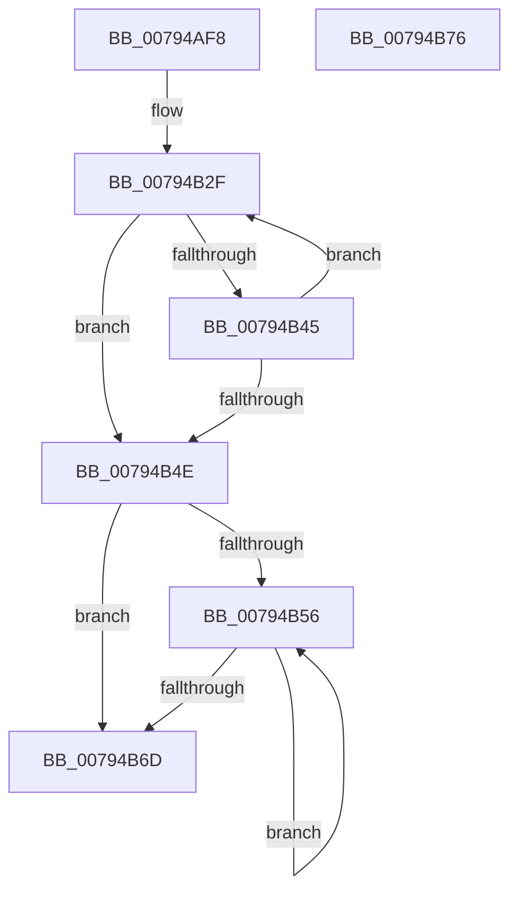

# RtlpRunOnceWaitForInit

- RVA: `0x00794AF8`–`0x00794B77` (길이 `127` bytes)
- VA: `0x0000000140794AF8`
- 실행 섹션: `PAGE`
- PDB 이름 있음: `예`; PDB Function 태그: `아니요`
- unwind 정보 RVA: `0x000AF0B0`
- 디코드: `40`개 명령, `127/127` bytes 표시
- 미해석 바이트: `0` (있으면 어셈블리에 `.byte`로 보존)

> 이 문서는 커널 이미지의 기계어와 PDB 기호를 분석해 생성했습니다. 4번과 5번은 함수 원형과 자료형을 바이너리 사용 방식에서 추정한 C 해석이며 원본 소스 복구 결과는 아닙니다.

## 1. Dependencies

- 직접 호출 지점: **1**; 고유 호출 대상: **1**
- 직접 호출자로 확인된 함수: **2**
- RIP 상대 이미지 참조: **0**

### Outgoing calls
- `0x00794B5D` → [KeWaitForAlertByThreadId](../../text/3C/KeWaitForAlertByThreadId_function_003C4B14.md) (function, `0x003C4B14`)

### Direct callers
- [RtlRunOnceExecuteOnce](../95/RtlRunOnceExecuteOnce_function_0095DC00.md) at `0x0095DD11`
- [RtlRunOnceBeginInitialize](../A2/RtlRunOnceBeginInitialize_function_00A20E60.md) at `0x00A20F19`

### Static image references
- 디코드된 RIP-relative 메모리 참조가 없습니다.

## 2. Other-region calls and transfers

- 다른 실행 섹션으로 향하는 call: **1**
  - `0x00794B5D` → [KeWaitForAlertByThreadId](../../text/3C/KeWaitForAlertByThreadId_function_003C4B14.md) (`PAGE` → `.text`)
- 별도 외부 분기/꼬리 이동을 확인하지 못했습니다.

## 3. Assembly (complete function range)

```asm
00794AF8  4C 8B DC                        mov r11, rsp
00794AFB  53                              push rbx
00794AFC  48 83 EC 50                     sub rsp, 0x50
00794B00  49 83 63 D0 00                  and qword ptr [r11 - 0x30], 0
00794B05  48 8B DA                        mov rbx, rdx
00794B08  49 83 63 D8 00                  and qword ptr [r11 - 0x28], 0
00794B0D  49 8D 53 C8                     lea rdx, [r11 - 0x38]
00794B11  0F 57 C0                        xorps xmm0, xmm0
00794B14  48 83 E2 FD                     and rdx, 0xfffffffffffffffd
00794B18  66 0F 7F 44 24 40               movdqa xmmword ptr [rsp + 0x40], xmm0
00794B1E  48 83 CA 01                     or rdx, 1
00794B22  65 48 8B 04 25 88 01 00 00      mov rax, qword ptr gs:[0x188]
00794B2B  49 89 43 E0                     mov qword ptr [r11 - 0x20], rax
00794B2F  48 8B C1                        mov rax, rcx
00794B32  48 83 E0 FC                     and rax, 0xfffffffffffffffc
00794B36  48 89 44 24 20                  mov qword ptr [rsp + 0x20], rax
00794B3B  48 8B C1                        mov rax, rcx
00794B3E  F0 48 0F B1 13                  lock cmpxchg qword ptr [rbx], rdx
00794B43  74 09                           je 0x140794b4e
00794B45  48 8B C8                        mov rcx, rax
00794B48  24 03                           and al, 3
00794B4A  3C 01                           cmp al, 1
00794B4C  74 E1                           je 0x140794b2f
00794B4E  8A C1                           mov al, cl
00794B50  24 03                           and al, 3
00794B52  3C 01                           cmp al, 1
00794B54  75 17                           jne 0x140794b6d
00794B56  4C 8B C3                        mov r8, rbx
00794B59  33 D2                           xor edx, edx
00794B5B  33 C9                           xor ecx, ecx
00794B5D  E8 B2 FF C2 FF                  call 0x1403c4b14
00794B62  48 8B 0B                        mov rcx, qword ptr [rbx]
00794B65  8B 44 24 44                     mov eax, dword ptr [rsp + 0x44]
00794B69  A8 04                           test al, 4
00794B6B  74 E9                           je 0x140794b56
00794B6D  48 8B C1                        mov rax, rcx
00794B70  48 83 C4 50                     add rsp, 0x50
00794B74  5B                              pop rbx
00794B75  C3                              ret
00794B76  CC                              int3
```

## 4. C-style interpretation (structured pseudocode)

```c
__int64 __fastcall RtlpRunOnceWaitForInit(__int64 a1, __int64 a2)
{
    __int64 result;
    __int64 v_rsp;
    unsigned int v_stack_m14;
    unsigned __int64 v_stack_m18;
    unsigned __int64 v_stack_m38;

    v_rsp = (v_rsp) - (80);
    a2 = (v_rsp - 56) & (-3);
    v_stack_m18 = v_xmm0;
    a2 = (a2) | (1);
    *(unsigned __int64 *)(v_rsp - 32) = *(unsigned __int64 *)(gs_base + (0 + 392));
loc_00794B2F:
    result = (a1) & (-4);
    v_stack_m38 = result;
    if (condition_is_equal) goto loc_00794B4E;
    result = (unsigned __int8)((a1) & (3));
    if (((unsigned __int8)(result)) == 1) goto loc_00794B2F;
loc_00794B4E:
    result = (unsigned __int8)(((unsigned __int8)(a1)) & (3));
    if (((unsigned __int8)(result)) != 1) goto loc_00794B6D;
loc_00794B56:
    a2 = 0;
    a1 = 0;
    result = KeWaitForAlertByThreadId(a1, a2, a2, a4);
    if ((((unsigned __int8)((unsigned int)(v_stack_m14))) & (4)) == 0) goto loc_00794B56;
loc_00794B6D:
    v_rsp = (v_rsp) + (80);
    return *(unsigned __int64 *)(a2);
}
```

## 5. (Beta) C Style

```c
int64_t RtlpRunOnceWaitForInit(int64_t Arg1, void *Arg2)
{
    uint8_t *arg2 = (uint8_t *)Arg2;

    int64_t result;
    int64_t local_rsp;
    uint32_t v_stack_m14;
    uint64_t v_stack_m18;
    uint64_t v_stack_m38;

    local_rsp = (local_rsp) - (80);
    Arg2 = (local_rsp - 56) & (-3);
    v_stack_m18 = v_xmm0;
    Arg2 = (Arg2) | (1);
    *(uint64_t *)(local_rsp - 0x20) = *(uint64_t *)(gs_base + (0 + 0x188));
loc_00794B2F:
    result = (Arg1) & (-4);
    v_stack_m38 = result;
    if (condition_is_equal) goto loc_00794B4E;
    result = (uint8_t)((Arg1) & (3));
    if (((uint8_t)(result)) == 1) goto loc_00794B2F;
loc_00794B4E:
    result = (uint8_t)(((uint8_t)(Arg1)) & (3));
    if (((uint8_t)(result)) != 1) goto loc_00794B6D;
loc_00794B56:
    Arg2 = 0;
    Arg1 = 0;
    result = KeWaitForAlertByThreadId(Arg1, Arg2, Arg2, a4);
    if ((((uint8_t)((uint32_t)(v_stack_m14))) & (4)) == 0) goto loc_00794B56;
loc_00794B6D:
    local_rsp = (local_rsp) + (80);
    return *(uint64_t *)(arg2);
}
```

### 관측된 메모리 오프셋

구조체 형식이 확인되지 않은 접근은 인자 기준의 오프셋으로만 기록했습니다.

| 기준 인자 | 오프셋 표현 | 폭 (bit) | 접근 |
|---|---:|---:|---|
| `Arg2` | `+ 0x0` | `64` | `R` |

## 6. Execution-region graph

[열기: 2D/3D 그래프와 함수 탐색 컨트롤 패널](../../../control-panel.html?section=page&rva=0x00794AF8&view=graph)

- 2D 그래프는 위에서 아래로 흐르고, 3D 그래프는 빈 공간을 드래그해 회전합니다. Shift+드래그는 이동, 휠은 확대·축소, 함수 노드 선택은 대상 보고서 이동입니다.

### Static fallback


