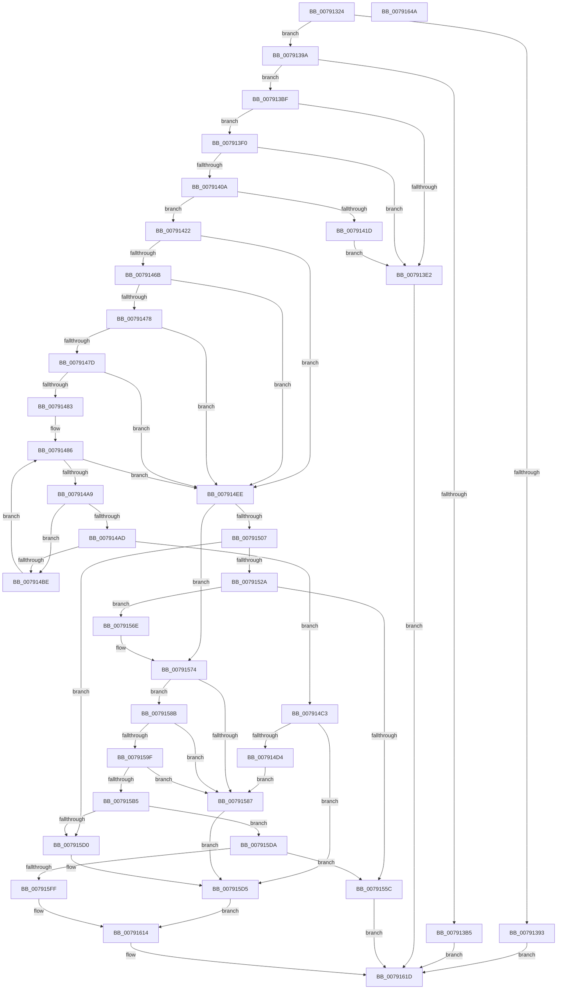

# RtlpSysVolCheckOwnerAndSecurity

- RVA: `0x00791324`–`0x0079164B` (길이 `807` bytes)
- VA: `0x0000000140791324`
- 실행 섹션: `PAGE`
- PDB 이름 있음: `예`; PDB Function 태그: `아니요`
- unwind 정보 RVA: `0x000C98E4`
- 디코드: `231`개 명령, `807/807` bytes 표시
- 미해석 바이트: `0` (있으면 어셈블리에 `.byte`로 보존)

> 이 문서는 커널 이미지의 기계어와 PDB 기호를 분석해 생성했습니다. 4번과 5번은 함수 원형과 자료형을 바이너리 사용 방식에서 추정한 C 해석이며 원본 소스 복구 결과는 아닙니다.

## 1. Dependencies

- 직접 호출 지점: **25**; 고유 호출 대상: **14**
- 직접 호출자로 확인된 함수: **1**
- RIP 상대 이미지 참조: **3**

### Outgoing calls
- `0x00791383` → [NtQuerySecurityObject](../87/NtQuerySecurityObject_function_008737B0.md) (function, `0x008737B0`)
- `0x007913A8` → [ExAllocatePool2](../../poolcode/B8/ExAllocatePool2_function_00B820F0.md) (function, `0x00B820F0`)
- `0x007913D4` → [NtQuerySecurityObject](../87/NtQuerySecurityObject_function_008737B0.md) (function, `0x008737B0`)
- `0x007913E4` → [ExFreePoolWithTag](../../poolcode/B8/ExFreePoolWithTag_function_00B82870.md) (function, `0x00B82870`)
- `0x007913FC` → [RtlGetDaclSecurityDescriptor](../../text/45/RtlGetDaclSecurityDescriptor_function_00459570.md) (function, `0x00459570`)
- `0x00791412` → [RtlGetOwnerSecurityDescriptor](../A2/RtlGetOwnerSecurityDescriptor_function_00A22590.md) (function, `0x00A22590`)
- `0x0079146F` → [RtlEqualSid](../../text/40/RtlEqualSid_function_00400AD0.md) (function, `0x00400AD0`)
- `0x00791491` → [RtlGetAce](../../text/40/RtlGetAce_function_0040FAF0.md) (function, `0x0040FAF0`)
- `0x007914B5` → [RtlEqualSid](../../text/40/RtlEqualSid_function_00400AD0.md) (function, `0x00400AD0`)
- `0x007914E4` → [NtSetSecurityObject](../AD/NtSetSecurityObject_function_00ADE2B0.md) (function, `0x00ADE2B0`)
- `0x007914FD` → [RtlSelfRelativeToAbsoluteSD2](../78/RtlSelfRelativeToAbsoluteSD2_function_0078CF80.md) (function, `0x0078CF80`)
- `0x00791519` → [ExAllocatePool2](../../poolcode/B8/ExAllocatePool2_function_00B820F0.md) (function, `0x00B820F0`)
- `0x00791533` → [memcpy](../../text/6C/memcpy_function_006C6840.md) (function, `0x006C6840`)
- `0x0079153D` → [ExFreePoolWithTag](../../poolcode/B8/ExFreePoolWithTag_function_00B82870.md) (function, `0x00B82870`)
- `0x00791550` → [RtlSelfRelativeToAbsoluteSD2](../78/RtlSelfRelativeToAbsoluteSD2_function_0078CF80.md) (function, `0x0078CF80`)
- `0x00791561` → [ExFreePoolWithTag](../../poolcode/B8/ExFreePoolWithTag_function_00B82870.md) (function, `0x00B82870`)
- `0x0079157E` → [RtlSetOwnerSecurityDescriptor](../91/RtlSetOwnerSecurityDescriptor_function_00916F90.md) (function, `0x00916F90`)
- `0x00791596` → [RtlSetDaclSecurityDescriptor](../9E/RtlSetDaclSecurityDescriptor_function_009EC210.md) (function, `0x009EC210`)
- `0x007915AB` → [RtlMakeSelfRelativeSD](../A1/RtlMakeSelfRelativeSD_function_00A119D4.md) (function, `0x00A119D4`)
- `0x007915C3` → [ExAllocatePool2](../../poolcode/B8/ExAllocatePool2_function_00B820F0.md) (function, `0x00B820F0`)
- `0x007915E4` → [RtlMakeSelfRelativeSD](../A1/RtlMakeSelfRelativeSD_function_00A119D4.md) (function, `0x00A119D4`)
- `0x007915F1` → [ExFreePoolWithTag](../../poolcode/B8/ExFreePoolWithTag_function_00B82870.md) (function, `0x00B82870`)
- `0x0079160A` → [NtSetSecurityObject](../AD/NtSetSecurityObject_function_00ADE2B0.md) (function, `0x00ADE2B0`)
- `0x00791616` → [ExFreePoolWithTag](../../poolcode/B8/ExFreePoolWithTag_function_00B82870.md) (function, `0x00B82870`)
- `0x00791624` → [_security_check_cookie](../../text/6A/_security_check_cookie_function_006AC640.md) (function, `0x006AC640`)

### Direct callers
- [RtlCreateSystemVolumeInformationFolder](RtlCreateSystemVolumeInformationFolder_function_00791010.md) at `0x007912E5`

### Static image references
- `0x00791347` → RVA `0x00E0A740` (`.data`; read)
- `0x00791422` → RVA `0x00031440` (`.rdata`; read)
- `0x00791428` → RVA `0x00031444` (`.rdata`; read)

## 2. Other-region calls and transfers

- 다른 실행 섹션으로 향하는 call: **14**
  - `0x007913A8` → [ExAllocatePool2](../../poolcode/B8/ExAllocatePool2_function_00B820F0.md) (`PAGE` → `POOLCODE`)
  - `0x007913E4` → [ExFreePoolWithTag](../../poolcode/B8/ExFreePoolWithTag_function_00B82870.md) (`PAGE` → `POOLCODE`)
  - `0x007913FC` → [RtlGetDaclSecurityDescriptor](../../text/45/RtlGetDaclSecurityDescriptor_function_00459570.md) (`PAGE` → `.text`)
  - `0x0079146F` → [RtlEqualSid](../../text/40/RtlEqualSid_function_00400AD0.md) (`PAGE` → `.text`)
  - `0x00791491` → [RtlGetAce](../../text/40/RtlGetAce_function_0040FAF0.md) (`PAGE` → `.text`)
  - `0x007914B5` → [RtlEqualSid](../../text/40/RtlEqualSid_function_00400AD0.md) (`PAGE` → `.text`)
  - `0x00791519` → [ExAllocatePool2](../../poolcode/B8/ExAllocatePool2_function_00B820F0.md) (`PAGE` → `POOLCODE`)
  - `0x00791533` → [memcpy](../../text/6C/memcpy_function_006C6840.md) (`PAGE` → `.text`)
  - `0x0079153D` → [ExFreePoolWithTag](../../poolcode/B8/ExFreePoolWithTag_function_00B82870.md) (`PAGE` → `POOLCODE`)
  - `0x00791561` → [ExFreePoolWithTag](../../poolcode/B8/ExFreePoolWithTag_function_00B82870.md) (`PAGE` → `POOLCODE`)
  - `0x007915C3` → [ExAllocatePool2](../../poolcode/B8/ExAllocatePool2_function_00B820F0.md) (`PAGE` → `POOLCODE`)
  - `0x007915F1` → [ExFreePoolWithTag](../../poolcode/B8/ExFreePoolWithTag_function_00B82870.md) (`PAGE` → `POOLCODE`)
  - `0x00791616` → [ExFreePoolWithTag](../../poolcode/B8/ExFreePoolWithTag_function_00B82870.md) (`PAGE` → `POOLCODE`)
  - `0x00791624` → [_security_check_cookie](../../text/6A/_security_check_cookie_function_006AC640.md) (`PAGE` → `.text`)
- 별도 외부 분기/꼬리 이동을 확인하지 못했습니다.

## 3. Assembly (complete function range)

```asm
00791324  48 8B C4                        mov rax, rsp
00791327  48 89 58 10                     mov qword ptr [rax + 0x10], rbx
0079132B  48 89 70 18                     mov qword ptr [rax + 0x18], rsi
0079132F  48 89 78 20                     mov qword ptr [rax + 0x20], rdi
00791333  55                              push rbp
00791334  41 54                           push r12
00791336  41 55                           push r13
00791338  41 56                           push r14
0079133A  41 57                           push r15
0079133C  48 8D 68 A1                     lea rbp, [rax - 0x5f]
00791340  48 81 EC 90 00 00 00            sub rsp, 0x90
00791347  48 8B 05 F2 93 67 00            mov rax, qword ptr [rip + 0x6793f2]
0079134E  48 33 C4                        xor rax, rsp
00791351  48 89 45 27                     mov qword ptr [rbp + 0x27], rax
00791355  33 DB                           xor ebx, ebx
00791357  48 8D 45 D7                     lea rax, [rbp - 0x29]
0079135B  4C 8B EA                        mov r13, rdx
0079135E  89 5D D7                        mov dword ptr [rbp - 0x29], ebx
00791361  45 33 C9                        xor r9d, r9d
00791364  48 89 5D EF                     mov qword ptr [rbp - 0x11], rbx
00791368  45 33 C0                        xor r8d, r8d
0079136B  88 5D DB                        mov byte ptr [rbp - 0x25], bl
0079136E  8D 73 05                        lea esi, [rbx + 5]
00791371  48 89 5D E7                     mov qword ptr [rbp - 0x19], rbx
00791375  8B D6                           mov edx, esi
00791377  48 89 5D DF                     mov qword ptr [rbp - 0x21], rbx
0079137B  4C 8B F9                        mov r15, rcx
0079137E  48 89 44 24 20                  mov qword ptr [rsp + 0x20], rax
00791383  E8 28 24 0E 00                  call 0x1408737b0
00791388  41 BC 23 00 00 C0               mov r12d, 0xc0000023
0079138E  41 3B C4                        cmp eax, r12d
00791391  74 07                           je 0x14079139a
00791393  33 C0                           xor eax, eax
00791395  E9 83 02 00 00                  jmp 0x14079161d
0079139A  8B 55 D7                        mov edx, dword ptr [rbp - 0x29]
0079139D  B9 00 01 00 00                  mov ecx, 0x100
007913A2  41 B8 56 6F 6C 53               mov r8d, 0x536c6f56
007913A8  E8 43 0D 3F 00                  call 0x140b820f0
007913AD  48 8B F8                        mov rdi, rax
007913B0  48 85 C0                        test rax, rax
007913B3  75 0A                           jne 0x1407913bf
007913B5  B8 9A 00 00 C0                  mov eax, 0xc000009a
007913BA  E9 5E 02 00 00                  jmp 0x14079161d
007913BF  44 8B 4D D7                     mov r9d, dword ptr [rbp - 0x29]
007913C3  48 8D 45 D7                     lea rax, [rbp - 0x29]
007913C7  4C 8B C7                        mov r8, rdi
007913CA  48 89 44 24 20                  mov qword ptr [rsp + 0x20], rax
007913CF  8B D6                           mov edx, esi
007913D1  49 8B CF                        mov rcx, r15
007913D4  E8 D7 23 0E 00                  call 0x1408737b0
007913D9  8B F0                           mov esi, eax
007913DB  48 8B CF                        mov rcx, rdi
007913DE  85 C0                           test eax, eax
007913E0  79 0E                           jns 0x1407913f0
007913E2  33 D2                           xor edx, edx
007913E4  E8 87 14 3F 00                  call 0x140b82870
007913E9  8B C6                           mov eax, esi
007913EB  E9 2D 02 00 00                  jmp 0x14079161d
007913F0  4C 8D 4D DC                     lea r9, [rbp - 0x24]
007913F4  4C 8D 45 DF                     lea r8, [rbp - 0x21]
007913F8  48 8D 55 DB                     lea rdx, [rbp - 0x25]
007913FC  E8 6F 81 CC FF                  call 0x140459570
00791401  8B F0                           mov esi, eax
00791403  48 8B CF                        mov rcx, rdi
00791406  85 C0                           test eax, eax
00791408  78 D8                           js 0x1407913e2
0079140A  4C 8D 45 DC                     lea r8, [rbp - 0x24]
0079140E  48 8D 55 EF                     lea rdx, [rbp - 0x11]
00791412  E8 79 11 29 00                  call 0x140a22590
00791417  8B F0                           mov esi, eax
00791419  85 C0                           test eax, eax
0079141B  79 05                           jns 0x140791422
0079141D  48 8B CF                        mov rcx, rdi
00791420  EB C0                           jmp 0x1407913e2
00791422  8B 0D 18 00 8A FF               mov ecx, dword ptr [rip - 0x75ffe8]
00791428  0F B7 05 15 00 8A FF            movzx eax, word ptr [rip - 0x75ffeb]
0079142F  89 4D 11                        mov dword ptr [rbp + 0x11], ecx
00791432  89 4D F9                        mov dword ptr [rbp - 7], ecx
00791435  48 8B 4D EF                     mov rcx, qword ptr [rbp - 0x11]
00791439  66 C7 45 0F 01 01               mov word ptr [rbp + 0xf], 0x101
0079143F  66 89 45 15                     mov word ptr [rbp + 0x15], ax
00791443  C7 45 17 12 00 00 00            mov dword ptr [rbp + 0x17], 0x12
0079144A  66 C7 45 F7 01 02               mov word ptr [rbp - 9], 0x201
00791450  66 89 45 FD                     mov word ptr [rbp - 3], ax
00791454  C7 45 FF 20 00 00 00            mov dword ptr [rbp - 1], 0x20
0079145B  C7 45 03 20 02 00 00            mov dword ptr [rbp + 3], 0x220
00791462  48 85 C9                        test rcx, rcx
00791465  0F 84 83 00 00 00               je 0x1407914ee
0079146B  48 8D 55 F7                     lea rdx, [rbp - 9]
0079146F  E8 5C F6 C6 FF                  call 0x140400ad0
00791474  84 C0                           test al, al
00791476  74 76                           je 0x1407914ee
00791478  38 5D DB                        cmp byte ptr [rbp - 0x25], bl
0079147B  74 71                           je 0x1407914ee
0079147D  48 39 5D DF                     cmp qword ptr [rbp - 0x21], rbx
00791481  74 6B                           je 0x1407914ee
00791483  44 8B F3                        mov r14d, ebx
00791486  48 8B 4D DF                     mov rcx, qword ptr [rbp - 0x21]
0079148A  4C 8D 45 E7                     lea r8, [rbp - 0x19]
0079148E  41 8B D6                        mov edx, r14d
00791491  E8 5A E6 C7 FF                  call 0x14040faf0
00791496  48 8B 75 E7                     mov rsi, qword ptr [rbp - 0x19]
0079149A  85 C0                           test eax, eax
0079149C  48 0F 48 F3                     cmovs rsi, rbx
007914A0  48 89 75 E7                     mov qword ptr [rbp - 0x19], rsi
007914A4  48 85 F6                        test rsi, rsi
007914A7  74 45                           je 0x1407914ee
007914A9  38 1E                           cmp byte ptr [rsi], bl
007914AB  75 11                           jne 0x1407914be
007914AD  48 8D 4E 08                     lea rcx, [rsi + 8]
007914B1  48 8D 55 0F                     lea rdx, [rbp + 0xf]
007914B5  E8 16 F6 C6 FF                  call 0x140400ad0
007914BA  84 C0                           test al, al
007914BC  75 05                           jne 0x1407914c3
007914BE  41 FF C6                        inc r14d
007914C1  EB C3                           jmp 0x140791486
007914C3  8A 4E 01                        mov cl, byte ptr [rsi + 1]
007914C6  B2 03                           mov dl, 3
007914C8  8A C1                           mov al, cl
007914CA  22 C2                           and al, dl
007914CC  3A C2                           cmp al, dl
007914CE  0F 84 01 01 00 00               je 0x1407915d5
007914D4  0A CA                           or cl, dl
007914D6  4C 8B C7                        mov r8, rdi
007914D9  88 4E 01                        mov byte ptr [rsi + 1], cl
007914DC  BA 04 00 00 00                  mov edx, 4
007914E1  49 8B CF                        mov rcx, r15
007914E4  E8 C7 CD 34 00                  call 0x140ade2b0
007914E9  E9 99 00 00 00                  jmp 0x140791587
007914EE  44 8B 75 D7                     mov r14d, dword ptr [rbp - 0x29]
007914F2  48 8D 55 D7                     lea rdx, [rbp - 0x29]
007914F6  48 8B CF                        mov rcx, rdi
007914F9  44 89 75 D7                     mov dword ptr [rbp - 0x29], r14d
007914FD  E8 7E BA FF FF                  call 0x14078cf80
00791502  41 3B C4                        cmp eax, r12d
00791505  75 6D                           jne 0x140791574
00791507  44 8B 65 D7                     mov r12d, dword ptr [rbp - 0x29]
0079150B  B9 00 01 00 00                  mov ecx, 0x100
00791510  41 8B D4                        mov edx, r12d
00791513  41 B8 56 6F 6C 53               mov r8d, 0x536c6f56
00791519  E8 D2 0B 3F 00                  call 0x140b820f0
0079151E  48 8B F0                        mov rsi, rax
00791521  48 85 C0                        test rax, rax
00791524  0F 84 A6 00 00 00               je 0x1407915d0
0079152A  45 8B C6                        mov r8d, r14d
0079152D  48 8B D7                        mov rdx, rdi
00791530  48 8B C8                        mov rcx, rax
00791533  E8 08 53 F3 FF                  call 0x1406c6840
00791538  33 D2                           xor edx, edx
0079153A  48 8B CF                        mov rcx, rdi
0079153D  E8 2E 13 3F 00                  call 0x140b82870
00791542  48 8D 55 D7                     lea rdx, [rbp - 0x29]
00791546  44 89 65 D7                     mov dword ptr [rbp - 0x29], r12d
0079154A  48 8B CE                        mov rcx, rsi
0079154D  48 8B FE                        mov rdi, rsi
00791550  E8 2B BA FF FF                  call 0x14078cf80
00791555  44 8B F0                        mov r14d, eax
00791558  85 C0                           test eax, eax
0079155A  79 12                           jns 0x14079156e
0079155C  33 D2                           xor edx, edx
0079155E  48 8B CE                        mov rcx, rsi
00791561  E8 0A 13 3F 00                  call 0x140b82870
00791566  41 8B C6                        mov eax, r14d
00791569  E9 AF 00 00 00                  jmp 0x14079161d
0079156E  41 BC 23 00 00 C0               mov r12d, 0xc0000023
00791574  45 33 C0                        xor r8d, r8d
00791577  48 8D 55 F7                     lea rdx, [rbp - 9]
0079157B  48 8B CF                        mov rcx, rdi
0079157E  E8 0D 5A 18 00                  call 0x140916f90
00791583  85 C0                           test eax, eax
00791585  79 04                           jns 0x14079158b
00791587  8B D8                           mov ebx, eax
00791589  EB 4A                           jmp 0x1407915d5
0079158B  45 33 C9                        xor r9d, r9d
0079158E  4D 8B C5                        mov r8, r13
00791591  B2 01                           mov dl, 1
00791593  48 8B CF                        mov rcx, rdi
00791596  E8 75 AC 25 00                  call 0x1409ec210
0079159B  85 C0                           test eax, eax
0079159D  78 E8                           js 0x140791587
0079159F  4C 8D 45 D7                     lea r8, [rbp - 0x29]
007915A3  89 5D D7                        mov dword ptr [rbp - 0x29], ebx
007915A6  33 D2                           xor edx, edx
007915A8  48 8B CF                        mov rcx, rdi
007915AB  E8 24 04 28 00                  call 0x140a119d4
007915B0  41 3B C4                        cmp eax, r12d
007915B3  75 D2                           jne 0x140791587
007915B5  8B 55 D7                        mov edx, dword ptr [rbp - 0x29]
007915B8  B9 00 01 00 00                  mov ecx, 0x100
007915BD  41 B8 56 6F 6C 53               mov r8d, 0x536c6f56
007915C3  E8 28 0B 3F 00                  call 0x140b820f0
007915C8  48 8B F0                        mov rsi, rax
007915CB  48 85 C0                        test rax, rax
007915CE  75 0A                           jne 0x1407915da
007915D0  BB 9A 00 00 C0                  mov ebx, 0xc000009a
007915D5  48 8B CF                        mov rcx, rdi
007915D8  EB 3A                           jmp 0x140791614
007915DA  4C 8D 45 D7                     lea r8, [rbp - 0x29]
007915DE  48 8B D6                        mov rdx, rsi
007915E1  48 8B CF                        mov rcx, rdi
007915E4  E8 EB 03 28 00                  call 0x140a119d4
007915E9  33 D2                           xor edx, edx
007915EB  48 8B CF                        mov rcx, rdi
007915EE  44 8B F0                        mov r14d, eax
007915F1  E8 7A 12 3F 00                  call 0x140b82870
007915F6  45 85 F6                        test r14d, r14d
007915F9  0F 88 5D FF FF FF               js 0x14079155c
007915FF  4C 8B C6                        mov r8, rsi
00791602  BA 05 00 00 00                  mov edx, 5
00791607  49 8B CF                        mov rcx, r15
0079160A  E8 A1 CC 34 00                  call 0x140ade2b0
0079160F  8B D8                           mov ebx, eax
00791611  48 8B CE                        mov rcx, rsi
00791614  33 D2                           xor edx, edx
00791616  E8 55 12 3F 00                  call 0x140b82870
0079161B  8B C3                           mov eax, ebx
0079161D  48 8B 4D 27                     mov rcx, qword ptr [rbp + 0x27]
00791621  48 33 CC                        xor rcx, rsp
00791624  E8 17 B0 F1 FF                  call 0x1406ac640
00791629  4C 8D 9C 24 90 00 00 00         lea r11, [rsp + 0x90]
00791631  49 8B 5B 38                     mov rbx, qword ptr [r11 + 0x38]
00791635  49 8B 73 40                     mov rsi, qword ptr [r11 + 0x40]
00791639  49 8B 7B 48                     mov rdi, qword ptr [r11 + 0x48]
0079163D  49 8B E3                        mov rsp, r11
00791640  41 5F                           pop r15
00791642  41 5E                           pop r14
00791644  41 5D                           pop r13
00791646  41 5C                           pop r12
00791648  5D                              pop rbp
00791649  C3                              ret
0079164A  CC                              int3
```

## 4. C-style interpretation (structured pseudocode)

```c
__int64 __fastcall RtlpSysVolCheckOwnerAndSecurity(__int64 a1, __int64 a2, int a3, int a4)
{
    __int64 result;
    __int64 v_r14;
    __int64 v_rbx;
    __int64 v_rsi;
    __int64 v_rsp;
    unsigned __int64 v_stack_m28;
    unsigned __int64 v_stack_m98;

    *(unsigned __int64 *)(v_rsp + 16) = v_rbx;
    *(unsigned __int64 *)(v_rsp + 24) = v_rsi;
    *(unsigned __int64 *)(v_rsp + 32) = v_rdi;
    v_rsp = (v_rsp) - (144);
    result = (*(unsigned __int64 *)(v_rip + 6788082)) ^ (v_rsp);
    *(unsigned __int64 *)(v_rsp - 95 + 39) = result;
    v_rbx = 0;
    *(unsigned int *)(v_rsp - 95 - 41) = 0;
    a4 = 0;
    *(unsigned __int64 *)(v_rsp - 95 - 17) = 0;
    a3 = 0;
    *(unsigned __int8 *)(v_rsp - 95 - 37) = 0;
    *(unsigned __int64 *)(v_rsp - 95 - 25) = 0;
    *(unsigned __int64 *)(v_rsp - 95 - 33) = 0;
    v_stack_m98 = v_rsp - 95 - 41;
    result = NtQuerySecurityObject(a1, (unsigned int)((unsigned int)(v_rbx + 5)), a3, a4);
    if (((unsigned int)(result)) == ((unsigned int)((unsigned int)(0xC0000023ULL)))) goto loc_0079139A;
    result = 0;
    goto loc_0079161D;
loc_0079139A:
    result = ExAllocatePool2(256, (unsigned int)(*(unsigned int *)(v_rsp - 95 - 41)), (unsigned int)(0x536C6F56ULL), a4);
    if (result != 0) goto loc_007913BF;
    goto loc_0079161D;
loc_007913BF:
    v_stack_m98 = v_rsp - 95 - 41;
    result = NtQuerySecurityObject(a1, (unsigned int)((unsigned int)(v_rbx + 5)), result, (unsigned int)(*(unsigned int *)(v_rsp - 95 - 41)));
    if (!sign_flag) goto loc_007913F0;
loc_007913E2:
    a2 = 0;
    result = ExFreePoolWithTag(result, a2, result, (unsigned int)(*(unsigned int *)(v_rsp - 95 - 41)));
    goto loc_0079161D;
loc_007913F0:
    result = RtlGetDaclSecurityDescriptor(result, v_rsp - 95 - 37, v_rsp - 95 - 33, v_rsp - 95 - 36);
    if (sign_flag) goto loc_007913E2;
    result = RtlGetOwnerSecurityDescriptor(result, v_rsp - 95 - 17, v_rsp - 95 - 36, v_rsp - 95 - 36);
    if (!sign_flag) goto loc_00791422;
    goto loc_007913E2;
loc_00791422:
    *(unsigned int *)(v_rsp - 95 + 17) = (unsigned int)((unsigned int)(*(unsigned int *)(v_rip - 7733224)));
    *(unsigned int *)(v_rsp - 95 - 7) = (unsigned int)((unsigned int)(*(unsigned int *)(v_rip - 7733224)));
    *(unsigned __int16 *)(v_rsp - 95 + 15) = 257;
    *(unsigned __int16 *)(v_rsp - 95 + 21) = (unsigned __int16)(*(unsigned __int16 *)(v_rip - 7733227));
    *(unsigned int *)(v_rsp - 95 + 23) = 18;
    *(unsigned __int16 *)(v_rsp - 95 - 9) = 513;
    *(unsigned __int16 *)(v_rsp - 95 - 3) = (unsigned __int16)(*(unsigned __int16 *)(v_rip - 7733227));
    *(unsigned int *)(v_rsp - 95 - 1) = 32;
    *(unsigned int *)(v_rsp - 95 + 3) = 544;
    if (*(unsigned __int64 *)(v_rsp - 95 - 17) == 0) goto loc_007914EE;
    result = RtlEqualSid(*(unsigned __int64 *)(v_rsp - 95 - 17), v_rsp - 95 - 9, v_rsp - 95 - 36, v_rsp - 95 - 36);
    if ((unsigned __int8)(result) == 0) goto loc_007914EE;
    if ((*(unsigned __int8 *)(v_rsp - 95 - 37)) == 0) goto loc_007914EE;
    if ((*(unsigned __int64 *)(v_rsp - 95 - 33)) == 0) goto loc_007914EE;
loc_00791486:
    result = RtlGetAce(*(unsigned __int64 *)(v_rsp - 95 - 33), 0, v_rsp - 95 - 25, v_rsp - 95 - 36);
    v_rsi = *(unsigned __int64 *)(v_rsp - 95 - 25);
    if (sign_flag) { v_rsi = 0; }
    *(unsigned __int64 *)(v_rsp - 95 - 25) = v_rsi;
    if (v_rsi == 0) goto loc_007914EE;
    if ((*(unsigned __int8 *)(v_rsi)) != 0) goto loc_007914BE;
    result = RtlEqualSid(v_rsi + 8, v_rsp - 95 + 15, v_rsp - 95 - 25, v_rsp - 95 - 36);
    if ((unsigned __int8)(result) != 0) goto loc_007914C3;
loc_007914BE:
    v_r14 = (unsigned int)((0) + 1);
    goto loc_00791486;
loc_007914C3:
    result = (unsigned __int8)(((unsigned __int8)(*(unsigned __int8 *)(v_rsi + 1))) & (3));
    if (((unsigned __int8)(result)) == 3) goto loc_007915D5;
    a1 = (unsigned __int8)((*(unsigned __int8 *)(v_rsi + 1)) | (3));
    *(unsigned __int8 *)(v_rsi + 1) = (unsigned __int8)(a1);
    result = NtSetSecurityObject(a1, 4, result, v_rsp - 95 - 36);
    goto loc_00791587;
loc_007914EE:
    *(unsigned int *)(v_rsp - 95 - 41) = (unsigned int)((unsigned int)(*(unsigned int *)(v_rsp - 95 - 41)));
    result = RtlSelfRelativeToAbsoluteSD2(result, v_rsp - 95 - 41, result, v_rsp - 95 - 36);
    if (((unsigned int)(result)) != ((unsigned int)((unsigned int)(0xC0000023ULL)))) goto loc_00791574;
    result = ExAllocatePool2(256, (unsigned int)((unsigned int)((unsigned int)(*(unsigned int *)(v_rsp - 95 - 41)))), (unsigned int)(0x536C6F56ULL), v_rsp - 95 - 36);
    if (result == 0) goto loc_007915D0;
    result = memcpy(result, result, (unsigned int)((unsigned int)((unsigned int)(*(unsigned int *)(v_rsp - 95 - 41)))), v_rsp - 95 - 36);
    a2 = 0;
    result = ExFreePoolWithTag(result, a2, (unsigned int)((unsigned int)((unsigned int)(*(unsigned int *)(v_rsp - 95 - 41)))), v_rsp - 95 - 36);
    *(unsigned int *)(v_rsp - 95 - 41) = (unsigned int)((unsigned int)(*(unsigned int *)(v_rsp - 95 - 41)));
    result = RtlSelfRelativeToAbsoluteSD2(result, v_rsp - 95 - 41, (unsigned int)((unsigned int)((unsigned int)(*(unsigned int *)(v_rsp - 95 - 41)))), v_rsp - 95 - 36);
    if (!sign_flag) goto loc_0079156E;
loc_0079155C:
    a2 = 0;
    result = ExFreePoolWithTag(result, a2, (unsigned int)((unsigned int)((unsigned int)(*(unsigned int *)(v_rsp - 95 - 41)))), v_rsp - 95 - 36);
    goto loc_0079161D;
loc_0079156E:
loc_00791574:
    a3 = 0;
    result = RtlSetOwnerSecurityDescriptor(result, v_rsp - 95 - 9, a3, v_rsp - 95 - 36);
    if (!sign_flag) goto loc_0079158B;
loc_00791587:
    goto loc_007915D5;
loc_0079158B:
    a4 = 0;
    result = RtlSetDaclSecurityDescriptor(result, 1, 0, a4);
    if (sign_flag) goto loc_00791587;
    *(unsigned int *)(v_rsp - 95 - 41) = (unsigned int)((unsigned int)((unsigned int)(result)));
    a2 = 0;
    result = RtlMakeSelfRelativeSD(result, a2, v_rsp - 95 - 41, a4);
    if (((unsigned int)(result)) != ((unsigned int)((unsigned int)(0xC0000023ULL)))) goto loc_00791587;
    result = ExAllocatePool2(256, (unsigned int)(*(unsigned int *)(v_rsp - 95 - 41)), (unsigned int)(0x536C6F56ULL), a4);
    if (result != 0) goto loc_007915DA;
loc_007915D0:
loc_007915D5:
    goto loc_00791614;
loc_007915DA:
    result = RtlMakeSelfRelativeSD(result, result, v_rsp - 95 - 41, a4);
    a2 = 0;
    result = ExFreePoolWithTag(result, a2, v_rsp - 95 - 41, a4);
    if (sign_flag) goto loc_0079155C;
    result = NtSetSecurityObject(a1, 5, result, a4);
loc_00791614:
    a2 = 0;
    result = ExFreePoolWithTag(result, a2, result, a4);
loc_0079161D:
    a1 = (*(unsigned __int64 *)(v_rsp - 95 + 39)) ^ (v_rsp);
    result = _security_check_cookie(a1, a2, result, a4);
    return result;
}
```

## 5. (Beta) C Style

```c
int64_t RtlpSysVolCheckOwnerAndSecurity(int64_t Arg1, int64_t Arg2, int32_t Arg3, int32_t Arg4)
{
    int64_t result;
    int64_t local_r14;
    int64_t local_rbx;
    int64_t local_rsi;
    int64_t local_rsp;
    uint64_t v_stack_m28;
    uint64_t v_stack_m98;

    *(uint64_t *)(local_rsp + 0x10) = local_rbx;
    *(uint64_t *)(local_rsp + 0x18) = local_rsi;
    *(uint64_t *)(local_rsp + 0x20) = local_rdi;
    local_rsp = (local_rsp) - (144);
    result = (*(uint64_t *)(v_rip + 0x6793F2)) ^ (local_rsp);
    *(uint64_t *)(local_rsp - 0x5F + 0x27) = result;
    local_rbx = 0;
    *(uint32_t *)(local_rsp - 0x5F - 0x29) = 0;
    Arg4 = 0;
    *(uint64_t *)(local_rsp - 0x5F - 0x11) = 0;
    Arg3 = 0;
    *(uint8_t *)(local_rsp - 0x5F - 0x25) = 0;
    *(uint64_t *)(local_rsp - 0x5F - 0x19) = 0;
    *(uint64_t *)(local_rsp - 0x5F - 0x21) = 0;
    v_stack_m98 = local_rsp - 95 - 41;
    result = NtQuerySecurityObject(Arg1, (uint32_t)((uint32_t)(local_rbx + 5)), Arg3, Arg4);
    if (((uint32_t)(result)) == ((uint32_t)((uint32_t)(0xC0000023ULL)))) goto loc_0079139A;
    result = 0;
    goto loc_0079161D;
loc_0079139A:
    result = ExAllocatePool2(256, (uint32_t)(*(uint32_t *)(local_rsp - 0x5F - 0x29)), (uint32_t)(0x536C6F56ULL), Arg4);
    if (result != 0) goto loc_007913BF;
    goto loc_0079161D;
loc_007913BF:
    v_stack_m98 = local_rsp - 95 - 41;
    result = NtQuerySecurityObject(Arg1, (uint32_t)((uint32_t)(local_rbx + 5)), result, (uint32_t)(*(uint32_t *)(local_rsp - 0x5F - 0x29)));
    if (!sign_flag) goto loc_007913F0;
loc_007913E2:
    Arg2 = 0;
    result = ExFreePoolWithTag(result, Arg2, result, (uint32_t)(*(uint32_t *)(local_rsp - 0x5F - 0x29)));
    goto loc_0079161D;
loc_007913F0:
    result = RtlGetDaclSecurityDescriptor(result, local_rsp - 95 - 37, local_rsp - 95 - 33, local_rsp - 95 - 36);
    if (sign_flag) goto loc_007913E2;
    result = RtlGetOwnerSecurityDescriptor(result, local_rsp - 95 - 17, local_rsp - 95 - 36, local_rsp - 95 - 36);
    if (!sign_flag) goto loc_00791422;
    goto loc_007913E2;
loc_00791422:
    *(uint32_t *)(local_rsp - 0x5F + 0x11) = (uint32_t)((uint32_t)(*(uint32_t *)(v_rip - 0x75FFE8)));
    *(uint32_t *)(local_rsp - 0x5F - 0x7) = (uint32_t)((uint32_t)(*(uint32_t *)(v_rip - 0x75FFE8)));
    *(uint16_t *)(local_rsp - 0x5F + 0xF) = 257;
    *(uint16_t *)(local_rsp - 0x5F + 0x15) = (uint16_t)(*(uint16_t *)(v_rip - 0x75FFEB));
    *(uint32_t *)(local_rsp - 0x5F + 0x17) = 18;
    *(uint16_t *)(local_rsp - 0x5F - 0x9) = 513;
    *(uint16_t *)(local_rsp - 0x5F - 0x3) = (uint16_t)(*(uint16_t *)(v_rip - 0x75FFEB));
    *(uint32_t *)(local_rsp - 0x5F - 0x1) = 32;
    *(uint32_t *)(local_rsp - 0x5F + 0x3) = 544;
    if (*(uint64_t *)(local_rsp - 0x5F - 0x11) == 0) goto loc_007914EE;
    result = RtlEqualSid(*(uint64_t *)(local_rsp - 0x5F - 0x11), local_rsp - 95 - 9, local_rsp - 95 - 36, local_rsp - 95 - 36);
    if ((uint8_t)(result) == 0) goto loc_007914EE;
    if ((*(uint8_t *)(local_rsp - 0x5F - 0x25)) == 0) goto loc_007914EE;
    if ((*(uint64_t *)(local_rsp - 0x5F - 0x21)) == 0) goto loc_007914EE;
loc_00791486:
    result = RtlGetAce(*(uint64_t *)(local_rsp - 0x5F - 0x21), 0, local_rsp - 95 - 25, local_rsp - 95 - 36);
    local_rsi = *(uint64_t *)(local_rsp - 0x5F - 0x19);
    if (sign_flag) { local_rsi = 0; }
    *(uint64_t *)(local_rsp - 0x5F - 0x19) = local_rsi;
    if (local_rsi == 0) goto loc_007914EE;
    if ((*(uint8_t *)(local_rsi)) != 0) goto loc_007914BE;
    result = RtlEqualSid(local_rsi + 8, local_rsp - 95 + 15, local_rsp - 95 - 25, local_rsp - 95 - 36);
    if ((uint8_t)(result) != 0) goto loc_007914C3;
loc_007914BE:
    local_r14 = (uint32_t)((0) + 1);
    goto loc_00791486;
loc_007914C3:
    result = (uint8_t)(((uint8_t)(*(uint8_t *)(local_rsi + 0x1))) & (3));
    if (((uint8_t)(result)) == 3) goto loc_007915D5;
    Arg1 = (uint8_t)((*(uint8_t *)(local_rsi + 0x1)) | (3));
    *(uint8_t *)(local_rsi + 0x1) = (uint8_t)(Arg1);
    result = NtSetSecurityObject(Arg1, 4, result, local_rsp - 95 - 36);
    goto loc_00791587;
loc_007914EE:
    *(uint32_t *)(local_rsp - 0x5F - 0x29) = (uint32_t)((uint32_t)(*(uint32_t *)(local_rsp - 0x5F - 0x29)));
    result = RtlSelfRelativeToAbsoluteSD2(result, local_rsp - 95 - 41, result, local_rsp - 95 - 36);
    if (((uint32_t)(result)) != ((uint32_t)((uint32_t)(0xC0000023ULL)))) goto loc_00791574;
    result = ExAllocatePool2(256, (uint32_t)((uint32_t)((uint32_t)(*(uint32_t *)(local_rsp - 0x5F - 0x29)))), (uint32_t)(0x536C6F56ULL), local_rsp - 95 - 36);
    if (result == 0) goto loc_007915D0;
    result = memcpy(result, result, (uint32_t)((uint32_t)((uint32_t)(*(uint32_t *)(local_rsp - 0x5F - 0x29)))), local_rsp - 95 - 36);
    Arg2 = 0;
    result = ExFreePoolWithTag(result, Arg2, (uint32_t)((uint32_t)((uint32_t)(*(uint32_t *)(local_rsp - 0x5F - 0x29)))), local_rsp - 95 - 36);
    *(uint32_t *)(local_rsp - 0x5F - 0x29) = (uint32_t)((uint32_t)(*(uint32_t *)(local_rsp - 0x5F - 0x29)));
    result = RtlSelfRelativeToAbsoluteSD2(result, local_rsp - 95 - 41, (uint32_t)((uint32_t)((uint32_t)(*(uint32_t *)(local_rsp - 0x5F - 0x29)))), local_rsp - 95 - 36);
    if (!sign_flag) goto loc_0079156E;
loc_0079155C:
    Arg2 = 0;
    result = ExFreePoolWithTag(result, Arg2, (uint32_t)((uint32_t)((uint32_t)(*(uint32_t *)(local_rsp - 0x5F - 0x29)))), local_rsp - 95 - 36);
    goto loc_0079161D;
loc_0079156E:
loc_00791574:
    Arg3 = 0;
    result = RtlSetOwnerSecurityDescriptor(result, local_rsp - 95 - 9, Arg3, local_rsp - 95 - 36);
    if (!sign_flag) goto loc_0079158B;
loc_00791587:
    goto loc_007915D5;
loc_0079158B:
    Arg4 = 0;
    result = RtlSetDaclSecurityDescriptor(result, 1, 0, Arg4);
    if (sign_flag) goto loc_00791587;
    *(uint32_t *)(local_rsp - 0x5F - 0x29) = (uint32_t)((uint32_t)((uint32_t)(result)));
    Arg2 = 0;
    result = RtlMakeSelfRelativeSD(result, Arg2, local_rsp - 95 - 41, Arg4);
    if (((uint32_t)(result)) != ((uint32_t)((uint32_t)(0xC0000023ULL)))) goto loc_00791587;
    result = ExAllocatePool2(256, (uint32_t)(*(uint32_t *)(local_rsp - 0x5F - 0x29)), (uint32_t)(0x536C6F56ULL), Arg4);
    if (result != 0) goto loc_007915DA;
loc_007915D0:
loc_007915D5:
    goto loc_00791614;
loc_007915DA:
    result = RtlMakeSelfRelativeSD(result, result, local_rsp - 95 - 41, Arg4);
    Arg2 = 0;
    result = ExFreePoolWithTag(result, Arg2, local_rsp - 95 - 41, Arg4);
    if (sign_flag) goto loc_0079155C;
    result = NtSetSecurityObject(Arg1, 5, result, Arg4);
loc_00791614:
    Arg2 = 0;
    result = ExFreePoolWithTag(result, Arg2, result, Arg4);
loc_0079161D:
    Arg1 = (*(uint64_t *)(local_rsp - 0x5F + 0x27)) ^ (local_rsp);
    result = _security_check_cookie(Arg1, Arg2, result, Arg4);
    return result;
}
```

## 6. Execution-region graph

[열기: 2D/3D 그래프와 함수 탐색 컨트롤 패널](../../../control-panel.html?section=page&rva=0x00791324&view=graph)

- 2D 그래프는 위에서 아래로 흐르고, 3D 그래프는 빈 공간을 드래그해 회전합니다. Shift+드래그는 이동, 휠은 확대·축소, 함수 노드 선택은 대상 보고서 이동입니다.

### Static fallback


