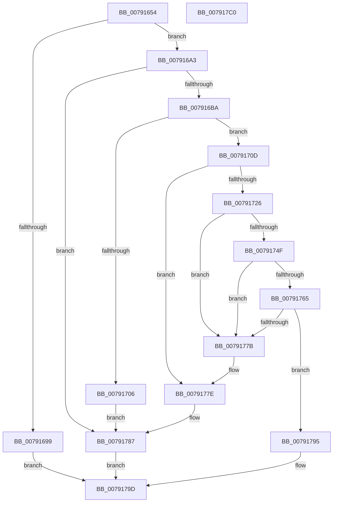

# RtlpSysVolCreateSecurityDescriptor

- RVA: `0x00791654`–`0x007917C1` (길이 `365` bytes)
- VA: `0x0000000140791654`
- 실행 섹션: `PAGE`
- PDB 이름 있음: `예`; PDB Function 태그: `아니요`
- unwind 정보 RVA: `0x000CFCD4`
- 디코드: `101`개 명령, `365/365` bytes 표시
- 미해석 바이트: `0` (있으면 어셈블리에 `.byte`로 보존)

> 이 문서는 커널 이미지의 기계어와 PDB 기호를 분석해 생성했습니다. 4번과 5번은 함수 원형과 자료형을 바이너리 사용 방식에서 추정한 C 해석이며 원본 소스 복구 결과는 아닙니다.

## 1. Dependencies

- 직접 호출 지점: **11**; 고유 호출 대상: **9**
- 직접 호출자로 확인된 함수: **1**
- RIP 상대 이미지 참조: **3**

### Outgoing calls
- `0x0079168C` → [ExAllocatePool2](../../poolcode/B8/ExAllocatePool2_function_00B820F0.md) (function, `0x00B820F0`)
- `0x007916AB` → [RtlCreateSecurityDescriptor](../9F/RtlCreateSecurityDescriptor_function_009F1DF0.md) (function, `0x009F1DF0`)
- `0x007916E4` → [RtlLengthSid](../../text/45/RtlLengthSid_function_0045D270.md) (function, `0x0045D270`)
- `0x007916F9` → [ExAllocatePool2](../../poolcode/B8/ExAllocatePool2_function_00B820F0.md) (function, `0x00B820F0`)
- `0x00791718` → [RtlCreateAcl](../91/RtlCreateAcl_function_00916F00.md) (function, `0x00916F00`)
- `0x00791744` → [RtlpAddKnownAce](../92/RtlpAddKnownAce_function_00929A20.md) (function, `0x00929A20`)
- `0x0079175A` → [RtlSetDaclSecurityDescriptor](../9E/RtlSetDaclSecurityDescriptor_function_009EC210.md) (function, `0x009EC210`)
- `0x00791770` → [RtlSetControlSecurityDescriptor](../78/RtlSetControlSecurityDescriptor_function_0078E9F0.md) (function, `0x0078E9F0`)
- `0x00791780` → [ExFreePoolWithTag](../../poolcode/B8/ExFreePoolWithTag_function_00B82870.md) (function, `0x00B82870`)
- `0x0079178C` → [ExFreePoolWithTag](../../poolcode/B8/ExFreePoolWithTag_function_00B82870.md) (function, `0x00B82870`)
- `0x007917A5` → [_security_check_cookie](../../text/6A/_security_check_cookie_function_006AC640.md) (function, `0x006AC640`)

### Direct callers
- [RtlCreateSystemVolumeInformationFolder](RtlCreateSystemVolumeInformationFolder_function_00791010.md) at `0x0079113E`

### Static image references
- `0x00791667` → RVA `0x00E0A740` (`.data`; read)
- `0x007916BA` → RVA `0x00031440` (`.rdata`; read)
- `0x007916C9` → RVA `0x00031444` (`.rdata`; read)

## 2. Other-region calls and transfers

- 다른 실행 섹션으로 향하는 call: **6**
  - `0x0079168C` → [ExAllocatePool2](../../poolcode/B8/ExAllocatePool2_function_00B820F0.md) (`PAGE` → `POOLCODE`)
  - `0x007916E4` → [RtlLengthSid](../../text/45/RtlLengthSid_function_0045D270.md) (`PAGE` → `.text`)
  - `0x007916F9` → [ExAllocatePool2](../../poolcode/B8/ExAllocatePool2_function_00B820F0.md) (`PAGE` → `POOLCODE`)
  - `0x00791780` → [ExFreePoolWithTag](../../poolcode/B8/ExFreePoolWithTag_function_00B82870.md) (`PAGE` → `POOLCODE`)
  - `0x0079178C` → [ExFreePoolWithTag](../../poolcode/B8/ExFreePoolWithTag_function_00B82870.md) (`PAGE` → `POOLCODE`)
  - `0x007917A5` → [_security_check_cookie](../../text/6A/_security_check_cookie_function_006AC640.md) (`PAGE` → `.text`)
- 별도 외부 분기/꼬리 이동을 확인하지 못했습니다.

## 3. Assembly (complete function range)

```asm
00791654  48 89 5C 24 18                  mov qword ptr [rsp + 0x18], rbx
00791659  48 89 74 24 20                  mov qword ptr [rsp + 0x20], rsi
0079165E  57                              push rdi
0079165F  41 56                           push r14
00791661  41 57                           push r15
00791663  48 83 EC 50                     sub rsp, 0x50
00791667  48 8B 05 D2 90 67 00            mov rax, qword ptr [rip + 0x6790d2]
0079166E  48 33 C4                        xor rax, rsp
00791671  48 89 44 24 48                  mov qword ptr [rsp + 0x48], rax
00791676  4C 8B FA                        mov r15, rdx
00791679  4C 8B F1                        mov r14, rcx
0079167C  BA 28 00 00 00                  mov edx, 0x28
00791681  B9 00 01 00 00                  mov ecx, 0x100
00791686  41 B8 56 6F 6C 53               mov r8d, 0x536c6f56
0079168C  E8 5F 0A 3F 00                  call 0x140b820f0
00791691  48 8B F8                        mov rdi, rax
00791694  48 85 C0                        test rax, rax
00791697  75 0A                           jne 0x1407916a3
00791699  B8 9A 00 00 C0                  mov eax, 0xc000009a
0079169E  E9 FA 00 00 00                  jmp 0x14079179d
007916A3  BA 01 00 00 00                  mov edx, 1
007916A8  48 8B CF                        mov rcx, rdi
007916AB  E8 40 07 26 00                  call 0x1409f1df0
007916B0  8B D8                           mov ebx, eax
007916B2  85 C0                           test eax, eax
007916B4  0F 88 CD 00 00 00               js 0x140791787
007916BA  8B 05 80 FD 89 FF               mov eax, dword ptr [rip - 0x760280]
007916C0  48 8D 4C 24 30                  lea rcx, [rsp + 0x30]
007916C5  89 44 24 32                     mov dword ptr [rsp + 0x32], eax
007916C9  0F B7 05 74 FD 89 FF            movzx eax, word ptr [rip - 0x76028c]
007916D0  66 89 44 24 36                  mov word ptr [rsp + 0x36], ax
007916D5  66 C7 44 24 30 01 01            mov word ptr [rsp + 0x30], 0x101
007916DC  C7 44 24 38 12 00 00 00         mov dword ptr [rsp + 0x38], 0x12
007916E4  E8 87 BB CC FF                  call 0x14045d270
007916E9  B9 00 01 00 00                  mov ecx, 0x100
007916EE  41 B8 56 6F 6C 53               mov r8d, 0x536c6f56
007916F4  8D 70 10                        lea esi, [rax + 0x10]
007916F7  8B D6                           mov edx, esi
007916F9  E8 F2 09 3F 00                  call 0x140b820f0
007916FE  48 8B D8                        mov rbx, rax
00791701  48 85 C0                        test rax, rax
00791704  75 07                           jne 0x14079170d
00791706  BB 9A 00 00 C0                  mov ebx, 0xc000009a
0079170B  EB 7A                           jmp 0x140791787
0079170D  41 B8 02 00 00 00               mov r8d, 2
00791713  8B D6                           mov edx, esi
00791715  48 8B CB                        mov rcx, rbx
00791718  E8 E3 57 18 00                  call 0x140916f00
0079171D  8B F0                           mov esi, eax
0079171F  48 8B CB                        mov rcx, rbx
00791722  85 C0                           test eax, eax
00791724  78 58                           js 0x14079177e
00791726  BA 02 00 00 00                  mov edx, 2
0079172B  C6 44 24 28 00                  mov byte ptr [rsp + 0x28], 0
00791730  48 8D 44 24 30                  lea rax, [rsp + 0x30]
00791735  41 B9 FF FF 1F 00               mov r9d, 0x1fffff
0079173B  48 89 44 24 20                  mov qword ptr [rsp + 0x20], rax
00791740  44 8D 42 01                     lea r8d, [rdx + 1]
00791744  E8 D7 82 19 00                  call 0x140929a20
00791749  8B F0                           mov esi, eax
0079174B  85 C0                           test eax, eax
0079174D  78 2C                           js 0x14079177b
0079174F  45 33 C9                        xor r9d, r9d
00791752  4C 8B C3                        mov r8, rbx
00791755  B2 01                           mov dl, 1
00791757  48 8B CF                        mov rcx, rdi
0079175A  E8 B1 AA 25 00                  call 0x1409ec210
0079175F  8B F0                           mov esi, eax
00791761  85 C0                           test eax, eax
00791763  78 16                           js 0x14079177b
00791765  BA 00 10 00 00                  mov edx, 0x1000
0079176A  48 8B CF                        mov rcx, rdi
0079176D  44 8B C2                        mov r8d, edx
00791770  E8 7B D2 FF FF                  call 0x14078e9f0
00791775  8B F0                           mov esi, eax
00791777  85 C0                           test eax, eax
00791779  79 1A                           jns 0x140791795
0079177B  48 8B CB                        mov rcx, rbx
0079177E  33 D2                           xor edx, edx
00791780  E8 EB 10 3F 00                  call 0x140b82870
00791785  8B DE                           mov ebx, esi
00791787  33 D2                           xor edx, edx
00791789  48 8B CF                        mov rcx, rdi
0079178C  E8 DF 10 3F 00                  call 0x140b82870
00791791  8B C3                           mov eax, ebx
00791793  EB 08                           jmp 0x14079179d
00791795  49 89 3E                        mov qword ptr [r14], rdi
00791798  33 C0                           xor eax, eax
0079179A  49 89 1F                        mov qword ptr [r15], rbx
0079179D  48 8B 4C 24 48                  mov rcx, qword ptr [rsp + 0x48]
007917A2  48 33 CC                        xor rcx, rsp
007917A5  E8 96 AE F1 FF                  call 0x1406ac640
007917AA  4C 8D 5C 24 50                  lea r11, [rsp + 0x50]
007917AF  49 8B 5B 30                     mov rbx, qword ptr [r11 + 0x30]
007917B3  49 8B 73 38                     mov rsi, qword ptr [r11 + 0x38]
007917B7  49 8B E3                        mov rsp, r11
007917BA  41 5F                           pop r15
007917BC  41 5E                           pop r14
007917BE  5F                              pop rdi
007917BF  C3                              ret
007917C0  CC                              int3
```

## 4. C-style interpretation (structured pseudocode)

```c
__int64 __fastcall RtlpSysVolCreateSecurityDescriptor(__int64 a1, __int64 a2)
{
    __int64 result;
    __int64 v_rsp;
    unsigned __int64 v_stack_m18;
    unsigned __int64 v_stack_m20;
    unsigned int v_stack_m30;
    unsigned __int16 v_stack_m32;
    unsigned int v_stack_m36;
    unsigned __int64 v_stack_m38;
    unsigned __int8 v_stack_m40;
    unsigned __int64 v_stack_m48;
    unsigned __int64 v_stack_p18;
    unsigned __int64 v_stack_p20;

    v_stack_p18 = v_rbx;
    v_stack_p20 = v_rsi;
    v_rsp = (v_rsp) - (80);
    result = (*(unsigned __int64 *)(v_rip + 6787282)) ^ (v_rsp);
    v_stack_m20 = result;
    result = ExAllocatePool2(256, 40, (unsigned int)(0x536C6F56ULL), a4);
    if (result != 0) goto loc_007916A3;
    goto loc_0079179D;
loc_007916A3:
    result = RtlCreateSecurityDescriptor(result, 1, (unsigned int)(0x536C6F56ULL), a4);
    if (sign_flag) goto loc_00791787;
    v_stack_m36 = (unsigned int)((unsigned int)(*(unsigned int *)(v_rip - 7733888)));
    v_stack_m32 = (unsigned __int16)(*(unsigned __int16 *)(v_rip - 7733900));
    v_stack_m38 = 257;
    v_stack_m30 = 18;
    result = RtlLengthSid(v_stack_m38, 1, (unsigned int)(0x536C6F56ULL), a4);
    result = ExAllocatePool2(256, (unsigned int)((unsigned int)(result + 16)), (unsigned int)(0x536C6F56ULL), a4);
    if (result != 0) goto loc_0079170D;
    goto loc_00791787;
loc_0079170D:
    result = RtlCreateAcl((unsigned int)(0xC000009AULL), (unsigned int)((unsigned int)(result + 16)), 2, a4);
    if (sign_flag) goto loc_0079177E;
    v_stack_m40 = 0;
    v_stack_m48 = v_stack_m38;
    result = RtlpAddKnownAce((unsigned int)(0xC000009AULL), 2, 2 + 1, (unsigned int)(0x1FFFFFULL));
    if (sign_flag) goto loc_0079177B;
    a4 = 0;
    result = RtlSetDaclSecurityDescriptor(result, 1, (unsigned int)(0xC000009AULL), a4);
    if (sign_flag) goto loc_0079177B;
    result = RtlSetControlSecurityDescriptor(result, (unsigned int)(0x1000ULL), (unsigned int)((unsigned int)((unsigned int)(0x1000ULL))), a4);
    if (!sign_flag) goto loc_00791795;
loc_0079177B:
loc_0079177E:
    a2 = 0;
    result = ExFreePoolWithTag((unsigned int)(0xC000009AULL), a2, (unsigned int)((unsigned int)((unsigned int)(0x1000ULL))), a4);
loc_00791787:
    a2 = 0;
    result = ExFreePoolWithTag(result, a2, (unsigned int)((unsigned int)((unsigned int)(0x1000ULL))), a4);
    goto loc_0079179D;
loc_00791795:
    *(unsigned __int64 *)(a1) = result;
    result = 0;
    *(unsigned __int64 *)(a2) = (unsigned int)((unsigned int)((unsigned int)((unsigned int)(result))));
loc_0079179D:
    a1 = (v_stack_m20) ^ (v_rsp);
    result = _security_check_cookie(a1, a2, (unsigned int)((unsigned int)((unsigned int)(0x1000ULL))), a4);
    return result;
}
```

## 5. (Beta) C Style

```c
int64_t RtlpSysVolCreateSecurityDescriptor(void *Arg1, void *Arg2)
{
    uint8_t *arg1 = (uint8_t *)Arg1;
    uint8_t *arg2 = (uint8_t *)Arg2;

    int64_t result;
    int64_t local_rsp;
    uint64_t v_stack_m18;
    uint64_t v_stack_m20;
    uint32_t v_stack_m30;
    uint16_t v_stack_m32;
    uint32_t v_stack_m36;
    uint64_t v_stack_m38;
    uint8_t v_stack_m40;
    uint64_t v_stack_m48;
    uint64_t v_stack_p18;
    uint64_t v_stack_p20;

    v_stack_p18 = local_rbx;
    v_stack_p20 = local_rsi;
    local_rsp = (local_rsp) - (80);
    result = (*(uint64_t *)(v_rip + 0x6790D2)) ^ (local_rsp);
    v_stack_m20 = result;
    result = ExAllocatePool2(256, 40, (uint32_t)(0x536C6F56ULL), a4);
    if (result != 0) goto loc_007916A3;
    goto loc_0079179D;
loc_007916A3:
    result = RtlCreateSecurityDescriptor(result, 1, (uint32_t)(0x536C6F56ULL), a4);
    if (sign_flag) goto loc_00791787;
    v_stack_m36 = (uint32_t)((uint32_t)(*(uint32_t *)(v_rip - 0x760280)));
    v_stack_m32 = (uint16_t)(*(uint16_t *)(v_rip - 0x76028C));
    v_stack_m38 = 257;
    v_stack_m30 = 18;
    result = RtlLengthSid(v_stack_m38, 1, (uint32_t)(0x536C6F56ULL), a4);
    result = ExAllocatePool2(256, (uint32_t)((uint32_t)(result + 16)), (uint32_t)(0x536C6F56ULL), a4);
    if (result != 0) goto loc_0079170D;
    goto loc_00791787;
loc_0079170D:
    result = RtlCreateAcl((uint32_t)(0xC000009AULL), (uint32_t)((uint32_t)(result + 16)), 2, a4);
    if (sign_flag) goto loc_0079177E;
    v_stack_m40 = 0;
    v_stack_m48 = v_stack_m38;
    result = RtlpAddKnownAce((uint32_t)(0xC000009AULL), 2, 2 + 1, (uint32_t)(0x1FFFFFULL));
    if (sign_flag) goto loc_0079177B;
    a4 = 0;
    result = RtlSetDaclSecurityDescriptor(result, 1, (uint32_t)(0xC000009AULL), a4);
    if (sign_flag) goto loc_0079177B;
    result = RtlSetControlSecurityDescriptor(result, (uint32_t)(0x1000ULL), (uint32_t)((uint32_t)((uint32_t)(0x1000ULL))), a4);
    if (!sign_flag) goto loc_00791795;
loc_0079177B:
loc_0079177E:
    Arg2 = 0;
    result = ExFreePoolWithTag((uint32_t)(0xC000009AULL), Arg2, (uint32_t)((uint32_t)((uint32_t)(0x1000ULL))), a4);
loc_00791787:
    Arg2 = 0;
    result = ExFreePoolWithTag(result, Arg2, (uint32_t)((uint32_t)((uint32_t)(0x1000ULL))), a4);
    goto loc_0079179D;
loc_00791795:
    *(uint64_t *)(arg1) = result;
    result = 0;
    *(uint64_t *)(arg2) = (uint32_t)((uint32_t)((uint32_t)((uint32_t)(result))));
loc_0079179D:
    Arg1 = (v_stack_m20) ^ (local_rsp);
    result = _security_check_cookie(Arg1, Arg2, (uint32_t)((uint32_t)((uint32_t)(0x1000ULL))), a4);
    return result;
}
```

### 관측된 메모리 오프셋

구조체 형식이 확인되지 않은 접근은 인자 기준의 오프셋으로만 기록했습니다.

| 기준 인자 | 오프셋 표현 | 폭 (bit) | 접근 |
|---|---:|---:|---|
| `Arg1` | `+ 0x0` | `64` | `W` |
| `Arg2` | `+ 0x0` | `64` | `W` |

## 6. Execution-region graph

[열기: 2D/3D 그래프와 함수 탐색 컨트롤 패널](../../../control-panel.html?section=page&rva=0x00791654&view=graph)

- 2D 그래프는 위에서 아래로 흐르고, 3D 그래프는 빈 공간을 드래그해 회전합니다. Shift+드래그는 이동, 휠은 확대·축소, 함수 노드 선택은 대상 보고서 이동입니다.

### Static fallback


