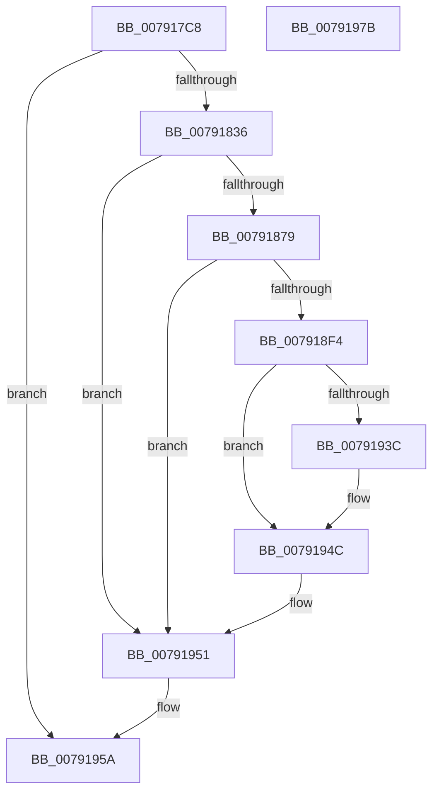

# RtlpSysVolTakeOwnership

- RVA: `0x007917C8`–`0x0079197C` (길이 `436` bytes)
- VA: `0x00000001407917C8`
- 실행 섹션: `PAGE`
- PDB 이름 있음: `예`; PDB Function 태그: `아니요`
- unwind 정보 RVA: `0x000CFCB4`
- 디코드: `102`개 명령, `436/436` bytes 표시
- 미해석 바이트: `0` (있으면 어셈블리에 `.byte`로 보존)

> 이 문서는 커널 이미지의 기계어와 PDB 기호를 분석해 생성했습니다. 4번과 5번은 함수 원형과 자료형을 바이너리 사용 방식에서 추정한 C 해석이며 원본 소스 복구 결과는 아닙니다.

## 1. Dependencies

- 직접 호출 지점: **9**; 고유 호출 대상: **8**
- 직접 호출자로 확인된 함수: **1**
- RIP 상대 이미지 참조: **3**

### Outgoing calls
- `0x00791829` → [NtOpenProcessTokenEx](../8B/NtOpenProcessTokenEx_function_008B72D0.md) (function, `0x008B72D0`)
- `0x0079186C` → [NtAdjustPrivilegesToken](../9C/NtAdjustPrivilegesToken_function_009C86C0.md) (function, `0x009C86C0`)
- `0x007918EB` → [IopCreateFile](../8A/IopCreateFile_function_008AB298.md) (function, `0x008AB298`)
- `0x007918FB` → [RtlCreateSecurityDescriptor](../9F/RtlCreateSecurityDescriptor_function_009F1DF0.md) (function, `0x009F1DF0`)
- `0x0079192F` → [RtlSetOwnerSecurityDescriptor](../91/RtlSetOwnerSecurityDescriptor_function_00916F90.md) (function, `0x00916F90`)
- `0x00791943` → [NtSetSecurityObject](../AD/NtSetSecurityObject_function_00ADE2B0.md) (function, `0x00ADE2B0`)
- `0x0079194C` → [NtClose](../86/NtClose_function_00868870.md) (function, `0x00868870`)
- `0x00791955` → [NtClose](../86/NtClose_function_00868870.md) (function, `0x00868870`)
- `0x00791961` → [_security_check_cookie](../../text/6A/_security_check_cookie_function_006AC640.md) (function, `0x006AC640`)

### Direct callers
- [RtlCreateSystemVolumeInformationFolder](RtlCreateSystemVolumeInformationFolder_function_00791010.md) at `0x00791252`

### Static image references
- `0x007917DF` → RVA `0x00E0A740` (`.data`; read)
- `0x00791900` → RVA `0x00031440` (`.rdata`; read)
- `0x00791911` → RVA `0x00031444` (`.rdata`; read)

## 2. Other-region calls and transfers

- 다른 실행 섹션으로 향하는 call: **1**
  - `0x00791961` → [_security_check_cookie](../../text/6A/_security_check_cookie_function_006AC640.md) (`PAGE` → `.text`)
- 별도 외부 분기/꼬리 이동을 확인하지 못했습니다.

## 3. Assembly (complete function range)

```asm
007917C8  48 89 74 24 10                  mov qword ptr [rsp + 0x10], rsi
007917CD  48 89 7C 24 18                  mov qword ptr [rsp + 0x18], rdi
007917D2  55                              push rbp
007917D3  48 8D 6C 24 D0                  lea rbp, [rsp - 0x30]
007917D8  48 81 EC 30 01 00 00            sub rsp, 0x130
007917DF  48 8B 05 5A 8F 67 00            mov rax, qword ptr [rip + 0x678f5a]
007917E6  48 33 C4                        xor rax, rsp
007917E9  48 89 45 28                     mov qword ptr [rbp + 0x28], rax
007917ED  33 F6                           xor esi, esi
007917EF  4C 8D 4D 80                     lea r9, [rbp - 0x80]
007917F3  0F 57 C9                        xorps xmm1, xmm1
007917F6  48 89 75 80                     mov qword ptr [rbp - 0x80], rsi
007917FA  48 8B F9                        mov rdi, rcx
007917FD  48 89 75 88                     mov qword ptr [rbp - 0x78], rsi
00791801  33 C0                           xor eax, eax
00791803  89 75 9C                        mov dword ptr [rbp - 0x64], esi
00791806  0F 57 C0                        xorps xmm0, xmm0
00791809  89 75 B4                        mov dword ptr [rbp - 0x4c], esi
0079180C  8D 56 28                        lea edx, [rsi + 0x28]
0079180F  48 89 45 E8                     mov qword ptr [rbp - 0x18], rax
00791813  41 B8 00 02 00 00               mov r8d, 0x200
00791819  48 83 C9 FF                     or rcx, 0xffffffffffffffff
0079181D  0F 11 45 F0                     movups xmmword ptr [rbp - 0x10], xmm0
00791821  0F 11 4D C8                     movups xmmword ptr [rbp - 0x38], xmm1
00791825  0F 11 4D D8                     movups xmmword ptr [rbp - 0x28], xmm1
00791829  E8 A2 5A 12 00                  call 0x1408b72d0
0079182E  85 C0                           test eax, eax
00791830  0F 88 24 01 00 00               js 0x14079195a
00791836  48 8B 4D 80                     mov rcx, qword ptr [rbp - 0x80]
0079183A  44 8D 4E 10                     lea r9d, [rsi + 0x10]
0079183E  48 C7 45 90 09 00 00 00         mov qword ptr [rbp - 0x70], 9
00791846  4C 8D 45 00                     lea r8, [rbp]
0079184A  48 8B 45 90                     mov rax, qword ptr [rbp - 0x70]
0079184E  33 D2                           xor edx, edx
00791850  48 89 74 24 28                  mov qword ptr [rsp + 0x28], rsi
00791855  48 89 45 04                     mov qword ptr [rbp + 4], rax
00791859  C7 45 00 01 00 00 00            mov dword ptr [rbp], 1
00791860  C7 45 0C 02 00 00 00            mov dword ptr [rbp + 0xc], 2
00791867  48 89 74 24 20                  mov qword ptr [rsp + 0x20], rsi
0079186C  E8 4F 6E 23 00                  call 0x1409c86c0
00791871  85 C0                           test eax, eax
00791873  0F 88 D8 00 00 00               js 0x140791951
00791879  48 89 74 24 78                  mov qword ptr [rsp + 0x78], rsi
0079187E  4C 8D 4D F0                     lea r9, [rbp - 0x10]
00791882  48 89 7D A8                     mov qword ptr [rbp - 0x58], rdi
00791886  4C 8D 45 98                     lea r8, [rbp - 0x68]
0079188A  0F 57 C0                        xorps xmm0, xmm0
0079188D  C7 45 98 30 00 00 00            mov dword ptr [rbp - 0x68], 0x30
00791894  8D 7E 20                        lea edi, [rsi + 0x20]
00791897  48 89 75 A0                     mov qword ptr [rbp - 0x60], rsi
0079189B  89 7C 24 70                     mov dword ptr [rsp + 0x70], edi
0079189F  48 8D 4D 88                     lea rcx, [rbp - 0x78]
007918A3  89 74 24 68                     mov dword ptr [rsp + 0x68], esi
007918A7  BA 00 00 18 00                  mov edx, 0x180000
007918AC  48 89 74 24 60                  mov qword ptr [rsp + 0x60], rsi
007918B1  89 74 24 58                     mov dword ptr [rsp + 0x58], esi
007918B5  89 74 24 50                     mov dword ptr [rsp + 0x50], esi
007918B9  48 89 74 24 48                  mov qword ptr [rsp + 0x48], rsi
007918BE  C7 44 24 40 21 00 00 00         mov dword ptr [rsp + 0x40], 0x21
007918C6  C7 44 24 38 01 00 00 00         mov dword ptr [rsp + 0x38], 1
007918CE  C7 44 24 30 07 00 00 00         mov dword ptr [rsp + 0x30], 7
007918D6  89 74 24 28                     mov dword ptr [rsp + 0x28], esi
007918DA  48 89 74 24 20                  mov qword ptr [rsp + 0x20], rsi
007918DF  C7 45 B0 40 02 00 00            mov dword ptr [rbp - 0x50], 0x240
007918E6  F3 0F 7F 45 B8                  movdqu xmmword ptr [rbp - 0x48], xmm0
007918EB  E8 A8 99 11 00                  call 0x1408ab298
007918F0  85 C0                           test eax, eax
007918F2  78 5D                           js 0x140791951
007918F4  8D 56 01                        lea edx, [rsi + 1]
007918F7  48 8D 4D C8                     lea rcx, [rbp - 0x38]
007918FB  E8 F0 04 26 00                  call 0x1409f1df0
00791900  8B 05 3A FB 89 FF               mov eax, dword ptr [rip - 0x7604c6]
00791906  48 8D 55 10                     lea rdx, [rbp + 0x10]
0079190A  89 45 12                        mov dword ptr [rbp + 0x12], eax
0079190D  48 8D 4D C8                     lea rcx, [rbp - 0x38]
00791911  0F B7 05 2C FB 89 FF            movzx eax, word ptr [rip - 0x7604d4]
00791918  45 33 C0                        xor r8d, r8d
0079191B  66 89 45 16                     mov word ptr [rbp + 0x16], ax
0079191F  66 C7 45 10 01 02               mov word ptr [rbp + 0x10], 0x201
00791925  89 7D 18                        mov dword ptr [rbp + 0x18], edi
00791928  C7 45 1C 20 02 00 00            mov dword ptr [rbp + 0x1c], 0x220
0079192F  E8 5C 56 18 00                  call 0x140916f90
00791934  48 8B 4D 88                     mov rcx, qword ptr [rbp - 0x78]
00791938  85 C0                           test eax, eax
0079193A  78 10                           js 0x14079194c
0079193C  4C 8D 45 C8                     lea r8, [rbp - 0x38]
00791940  8D 56 01                        lea edx, [rsi + 1]
00791943  E8 68 C9 34 00                  call 0x140ade2b0
00791948  48 8B 4D 88                     mov rcx, qword ptr [rbp - 0x78]
0079194C  E8 1F 6F 0D 00                  call 0x140868870
00791951  48 8B 4D 80                     mov rcx, qword ptr [rbp - 0x80]
00791955  E8 16 6F 0D 00                  call 0x140868870
0079195A  48 8B 4D 28                     mov rcx, qword ptr [rbp + 0x28]
0079195E  48 33 CC                        xor rcx, rsp
00791961  E8 DA AC F1 FF                  call 0x1406ac640
00791966  4C 8D 9C 24 30 01 00 00         lea r11, [rsp + 0x130]
0079196E  49 8B 73 18                     mov rsi, qword ptr [r11 + 0x18]
00791972  49 8B 7B 20                     mov rdi, qword ptr [r11 + 0x20]
00791976  49 8B E3                        mov rsp, r11
00791979  5D                              pop rbp
0079197A  C3                              ret
0079197B  CC                              int3
```

## 4. C-style interpretation (structured pseudocode)

```c
__int64 __fastcall RtlpSysVolTakeOwnership(__int64 a1)
{
    __int64 result;
    __int64 v_rsi;
    __int64 v_rsp;
    unsigned __int64 v_stack_m10;
    unsigned int v_stack_m100;
    unsigned int v_stack_m108;
    unsigned __int64 v_stack_m110;
    unsigned __int64 v_stack_m118;
    unsigned int v_stack_m1C;
    unsigned int v_stack_m20;
    unsigned __int16 v_stack_m22;
    unsigned int v_stack_m26;
    unsigned __int64 v_stack_m28;
    unsigned int v_stack_m2C;
    unsigned __int64 v_stack_m34;
    unsigned __int64 v_stack_m38;
    unsigned __int64 v_stack_m48;
    unsigned __int64 v_stack_m50;
    unsigned __int64 v_stack_m60;
    unsigned __int64 v_stack_m70;
    unsigned __int64 v_stack_m8;
    unsigned __int64 v_stack_m80;
    unsigned int v_stack_m84;
    unsigned int v_stack_m88;
    unsigned __int64 v_stack_m90;
    unsigned __int64 v_stack_m98;
    unsigned int v_stack_m9C;
    unsigned __int64 v_stack_mA0;
    unsigned __int64 v_stack_mA8;
    unsigned __int64 v_stack_mB0;
    unsigned __int64 v_stack_mB8;
    unsigned __int64 v_stack_mC0;
    unsigned int v_stack_mC8;
    unsigned int v_stack_mD0;
    unsigned __int64 v_stack_mD8;
    unsigned int v_stack_mE0;
    unsigned int v_stack_mE8;
    unsigned __int64 v_stack_mF0;
    unsigned int v_stack_mF8;
    unsigned __int64 v_stack_p10;
    unsigned __int64 v_stack_p18;

    v_stack_p10 = v_rsi;
    v_stack_p18 = v_rdi;
    v_rsp = (v_rsp) - (304);
    result = (*(unsigned __int64 *)(v_rip + 6786906)) ^ (v_rsp);
    v_stack_m10 = result;
    v_rsi = 0;
    v_stack_mB8 = 0;
    v_stack_mB0 = 0;
    result = 0;
    v_stack_m9C = 0;
    v_stack_m84 = 0;
    v_stack_m50 = 0;
    a1 = (a1) | (-1);
    v_stack_m48 = v_xmm0;
    v_stack_m70 = v_xmm1;
    v_stack_m60 = v_xmm1;
    result = NtOpenProcessTokenEx(a1, v_rsi + 40, 512, v_stack_mB8);
    if (sign_flag) goto loc_0079195A;
    v_stack_mA8 = 9;
    a2 = 0;
    v_stack_m110 = 0;
    v_stack_m34 = v_stack_mA8;
    v_stack_m38 = 1;
    v_stack_m2C = 2;
    v_stack_m118 = 0;
    result = NtAdjustPrivilegesToken(v_stack_mB8, a2, v_stack_m38, v_rsi + 16);
    if (sign_flag) goto loc_00791951;
    v_stack_mC0 = 0;
    v_stack_m90 = a1;
    v_stack_mA0 = 48;
    v_stack_m98 = 0;
    v_stack_mC8 = (unsigned int)(v_rsi + 32);
    v_stack_mD0 = 0;
    v_stack_mD8 = 0;
    v_stack_mE0 = 0;
    v_stack_mE8 = 0;
    v_stack_mF0 = 0;
    v_stack_mF8 = 33;
    v_stack_m100 = 1;
    v_stack_m108 = 7;
    v_stack_m110 = 0;
    v_stack_m118 = 0;
    v_stack_m88 = 576;
    v_stack_m80 = v_xmm0;
    result = IopCreateFile(v_stack_mB0, (unsigned int)(0x180000ULL), v_stack_mA0, v_stack_m48);
    if (sign_flag) goto loc_00791951;
    result = RtlCreateSecurityDescriptor(v_stack_m70, v_rsi + 1, v_stack_mA0, v_stack_m48);
    v_stack_m26 = (unsigned int)((unsigned int)(*(unsigned int *)(v_rip - 7734470)));
    a3 = 0;
    v_stack_m22 = (unsigned __int16)(*(unsigned __int16 *)(v_rip - 7734484));
    v_stack_m28 = 513;
    v_stack_m20 = (unsigned int)(v_rsi + 32);
    v_stack_m1C = 544;
    result = RtlSetOwnerSecurityDescriptor(v_stack_m70, v_stack_m28, a3, v_stack_m48);
    if (!(sign_flag)) {
        a3 = v_stack_m70;
        a2 = v_rsi + 1;
        result = NtSetSecurityObject(v_stack_mB0, a2, a3, v_stack_m48);
        a1 = v_stack_mB0;
    }
    result = NtClose(a1, a2, a3, v_stack_m48);
loc_00791951:
    result = NtClose(v_stack_mB8, a2, a3, v_stack_m48);
loc_0079195A:
    a1 = (v_stack_m10) ^ (v_rsp);
    result = _security_check_cookie(a1, a2, a3, v_stack_m48);
    return result;
}
```

## 5. (Beta) C Style

```c
int64_t RtlpSysVolTakeOwnership(int64_t Arg1)
{
    int64_t result;
    int64_t local_rsi;
    int64_t local_rsp;
    uint64_t v_stack_m10;
    uint32_t v_stack_m100;
    uint32_t v_stack_m108;
    uint64_t v_stack_m110;
    uint64_t v_stack_m118;
    uint32_t v_stack_m1C;
    uint32_t v_stack_m20;
    uint16_t v_stack_m22;
    uint32_t v_stack_m26;
    uint64_t v_stack_m28;
    uint32_t v_stack_m2C;
    uint64_t v_stack_m34;
    uint64_t v_stack_m38;
    uint64_t v_stack_m48;
    uint64_t v_stack_m50;
    uint64_t v_stack_m60;
    uint64_t v_stack_m70;
    uint64_t v_stack_m8;
    uint64_t v_stack_m80;
    uint32_t v_stack_m84;
    uint32_t v_stack_m88;
    uint64_t v_stack_m90;
    uint64_t v_stack_m98;
    uint32_t v_stack_m9C;
    uint64_t v_stack_mA0;
    uint64_t v_stack_mA8;
    uint64_t v_stack_mB0;
    uint64_t v_stack_mB8;
    uint64_t v_stack_mC0;
    uint32_t v_stack_mC8;
    uint32_t v_stack_mD0;
    uint64_t v_stack_mD8;
    uint32_t v_stack_mE0;
    uint32_t v_stack_mE8;
    uint64_t v_stack_mF0;
    uint32_t v_stack_mF8;
    uint64_t v_stack_p10;
    uint64_t v_stack_p18;

    v_stack_p10 = local_rsi;
    v_stack_p18 = local_rdi;
    local_rsp = (local_rsp) - (304);
    result = (*(uint64_t *)(v_rip + 0x678F5A)) ^ (local_rsp);
    v_stack_m10 = result;
    local_rsi = 0;
    v_stack_mB8 = 0;
    v_stack_mB0 = 0;
    result = 0;
    v_stack_m9C = 0;
    v_stack_m84 = 0;
    v_stack_m50 = 0;
    Arg1 = (Arg1) | (-1);
    v_stack_m48 = v_xmm0;
    v_stack_m70 = v_xmm1;
    v_stack_m60 = v_xmm1;
    result = NtOpenProcessTokenEx(Arg1, local_rsi + 40, 512, v_stack_mB8);
    if (sign_flag) goto loc_0079195A;
    v_stack_mA8 = 9;
    a2 = 0;
    v_stack_m110 = 0;
    v_stack_m34 = v_stack_mA8;
    v_stack_m38 = 1;
    v_stack_m2C = 2;
    v_stack_m118 = 0;
    result = NtAdjustPrivilegesToken(v_stack_mB8, a2, v_stack_m38, local_rsi + 16);
    if (sign_flag) goto loc_00791951;
    v_stack_mC0 = 0;
    v_stack_m90 = Arg1;
    v_stack_mA0 = 48;
    v_stack_m98 = 0;
    v_stack_mC8 = (uint32_t)(local_rsi + 32);
    v_stack_mD0 = 0;
    v_stack_mD8 = 0;
    v_stack_mE0 = 0;
    v_stack_mE8 = 0;
    v_stack_mF0 = 0;
    v_stack_mF8 = 33;
    v_stack_m100 = 1;
    v_stack_m108 = 7;
    v_stack_m110 = 0;
    v_stack_m118 = 0;
    v_stack_m88 = 576;
    v_stack_m80 = v_xmm0;
    result = IopCreateFile(v_stack_mB0, (uint32_t)(0x180000ULL), v_stack_mA0, v_stack_m48);
    if (sign_flag) goto loc_00791951;
    result = RtlCreateSecurityDescriptor(v_stack_m70, local_rsi + 1, v_stack_mA0, v_stack_m48);
    v_stack_m26 = (uint32_t)((uint32_t)(*(uint32_t *)(v_rip - 0x7604C6)));
    a3 = 0;
    v_stack_m22 = (uint16_t)(*(uint16_t *)(v_rip - 0x7604D4));
    v_stack_m28 = 513;
    v_stack_m20 = (uint32_t)(local_rsi + 32);
    v_stack_m1C = 544;
    result = RtlSetOwnerSecurityDescriptor(v_stack_m70, v_stack_m28, a3, v_stack_m48);
    if (!(sign_flag)) {
        a3 = v_stack_m70;
        a2 = local_rsi + 1;
        result = NtSetSecurityObject(v_stack_mB0, a2, a3, v_stack_m48);
        Arg1 = v_stack_mB0;
    }
    result = NtClose(Arg1, a2, a3, v_stack_m48);
loc_00791951:
    result = NtClose(v_stack_mB8, a2, a3, v_stack_m48);
loc_0079195A:
    Arg1 = (v_stack_m10) ^ (local_rsp);
    result = _security_check_cookie(Arg1, a2, a3, v_stack_m48);
    return result;
}
```

## 6. Execution-region graph

[열기: 2D/3D 그래프와 함수 탐색 컨트롤 패널](../../../control-panel.html?section=page&rva=0x007917C8&view=graph)

- 2D 그래프는 위에서 아래로 흐르고, 3D 그래프는 빈 공간을 드래그해 회전합니다. Shift+드래그는 이동, 휠은 확대·축소, 함수 노드 선택은 대상 보고서 이동입니다.

### Static fallback


