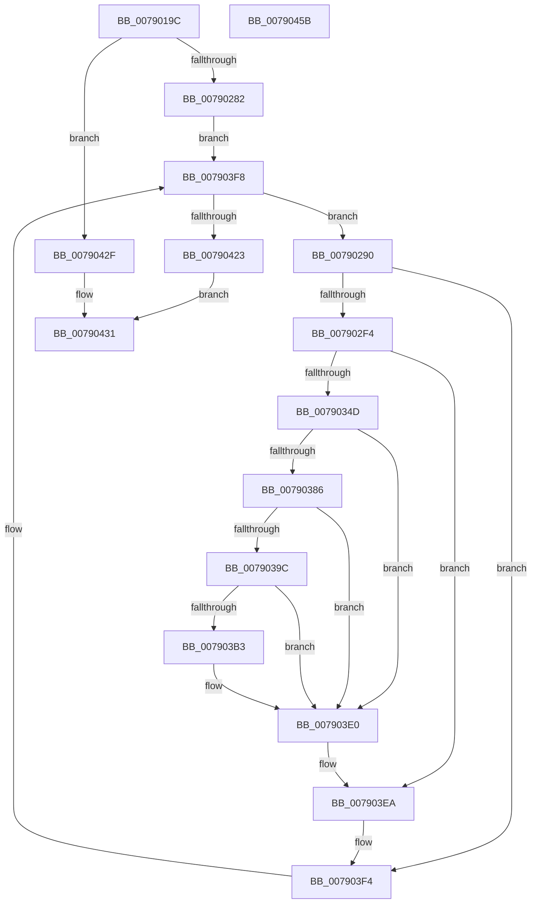

# RtlpUpdateDynamicTimeZones

- RVA: `0x0079019C`–`0x0079045C` (길이 `704` bytes)
- VA: `0x000000014079019C`
- 실행 섹션: `PAGE`
- PDB 이름 있음: `예`; PDB Function 태그: `아니요`
- unwind 정보 RVA: `0x000CFA70`
- 디코드: `159`개 명령, `704/704` bytes 표시
- 미해석 바이트: `0` (있으면 어셈블리에 `.byte`로 보존)

> 이 문서는 커널 이미지의 기계어와 PDB 기호를 분석해 생성했습니다. 4번과 5번은 함수 원형과 자료형을 바이너리 사용 방식에서 추정한 C 해석이며 원본 소스 복구 결과는 아닙니다.

## 1. Dependencies

- 직접 호출 지점: **15**; 고유 호출 대상: **11**
- 직접 호출자로 확인된 함수: **1**
- RIP 상대 이미지 참조: **4**

### Outgoing calls
- `0x007901F9` → [memset](../../text/6C/memset_function_006C6C40.md) (function, `0x006C6C40`)
- `0x0079023C` → [memset](../../text/6C/memset_function_006C6C40.md) (function, `0x006C6C40`)
- `0x00790275` → [RtlpGetRegistryHandle](../8C/RtlpGetRegistryHandle_function_008C955C.md) (function, `0x008C955C`)
- `0x007902E7` → [ZwOpenKey](../../text/6A/ZwOpenKey_function_006AD310.md) (function, `0x006AD310`)
- `0x00790300` → [RtlInitUnicodeString](../../text/42/RtlInitUnicodeString_function_0042A780.md) (function, `0x0042A780`)
- `0x00790340` → [ZwOpenKey](../../text/6A/ZwOpenKey_function_006AD310.md) (function, `0x006AD310`)
- `0x0079037D` → [RtlpQueryRegistryValues](../8C/RtlpQueryRegistryValues_function_008C9050.md) (function, `0x008C9050`)
- `0x00790393` → [RtlpFindRegTziForCurrentYear](../../text/5E/RtlpFindRegTziForCurrentYear_function_005E7754.md) (function, `0x005E7754`)
- `0x007903AA` → [memcmp](../../text/6C/memcmp_function_006C6B10.md) (function, `0x006C6B10`)
- `0x007903DB` → [RtlWriteRegistryValue](../A6/RtlWriteRegistryValue_function_00A6C620.md) (function, `0x00A6C620`)
- `0x007903E5` → [ZwClose](../../text/6A/ZwClose_function_006AD2B0.md) (function, `0x006AD2B0`)
- `0x007903EF` → [ZwClose](../../text/6A/ZwClose_function_006AD2B0.md) (function, `0x006AD2B0`)
- `0x00790416` → [ZwEnumerateKey](../../text/6A/ZwEnumerateKey_function_006AD710.md) (function, `0x006AD710`)
- `0x00790428` → [ZwClose](../../text/6A/ZwClose_function_006AD2B0.md) (function, `0x006AD2B0`)
- `0x0079043D` → [_security_check_cookie](../../text/6A/_security_check_cookie_function_006AC640.md) (function, `0x006AC640`)

### Direct callers
- [ExpRefreshTimeZoneInformation](../A6/ExpRefreshTimeZoneInformation_function_00A6B46C.md) at `0x00A6BAC3`

### Static image references
- `0x007901BA` → RVA `0x00E0A740` (`.data`; read)
- `0x0079024B` → RVA `0x00B05930` (` ?? ::NNGAKEGL::`string'`; read)
- `0x0079026E` → RVA `0x00B05910` (` ?? ::NNGAKEGL::`string'`; read)
- `0x007902F4` → RVA `0x00B4C418` (`szDynamicDst`; read)

## 2. Other-region calls and transfers

- 다른 실행 섹션으로 향하는 call: **12**
  - `0x007901F9` → [memset](../../text/6C/memset_function_006C6C40.md) (`PAGE` → `.text`)
  - `0x0079023C` → [memset](../../text/6C/memset_function_006C6C40.md) (`PAGE` → `.text`)
  - `0x007902E7` → [ZwOpenKey](../../text/6A/ZwOpenKey_function_006AD310.md) (`PAGE` → `.text`)
  - `0x00790300` → [RtlInitUnicodeString](../../text/42/RtlInitUnicodeString_function_0042A780.md) (`PAGE` → `.text`)
  - `0x00790340` → [ZwOpenKey](../../text/6A/ZwOpenKey_function_006AD310.md) (`PAGE` → `.text`)
  - `0x00790393` → [RtlpFindRegTziForCurrentYear](../../text/5E/RtlpFindRegTziForCurrentYear_function_005E7754.md) (`PAGE` → `.text`)
  - `0x007903AA` → [memcmp](../../text/6C/memcmp_function_006C6B10.md) (`PAGE` → `.text`)
  - `0x007903E5` → [ZwClose](../../text/6A/ZwClose_function_006AD2B0.md) (`PAGE` → `.text`)
  - `0x007903EF` → [ZwClose](../../text/6A/ZwClose_function_006AD2B0.md) (`PAGE` → `.text`)
  - `0x00790416` → [ZwEnumerateKey](../../text/6A/ZwEnumerateKey_function_006AD710.md) (`PAGE` → `.text`)
  - `0x00790428` → [ZwClose](../../text/6A/ZwClose_function_006AD2B0.md) (`PAGE` → `.text`)
  - `0x0079043D` → [_security_check_cookie](../../text/6A/_security_check_cookie_function_006AC640.md) (`PAGE` → `.text`)
- 별도 외부 분기/꼬리 이동을 확인하지 못했습니다.

## 3. Assembly (complete function range)

```asm
0079019C  48 8B C4                        mov rax, rsp
0079019F  48 89 58 10                     mov qword ptr [rax + 0x10], rbx
007901A3  48 89 70 18                     mov qword ptr [rax + 0x18], rsi
007901A7  48 89 78 20                     mov qword ptr [rax + 0x20], rdi
007901AB  55                              push rbp
007901AC  48 8D A8 78 FE FF FF            lea rbp, [rax - 0x188]
007901B3  48 81 EC 80 02 00 00            sub rsp, 0x280
007901BA  48 8B 05 7F A5 67 00            mov rax, qword ptr [rip + 0x67a57f]
007901C1  48 33 C4                        xor rax, rsp
007901C4  48 89 85 70 01 00 00            mov qword ptr [rbp + 0x170], rax
007901CB  48 83 64 24 40 00               and qword ptr [rsp + 0x40], 0
007901D1  0F B7 F1                        movzx esi, cx
007901D4  48 83 64 24 38 00               and qword ptr [rsp + 0x38], 0
007901DA  48 8D 4D 60                     lea rcx, [rbp + 0x60]
007901DE  48 83 64 24 48 00               and qword ptr [rsp + 0x48], 0
007901E4  0F 57 C0                        xorps xmm0, xmm0
007901E7  83 64 24 30 00                  and dword ptr [rsp + 0x30], 0
007901EC  33 D2                           xor edx, edx
007901EE  41 B8 10 01 00 00               mov r8d, 0x110
007901F4  0F 11 44 24 50                  movups xmmword ptr [rsp + 0x50], xmm0
007901F9  E8 42 6A F3 FF                  call 0x1406c6c40
007901FE  33 C0                           xor eax, eax
00790200  48 8D 4D 90                     lea rcx, [rbp - 0x70]
00790204  0F 57 C0                        xorps xmm0, xmm0
00790207  48 89 45 20                     mov qword ptr [rbp + 0x20], rax
0079020B  33 D2                           xor edx, edx
0079020D  89 45 28                        mov dword ptr [rbp + 0x28], eax
00790210  0F 11 45 00                     movups xmmword ptr [rbp], xmm0
00790214  44 8D 40 70                     lea r8d, [rax + 0x70]
00790218  48 89 45 50                     mov qword ptr [rbp + 0x50], rax
0079021C  0F 11 45 10                     movups xmmword ptr [rbp + 0x10], xmm0
00790220  89 45 58                        mov dword ptr [rbp + 0x58], eax
00790223  0F 11 45 30                     movups xmmword ptr [rbp + 0x30], xmm0
00790227  48 89 45 80                     mov qword ptr [rbp - 0x80], rax
0079022B  0F 11 45 40                     movups xmmword ptr [rbp + 0x40], xmm0
0079022F  89 45 88                        mov dword ptr [rbp - 0x78], eax
00790232  0F 11 44 24 60                  movups xmmword ptr [rsp + 0x60], xmm0
00790237  0F 11 44 24 70                  movups xmmword ptr [rsp + 0x70], xmm0
0079023C  E8 FF 69 F3 FF                  call 0x1406c6c40
00790241  45 33 C0                        xor r8d, r8d
00790244  C7 45 98 24 01 00 00            mov dword ptr [rbp - 0x68], 0x124
0079024B  48 8D 05 DE 56 37 00            lea rax, [rip + 0x3756de]
00790252  C7 45 B0 00 00 00 03            mov dword ptr [rbp - 0x50], 0x3000000
00790259  48 89 45 A0                     mov qword ptr [rbp - 0x60], rax
0079025D  4C 8D 4C 24 40                  lea r9, [rsp + 0x40]
00790262  48 8D 45 00                     lea rax, [rbp]
00790266  41 8D 48 03                     lea ecx, [r8 + 3]
0079026A  48 89 45 A8                     mov qword ptr [rbp - 0x58], rax
0079026E  48 8D 15 9B 56 37 00            lea rdx, [rip + 0x37569b]
00790275  E8 E2 92 13 00                  call 0x1408c955c
0079027A  85 C0                           test eax, eax
0079027C  0F 88 AD 01 00 00               js 0x14079042f
00790282  33 FF                           xor edi, edi
00790284  BB 01 00 00 00                  mov ebx, 1
00790289  33 D2                           xor edx, edx
0079028B  E9 68 01 00 00                  jmp 0x1407903f8
00790290  0F B7 45 6C                     movzx eax, word ptr [rbp + 0x6c]
00790294  48 8D 4D 70                     lea rcx, [rbp + 0x70]
00790298  83 64 24 54 00                  and dword ptr [rsp + 0x54], 0
0079029D  4C 8D 44 24 60                  lea r8, [rsp + 0x60]
007902A2  66 89 44 24 52                  mov word ptr [rsp + 0x52], ax
007902A7  0F 57 C0                        xorps xmm0, xmm0
007902AA  66 89 44 24 50                  mov word ptr [rsp + 0x50], ax
007902AF  BA 00 00 00 02                  mov edx, 0x2000000
007902B4  48 8B 44 24 40                  mov rax, qword ptr [rsp + 0x40]
007902B9  48 89 44 24 68                  mov qword ptr [rsp + 0x68], rax
007902BE  48 8D 44 24 50                  lea rax, [rsp + 0x50]
007902C3  48 89 4C 24 58                  mov qword ptr [rsp + 0x58], rcx
007902C8  48 8D 4C 24 38                  lea rcx, [rsp + 0x38]
007902CD  48 89 44 24 70                  mov qword ptr [rsp + 0x70], rax
007902D2  C7 44 24 60 30 00 00 00         mov dword ptr [rsp + 0x60], 0x30
007902DA  C7 44 24 78 40 02 00 00         mov dword ptr [rsp + 0x78], 0x240
007902E2  F3 0F 7F 45 80                  movdqu xmmword ptr [rbp - 0x80], xmm0
007902E7  E8 24 D0 F1 FF                  call 0x1406ad310
007902EC  85 C0                           test eax, eax
007902EE  0F 88 00 01 00 00               js 0x1407903f4
007902F4  48 8D 15 1D C1 3B 00            lea rdx, [rip + 0x3bc11d]
007902FB  48 8D 4C 24 50                  lea rcx, [rsp + 0x50]
00790300  E8 7B A4 C9 FF                  call 0x14042a780
00790305  48 8B 44 24 38                  mov rax, qword ptr [rsp + 0x38]
0079030A  4C 8D 44 24 60                  lea r8, [rsp + 0x60]
0079030F  48 89 44 24 68                  mov qword ptr [rsp + 0x68], rax
00790314  48 8D 4C 24 48                  lea rcx, [rsp + 0x48]
00790319  48 8D 44 24 50                  lea rax, [rsp + 0x50]
0079031E  C7 44 24 60 30 00 00 00         mov dword ptr [rsp + 0x60], 0x30
00790326  0F 57 C0                        xorps xmm0, xmm0
00790329  48 89 44 24 70                  mov qword ptr [rsp + 0x70], rax
0079032E  BA 19 00 02 00                  mov edx, 0x20019
00790333  C7 44 24 78 40 02 00 00         mov dword ptr [rsp + 0x78], 0x240
0079033B  F3 0F 7F 45 80                  movdqu xmmword ptr [rbp - 0x80], xmm0
00790340  E8 CB CF F1 FF                  call 0x1406ad310
00790345  85 C0                           test eax, eax
00790347  0F 88 9D 00 00 00               js 0x1407903ea
0079034D  48 8B 54 24 38                  mov rdx, qword ptr [rsp + 0x38]
00790352  4C 8D 45 90                     lea r8, [rbp - 0x70]
00790356  0F 57 C0                        xorps xmm0, xmm0
00790359  88 5C 24 28                     mov byte ptr [rsp + 0x28], bl
0079035D  33 C0                           xor eax, eax
0079035F  45 33 C9                        xor r9d, r9d
00790362  0F 11 45 00                     movups xmmword ptr [rbp], xmm0
00790366  B9 00 00 00 40                  mov ecx, 0x40000000
0079036B  C7 45 00 D4 FF FF FF            mov dword ptr [rbp], 0xffffffd4
00790372  0F 11 45 10                     movups xmmword ptr [rbp + 0x10], xmm0
00790376  48 89 45 20                     mov qword ptr [rbp + 0x20], rax
0079037A  89 45 28                        mov dword ptr [rbp + 0x28], eax
0079037D  E8 CE 8C 13 00                  call 0x1408c9050
00790382  85 C0                           test eax, eax
00790384  78 5A                           js 0x1407903e0
00790386  48 8B 54 24 48                  mov rdx, qword ptr [rsp + 0x48]
0079038B  48 8D 4D 30                     lea rcx, [rbp + 0x30]
0079038F  44 0F B7 C6                     movzx r8d, si
00790393  E8 BC 73 E5 FF                  call 0x1405e7754
00790398  85 C0                           test eax, eax
0079039A  78 44                           js 0x1407903e0
0079039C  41 B8 2C 00 00 00               mov r8d, 0x2c
007903A2  48 8D 55 00                     lea rdx, [rbp]
007903A6  48 8D 4D 30                     lea rcx, [rbp + 0x30]
007903AA  E8 61 67 F3 FF                  call 0x1406c6b10
007903AF  85 C0                           test eax, eax
007903B1  74 2D                           je 0x1407903e0
007903B3  48 8B 54 24 38                  mov rdx, qword ptr [rsp + 0x38]
007903B8  48 8D 45 30                     lea rax, [rbp + 0x30]
007903BC  C7 44 24 28 2C 00 00 00         mov dword ptr [rsp + 0x28], 0x2c
007903C4  4C 8D 05 65 55 37 00            lea r8, [rip + 0x375565]
007903CB  41 B9 03 00 00 00               mov r9d, 3
007903D1  48 89 44 24 20                  mov qword ptr [rsp + 0x20], rax
007903D6  B9 00 00 00 40                  mov ecx, 0x40000000
007903DB  E8 40 C2 2D 00                  call 0x140a6c620
007903E0  48 8B 4C 24 48                  mov rcx, qword ptr [rsp + 0x48]
007903E5  E8 C6 CE F1 FF                  call 0x1406ad2b0
007903EA  48 8B 4C 24 38                  mov rcx, qword ptr [rsp + 0x38]
007903EF  E8 BC CE F1 FF                  call 0x1406ad2b0
007903F4  03 FB                           add edi, ebx
007903F6  8B D7                           mov edx, edi
007903F8  48 8B 4C 24 40                  mov rcx, qword ptr [rsp + 0x40]
007903FD  48 8D 44 24 30                  lea rax, [rsp + 0x30]
00790402  48 89 44 24 28                  mov qword ptr [rsp + 0x28], rax
00790407  4C 8D 4D 60                     lea r9, [rbp + 0x60]
0079040B  45 33 C0                        xor r8d, r8d
0079040E  C7 44 24 20 10 01 00 00         mov dword ptr [rsp + 0x20], 0x110
00790416  E8 F5 D2 F1 FF                  call 0x1406ad710
0079041B  85 C0                           test eax, eax
0079041D  0F 89 6D FE FF FF               jns 0x140790290
00790423  48 8B 4C 24 40                  mov rcx, qword ptr [rsp + 0x40]
00790428  E8 83 CE F1 FF                  call 0x1406ad2b0
0079042D  EB 02                           jmp 0x140790431
0079042F  32 DB                           xor bl, bl
00790431  8A C3                           mov al, bl
00790433  48 8B 8D 70 01 00 00            mov rcx, qword ptr [rbp + 0x170]
0079043A  48 33 CC                        xor rcx, rsp
0079043D  E8 FE C1 F1 FF                  call 0x1406ac640
00790442  4C 8D 9C 24 80 02 00 00         lea r11, [rsp + 0x280]
0079044A  49 8B 5B 18                     mov rbx, qword ptr [r11 + 0x18]
0079044E  49 8B 73 20                     mov rsi, qword ptr [r11 + 0x20]
00790452  49 8B 7B 28                     mov rdi, qword ptr [r11 + 0x28]
00790456  49 8B E3                        mov rsp, r11
00790459  5D                              pop rbp
0079045A  C3                              ret
0079045B  CC                              int3
```

## 4. C-style interpretation (structured pseudocode)

```c
__int64 __fastcall RtlpUpdateDynamicTimeZones(unsigned __int16 a1, int a2)
{
    __int64 result;
    __int64 v_rbx;
    __int64 v_rdi;
    __int64 v_rsp;
    unsigned int v_stack_m210;
    unsigned __int64 v_stack_m218;
    unsigned __int64 v_stack_m220;
    unsigned __int64 v_stack_m228;
    unsigned __int64 v_stack_m230;
    unsigned int v_stack_m234;
    unsigned __int16 v_stack_m236;
    unsigned __int64 v_stack_m238;
    unsigned __int64 v_stack_m240;
    unsigned __int64 v_stack_m248;
    unsigned __int64 v_stack_m250;
    unsigned int v_stack_m258;
    unsigned __int8 v_stack_m260;
    unsigned __int64 v_stack_m268;
    unsigned __int64 v_stack_m8;

    *(unsigned __int64 *)(v_rsp + 16) = v_rbx;
    *(unsigned __int64 *)(v_rsp + 24) = v_rsi;
    *(unsigned __int64 *)(v_rsp + 32) = v_rdi;
    v_rsp = (v_rsp) - (640);
    result = (*(unsigned __int64 *)(v_rip + 6792575)) ^ (v_rsp);
    *(unsigned __int64 *)(v_rsp - 392 + 368) = result;
    a2 = 0;
    v_stack_m238 = v_xmm0;
    result = memset(v_rsp - 392 + 96, a2, 272, a4);
    result = 0;
    *(unsigned __int64 *)(v_rsp - 392 + 32) = 0;
    a2 = 0;
    *(unsigned int *)(v_rsp - 392 + 40) = 0;
    *(unsigned __int64 *)(v_rsp - 392) = v_xmm0;
    *(unsigned __int64 *)(v_rsp - 392 + 80) = 0;
    *(unsigned __int64 *)(v_rsp - 392 + 16) = v_xmm0;
    *(unsigned int *)(v_rsp - 392 + 88) = 0;
    *(unsigned __int64 *)(v_rsp - 392 + 48) = v_xmm0;
    *(unsigned __int64 *)(v_rsp - 392 - 128) = 0;
    *(unsigned __int64 *)(v_rsp - 392 + 64) = v_xmm0;
    *(unsigned int *)(v_rsp - 392 - 120) = 0;
    v_stack_m228 = v_xmm0;
    v_stack_m218 = v_xmm0;
    result = memset(v_rsp - 392 - 112, a2, result + 112, a4);
    a3 = 0;
    *(unsigned int *)(v_rsp - 392 - 104) = 292;
    *(unsigned int *)(v_rsp - 392 - 80) = 0x3000000ULL;
    *(unsigned __int64 *)(v_rsp - 392 - 96) = v_rip + 3626718;
    *(unsigned __int64 *)(v_rsp - 392 - 88) = v_rsp - 392;
    result = RtlpGetRegistryHandle(a3 + 3, v_rip + 3626651, a3, v_stack_m248);
    if (sign_flag) goto loc_0079042F;
    v_rdi = 0;
    a2 = 0;
    goto loc_007903F8;
loc_00790290:
    v_stack_m236 = (unsigned __int16)(*(unsigned __int16 *)(v_rsp - 392 + 108));
    v_stack_m238 = (unsigned __int16)(*(unsigned __int16 *)(v_rsp - 392 + 108));
    v_stack_m220 = v_stack_m248;
    v_stack_m230 = v_rsp - 392 + 112;
    v_stack_m218 = v_stack_m238;
    v_stack_m228 = 48;
    v_stack_m210 = 576;
    *(unsigned __int64 *)(v_rsp - 392 - 128) = v_xmm0;
    result = ZwOpenKey(v_stack_m250, (unsigned int)(0x2000000ULL), v_stack_m228, v_stack_m248);
    if (sign_flag) goto loc_007903F4;
    result = RtlInitUnicodeString(v_stack_m238, v_rip + 3916061, v_stack_m228, v_stack_m248);
    v_stack_m220 = v_stack_m250;
    v_stack_m228 = 48;
    v_stack_m218 = v_stack_m238;
    v_stack_m210 = 576;
    *(unsigned __int64 *)(v_rsp - 392 - 128) = v_xmm0;
    result = ZwOpenKey(v_stack_m240, (unsigned int)(0x20019ULL), v_stack_m228, v_stack_m248);
    if (sign_flag) goto loc_007903EA;
    v_stack_m260 = 1;
    result = 0;
    a4 = 0;
    *(unsigned __int64 *)(v_rsp - 392) = v_xmm0;
    *(unsigned int *)(v_rsp - 392) = 0xFFFFFFD4ULL;
    *(unsigned __int64 *)(v_rsp - 392 + 16) = v_xmm0;
    *(unsigned __int64 *)(v_rsp - 392 + 32) = 0;
    *(unsigned int *)(v_rsp - 392 + 40) = 0;
    result = RtlpQueryRegistryValues((unsigned int)(0x40000000ULL), v_stack_m250, v_rsp - 392 - 112, a4);
    if (sign_flag) goto loc_007903E0;
    result = RtlpFindRegTziForCurrentYear(v_rsp - 392 + 48, v_stack_m240, a1, a4);
    if (sign_flag) goto loc_007903E0;
    result = memcmp(v_rsp - 392 + 48, v_rsp - 392, 44, a4);
    if ((unsigned int)(result) != 0) {
        a2 = v_stack_m250;
        result = v_rsp - 392 + 48;
        v_stack_m260 = 44;
        a3 = v_rip + 3626341;
        a4 = 3;
        v_stack_m268 = result;
        a1 = 0x40000000ULL;
        result = RtlWriteRegistryValue(a1, a2, a3, a4);
    }
    result = ZwClose(v_stack_m240, a2, a3, a4);
loc_007903EA:
    result = ZwClose(v_stack_m250, a2, a3, a4);
loc_007903F4:
    v_rdi = (unsigned int)((v_rdi) + (1));
loc_007903F8:
    v_stack_m260 = v_stack_m258;
    a3 = 0;
    v_stack_m268 = 272;
    result = ZwEnumerateKey(v_stack_m248, (unsigned int)((unsigned int)(v_rdi)), a3, v_rsp - 392 + 96);
    if (!sign_flag) goto loc_00790290;
    result = ZwClose(v_stack_m248, (unsigned int)((unsigned int)(v_rdi)), a3, v_rsp - 392 + 96);
    goto loc_00790431;
loc_0079042F:
    v_rbx = 0;
loc_00790431:
    a1 = (*(unsigned __int64 *)(v_rsp - 392 + 368)) ^ (v_rsp);
    result = _security_check_cookie(a1, (unsigned int)((unsigned int)(v_rdi)), a3, v_rsp - 392 + 96);
    return result;
}
```

## 5. (Beta) C Style

```c
int64_t RtlpUpdateDynamicTimeZones(uint16_t Arg1, int32_t Arg2)
{
    int64_t result;
    int64_t local_rbx;
    int64_t local_rdi;
    int64_t local_rsp;
    uint32_t v_stack_m210;
    uint64_t v_stack_m218;
    uint64_t v_stack_m220;
    uint64_t v_stack_m228;
    uint64_t v_stack_m230;
    uint32_t v_stack_m234;
    uint16_t v_stack_m236;
    uint64_t v_stack_m238;
    uint64_t v_stack_m240;
    uint64_t v_stack_m248;
    uint64_t v_stack_m250;
    uint32_t v_stack_m258;
    uint8_t v_stack_m260;
    uint64_t v_stack_m268;
    uint64_t v_stack_m8;

    *(uint64_t *)(local_rsp + 0x10) = local_rbx;
    *(uint64_t *)(local_rsp + 0x18) = local_rsi;
    *(uint64_t *)(local_rsp + 0x20) = local_rdi;
    local_rsp = (local_rsp) - (640);
    result = (*(uint64_t *)(v_rip + 0x67A57F)) ^ (local_rsp);
    *(uint64_t *)(local_rsp - 0x188 + 0x170) = result;
    Arg2 = 0;
    v_stack_m238 = v_xmm0;
    result = memset(local_rsp - 392 + 96, Arg2, 272, a4);
    result = 0;
    *(uint64_t *)(local_rsp - 0x188 + 0x20) = 0;
    Arg2 = 0;
    *(uint32_t *)(local_rsp - 0x188 + 0x28) = 0;
    *(uint64_t *)(local_rsp - 0x188) = v_xmm0;
    *(uint64_t *)(local_rsp - 0x188 + 0x50) = 0;
    *(uint64_t *)(local_rsp - 0x188 + 0x10) = v_xmm0;
    *(uint32_t *)(local_rsp - 0x188 + 0x58) = 0;
    *(uint64_t *)(local_rsp - 0x188 + 0x30) = v_xmm0;
    *(uint64_t *)(local_rsp - 0x188 - 0x80) = 0;
    *(uint64_t *)(local_rsp - 0x188 + 0x40) = v_xmm0;
    *(uint32_t *)(local_rsp - 0x188 - 0x78) = 0;
    v_stack_m228 = v_xmm0;
    v_stack_m218 = v_xmm0;
    result = memset(local_rsp - 392 - 112, Arg2, result + 112, a4);
    a3 = 0;
    *(uint32_t *)(local_rsp - 0x188 - 0x68) = 292;
    *(uint32_t *)(local_rsp - 0x188 - 0x50) = 0x3000000ULL;
    *(uint64_t *)(local_rsp - 0x188 - 0x60) = v_rip + 3626718;
    *(uint64_t *)(local_rsp - 0x188 - 0x58) = local_rsp - 392;
    result = RtlpGetRegistryHandle(a3 + 3, v_rip + 3626651, a3, v_stack_m248);
    if (sign_flag) goto loc_0079042F;
    local_rdi = 0;
    Arg2 = 0;
    goto loc_007903F8;
loc_00790290:
    v_stack_m236 = (uint16_t)(*(uint16_t *)(local_rsp - 0x188 + 0x6C));
    v_stack_m238 = (uint16_t)(*(uint16_t *)(local_rsp - 0x188 + 0x6C));
    v_stack_m220 = v_stack_m248;
    v_stack_m230 = local_rsp - 392 + 112;
    v_stack_m218 = v_stack_m238;
    v_stack_m228 = 48;
    v_stack_m210 = 576;
    *(uint64_t *)(local_rsp - 0x188 - 0x80) = v_xmm0;
    result = ZwOpenKey(v_stack_m250, (uint32_t)(0x2000000ULL), v_stack_m228, v_stack_m248);
    if (sign_flag) goto loc_007903F4;
    result = RtlInitUnicodeString(v_stack_m238, v_rip + 3916061, v_stack_m228, v_stack_m248);
    v_stack_m220 = v_stack_m250;
    v_stack_m228 = 48;
    v_stack_m218 = v_stack_m238;
    v_stack_m210 = 576;
    *(uint64_t *)(local_rsp - 0x188 - 0x80) = v_xmm0;
    result = ZwOpenKey(v_stack_m240, (uint32_t)(0x20019ULL), v_stack_m228, v_stack_m248);
    if (sign_flag) goto loc_007903EA;
    v_stack_m260 = 1;
    result = 0;
    a4 = 0;
    *(uint64_t *)(local_rsp - 0x188) = v_xmm0;
    *(uint32_t *)(local_rsp - 0x188) = 0xFFFFFFD4ULL;
    *(uint64_t *)(local_rsp - 0x188 + 0x10) = v_xmm0;
    *(uint64_t *)(local_rsp - 0x188 + 0x20) = 0;
    *(uint32_t *)(local_rsp - 0x188 + 0x28) = 0;
    result = RtlpQueryRegistryValues((uint32_t)(0x40000000ULL), v_stack_m250, local_rsp - 392 - 112, a4);
    if (sign_flag) goto loc_007903E0;
    result = RtlpFindRegTziForCurrentYear(local_rsp - 392 + 48, v_stack_m240, Arg1, a4);
    if (sign_flag) goto loc_007903E0;
    result = memcmp(local_rsp - 392 + 48, local_rsp - 392, 44, a4);
    if ((uint32_t)(result) != 0) {
        Arg2 = v_stack_m250;
        result = local_rsp - 392 + 48;
        v_stack_m260 = 44;
        a3 = v_rip + 3626341;
        a4 = 3;
        v_stack_m268 = result;
        Arg1 = 0x40000000ULL;
        result = RtlWriteRegistryValue(Arg1, Arg2, a3, a4);
    }
    result = ZwClose(v_stack_m240, Arg2, a3, a4);
loc_007903EA:
    result = ZwClose(v_stack_m250, Arg2, a3, a4);
loc_007903F4:
    local_rdi = (uint32_t)((local_rdi) + (1));
loc_007903F8:
    v_stack_m260 = v_stack_m258;
    a3 = 0;
    v_stack_m268 = 272;
    result = ZwEnumerateKey(v_stack_m248, (uint32_t)((uint32_t)(local_rdi)), a3, local_rsp - 392 + 96);
    if (!sign_flag) goto loc_00790290;
    result = ZwClose(v_stack_m248, (uint32_t)((uint32_t)(local_rdi)), a3, local_rsp - 392 + 96);
    goto loc_00790431;
loc_0079042F:
    local_rbx = 0;
loc_00790431:
    Arg1 = (*(uint64_t *)(local_rsp - 0x188 + 0x170)) ^ (local_rsp);
    result = _security_check_cookie(Arg1, (uint32_t)((uint32_t)(local_rdi)), a3, local_rsp - 392 + 96);
    return result;
}
```

## 6. Execution-region graph

[열기: 2D/3D 그래프와 함수 탐색 컨트롤 패널](../../../control-panel.html?section=page&rva=0x0079019C&view=graph)

- 2D 그래프는 위에서 아래로 흐르고, 3D 그래프는 빈 공간을 드래그해 회전합니다. Shift+드래그는 이동, 휠은 확대·축소, 함수 노드 선택은 대상 보고서 이동입니다.

### Static fallback


