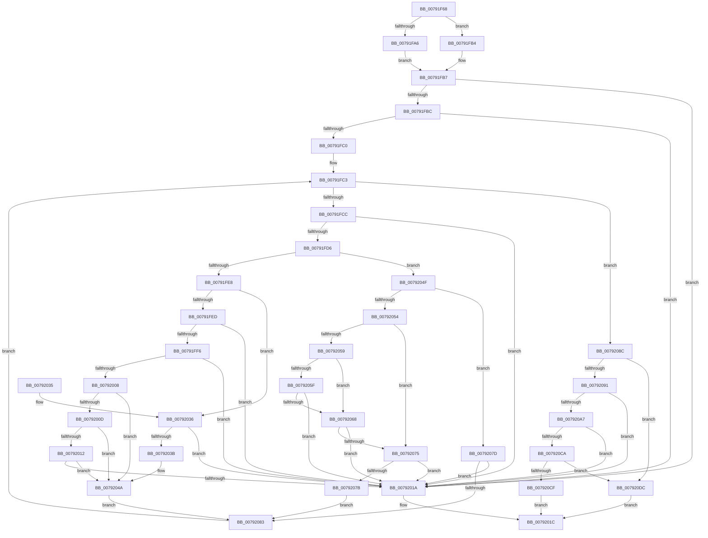

# RtlpValidateAsciiStd3AndLength

- RVA: `0x00791F68`–`0x007920E3` (길이 `379` bytes)
- VA: `0x0000000140791F68`
- 실행 섹션: `PAGE`
- PDB 이름 있음: `예`; PDB Function 태그: `아니요`
- unwind 정보 RVA: `0x000CFDD8`
- 디코드: `117`개 명령, `379/379` bytes 표시
- 미해석 바이트: `0` (있으면 어셈블리에 `.byte`로 보존)

> 이 문서는 커널 이미지의 기계어와 PDB 기호를 분석해 생성했습니다. 4번과 5번은 함수 원형과 자료형을 바이너리 사용 방식에서 추정한 C 해석이며 원본 소스 복구 결과는 아닙니다.

## 1. Dependencies

- 직접 호출 지점: **2**; 고유 호출 대상: **2**
- 직접 호출자로 확인된 함수: **1**
- RIP 상대 이미지 참조: **0**

### Outgoing calls
- `0x00791FA6` → [FindEmailAt](../../text/5E/FindEmailAt_function_005ECA74.md) (function, `0x005ECA74`)
- `0x0079206C` → [ValidateStd3Range](../../text/5E/ValidateStd3Range_function_005ED154.md) (function, `0x005ED154`)

### Direct callers
- [RtlpNameprepAsciiRealWorker](../../text/5E/RtlpNameprepAsciiRealWorker_function_005ECDF8.md) at `0x005ECEDC`

### Static image references
- 디코드된 RIP-relative 메모리 참조가 없습니다.

## 2. Other-region calls and transfers

- 다른 실행 섹션으로 향하는 call: **2**
  - `0x00791FA6` → [FindEmailAt](../../text/5E/FindEmailAt_function_005ECA74.md) (`PAGE` → `.text`)
  - `0x0079206C` → [ValidateStd3Range](../../text/5E/ValidateStd3Range_function_005ED154.md) (`PAGE` → `.text`)
- 별도 외부 분기/꼬리 이동을 확인하지 못했습니다.

## 3. Assembly (complete function range)

```asm
00791F68  48 89 5C 24 08                  mov qword ptr [rsp + 8], rbx
00791F6D  48 89 6C 24 10                  mov qword ptr [rsp + 0x10], rbp
00791F72  48 89 74 24 18                  mov qword ptr [rsp + 0x18], rsi
00791F77  57                              push rdi
00791F78  41 54                           push r12
00791F7A  41 56                           push r14
00791F7C  48 83 EC 20                     sub rsp, 0x20
00791F80  48 63 C2                        movsxd rax, edx
00791F83  48 8D 59 FE                     lea rbx, [rcx - 2]
00791F87  45 33 F6                        xor r14d, r14d
00791F8A  41 BC 2E 00 00 00               mov r12d, 0x2e
00791F90  41 8A E9                        mov bpl, r9b
00791F93  41 8A F8                        mov dil, r8b
00791F96  48 8B F1                        mov rsi, rcx
00791F99  45 0F B7 D4                     movzx r10d, r12w
00791F9D  4C 8D 1C 41                     lea r11, [rcx + rax*2]
00791FA1  45 84 C0                        test r8b, r8b
00791FA4  74 0E                           je 0x140791fb4
00791FA6  E8 C9 AA E5 FF                  call 0x1405eca74
00791FAB  48 63 C8                        movsxd rcx, eax
00791FAE  4C 8D 0C 4E                     lea r9, [rsi + rcx*2]
00791FB2  EB 03                           jmp 0x140791fb7
00791FB4  4C 8B CB                        mov r9, rbx
00791FB7  4D 3B CB                        cmp r9, r11
00791FBA  74 5E                           je 0x14079201a
00791FBC  85 D2                           test edx, edx
00791FBE  7E 5A                           jle 0x14079201a
00791FC0  4C 8B C6                        mov r8, rsi
00791FC3  4D 3B C3                        cmp r8, r11
00791FC6  0F 84 C0 00 00 00               je 0x14079208c
00791FCC  45 0F B7 10                     movzx r10d, word ptr [r8]
00791FD0  41 83 FA 7F                     cmp r10d, 0x7f
00791FD4  73 44                           jae 0x14079201a
00791FD6  40 8A C7                        mov al, dil
00791FD9  F6 D8                           neg al
00791FDB  1B C9                           sbb ecx, ecx
00791FDD  83 E1 12                        and ecx, 0x12
00791FE0  41 03 CC                        add ecx, r12d
00791FE3  44 3B D1                        cmp r10d, ecx
00791FE6  75 67                           jne 0x14079204f
00791FE8  40 84 FF                        test dil, dil
00791FEB  75 49                           jne 0x140792036
00791FED  48 8D 43 02                     lea rax, [rbx + 2]
00791FF1  4C 3B C0                        cmp r8, rax
00791FF4  74 24                           je 0x14079201a
00791FF6  49 8B C0                        mov rax, r8
00791FF9  48 2B C3                        sub rax, rbx
00791FFC  48 83 E0 FE                     and rax, 0xfffffffffffffffe
00792000  48 3D 80 00 00 00               cmp rax, 0x80
00792006  7F 12                           jg 0x14079201a
00792008  40 84 ED                        test bpl, bpl
0079200B  74 3D                           je 0x14079204a
0079200D  4C 3B C6                        cmp r8, rsi
00792010  76 38                           jbe 0x14079204a
00792012  66 41 83 78 FE 2D               cmp word ptr [r8 - 2], 0x2d
00792018  75 30                           jne 0x14079204a
0079201A  32 C0                           xor al, al
0079201C  48 8B 5C 24 40                  mov rbx, qword ptr [rsp + 0x40]
00792021  48 8B 6C 24 48                  mov rbp, qword ptr [rsp + 0x48]
00792026  48 8B 74 24 50                  mov rsi, qword ptr [rsp + 0x50]
0079202B  48 83 C4 20                     add rsp, 0x20
0079202F  41 5E                           pop r14
00792031  41 5C                           pop r12
00792033  5F                              pop rdi
00792034  C3                              ret
00792035  CC                              int3
00792036  4C 3B C6                        cmp r8, rsi
00792039  74 DF                           je 0x14079201a
0079203B  49 8D 41 FE                     lea rax, [r9 - 2]
0079203F  40 0F B6 FF                     movzx edi, dil
00792043  4C 3B C0                        cmp r8, rax
00792046  41 0F 44 FE                     cmove edi, r14d
0079204A  49 8B D8                        mov rbx, r8
0079204D  EB 34                           jmp 0x140792083
0079204F  40 84 FF                        test dil, dil
00792052  75 29                           jne 0x14079207d
00792054  40 84 ED                        test bpl, bpl
00792057  74 1C                           je 0x140792075
00792059  41 83 FA 2D                     cmp r10d, 0x2d
0079205D  75 09                           jne 0x140792068
0079205F  48 8D 43 02                     lea rax, [rbx + 2]
00792063  4C 3B C0                        cmp r8, rax
00792066  74 B2                           je 0x14079201a
00792068  41 0F B7 CA                     movzx ecx, r10w
0079206C  E8 E3 B0 E5 FF                  call 0x1405ed154
00792071  84 C0                           test al, al
00792073  74 A5                           je 0x14079201a
00792075  41 83 FA 20                     cmp r10d, 0x20
00792079  72 9F                           jb 0x14079201a
0079207B  EB 06                           jmp 0x140792083
0079207D  66 45 85 D2                     test r10w, r10w
00792081  74 97                           je 0x14079201a
00792083  49 83 C0 02                     add r8, 2
00792087  E9 37 FF FF FF                  jmp 0x140791fc3
0079208C  40 84 FF                        test dil, dil
0079208F  75 4B                           jne 0x1407920dc
00792091  49 8B C3                        mov rax, r11
00792094  48 2B C3                        sub rax, rbx
00792097  48 83 E0 FE                     and rax, 0xfffffffffffffffe
0079209B  48 3D 80 00 00 00               cmp rax, 0x80
007920A1  0F 8F 73 FF FF FF               jg 0x14079201a
007920A7  4D 2B D9                        sub r11, r9
007920AA  41 0F B7 C2                     movzx eax, r10w
007920AE  66 41 2B C4                     sub ax, r12w
007920B2  49 D1 FB                        sar r11, 1
007920B5  66 F7 D8                        neg ax
007920B8  48 1B C0                        sbb rax, rax
007920BB  48 05 00 01 00 00               add rax, 0x100
007920C1  4C 3B D8                        cmp r11, rax
007920C4  0F 8F 50 FF FF FF               jg 0x14079201a
007920CA  40 84 ED                        test bpl, bpl
007920CD  74 0D                           je 0x1407920dc
007920CF  66 41 83 FA 2D                  cmp r10w, 0x2d
007920D4  0F 95 C0                        setne al
007920D7  E9 40 FF FF FF                  jmp 0x14079201c
007920DC  B0 01                           mov al, 1
007920DE  E9 39 FF FF FF                  jmp 0x14079201c
```

## 4. C-style interpretation (structured pseudocode)

```c
__int64 __fastcall RtlpValidateAsciiStd3AndLength(__int64 a1, int a2, unsigned __int8 a3, unsigned __int8 a4)
{
    __int64 result;
    __int64 v_r11;
    __int64 v_r14;
    __int64 v_rsp;
    unsigned __int64 v_stack_p10;
    unsigned __int64 v_stack_p18;
    unsigned __int64 v_stack_p8;

    v_stack_p8 = v_rbx;
    v_stack_p10 = v_rbp;
    v_stack_p18 = v_rsi;
    v_rsp = (v_rsp) - (32);
    v_r14 = 0;
    if (a3 == 0) goto loc_00791FB4;
    result = FindEmailAt(a1, a2, a3, a4);
    goto loc_00791FB7;
loc_00791FB4:
loc_00791FB7:
    if ((a1 - 2) == (a1 + (int)(a2) * 2)) goto loc_0079201A;
    if (condition_is_less_or_equal) goto loc_0079201A;
loc_00791FC3:
    if (a1 == (a1 + (int)(a2) * 2)) goto loc_0079208C;
    if (((unsigned int)(*(unsigned __int16 *)(a1))) >= 127) goto loc_0079201A;
    result = (unsigned __int8)(-(a3));
    a1 = (unsigned int)(((int)((unsigned int)(result))) & (18));
    a1 = (unsigned int)((a1) + (46));
    if (((unsigned int)(*(unsigned __int16 *)(a1))) != ((unsigned int)(a1))) goto loc_0079204F;
    if (a3 != 0) goto loc_00792036;
    if (a1 == (a1 - 2 + 2)) goto loc_0079201A;
    result = (a1) - (a1 - 2);
    result = (result) & (-2);
    if (result > 128) goto loc_0079201A;
    if (a4 == 0) goto loc_0079204A;
    if (a1 <= a1) goto loc_0079204A;
    if ((*(unsigned __int16 *)(a1 - 2)) != 45) goto loc_0079204A;
loc_0079201A:
    result = 0;
loc_0079201C:
    v_rsp = (v_rsp) + (32);
    return result;
loc_00792036:
    if (a1 == v_stack_p18) goto loc_0079201A;
    if (a1 == (a1 - 2 - 2)) { a3 = 0; }
loc_0079204A:
    goto loc_00792083;
loc_0079204F:
    if (a3 != 0) goto loc_0079207D;
    if ((unsigned __int8)(v_stack_p10) == 0) goto loc_00792075;
    if (((unsigned int)(*(unsigned __int16 *)(a1))) != 45) goto loc_00792068;
    if (a1 == (a1 + 2)) goto loc_0079201A;
loc_00792068:
    result = ValidateStd3Range((unsigned __int16)(*(unsigned __int16 *)(a1)), a2, a1, a1 - 2);
    if ((unsigned __int8)(result) == 0) goto loc_0079201A;
loc_00792075:
    if (((unsigned int)(*(unsigned __int16 *)(a1))) < 32) goto loc_0079201A;
    goto loc_00792083;
loc_0079207D:
    if ((unsigned __int16)(*(unsigned __int16 *)(a1)) == 0) goto loc_0079201A;
loc_00792083:
    a3 = (a1) + (2);
    goto loc_00791FC3;
loc_0079208C:
    if (a3 != 0) goto loc_007920DC;
    result = (a1 + (int)(a2) * 2) - (a1);
    result = (result) & (-2);
    if (result > 128) goto loc_0079201A;
    v_r11 = (a1 + (int)(a2) * 2) - (a1 - 2);
    result = (unsigned __int16)(((unsigned __int16)(*(unsigned __int16 *)(a1))) - (46));
    v_r11 = (v_r11) >> (1);
    result = (unsigned __int16)(-(result));
    result = (result) + (256);
    if (v_r11 > result) goto loc_0079201A;
    if ((unsigned __int8)(v_stack_p10) == 0) goto loc_007920DC;
    result = (((unsigned __int16)(*(unsigned __int16 *)(a1))) != 45) ? 1 : 0;
    goto loc_0079201C;
loc_007920DC:
    goto loc_0079201C;
}
```

## 5. (Beta) C Style

```c
int64_t RtlpValidateAsciiStd3AndLength(void *Arg1, int32_t Arg2, uint8_t Arg3, uint8_t Arg4)
{
    uint8_t *arg1 = (uint8_t *)Arg1;

    int64_t result;
    int64_t local_r11;
    int64_t local_r14;
    int64_t local_rsp;
    uint64_t v_stack_p10;
    uint64_t v_stack_p18;
    uint64_t v_stack_p8;

    v_stack_p8 = local_rbx;
    v_stack_p10 = local_rbp;
    v_stack_p18 = local_rsi;
    local_rsp = (local_rsp) - (32);
    local_r14 = 0;
    if (Arg3 == 0) goto loc_00791FB4;
    result = FindEmailAt(Arg1, Arg2, Arg3, Arg4);
    goto loc_00791FB7;
loc_00791FB4:
loc_00791FB7:
    if ((Arg1 - 2) == (Arg1 + (int32_t)(Arg2) * 2)) goto loc_0079201A;
    if (condition_is_less_or_equal) goto loc_0079201A;
loc_00791FC3:
    if (Arg1 == (Arg1 + (int32_t)(Arg2) * 2)) goto loc_0079208C;
    if (((uint32_t)(*(uint16_t *)(arg1))) >= 127) goto loc_0079201A;
    result = (uint8_t)(-(Arg3));
    Arg1 = (uint32_t)(((int32_t)((uint32_t)(result))) & (18));
    Arg1 = (uint32_t)((Arg1) + (46));
    if (((uint32_t)(*(uint16_t *)(arg1))) != ((uint32_t)(Arg1))) goto loc_0079204F;
    if (Arg3 != 0) goto loc_00792036;
    if (Arg1 == (Arg1 - 2 + 2)) goto loc_0079201A;
    result = (Arg1) - (Arg1 - 2);
    result = (result) & (-2);
    if (result > 128) goto loc_0079201A;
    if (Arg4 == 0) goto loc_0079204A;
    if (Arg1 <= Arg1) goto loc_0079204A;
    if ((*(uint16_t *)(arg1 - 0x2)) != 45) goto loc_0079204A;
loc_0079201A:
    result = 0;
loc_0079201C:
    local_rsp = (local_rsp) + (32);
    return result;
loc_00792036:
    if (Arg1 == v_stack_p18) goto loc_0079201A;
    if (Arg1 == (Arg1 - 2 - 2)) { Arg3 = 0; }
loc_0079204A:
    goto loc_00792083;
loc_0079204F:
    if (Arg3 != 0) goto loc_0079207D;
    if ((uint8_t)(v_stack_p10) == 0) goto loc_00792075;
    if (((uint32_t)(*(uint16_t *)(arg1))) != 45) goto loc_00792068;
    if (Arg1 == (Arg1 + 2)) goto loc_0079201A;
loc_00792068:
    result = ValidateStd3Range((uint16_t)(*(uint16_t *)(arg1)), Arg2, Arg1, Arg1 - 2);
    if ((uint8_t)(result) == 0) goto loc_0079201A;
loc_00792075:
    if (((uint32_t)(*(uint16_t *)(arg1))) < 32) goto loc_0079201A;
    goto loc_00792083;
loc_0079207D:
    if ((uint16_t)(*(uint16_t *)(arg1)) == 0) goto loc_0079201A;
loc_00792083:
    Arg3 = (Arg1) + (2);
    goto loc_00791FC3;
loc_0079208C:
    if (Arg3 != 0) goto loc_007920DC;
    result = (Arg1 + (int32_t)(Arg2) * 2) - (Arg1);
    result = (result) & (-2);
    if (result > 128) goto loc_0079201A;
    local_r11 = (Arg1 + (int32_t)(Arg2) * 2) - (Arg1 - 2);
    result = (uint16_t)(((uint16_t)(*(uint16_t *)(arg1))) - (46));
    local_r11 = (local_r11) >> (1);
    result = (uint16_t)(-(result));
    result = (result) + (256);
    if (local_r11 > result) goto loc_0079201A;
    if ((uint8_t)(v_stack_p10) == 0) goto loc_007920DC;
    result = (((uint16_t)(*(uint16_t *)(arg1))) != 45) ? 1 : 0;
    goto loc_0079201C;
loc_007920DC:
    goto loc_0079201C;
}
```

### 관측된 메모리 오프셋

구조체 형식이 확인되지 않은 접근은 인자 기준의 오프셋으로만 기록했습니다.

| 기준 인자 | 오프셋 표현 | 폭 (bit) | 접근 |
|---|---:|---:|---|
| `Arg1` | `- 0x2` | `64` | `R` |
| `Arg1` | `+ 0x0 + rax*2` | `64` | `R` |
| `Arg1` | `+ 0x0 + rcx*2` | `64` | `R` |

## 6. Execution-region graph

[열기: 2D/3D 그래프와 함수 탐색 컨트롤 패널](../../../control-panel.html?section=page&rva=0x00791F68&view=graph)

- 2D 그래프는 위에서 아래로 흐르고, 3D 그래프는 빈 공간을 드래그해 회전합니다. Shift+드래그는 이동, 휠은 확대·축소, 함수 노드 선택은 대상 보고서 이동입니다.

### Static fallback


