# SeAdtRegistryValueChangedAuditAlarm

- RVA: `0x0079DDD4`–`0x0079E36C` (길이 `1,432` bytes)
- VA: `0x000000014079DDD4`
- 실행 섹션: `PAGE`
- PDB 이름 있음: `예`; PDB Function 태그: `아니요`
- unwind 정보 RVA: `0x000D1110`
- 디코드: `337`개 명령, `1,432/1,432` bytes 표시
- 미해석 바이트: `0` (있으면 어셈블리에 `.byte`로 보존)

> 이 문서는 커널 이미지의 기계어와 PDB 기호를 분석해 생성했습니다. 4번과 5번은 함수 원형과 자료형을 바이너리 사용 방식에서 추정한 C 해석이며 원본 소스 복구 결과는 아닙니다.

## 1. Dependencies

- 직접 호출 지점: **27**; 고유 호출 대상: **17**
- 직접 호출자로 확인된 함수: **2**
- RIP 상대 이미지 참조: **4**

### Outgoing calls
- `0x0079DE2B` → [memset](../../text/6C/memset_function_006C6C40.md) (function, `0x006C6C40`)
- `0x0079DE77` → [SeCaptureSubjectContext](../86/SeCaptureSubjectContext_function_0086B820.md) (function, `0x0086B820`)
- `0x0079DE91` → [SeAuditingWithTokenForSubcategory](../90/SeAuditingWithTokenForSubcategory_function_009047D0.md) (function, `0x009047D0`)
- `0x0079DF1A` → [SeExamineSacl](../97/SeExamineSacl_function_00973A30.md) (function, `0x00973A30`)
- `0x0079DF2A` → [RtlInitUnicodeString](../../text/42/RtlInitUnicodeString_function_0042A780.md) (function, `0x0042A780`)
- `0x0079DF81` → [SeExamineGlobalSacl](../97/SeExamineGlobalSacl_function_00973C98.md) (function, `0x00973C98`)
- `0x0079DF9F` → [SepQueryNameString](../8F/SepQueryNameString_function_008F5DE8.md) (function, `0x008F5DE8`)
- `0x0079DFED` → [AdtpBuildRegistryValueString](../82/AdtpBuildRegistryValueString_function_00822194.md) (function, `0x00822194`)
- `0x0079E01C` → [AdtpBuildReplacementString](../82/AdtpBuildReplacementString_function_00822884.md) (function, `0x00822884`)
- `0x0079E039` → [RtlInitUnicodeString](../../text/42/RtlInitUnicodeString_function_0042A780.md) (function, `0x0042A780`)
- `0x0079E04A` → [RtlInitUnicodeString](../../text/42/RtlInitUnicodeString_function_0042A780.md) (function, `0x0042A780`)
- `0x0079E05C` → [RtlInitUnicodeString](../../text/42/RtlInitUnicodeString_function_0042A780.md) (function, `0x0042A780`)
- `0x0079E06D` → [RtlInitUnicodeString](../../text/42/RtlInitUnicodeString_function_0042A780.md) (function, `0x0042A780`)
- `0x0079E093` → [AdtpBuildRegistryValueString](../82/AdtpBuildRegistryValueString_function_00822194.md) (function, `0x00822194`)
- `0x0079E0C3` → [AdtpBuildReplacementString](../82/AdtpBuildReplacementString_function_00822884.md) (function, `0x00822884`)
- `0x0079E0EE` → [AdtpBuildReplacementString](../82/AdtpBuildReplacementString_function_00822884.md) (function, `0x00822884`)
- `0x0079E0FD` → [PsGetCurrentThreadProcess](../../text/47/PsGetCurrentThreadProcess_function_0047C7E0.md) (function, `0x0047C7E0`)
- `0x0079E111` → [PsGetAllocatedFullProcessImageNameEx](../91/PsGetAllocatedFullProcessImageNameEx_function_0091D6F0.md) (function, `0x0091D6F0`)
- `0x0079E1ED` → [ObNormalizeHandleValue](../91/ObNormalizeHandleValue_function_0091E6A8.md) (function, `0x0091E6A8`)
- `0x0079E2DC` → [SepAdtLogAuditRecord](../../text/22/SepAdtLogAuditRecord_function_00224B6C.md) (function, `0x00224B6C`)
- `0x0079E2E7` → [SepAuditFailed](../86/SepAuditFailed_function_0086EE20.md) (function, `0x0086EE20`)
- `0x0079E2F9` → [ExFreePoolWithTag](../../poolcode/B8/ExFreePoolWithTag_function_00B82870.md) (function, `0x00B82870`)
- `0x0079E30B` → [ExFreePoolWithTag](../../poolcode/B8/ExFreePoolWithTag_function_00B82870.md) (function, `0x00B82870`)
- `0x0079E31C` → [ExFreePoolWithTag](../../poolcode/B8/ExFreePoolWithTag_function_00B82870.md) (function, `0x00B82870`)
- `0x0079E32D` → [ExFreePoolWithTag](../../poolcode/B8/ExFreePoolWithTag_function_00B82870.md) (function, `0x00B82870`)
- `0x0079E336` → [SeReleaseSubjectContext](../86/SeReleaseSubjectContext_function_0086B710.md) (function, `0x0086B710`)
- `0x0079E345` → [_security_check_cookie](../../text/6A/_security_check_cookie_function_006AC640.md) (function, `0x006AC640`)

### Direct callers
- [CmDeleteValueKey](../84/CmDeleteValueKey_function_008476E8.md) at `0x00847D99`
- [sub_00B160F4](../B1/Unknown_function_00B160F4.md) at `0x00B1632D`

### Static image references
- `0x0079DDFA` → RVA `0x00E0A740` (`.data`; read)
- `0x0079DF1F` → RVA `0x00B05E30` (` ?? ::NNGAKEGL::`string'`; read)
- `0x0079E02E` → RVA `0x00B05E40` (` ?? ::NNGAKEGL::`string'`; read)
- `0x0079E18F` → RVA `0x000013A8` (`.rdata`; read)

## 2. Other-region calls and transfers

- 다른 실행 섹션으로 향하는 call: **13**
  - `0x0079DE2B` → [memset](../../text/6C/memset_function_006C6C40.md) (`PAGE` → `.text`)
  - `0x0079DF2A` → [RtlInitUnicodeString](../../text/42/RtlInitUnicodeString_function_0042A780.md) (`PAGE` → `.text`)
  - `0x0079E039` → [RtlInitUnicodeString](../../text/42/RtlInitUnicodeString_function_0042A780.md) (`PAGE` → `.text`)
  - `0x0079E04A` → [RtlInitUnicodeString](../../text/42/RtlInitUnicodeString_function_0042A780.md) (`PAGE` → `.text`)
  - `0x0079E05C` → [RtlInitUnicodeString](../../text/42/RtlInitUnicodeString_function_0042A780.md) (`PAGE` → `.text`)
  - `0x0079E06D` → [RtlInitUnicodeString](../../text/42/RtlInitUnicodeString_function_0042A780.md) (`PAGE` → `.text`)
  - `0x0079E0FD` → [PsGetCurrentThreadProcess](../../text/47/PsGetCurrentThreadProcess_function_0047C7E0.md) (`PAGE` → `.text`)
  - `0x0079E2DC` → [SepAdtLogAuditRecord](../../text/22/SepAdtLogAuditRecord_function_00224B6C.md) (`PAGE` → `.text`)
  - `0x0079E2F9` → [ExFreePoolWithTag](../../poolcode/B8/ExFreePoolWithTag_function_00B82870.md) (`PAGE` → `POOLCODE`)
  - `0x0079E30B` → [ExFreePoolWithTag](../../poolcode/B8/ExFreePoolWithTag_function_00B82870.md) (`PAGE` → `POOLCODE`)
  - `0x0079E31C` → [ExFreePoolWithTag](../../poolcode/B8/ExFreePoolWithTag_function_00B82870.md) (`PAGE` → `POOLCODE`)
  - `0x0079E32D` → [ExFreePoolWithTag](../../poolcode/B8/ExFreePoolWithTag_function_00B82870.md) (`PAGE` → `POOLCODE`)
  - `0x0079E345` → [_security_check_cookie](../../text/6A/_security_check_cookie_function_006AC640.md) (`PAGE` → `.text`)
- 별도 외부 분기/꼬리 이동을 확인하지 못했습니다.

## 3. Assembly (complete function range)

```asm
0079DDD4  48 8B C4                        mov rax, rsp
0079DDD7  48 89 58 08                     mov qword ptr [rax + 8], rbx
0079DDDB  48 89 70 18                     mov qword ptr [rax + 0x18], rsi
0079DDDF  48 89 78 20                     mov qword ptr [rax + 0x20], rdi
0079DDE3  55                              push rbp
0079DDE4  41 54                           push r12
0079DDE6  41 55                           push r13
0079DDE8  41 56                           push r14
0079DDEA  41 57                           push r15
0079DDEC  48 8D A8 68 FB FF FF            lea rbp, [rax - 0x498]
0079DDF3  48 81 EC 70 05 00 00            sub rsp, 0x570
0079DDFA  48 8B 05 3F C9 66 00            mov rax, qword ptr [rip + 0x66c93f]
0079DE01  48 33 C4                        xor rax, rsp
0079DE04  48 89 85 60 04 00 00            mov qword ptr [rbp + 0x460], rax
0079DE0B  48 8B B5 C0 04 00 00            mov rsi, qword ptr [rbp + 0x4c0]
0079DE12  48 8D 4D E0                     lea rcx, [rbp - 0x20]
0079DE16  4C 8B B5 D0 04 00 00            mov r14, qword ptr [rbp + 0x4d0]
0079DE1D  48 8B DA                        mov rbx, rdx
0079DE20  33 D2                           xor edx, edx
0079DE22  41 B8 18 04 00 00               mov r8d, 0x418
0079DE28  4D 8B E1                        mov r12, r9
0079DE2B  E8 10 8E F2 FF                  call 0x1406c6c40
0079DE30  33 C0                           xor eax, eax
0079DE32  48 8D 4D B8                     lea rcx, [rbp - 0x48]
0079DE36  0F 57 C0                        xorps xmm0, xmm0
0079DE39  48 89 44 24 50                  mov qword ptr [rsp + 0x50], rax
0079DE3E  0F 57 C9                        xorps xmm1, xmm1
0079DE41  88 44 24 42                     mov byte ptr [rsp + 0x42], al
0079DE45  8B F8                           mov edi, eax
0079DE47  88 44 24 43                     mov byte ptr [rsp + 0x43], al
0079DE4B  0F 11 45 88                     movups xmmword ptr [rbp - 0x78], xmm0
0079DE4F  48 89 44 24 48                  mov qword ptr [rsp + 0x48], rax
0079DE54  0F 11 4D 98                     movups xmmword ptr [rbp - 0x68], xmm1
0079DE58  88 44 24 41                     mov byte ptr [rsp + 0x41], al
0079DE5C  0F 11 44 24 58                  movups xmmword ptr [rsp + 0x58], xmm0
0079DE61  0F 11 4C 24 68                  movups xmmword ptr [rsp + 0x68], xmm1
0079DE66  0F 11 44 24 78                  movups xmmword ptr [rsp + 0x78], xmm0
0079DE6B  0F 11 45 B8                     movups xmmword ptr [rbp - 0x48], xmm0
0079DE6F  0F 11 45 C8                     movups xmmword ptr [rbp - 0x38], xmm0
0079DE73  0F 11 45 A8                     movups xmmword ptr [rbp - 0x58], xmm0
0079DE77  E8 A4 D9 0C 00                  call 0x14086b820
0079DE7C  4C 8B 7D B8                     mov r15, qword ptr [rbp - 0x48]
0079DE80  8D 4F 76                        lea ecx, [rdi + 0x76]
0079DE83  4C 8B 6D C8                     mov r13, qword ptr [rbp - 0x38]
0079DE87  4D 85 FF                        test r15, r15
0079DE8A  49 8B D5                        mov rdx, r13
0079DE8D  49 0F 45 D7                     cmovne rdx, r15
0079DE91  E8 3A 69 16 00                  call 0x1409047d0
0079DE96  45 33 C9                        xor r9d, r9d
0079DE99  88 44 24 40                     mov byte ptr [rsp + 0x40], al
0079DE9D  84 C0                           test al, al
0079DE9F  0F 84 8D 04 00 00               je 0x14079e332
0079DEA5  0F B7 43 02                     movzx eax, word ptr [rbx + 2]
0079DEA9  4D 85 FF                        test r15, r15
0079DEAC  4D 8B C5                        mov r8, r13
0079DEAF  0F B7 C8                        movzx ecx, ax
0079DEB2  4D 0F 45 C7                     cmovne r8, r15
0079DEB6  BA 00 80 00 00                  mov edx, 0x8000
0079DEBB  66 23 CA                        and cx, dx
0079DEBE  A8 10                           test al, 0x10
0079DEC0  74 33                           je 0x14079def5
0079DEC2  66 85 C9                        test cx, cx
0079DEC5  74 12                           je 0x14079ded9
0079DEC7  8B 43 0C                        mov eax, dword ptr [rbx + 0xc]
0079DECA  85 C0                           test eax, eax
0079DECC  75 05                           jne 0x14079ded3
0079DECE  41 8B D1                        mov edx, r9d
0079DED1  EB 0A                           jmp 0x14079dedd
0079DED3  48 8D 14 03                     lea rdx, [rbx + rax]
0079DED7  EB 04                           jmp 0x14079dedd
0079DED9  48 8B 53 18                     mov rdx, qword ptr [rbx + 0x18]
0079DEDD  66 85 C9                        test cx, cx
0079DEE0  74 0D                           je 0x14079deef
0079DEE2  8B 43 0C                        mov eax, dword ptr [rbx + 0xc]
0079DEE5  85 C0                           test eax, eax
0079DEE7  74 0F                           je 0x14079def8
0079DEE9  48 8D 0C 03                     lea rcx, [rbx + rax]
0079DEED  EB 0C                           jmp 0x14079defb
0079DEEF  48 8B 4B 18                     mov rcx, qword ptr [rbx + 0x18]
0079DEF3  EB 06                           jmp 0x14079defb
0079DEF5  49 8B D1                        mov rdx, r9
0079DEF8  49 8B C9                        mov rcx, r9
0079DEFB  48 8D 44 24 41                  lea rax, [rsp + 0x41]
0079DF00  41 B9 02 00 00 00               mov r9d, 2
0079DF06  48 89 44 24 30                  mov qword ptr [rsp + 0x30], rax
0079DF0B  48 8D 44 24 40                  lea rax, [rsp + 0x40]
0079DF10  48 89 44 24 28                  mov qword ptr [rsp + 0x28], rax
0079DF15  C6 44 24 20 01                  mov byte ptr [rsp + 0x20], 1
0079DF1A  E8 11 5B 1D 00                  call 0x140973a30
0079DF1F  48 8D 15 0A 7F 36 00            lea rdx, [rip + 0x367f0a]
0079DF26  48 8D 4D A8                     lea rcx, [rbp - 0x58]
0079DF2A  E8 51 C8 C8 FF                  call 0x14042a780
0079DF2F  0F B7 43 02                     movzx eax, word ptr [rbx + 2]
0079DF33  33 C9                           xor ecx, ecx
0079DF35  4D 85 FF                        test r15, r15
0079DF38  4D 8B C5                        mov r8, r13
0079DF3B  4D 0F 45 C7                     cmovne r8, r15
0079DF3F  A8 10                           test al, 0x10
0079DF41  75 05                           jne 0x14079df48
0079DF43  48 8B D1                        mov rdx, rcx
0079DF46  EB 16                           jmp 0x14079df5e
0079DF48  66 85 C0                        test ax, ax
0079DF4B  79 0D                           jns 0x14079df5a
0079DF4D  8B 43 0C                        mov eax, dword ptr [rbx + 0xc]
0079DF50  85 C0                           test eax, eax
0079DF52  74 EF                           je 0x14079df43
0079DF54  48 8D 14 03                     lea rdx, [rbx + rax]
0079DF58  EB 04                           jmp 0x14079df5e
0079DF5A  48 8B 53 18                     mov rdx, qword ptr [rbx + 0x18]
0079DF5E  48 8D 44 24 41                  lea rax, [rsp + 0x41]
0079DF63  41 B9 02 00 00 00               mov r9d, 2
0079DF69  48 89 44 24 30                  mov qword ptr [rsp + 0x30], rax
0079DF6E  48 8D 4D A8                     lea rcx, [rbp - 0x58]
0079DF72  48 8D 44 24 40                  lea rax, [rsp + 0x40]
0079DF77  48 89 44 24 28                  mov qword ptr [rsp + 0x28], rax
0079DF7C  C6 44 24 20 01                  mov byte ptr [rsp + 0x20], 1
0079DF81  E8 12 5D 1D 00                  call 0x140973c98
0079DF86  33 C0                           xor eax, eax
0079DF88  38 44 24 40                     cmp byte ptr [rsp + 0x40], al
0079DF8C  0F 84 A0 03 00 00               je 0x14079e332
0079DF92  48 85 F6                        test rsi, rsi
0079DF95  74 23                           je 0x14079dfba
0079DF97  48 8D 54 24 50                  lea rdx, [rsp + 0x50]
0079DF9C  48 8B CE                        mov rcx, rsi
0079DF9F  E8 44 7E 15 00                  call 0x1408f5de8
0079DFA4  33 F6                           xor esi, esi
0079DFA6  85 C0                           test eax, eax
0079DFA8  0F 88 37 03 00 00               js 0x14079e2e5
0079DFAE  48 8B 44 24 50                  mov rax, qword ptr [rsp + 0x50]
0079DFB3  48 85 C0                        test rax, rax
0079DFB6  48 0F 45 F8                     cmovne rdi, rax
0079DFBA  8B B5 D8 04 00 00               mov esi, dword ptr [rbp + 0x4d8]
0079DFC0  BB 00 10 00 00                  mov ebx, 0x1000
0079DFC5  85 F6                           test esi, esi
0079DFC7  0F 84 84 00 00 00               je 0x14079e051
0079DFCD  41 8B 46 04                     mov eax, dword ptr [r14 + 4]
0079DFD1  4C 8D 4D 88                     lea r9, [rbp - 0x78]
0079DFD5  4D 8B 46 08                     mov r8, qword ptr [r14 + 8]
0079DFD9  3B C3                           cmp eax, ebx
0079DFDB  41 8B 0E                        mov ecx, dword ptr [r14]
0079DFDE  8B D3                           mov edx, ebx
0079DFE0  0F 42 D0                        cmovb edx, eax
0079DFE3  48 8D 44 24 42                  lea rax, [rsp + 0x42]
0079DFE8  48 89 44 24 20                  mov qword ptr [rsp + 0x20], rax
0079DFED  E8 A2 41 08 00                  call 0x140822194
0079DFF2  85 C0                           test eax, eax
0079DFF4  0F 88 E9 02 00 00               js 0x14079e2e3
0079DFFA  41 8B 0E                        mov ecx, dword ptr [r14]
0079DFFD  48 8D 85 00 04 00 00            lea rax, [rbp + 0x400]
0079E004  81 C1 50 07 00 00               add ecx, 0x750
0079E00A  C7 44 24 58 00 00 1A 00         mov dword ptr [rsp + 0x58], 0x1a0000
0079E012  48 8D 54 24 58                  lea rdx, [rsp + 0x58]
0079E017  48 89 44 24 60                  mov qword ptr [rsp + 0x60], rax
0079E01C  E8 63 48 08 00                  call 0x140822884
0079E021  85 C0                           test eax, eax
0079E023  0F 88 BA 02 00 00               js 0x14079e2e3
0079E029  83 FE 02                        cmp esi, 2
0079E02C  75 44                           jne 0x14079e072
0079E02E  48 8D 15 0B 7E 36 00            lea rdx, [rip + 0x367e0b]
0079E035  48 8D 4D 98                     lea rcx, [rbp - 0x68]
0079E039  E8 42 C7 C8 FF                  call 0x14042a780
0079E03E  48 8D 15 FB 7D 36 00            lea rdx, [rip + 0x367dfb]
0079E045  48 8D 4C 24 68                  lea rcx, [rsp + 0x68]
0079E04A  E8 31 C7 C8 FF                  call 0x14042a780
0079E04F  EB 7F                           jmp 0x14079e0d0
0079E051  48 8D 15 E8 7D 36 00            lea rdx, [rip + 0x367de8]
0079E058  48 8D 4D 88                     lea rcx, [rbp - 0x78]
0079E05C  E8 1F C7 C8 FF                  call 0x14042a780
0079E061  48 8D 15 D8 7D 36 00            lea rdx, [rip + 0x367dd8]
0079E068  48 8D 4C 24 58                  lea rcx, [rsp + 0x58]
0079E06D  E8 0E C7 C8 FF                  call 0x14042a780
0079E072  41 8B 46 14                     mov eax, dword ptr [r14 + 0x14]
0079E076  4C 8D 4D 98                     lea r9, [rbp - 0x68]
0079E07A  4D 8B 46 18                     mov r8, qword ptr [r14 + 0x18]
0079E07E  3B C3                           cmp eax, ebx
0079E080  41 8B 4E 10                     mov ecx, dword ptr [r14 + 0x10]
0079E084  0F 42 D8                        cmovb ebx, eax
0079E087  48 8D 44 24 43                  lea rax, [rsp + 0x43]
0079E08C  8B D3                           mov edx, ebx
0079E08E  48 89 44 24 20                  mov qword ptr [rsp + 0x20], rax
0079E093  E8 FC 40 08 00                  call 0x140822194
0079E098  85 C0                           test eax, eax
0079E09A  0F 88 43 02 00 00               js 0x14079e2e3
0079E0A0  41 8B 4E 10                     mov ecx, dword ptr [r14 + 0x10]
0079E0A4  48 8D 85 20 04 00 00            lea rax, [rbp + 0x420]
0079E0AB  81 C1 50 07 00 00               add ecx, 0x750
0079E0B1  C7 44 24 68 00 00 1A 00         mov dword ptr [rsp + 0x68], 0x1a0000
0079E0B9  48 8D 54 24 68                  lea rdx, [rsp + 0x68]
0079E0BE  48 89 44 24 70                  mov qword ptr [rsp + 0x70], rax
0079E0C3  E8 BC 47 08 00                  call 0x140822884
0079E0C8  85 C0                           test eax, eax
0079E0CA  0F 88 13 02 00 00               js 0x14079e2e3
0079E0D0  48 8D 85 40 04 00 00            lea rax, [rbp + 0x440]
0079E0D7  C7 44 24 78 00 00 1A 00         mov dword ptr [rsp + 0x78], 0x1a0000
0079E0DF  8D 8E 70 07 00 00               lea ecx, [rsi + 0x770]
0079E0E5  48 89 45 80                     mov qword ptr [rbp - 0x80], rax
0079E0E9  48 8D 54 24 78                  lea rdx, [rsp + 0x78]
0079E0EE  E8 91 47 08 00                  call 0x140822884
0079E0F3  33 F6                           xor esi, esi
0079E0F5  85 C0                           test eax, eax
0079E0F7  0F 88 E8 01 00 00               js 0x14079e2e5
0079E0FD  E8 DE E6 CD FF                  call 0x14047c7e0
0079E102  48 8D 54 24 48                  lea rdx, [rsp + 0x48]
0079E107  48 8B C8                        mov rcx, rax
0079E10A  48 8B 98 D0 01 00 00            mov rbx, qword ptr [rax + 0x1d0]
0079E111  E8 DA F5 17 00                  call 0x14091d6f0
0079E116  85 C0                           test eax, eax
0079E118  0F 88 C7 01 00 00               js 0x14079e2e5
0079E11E  4D 85 FF                        test r15, r15
0079E121  C7 45 E0 03 00 00 00            mov dword ptr [rbp - 0x20], 3
0079E128  49 8B C5                        mov rax, r13
0079E12B  C7 45 F0 76 00 08 00            mov dword ptr [rbp - 0x10], 0x80076
0079E132  49 0F 45 C7                     cmovne rax, r15
0079E136  C7 45 E4 31 12 00 00            mov dword ptr [rbp - 0x1c], 0x1231
0079E13D  44 8D 5E 08                     lea r11d, [rsi + 8]
0079E141  C7 45 F8 04 00 00 00            mov dword ptr [rbp - 8], 4
0079E148  44 8D 56 01                     lea r10d, [rsi + 1]
0079E14C  C7 45 1C 20 00 00 00            mov dword ptr [rbp + 0x1c], 0x20
0079E153  44 89 55 18                     mov dword ptr [rbp + 0x18], r10d
0079E157  48 8B 80 98 00 00 00            mov rax, qword ptr [rax + 0x98]
0079E15E  C7 45 38 05 00 00 00            mov dword ptr [rbp + 0x38], 5
0079E165  44 89 5D 3C                     mov dword ptr [rbp + 0x3c], r11d
0079E169  48 8B 08                        mov rcx, qword ptr [rax]
0079E16C  0F B6 41 01                     movzx eax, byte ptr [rcx + 1]
0079E170  8D 04 85 08 00 00 00            lea eax, [rax*4 + 8]
0079E177  89 45 FC                        mov dword ptr [rbp - 4], eax
0079E17A  49 8B C5                        mov rax, r13
0079E17D  49 0F 45 C7                     cmovne rax, r15
0079E181  4D 0F 45 EF                     cmovne r13, r15
0079E185  48 8B 80 98 00 00 00            mov rax, qword ptr [rax + 0x98]
0079E18C  48 8B 08                        mov rcx, qword ptr [rax]
0079E18F  48 8D 05 12 32 86 FF            lea rax, [rip - 0x79cdee]
0079E196  48 89 45 30                     mov qword ptr [rbp + 0x30], rax
0079E19A  49 8B 45 18                     mov rax, qword ptr [r13 + 0x18]
0079E19E  48 89 45 40                     mov qword ptr [rbp + 0x40], rax
0079E1A2  48 89 4D 10                     mov qword ptr [rbp + 0x10], rcx
0079E1A6  48 85 FF                        test rdi, rdi
0079E1A9  74 11                           je 0x14079e1bc
0079E1AB  0F B7 07                        movzx eax, word ptr [rdi]
0079E1AE  83 C0 10                        add eax, 0x10
0079E1B1  44 89 55 58                     mov dword ptr [rbp + 0x58], r10d
0079E1B5  89 45 5C                        mov dword ptr [rbp + 0x5c], eax
0079E1B8  48 89 7D 70                     mov qword ptr [rbp + 0x70], rdi
0079E1BC  41 0F B7 04 24                  movzx eax, word ptr [r12]
0079E1C1  41 B9 0B 00 00 00               mov r9d, 0xb
0079E1C7  48 8B 8D C8 04 00 00            mov rcx, qword ptr [rbp + 0x4c8]
0079E1CE  83 C0 10                        add eax, 0x10
0079E1D1  89 45 7C                        mov dword ptr [rbp + 0x7c], eax
0079E1D4  44 89 55 78                     mov dword ptr [rbp + 0x78], r10d
0079E1D8  4C 89 A5 90 00 00 00            mov qword ptr [rbp + 0x90], r12
0079E1DF  44 89 8D 98 00 00 00            mov dword ptr [rbp + 0x98], r9d
0079E1E6  44 89 9D 9C 00 00 00            mov dword ptr [rbp + 0x9c], r11d
0079E1ED  E8 B6 04 18 00                  call 0x14091e6a8
0079E1F2  48 8B 4C 24 48                  mov rcx, qword ptr [rsp + 0x48]
0079E1F7  48 89 85 A0 00 00 00            mov qword ptr [rbp + 0xa0], rax
0079E1FE  0F B7 44 24 78                  movzx eax, word ptr [rsp + 0x78]
0079E203  83 C0 10                        add eax, 0x10
0079E206  48 89 8D 90 01 00 00            mov qword ptr [rbp + 0x190], rcx
0079E20D  89 85 BC 00 00 00               mov dword ptr [rbp + 0xbc], eax
0079E213  48 8D 44 24 78                  lea rax, [rsp + 0x78]
0079E218  48 89 85 D0 00 00 00            mov qword ptr [rbp + 0xd0], rax
0079E21F  0F B7 44 24 58                  movzx eax, word ptr [rsp + 0x58]
0079E224  83 C0 10                        add eax, 0x10
0079E227  44 89 95 B8 00 00 00            mov dword ptr [rbp + 0xb8], r10d
0079E22E  89 85 DC 00 00 00               mov dword ptr [rbp + 0xdc], eax
0079E234  48 8D 44 24 58                  lea rax, [rsp + 0x58]
0079E239  48 89 85 F0 00 00 00            mov qword ptr [rbp + 0xf0], rax
0079E240  0F B7 45 88                     movzx eax, word ptr [rbp - 0x78]
0079E244  83 C0 10                        add eax, 0x10
0079E247  44 89 95 D8 00 00 00            mov dword ptr [rbp + 0xd8], r10d
0079E24E  89 85 FC 00 00 00               mov dword ptr [rbp + 0xfc], eax
0079E254  48 8D 45 88                     lea rax, [rbp - 0x78]
0079E258  48 89 85 10 01 00 00            mov qword ptr [rbp + 0x110], rax
0079E25F  0F B7 44 24 68                  movzx eax, word ptr [rsp + 0x68]
0079E264  83 C0 10                        add eax, 0x10
0079E267  44 89 95 F8 00 00 00            mov dword ptr [rbp + 0xf8], r10d
0079E26E  89 85 1C 01 00 00               mov dword ptr [rbp + 0x11c], eax
0079E274  48 8D 44 24 68                  lea rax, [rsp + 0x68]
0079E279  48 89 85 30 01 00 00            mov qword ptr [rbp + 0x130], rax
0079E280  0F B7 45 98                     movzx eax, word ptr [rbp - 0x68]
0079E284  83 C0 10                        add eax, 0x10
0079E287  44 89 95 18 01 00 00            mov dword ptr [rbp + 0x118], r10d
0079E28E  89 85 3C 01 00 00               mov dword ptr [rbp + 0x13c], eax
0079E294  48 8D 45 98                     lea rax, [rbp - 0x68]
0079E298  48 89 85 50 01 00 00            mov qword ptr [rbp + 0x150], rax
0079E29F  0F B7 01                        movzx eax, word ptr [rcx]
0079E2A2  48 8D 4D E0                     lea rcx, [rbp - 0x20]
0079E2A6  83 C0 10                        add eax, 0x10
0079E2A9  44 89 95 38 01 00 00            mov dword ptr [rbp + 0x138], r10d
0079E2B0  89 85 7C 01 00 00               mov dword ptr [rbp + 0x17c], eax
0079E2B6  44 89 8D 58 01 00 00            mov dword ptr [rbp + 0x158], r9d
0079E2BD  44 89 9D 5C 01 00 00            mov dword ptr [rbp + 0x15c], r11d
0079E2C4  48 89 9D 60 01 00 00            mov qword ptr [rbp + 0x160], rbx
0079E2CB  C7 85 78 01 00 00 02 00 00 00   mov dword ptr [rbp + 0x178], 2
0079E2D5  C7 45 E8 0D 00 00 00            mov dword ptr [rbp - 0x18], 0xd
0079E2DC  E8 8B 68 A8 FF                  call 0x140224b6c
0079E2E1  EB 09                           jmp 0x14079e2ec
0079E2E3  33 F6                           xor esi, esi
0079E2E5  8B C8                           mov ecx, eax
0079E2E7  E8 34 0B 0D 00                  call 0x14086ee20
0079E2EC  40 38 74 24 42                  cmp byte ptr [rsp + 0x42], sil
0079E2F1  74 0B                           je 0x14079e2fe
0079E2F3  48 8B 4D 90                     mov rcx, qword ptr [rbp - 0x70]
0079E2F7  33 D2                           xor edx, edx
0079E2F9  E8 72 45 3E 00                  call 0x140b82870
0079E2FE  40 38 74 24 43                  cmp byte ptr [rsp + 0x43], sil
0079E303  74 0B                           je 0x14079e310
0079E305  48 8B 4D A0                     mov rcx, qword ptr [rbp - 0x60]
0079E309  33 D2                           xor edx, edx
0079E30B  E8 60 45 3E 00                  call 0x140b82870
0079E310  48 8B 4C 24 48                  mov rcx, qword ptr [rsp + 0x48]
0079E315  48 85 C9                        test rcx, rcx
0079E318  74 07                           je 0x14079e321
0079E31A  33 D2                           xor edx, edx
0079E31C  E8 4F 45 3E 00                  call 0x140b82870
0079E321  48 8B 4C 24 50                  mov rcx, qword ptr [rsp + 0x50]
0079E326  48 85 C9                        test rcx, rcx
0079E329  74 07                           je 0x14079e332
0079E32B  33 D2                           xor edx, edx
0079E32D  E8 3E 45 3E 00                  call 0x140b82870
0079E332  48 8D 4D B8                     lea rcx, [rbp - 0x48]
0079E336  E8 D5 D3 0C 00                  call 0x14086b710
0079E33B  48 8B 8D 60 04 00 00            mov rcx, qword ptr [rbp + 0x460]
0079E342  48 33 CC                        xor rcx, rsp
0079E345  E8 F6 E2 F0 FF                  call 0x1406ac640
0079E34A  4C 8D 9C 24 70 05 00 00         lea r11, [rsp + 0x570]
0079E352  49 8B 5B 30                     mov rbx, qword ptr [r11 + 0x30]
0079E356  49 8B 73 40                     mov rsi, qword ptr [r11 + 0x40]
0079E35A  49 8B 7B 48                     mov rdi, qword ptr [r11 + 0x48]
0079E35E  49 8B E3                        mov rsp, r11
0079E361  41 5F                           pop r15
0079E363  41 5E                           pop r14
0079E365  41 5D                           pop r13
0079E367  41 5C                           pop r12
0079E369  5D                              pop rbp
0079E36A  C3                              ret
0079E36B  CC                              int3
```

## 4. C-style interpretation (structured pseudocode)

```c
__int64 __fastcall SeAdtRegistryValueChangedAuditAlarm(__int64 a1, __int64 a2, __int64 a3, __int64 a4)
{
    __int64 result;
    __int64 v_r13;
    __int64 v_rbx;
    __int64 v_rdi;
    __int64 v_rsi;
    __int64 v_rsp;
    unsigned __int64 v_stack_m28;
    unsigned __int64 v_stack_m520;
    unsigned __int64 v_stack_m528;
    unsigned __int64 v_stack_m530;
    unsigned __int64 v_stack_m538;
    unsigned __int64 v_stack_m540;
    unsigned __int64 v_stack_m548;
    unsigned __int64 v_stack_m550;
    unsigned __int8 v_stack_m555;
    unsigned __int8 v_stack_m556;
    unsigned __int8 v_stack_m557;
    unsigned __int8 v_stack_m558;
    unsigned __int64 v_stack_m568;
    unsigned __int64 v_stack_m570;
    unsigned __int8 v_stack_m578;

    *(unsigned __int64 *)(v_rsp + 8) = v_rbx;
    *(unsigned __int64 *)(v_rsp + 24) = v_rsi;
    *(unsigned __int64 *)(v_rsp + 32) = v_rdi;
    v_rsp = (v_rsp) - (0x570ULL);
    result = (*(unsigned __int64 *)(v_rip + 6736191)) ^ (v_rsp);
    *(unsigned __int64 *)(v_rsp - 1176 + 1120) = result;
    a2 = 0;
    result = memset(v_rsp - 1176 - 32, a2, (unsigned int)(0x418ULL), a4);
    result = 0;
    v_stack_m548 = 0;
    v_stack_m556 = 0;
    v_stack_m555 = 0;
    *(unsigned __int64 *)(v_rsp - 1176 - 120) = v_xmm0;
    v_stack_m550 = 0;
    *(unsigned __int64 *)(v_rsp - 1176 - 104) = v_xmm1;
    v_stack_m557 = 0;
    v_stack_m540 = v_xmm0;
    v_stack_m530 = v_xmm1;
    v_stack_m520 = v_xmm0;
    *(unsigned __int64 *)(v_rsp - 1176 - 72) = v_xmm0;
    *(unsigned __int64 *)(v_rsp - 1176 - 56) = v_xmm0;
    *(unsigned __int64 *)(v_rsp - 1176 - 88) = v_xmm0;
    result = SeCaptureSubjectContext(v_rsp - 1176 - 72, a2, (unsigned int)(0x418ULL), a4);
    a2 = *(unsigned __int64 *)(v_rsp - 1176 - 56);
    if (*(unsigned __int64 *)(v_rsp - 1176 - 72) != 0) { a2 = *(unsigned __int64 *)(v_rsp - 1176 - 72); }
    result = SeAuditingWithTokenForSubcategory(0 + 118, a2, (unsigned int)(0x418ULL), a4);
    a4 = 0;
    v_stack_m558 = (unsigned __int8)(result);
    if ((unsigned __int8)(result) == 0) goto loc_0079E332;
    a3 = *(unsigned __int64 *)(v_rsp - 1176 - 56);
    if (*(unsigned __int64 *)(v_rsp - 1176 - 72) != 0) { a3 = *(unsigned __int64 *)(v_rsp - 1176 - 72); }
    a1 = (unsigned __int16)(((unsigned __int16)(*(unsigned __int16 *)(a2 + 2))) & ((unsigned __int16)((unsigned int)(0x8000ULL))));
    if ((((unsigned __int8)(*(unsigned __int16 *)(a2 + 2))) & (16)) == 0) goto loc_0079DEF5;
    if ((unsigned __int16)(a1) == 0) goto loc_0079DED9;
    if ((unsigned int)((unsigned int)(*(unsigned int *)(a2 + 12))) != 0) goto loc_0079DED3;
    goto loc_0079DEDD;
loc_0079DED3:
    goto loc_0079DEDD;
loc_0079DED9:
loc_0079DEDD:
    if ((unsigned __int16)(a1) == 0) goto loc_0079DEEF;
    if ((unsigned int)((unsigned int)(*(unsigned int *)(a2 + 12))) == 0) goto loc_0079DEF8;
    goto loc_0079DEFB;
loc_0079DEEF:
    goto loc_0079DEFB;
loc_0079DEF5:
loc_0079DEF8:
loc_0079DEFB:
    v_stack_m568 = v_stack_m557;
    v_stack_m570 = v_stack_m558;
    v_stack_m578 = 1;
    result = SeExamineSacl(0, 0, a3, 2);
    result = RtlInitUnicodeString(v_rsp - 1176 - 88, v_rip + 3571466, a3, 2);
    a1 = 0;
    a3 = *(unsigned __int64 *)(v_rsp - 1176 - 56);
    if (*(unsigned __int64 *)(v_rsp - 1176 - 72) != 0) { a3 = *(unsigned __int64 *)(v_rsp - 1176 - 72); }
    if ((((unsigned __int8)(*(unsigned __int16 *)(a2 + 2))) & (16)) != 0) goto loc_0079DF48;
loc_0079DF43:
    goto loc_0079DF5E;
loc_0079DF48:
    if (!sign_flag) goto loc_0079DF5A;
    if ((unsigned int)((unsigned int)(*(unsigned int *)(a2 + 12))) == 0) goto loc_0079DF43;
    goto loc_0079DF5E;
loc_0079DF5A:
loc_0079DF5E:
    v_stack_m568 = v_stack_m557;
    v_stack_m570 = v_stack_m558;
    v_stack_m578 = 1;
    result = SeExamineGlobalSacl(v_rsp - 1176 - 88, *(unsigned __int64 *)(a2 + 24), a3, 2);
    result = 0;
    if (v_stack_m558 == 0) goto loc_0079E332;
    if (*(unsigned __int64 *)(v_rsp - 1176 + 1216) == 0) goto loc_0079DFBA;
    result = SepQueryNameString(*(unsigned __int64 *)(v_rsp - 1176 + 1216), v_stack_m548, a3, 2);
    v_rsi = 0;
    if (sign_flag) goto loc_0079E2E5;
    v_rdi = 0;
    if (v_stack_m548 != 0) { v_rdi = v_stack_m548; }
loc_0079DFBA:
    if ((unsigned int)((unsigned int)(*(unsigned int *)(v_rsp - 1176 + 1240))) == 0) goto loc_0079E051;
    a2 = (unsigned int)((unsigned int)((unsigned int)(0x1000ULL)));
    if (((unsigned int)((unsigned int)(*(unsigned int *)(*(unsigned __int64 *)(v_rsp - 1176 + 1232) + 4)))) < ((unsigned int)((unsigned int)(0x1000ULL)))) { a2 = (unsigned int)((unsigned int)(*(unsigned int *)(*(unsigned __int64 *)(v_rsp - 1176 + 1232) + 4))); }
    v_stack_m578 = v_stack_m556;
    result = AdtpBuildRegistryValueString((unsigned int)(*(unsigned int *)(*(unsigned __int64 *)(v_rsp - 1176 + 1232))), a2, *(unsigned __int64 *)(*(unsigned __int64 *)(v_rsp - 1176 + 1232) + 8), v_rsp - 1176 - 120);
    if (sign_flag) goto loc_0079E2E3;
    a1 = (unsigned int)(((unsigned int)(*(unsigned int *)(*(unsigned __int64 *)(v_rsp - 1176 + 1232)))) + (0x750ULL));
    v_stack_m540 = 0x1A0000ULL;
    v_stack_m538 = v_rsp - 1176 + 1024;
    result = AdtpBuildReplacementString(a1, v_stack_m540, *(unsigned __int64 *)(*(unsigned __int64 *)(v_rsp - 1176 + 1232) + 8), v_rsp - 1176 - 120);
    if (sign_flag) goto loc_0079E2E3;
    if (((unsigned int)((unsigned int)(*(unsigned int *)(v_rsp - 1176 + 1240)))) != 2) goto loc_0079E072;
    result = RtlInitUnicodeString(v_rsp - 1176 - 104, v_rip + 3571211, *(unsigned __int64 *)(*(unsigned __int64 *)(v_rsp - 1176 + 1232) + 8), v_rsp - 1176 - 120);
    result = RtlInitUnicodeString(v_stack_m530, v_rip + 3571195, *(unsigned __int64 *)(*(unsigned __int64 *)(v_rsp - 1176 + 1232) + 8), v_rsp - 1176 - 120);
    goto loc_0079E0D0;
loc_0079E051:
    result = RtlInitUnicodeString(v_rsp - 1176 - 120, v_rip + 3571176, *(unsigned __int64 *)(*(unsigned __int64 *)(v_rsp - 1176 + 1232) + 8), v_rsp - 1176 - 120);
    result = RtlInitUnicodeString(v_stack_m540, v_rip + 3571160, *(unsigned __int64 *)(*(unsigned __int64 *)(v_rsp - 1176 + 1232) + 8), v_rsp - 1176 - 120);
loc_0079E072:
    v_rbx = (unsigned int)(0x1000ULL);
    if (((unsigned int)((unsigned int)(*(unsigned int *)(*(unsigned __int64 *)(v_rsp - 1176 + 1232) + 20)))) < ((unsigned int)((unsigned int)(0x1000ULL)))) { v_rbx = (unsigned int)((unsigned int)(*(unsigned int *)(*(unsigned __int64 *)(v_rsp - 1176 + 1232) + 20))); }
    v_stack_m578 = v_stack_m555;
    result = AdtpBuildRegistryValueString((unsigned int)(*(unsigned int *)(*(unsigned __int64 *)(v_rsp - 1176 + 1232) + 16)), (unsigned int)((unsigned int)(v_rbx)), *(unsigned __int64 *)(*(unsigned __int64 *)(v_rsp - 1176 + 1232) + 24), v_rsp - 1176 - 104);
    if (sign_flag) goto loc_0079E2E3;
    a1 = (unsigned int)(((unsigned int)(*(unsigned int *)(*(unsigned __int64 *)(v_rsp - 1176 + 1232) + 16))) + (0x750ULL));
    v_stack_m530 = 0x1A0000ULL;
    v_stack_m528 = v_rsp - 1176 + 1056;
    result = AdtpBuildReplacementString(a1, v_stack_m530, *(unsigned __int64 *)(*(unsigned __int64 *)(v_rsp - 1176 + 1232) + 24), v_rsp - 1176 - 104);
    if (sign_flag) goto loc_0079E2E3;
loc_0079E0D0:
    v_stack_m520 = 0x1A0000ULL;
    *(unsigned __int64 *)(v_rsp - 1176 - 128) = v_rsp - 1176 + 1088;
    result = AdtpBuildReplacementString((unsigned int)(*(unsigned int *)(v_rsp - 1176 + 1240)) + 1904, v_stack_m520, *(unsigned __int64 *)(*(unsigned __int64 *)(v_rsp - 1176 + 1232) + 24), v_rsp - 1176 - 104);
    v_rsi = 0;
    if (sign_flag) goto loc_0079E2E5;
    result = PsGetCurrentThreadProcess((unsigned int)(*(unsigned int *)(v_rsp - 1176 + 1240)) + 1904, v_stack_m520, *(unsigned __int64 *)(*(unsigned __int64 *)(v_rsp - 1176 + 1232) + 24), v_rsp - 1176 - 104);
    result = PsGetAllocatedFullProcessImageNameEx(result, v_stack_m550, *(unsigned __int64 *)(*(unsigned __int64 *)(v_rsp - 1176 + 1232) + 24), v_rsp - 1176 - 104);
    if (sign_flag) goto loc_0079E2E5;
    *(unsigned int *)(v_rsp - 1176 - 32) = 3;
    *(unsigned int *)(v_rsp - 1176 - 16) = 0x80076ULL;
    result = *(unsigned __int64 *)(v_rsp - 1176 - 56);
    if (*(unsigned __int64 *)(v_rsp - 1176 - 72) != 0) { result = *(unsigned __int64 *)(v_rsp - 1176 - 72); }
    *(unsigned int *)(v_rsp - 1176 - 28) = 0x1231ULL;
    *(unsigned int *)(v_rsp - 1176 - 8) = 4;
    *(unsigned int *)(v_rsp - 1176 + 28) = 32;
    *(unsigned int *)(v_rsp - 1176 + 24) = (unsigned int)(v_rsi + 1);
    *(unsigned int *)(v_rsp - 1176 + 56) = 5;
    *(unsigned int *)(v_rsp - 1176 + 60) = (unsigned int)(v_rsi + 8);
    *(unsigned int *)(v_rsp - 1176 - 4) = (unsigned int)(*(unsigned __int8 *)(*(unsigned __int64 *)(*(unsigned __int64 *)(result + 152)) + 1) * 4 + 8);
    result = *(unsigned __int64 *)(v_rsp - 1176 - 56);
    if (*(unsigned __int64 *)(v_rsp - 1176 - 72) != 0) { result = *(unsigned __int64 *)(v_rsp - 1176 - 72); }
    v_r13 = *(unsigned __int64 *)(v_rsp - 1176 - 56);
    if (*(unsigned __int64 *)(v_rsp - 1176 - 72) != 0) { v_r13 = *(unsigned __int64 *)(v_rsp - 1176 - 72); }
    *(unsigned __int64 *)(v_rsp - 1176 + 48) = v_rip - 7982574;
    *(unsigned __int64 *)(v_rsp - 1176 + 64) = *(unsigned __int64 *)(v_r13 + 24);
    *(unsigned __int64 *)(v_rsp - 1176 + 16) = *(unsigned __int64 *)(*(unsigned __int64 *)(result + 152));
    result = *(unsigned __int64 *)(v_r13 + 24);
    if (v_rdi != 0) {
        result = *(unsigned __int16 *)(v_rdi);
        result = (unsigned int)((result) + (16));
        *(unsigned int *)(v_rsp - 1176 + 88) = (unsigned int)(v_rsi + 1);
        *(unsigned int *)(v_rsp - 1176 + 92) = (unsigned int)(result);
        *(unsigned __int64 *)(v_rsp - 1176 + 112) = v_rdi;
    }
    result = (unsigned int)((*(unsigned __int16 *)(a4)) + (16));
    *(unsigned int *)(v_rsp - 1176 + 124) = (unsigned int)(result);
    *(unsigned int *)(v_rsp - 1176 + 120) = (unsigned int)(v_rsi + 1);
    *(unsigned __int64 *)(v_rsp - 1176 + 144) = 0;
    *(unsigned int *)(v_rsp - 1176 + 152) = 11;
    *(unsigned int *)(v_rsp - 1176 + 156) = (unsigned int)(v_rsi + 8);
    result = ObNormalizeHandleValue(*(unsigned __int64 *)(v_rsp - 1176 + 1224), v_stack_m550, *(unsigned __int64 *)(*(unsigned __int64 *)(v_rsp - 1176 + 1232) + 24), 11);
    *(unsigned __int64 *)(v_rsp - 1176 + 160) = result;
    result = (unsigned int)((v_stack_m520) + (16));
    *(unsigned __int64 *)(v_rsp - 1176 + 400) = v_stack_m550;
    *(unsigned int *)(v_rsp - 1176 + 188) = (unsigned int)(result);
    *(unsigned __int64 *)(v_rsp - 1176 + 208) = v_stack_m520;
    result = (unsigned int)((v_stack_m540) + (16));
    *(unsigned int *)(v_rsp - 1176 + 184) = (unsigned int)(v_rsi + 1);
    *(unsigned int *)(v_rsp - 1176 + 220) = (unsigned int)(result);
    *(unsigned __int64 *)(v_rsp - 1176 + 240) = v_stack_m540;
    result = (unsigned int)((*(unsigned __int16 *)(v_rsp - 1176 - 120)) + (16));
    *(unsigned int *)(v_rsp - 1176 + 216) = (unsigned int)(v_rsi + 1);
    *(unsigned int *)(v_rsp - 1176 + 252) = (unsigned int)(result);
    *(unsigned __int64 *)(v_rsp - 1176 + 272) = v_rsp - 1176 - 120;
    result = (unsigned int)((v_stack_m530) + (16));
    *(unsigned int *)(v_rsp - 1176 + 248) = (unsigned int)(v_rsi + 1);
    *(unsigned int *)(v_rsp - 1176 + 284) = (unsigned int)(result);
    *(unsigned __int64 *)(v_rsp - 1176 + 304) = v_stack_m530;
    result = (unsigned int)((*(unsigned __int16 *)(v_rsp - 1176 - 104)) + (16));
    *(unsigned int *)(v_rsp - 1176 + 280) = (unsigned int)(v_rsi + 1);
    *(unsigned int *)(v_rsp - 1176 + 316) = (unsigned int)(result);
    *(unsigned __int64 *)(v_rsp - 1176 + 336) = v_rsp - 1176 - 104;
    result = (unsigned int)((*(unsigned __int16 *)(v_stack_m550)) + (16));
    *(unsigned int *)(v_rsp - 1176 + 312) = (unsigned int)(v_rsi + 1);
    *(unsigned int *)(v_rsp - 1176 + 380) = (unsigned int)(result);
    *(unsigned int *)(v_rsp - 1176 + 344) = 11;
    *(unsigned int *)(v_rsp - 1176 + 348) = (unsigned int)(v_rsi + 8);
    *(unsigned __int64 *)(v_rsp - 1176 + 352) = *(unsigned __int64 *)(result + 464);
    *(unsigned int *)(v_rsp - 1176 + 376) = 2;
    *(unsigned int *)(v_rsp - 1176 - 24) = 13;
    result = SepAdtLogAuditRecord(v_rsp - 1176 - 32, v_stack_m550, *(unsigned __int64 *)(*(unsigned __int64 *)(v_rsp - 1176 + 1232) + 24), 11);
    goto loc_0079E2EC;
loc_0079E2E3:
    v_rsi = 0;
loc_0079E2E5:
    result = SepAuditFailed((unsigned int)((unsigned int)(result)), v_stack_m550, *(unsigned __int64 *)(*(unsigned __int64 *)(v_rsp - 1176 + 1232) + 24), 11);
loc_0079E2EC:
    if (v_stack_m556 != 0) {
        a1 = *(unsigned __int64 *)(v_rsp - 1176 - 112);
        a2 = 0;
        result = ExFreePoolWithTag(a1, a2, *(unsigned __int64 *)(*(unsigned __int64 *)(v_rsp - 1176 + 1232) + 24), 11);
    }
    if (v_stack_m555 != 0) {
        a1 = *(unsigned __int64 *)(v_rsp - 1176 - 96);
        a2 = 0;
        result = ExFreePoolWithTag(a1, a2, *(unsigned __int64 *)(*(unsigned __int64 *)(v_rsp - 1176 + 1232) + 24), 11);
    }
    if (v_stack_m550 != 0) {
        a2 = 0;
        result = ExFreePoolWithTag(v_stack_m550, a2, *(unsigned __int64 *)(*(unsigned __int64 *)(v_rsp - 1176 + 1232) + 24), 11);
    }
    if (v_stack_m548 != 0) {
        a2 = 0;
        result = ExFreePoolWithTag(v_stack_m548, a2, *(unsigned __int64 *)(*(unsigned __int64 *)(v_rsp - 1176 + 1232) + 24), 11);
    }
    result = SeReleaseSubjectContext(v_rsp - 1176 - 72, a2, *(unsigned __int64 *)(*(unsigned __int64 *)(v_rsp - 1176 + 1232) + 24), 11);
    a1 = (*(unsigned __int64 *)(v_rsp - 1176 + 1120)) ^ (v_rsp);
    result = _security_check_cookie(a1, a2, *(unsigned __int64 *)(*(unsigned __int64 *)(v_rsp - 1176 + 1232) + 24), 11);
    return result;
}
```

## 5. (Beta) C Style

```c
int64_t SeAdtRegistryValueChangedAuditAlarm(int64_t Arg1, void *Arg2, int64_t Arg3, void *Arg4)
{
    uint8_t *arg2 = (uint8_t *)Arg2;
    uint8_t *arg4 = (uint8_t *)Arg4;

    int64_t result;
    int64_t local_r13;
    int64_t local_rbx;
    int64_t local_rdi;
    int64_t local_rsi;
    int64_t local_rsp;
    uint64_t v_stack_m28;
    uint64_t v_stack_m520;
    uint64_t v_stack_m528;
    uint64_t v_stack_m530;
    uint64_t v_stack_m538;
    uint64_t v_stack_m540;
    uint64_t v_stack_m548;
    uint64_t v_stack_m550;
    uint8_t v_stack_m555;
    uint8_t v_stack_m556;
    uint8_t v_stack_m557;
    uint8_t v_stack_m558;
    uint64_t v_stack_m568;
    uint64_t v_stack_m570;
    uint8_t v_stack_m578;

    *(uint64_t *)(local_rsp + 0x8) = local_rbx;
    *(uint64_t *)(local_rsp + 0x18) = local_rsi;
    *(uint64_t *)(local_rsp + 0x20) = local_rdi;
    local_rsp = (local_rsp) - (0x570ULL);
    result = (*(uint64_t *)(v_rip + 0x66C93F)) ^ (local_rsp);
    *(uint64_t *)(local_rsp - 0x498 + 0x460) = result;
    Arg2 = 0;
    result = memset(local_rsp - 1176 - 32, Arg2, (uint32_t)(0x418ULL), Arg4);
    result = 0;
    v_stack_m548 = 0;
    v_stack_m556 = 0;
    v_stack_m555 = 0;
    *(uint64_t *)(local_rsp - 0x498 - 0x78) = v_xmm0;
    v_stack_m550 = 0;
    *(uint64_t *)(local_rsp - 0x498 - 0x68) = v_xmm1;
    v_stack_m557 = 0;
    v_stack_m540 = v_xmm0;
    v_stack_m530 = v_xmm1;
    v_stack_m520 = v_xmm0;
    *(uint64_t *)(local_rsp - 0x498 - 0x48) = v_xmm0;
    *(uint64_t *)(local_rsp - 0x498 - 0x38) = v_xmm0;
    *(uint64_t *)(local_rsp - 0x498 - 0x58) = v_xmm0;
    result = SeCaptureSubjectContext(local_rsp - 1176 - 72, Arg2, (uint32_t)(0x418ULL), Arg4);
    Arg2 = *(uint64_t *)(local_rsp - 0x498 - 0x38);
    if (*(uint64_t *)(local_rsp - 0x498 - 0x48) != 0) { Arg2 = *(uint64_t *)(local_rsp - 0x498 - 0x48); }
    result = SeAuditingWithTokenForSubcategory(0 + 118, Arg2, (uint32_t)(0x418ULL), Arg4);
    Arg4 = 0;
    v_stack_m558 = (uint8_t)(result);
    if ((uint8_t)(result) == 0) goto loc_0079E332;
    Arg3 = *(uint64_t *)(local_rsp - 0x498 - 0x38);
    if (*(uint64_t *)(local_rsp - 0x498 - 0x48) != 0) { Arg3 = *(uint64_t *)(local_rsp - 0x498 - 0x48); }
    Arg1 = (uint16_t)(((uint16_t)(*(uint16_t *)(arg2 + 0x2))) & ((uint16_t)((uint32_t)(0x8000ULL))));
    if ((((uint8_t)(*(uint16_t *)(arg2 + 0x2))) & (16)) == 0) goto loc_0079DEF5;
    if ((uint16_t)(Arg1) == 0) goto loc_0079DED9;
    if ((uint32_t)((uint32_t)(*(uint32_t *)(arg2 + 0xC))) != 0) goto loc_0079DED3;
    goto loc_0079DEDD;
loc_0079DED3:
    goto loc_0079DEDD;
loc_0079DED9:
loc_0079DEDD:
    if ((uint16_t)(Arg1) == 0) goto loc_0079DEEF;
    if ((uint32_t)((uint32_t)(*(uint32_t *)(arg2 + 0xC))) == 0) goto loc_0079DEF8;
    goto loc_0079DEFB;
loc_0079DEEF:
    goto loc_0079DEFB;
loc_0079DEF5:
loc_0079DEF8:
loc_0079DEFB:
    v_stack_m568 = v_stack_m557;
    v_stack_m570 = v_stack_m558;
    v_stack_m578 = 1;
    result = SeExamineSacl(0, 0, Arg3, 2);
    result = RtlInitUnicodeString(local_rsp - 1176 - 88, v_rip + 3571466, Arg3, 2);
    Arg1 = 0;
    Arg3 = *(uint64_t *)(local_rsp - 0x498 - 0x38);
    if (*(uint64_t *)(local_rsp - 0x498 - 0x48) != 0) { Arg3 = *(uint64_t *)(local_rsp - 0x498 - 0x48); }
    if ((((uint8_t)(*(uint16_t *)(arg2 + 0x2))) & (16)) != 0) goto loc_0079DF48;
loc_0079DF43:
    goto loc_0079DF5E;
loc_0079DF48:
    if (!sign_flag) goto loc_0079DF5A;
    if ((uint32_t)((uint32_t)(*(uint32_t *)(arg2 + 0xC))) == 0) goto loc_0079DF43;
    goto loc_0079DF5E;
loc_0079DF5A:
loc_0079DF5E:
    v_stack_m568 = v_stack_m557;
    v_stack_m570 = v_stack_m558;
    v_stack_m578 = 1;
    result = SeExamineGlobalSacl(local_rsp - 1176 - 88, *(uint64_t *)(arg2 + 0x18), Arg3, 2);
    result = 0;
    if (v_stack_m558 == 0) goto loc_0079E332;
    if (*(uint64_t *)(local_rsp - 0x498 + 0x4C0) == 0) goto loc_0079DFBA;
    result = SepQueryNameString(*(uint64_t *)(local_rsp - 0x498 + 0x4C0), v_stack_m548, Arg3, 2);
    local_rsi = 0;
    if (sign_flag) goto loc_0079E2E5;
    local_rdi = 0;
    if (v_stack_m548 != 0) { local_rdi = v_stack_m548; }
loc_0079DFBA:
    if ((uint32_t)((uint32_t)(*(uint32_t *)(local_rsp - 0x498 + 0x4D8))) == 0) goto loc_0079E051;
    Arg2 = (uint32_t)((uint32_t)((uint32_t)(0x1000ULL)));
    if (((uint32_t)((uint32_t)(*(uint32_t *)(*(uint64_t *)(local_rsp - 0x498 + 0x4D0) + 0x4)))) < ((uint32_t)((uint32_t)(0x1000ULL)))) { Arg2 = (uint32_t)((uint32_t)(*(uint32_t *)(*(uint64_t *)(local_rsp - 0x498 + 0x4D0) + 0x4))); }
    v_stack_m578 = v_stack_m556;
    result = AdtpBuildRegistryValueString((uint32_t)(*(uint32_t *)(*(uint64_t *)(local_rsp - 0x498 + 0x4D0))), Arg2, *(uint64_t *)(*(uint64_t *)(local_rsp - 0x498 + 0x4D0) + 0x8), local_rsp - 1176 - 120);
    if (sign_flag) goto loc_0079E2E3;
    Arg1 = (uint32_t)(((uint32_t)(*(uint32_t *)(*(uint64_t *)(local_rsp - 0x498 + 0x4D0)))) + (0x750ULL));
    v_stack_m540 = 0x1A0000ULL;
    v_stack_m538 = local_rsp - 1176 + 1024;
    result = AdtpBuildReplacementString(Arg1, v_stack_m540, *(uint64_t *)(*(uint64_t *)(local_rsp - 0x498 + 0x4D0) + 0x8), local_rsp - 1176 - 120);
    if (sign_flag) goto loc_0079E2E3;
    if (((uint32_t)((uint32_t)(*(uint32_t *)(local_rsp - 0x498 + 0x4D8)))) != 2) goto loc_0079E072;
    result = RtlInitUnicodeString(local_rsp - 1176 - 104, v_rip + 3571211, *(uint64_t *)(*(uint64_t *)(local_rsp - 0x498 + 0x4D0) + 0x8), local_rsp - 1176 - 120);
    result = RtlInitUnicodeString(v_stack_m530, v_rip + 3571195, *(uint64_t *)(*(uint64_t *)(local_rsp - 0x498 + 0x4D0) + 0x8), local_rsp - 1176 - 120);
    goto loc_0079E0D0;
loc_0079E051:
    result = RtlInitUnicodeString(local_rsp - 1176 - 120, v_rip + 3571176, *(uint64_t *)(*(uint64_t *)(local_rsp - 0x498 + 0x4D0) + 0x8), local_rsp - 1176 - 120);
    result = RtlInitUnicodeString(v_stack_m540, v_rip + 3571160, *(uint64_t *)(*(uint64_t *)(local_rsp - 0x498 + 0x4D0) + 0x8), local_rsp - 1176 - 120);
loc_0079E072:
    local_rbx = (uint32_t)(0x1000ULL);
    if (((uint32_t)((uint32_t)(*(uint32_t *)(*(uint64_t *)(local_rsp - 0x498 + 0x4D0) + 0x14)))) < ((uint32_t)((uint32_t)(0x1000ULL)))) { local_rbx = (uint32_t)((uint32_t)(*(uint32_t *)(*(uint64_t *)(local_rsp - 0x498 + 0x4D0) + 0x14))); }
    v_stack_m578 = v_stack_m555;
    result = AdtpBuildRegistryValueString((uint32_t)(*(uint32_t *)(*(uint64_t *)(local_rsp - 0x498 + 0x4D0) + 0x10)), (uint32_t)((uint32_t)(local_rbx)), *(uint64_t *)(*(uint64_t *)(local_rsp - 0x498 + 0x4D0) + 0x18), local_rsp - 1176 - 104);
    if (sign_flag) goto loc_0079E2E3;
    Arg1 = (uint32_t)(((uint32_t)(*(uint32_t *)(*(uint64_t *)(local_rsp - 0x498 + 0x4D0) + 0x10))) + (0x750ULL));
    v_stack_m530 = 0x1A0000ULL;
    v_stack_m528 = local_rsp - 1176 + 1056;
    result = AdtpBuildReplacementString(Arg1, v_stack_m530, *(uint64_t *)(*(uint64_t *)(local_rsp - 0x498 + 0x4D0) + 0x18), local_rsp - 1176 - 104);
    if (sign_flag) goto loc_0079E2E3;
loc_0079E0D0:
    v_stack_m520 = 0x1A0000ULL;
    *(uint64_t *)(local_rsp - 0x498 - 0x80) = local_rsp - 1176 + 1088;
    result = AdtpBuildReplacementString((uint32_t)(*(uint32_t *)(local_rsp - 0x498 + 0x4D8)) + 1904, v_stack_m520, *(uint64_t *)(*(uint64_t *)(local_rsp - 0x498 + 0x4D0) + 0x18), local_rsp - 1176 - 104);
    local_rsi = 0;
    if (sign_flag) goto loc_0079E2E5;
    result = PsGetCurrentThreadProcess((uint32_t)(*(uint32_t *)(local_rsp - 0x498 + 0x4D8)) + 1904, v_stack_m520, *(uint64_t *)(*(uint64_t *)(local_rsp - 0x498 + 0x4D0) + 0x18), local_rsp - 1176 - 104);
    result = PsGetAllocatedFullProcessImageNameEx(result, v_stack_m550, *(uint64_t *)(*(uint64_t *)(local_rsp - 0x498 + 0x4D0) + 0x18), local_rsp - 1176 - 104);
    if (sign_flag) goto loc_0079E2E5;
    *(uint32_t *)(local_rsp - 0x498 - 0x20) = 3;
    *(uint32_t *)(local_rsp - 0x498 - 0x10) = 0x80076ULL;
    result = *(uint64_t *)(local_rsp - 0x498 - 0x38);
    if (*(uint64_t *)(local_rsp - 0x498 - 0x48) != 0) { result = *(uint64_t *)(local_rsp - 0x498 - 0x48); }
    *(uint32_t *)(local_rsp - 0x498 - 0x1C) = 0x1231ULL;
    *(uint32_t *)(local_rsp - 0x498 - 0x8) = 4;
    *(uint32_t *)(local_rsp - 0x498 + 0x1C) = 32;
    *(uint32_t *)(local_rsp - 0x498 + 0x18) = (uint32_t)(local_rsi + 1);
    *(uint32_t *)(local_rsp - 0x498 + 0x38) = 5;
    *(uint32_t *)(local_rsp - 0x498 + 0x3C) = (uint32_t)(local_rsi + 8);
    *(uint32_t *)(local_rsp - 0x498 - 0x4) = (uint32_t)(*(uint8_t *)(*(uint64_t *)(*(uint64_t *)(result + 0x98)) + 0x1) * 4 + 8);
    result = *(uint64_t *)(local_rsp - 0x498 - 0x38);
    if (*(uint64_t *)(local_rsp - 0x498 - 0x48) != 0) { result = *(uint64_t *)(local_rsp - 0x498 - 0x48); }
    local_r13 = *(uint64_t *)(local_rsp - 0x498 - 0x38);
    if (*(uint64_t *)(local_rsp - 0x498 - 0x48) != 0) { local_r13 = *(uint64_t *)(local_rsp - 0x498 - 0x48); }
    *(uint64_t *)(local_rsp - 0x498 + 0x30) = v_rip - 7982574;
    *(uint64_t *)(local_rsp - 0x498 + 0x40) = *(uint64_t *)(local_r13 + 0x18);
    *(uint64_t *)(local_rsp - 0x498 + 0x10) = *(uint64_t *)(*(uint64_t *)(result + 0x98));
    result = *(uint64_t *)(local_r13 + 0x18);
    if (local_rdi != 0) {
        result = *(uint16_t *)(local_rdi);
        result = (uint32_t)((result) + (16));
        *(uint32_t *)(local_rsp - 0x498 + 0x58) = (uint32_t)(local_rsi + 1);
        *(uint32_t *)(local_rsp - 0x498 + 0x5C) = (uint32_t)(result);
        *(uint64_t *)(local_rsp - 0x498 + 0x70) = local_rdi;
    }
    result = (uint32_t)((*(uint16_t *)(arg4)) + (16));
    *(uint32_t *)(local_rsp - 0x498 + 0x7C) = (uint32_t)(result);
    *(uint32_t *)(local_rsp - 0x498 + 0x78) = (uint32_t)(local_rsi + 1);
    *(uint64_t *)(local_rsp - 0x498 + 0x90) = 0;
    *(uint32_t *)(local_rsp - 0x498 + 0x98) = 11;
    *(uint32_t *)(local_rsp - 0x498 + 0x9C) = (uint32_t)(local_rsi + 8);
    result = ObNormalizeHandleValue(*(uint64_t *)(local_rsp - 0x498 + 0x4C8), v_stack_m550, *(uint64_t *)(*(uint64_t *)(local_rsp - 0x498 + 0x4D0) + 0x18), 11);
    *(uint64_t *)(local_rsp - 0x498 + 0xA0) = result;
    result = (uint32_t)((v_stack_m520) + (16));
    *(uint64_t *)(local_rsp - 0x498 + 0x190) = v_stack_m550;
    *(uint32_t *)(local_rsp - 0x498 + 0xBC) = (uint32_t)(result);
    *(uint64_t *)(local_rsp - 0x498 + 0xD0) = v_stack_m520;
    result = (uint32_t)((v_stack_m540) + (16));
    *(uint32_t *)(local_rsp - 0x498 + 0xB8) = (uint32_t)(local_rsi + 1);
    *(uint32_t *)(local_rsp - 0x498 + 0xDC) = (uint32_t)(result);
    *(uint64_t *)(local_rsp - 0x498 + 0xF0) = v_stack_m540;
    result = (uint32_t)((*(uint16_t *)(local_rsp - 0x498 - 0x78)) + (16));
    *(uint32_t *)(local_rsp - 0x498 + 0xD8) = (uint32_t)(local_rsi + 1);
    *(uint32_t *)(local_rsp - 0x498 + 0xFC) = (uint32_t)(result);
    *(uint64_t *)(local_rsp - 0x498 + 0x110) = local_rsp - 1176 - 120;
    result = (uint32_t)((v_stack_m530) + (16));
    *(uint32_t *)(local_rsp - 0x498 + 0xF8) = (uint32_t)(local_rsi + 1);
    *(uint32_t *)(local_rsp - 0x498 + 0x11C) = (uint32_t)(result);
    *(uint64_t *)(local_rsp - 0x498 + 0x130) = v_stack_m530;
    result = (uint32_t)((*(uint16_t *)(local_rsp - 0x498 - 0x68)) + (16));
    *(uint32_t *)(local_rsp - 0x498 + 0x118) = (uint32_t)(local_rsi + 1);
    *(uint32_t *)(local_rsp - 0x498 + 0x13C) = (uint32_t)(result);
    *(uint64_t *)(local_rsp - 0x498 + 0x150) = local_rsp - 1176 - 104;
    result = (uint32_t)((*(uint16_t *)(v_stack_m550)) + (16));
    *(uint32_t *)(local_rsp - 0x498 + 0x138) = (uint32_t)(local_rsi + 1);
    *(uint32_t *)(local_rsp - 0x498 + 0x17C) = (uint32_t)(result);
    *(uint32_t *)(local_rsp - 0x498 + 0x158) = 11;
    *(uint32_t *)(local_rsp - 0x498 + 0x15C) = (uint32_t)(local_rsi + 8);
    *(uint64_t *)(local_rsp - 0x498 + 0x160) = *(uint64_t *)(result + 0x1D0);
    *(uint32_t *)(local_rsp - 0x498 + 0x178) = 2;
    *(uint32_t *)(local_rsp - 0x498 - 0x18) = 13;
    result = SepAdtLogAuditRecord(local_rsp - 1176 - 32, v_stack_m550, *(uint64_t *)(*(uint64_t *)(local_rsp - 0x498 + 0x4D0) + 0x18), 11);
    goto loc_0079E2EC;
loc_0079E2E3:
    local_rsi = 0;
loc_0079E2E5:
    result = SepAuditFailed((uint32_t)((uint32_t)(result)), v_stack_m550, *(uint64_t *)(*(uint64_t *)(local_rsp - 0x498 + 0x4D0) + 0x18), 11);
loc_0079E2EC:
    if (v_stack_m556 != 0) {
        Arg1 = *(uint64_t *)(local_rsp - 0x498 - 0x70);
        Arg2 = 0;
        result = ExFreePoolWithTag(Arg1, Arg2, *(uint64_t *)(*(uint64_t *)(local_rsp - 0x498 + 0x4D0) + 0x18), 11);
    }
    if (v_stack_m555 != 0) {
        Arg1 = *(uint64_t *)(local_rsp - 0x498 - 0x60);
        Arg2 = 0;
        result = ExFreePoolWithTag(Arg1, Arg2, *(uint64_t *)(*(uint64_t *)(local_rsp - 0x498 + 0x4D0) + 0x18), 11);
    }
    if (v_stack_m550 != 0) {
        Arg2 = 0;
        result = ExFreePoolWithTag(v_stack_m550, Arg2, *(uint64_t *)(*(uint64_t *)(local_rsp - 0x498 + 0x4D0) + 0x18), 11);
    }
    if (v_stack_m548 != 0) {
        Arg2 = 0;
        result = ExFreePoolWithTag(v_stack_m548, Arg2, *(uint64_t *)(*(uint64_t *)(local_rsp - 0x498 + 0x4D0) + 0x18), 11);
    }
    result = SeReleaseSubjectContext(local_rsp - 1176 - 72, Arg2, *(uint64_t *)(*(uint64_t *)(local_rsp - 0x498 + 0x4D0) + 0x18), 11);
    Arg1 = (*(uint64_t *)(local_rsp - 0x498 + 0x460)) ^ (local_rsp);
    result = _security_check_cookie(Arg1, Arg2, *(uint64_t *)(*(uint64_t *)(local_rsp - 0x498 + 0x4D0) + 0x18), 11);
    return result;
}
```

### 관측된 메모리 오프셋

구조체 형식이 확인되지 않은 접근은 인자 기준의 오프셋으로만 기록했습니다.

| 기준 인자 | 오프셋 표현 | 폭 (bit) | 접근 |
|---|---:|---:|---|
| `Arg2` | `+ 0x0 + rax*1` | `64` | `R` |
| `Arg2` | `+ 0x2` | `16` | `R` |
| `Arg2` | `+ 0xC` | `32` | `R` |
| `Arg2` | `+ 0x18` | `64` | `R` |
| `Arg4` | `+ 0x0` | `16` | `R` |

## 6. Execution-region graph

[열기: 2D/3D 그래프와 함수 탐색 컨트롤 패널](../../../control-panel.html?section=page&rva=0x0079DDD4&view=graph)

- 2D 그래프는 위에서 아래로 흐르고, 3D 그래프는 빈 공간을 드래그해 회전합니다. Shift+드래그는 이동, 휠은 확대·축소, 함수 노드 선택은 대상 보고서 이동입니다.

### Static fallback

```mermaid
flowchart TD
  bb_0079DDD4[BB_0079DDD4]
  bb_0079DEA5[BB_0079DEA5]
  bb_0079DEC2[BB_0079DEC2]
  bb_0079DEC7[BB_0079DEC7]
  bb_0079DECE[BB_0079DECE]
  bb_0079DED3[BB_0079DED3]
  bb_0079DED9[BB_0079DED9]
  bb_0079DEDD[BB_0079DEDD]
  bb_0079DEE2[BB_0079DEE2]
  bb_0079DEE9[BB_0079DEE9]
  bb_0079DEEF[BB_0079DEEF]
  bb_0079DEF5[BB_0079DEF5]
  bb_0079DEF8[BB_0079DEF8]
  bb_0079DEFB[BB_0079DEFB]
  bb_0079DF43[BB_0079DF43]
  bb_0079DF48[BB_0079DF48]
  bb_0079DF4D[BB_0079DF4D]
  bb_0079DF54[BB_0079DF54]
  bb_0079DF5A[BB_0079DF5A]
  bb_0079DF5E[BB_0079DF5E]
  bb_0079DF92[BB_0079DF92]
  bb_0079DF97[BB_0079DF97]
  bb_0079DFAE[BB_0079DFAE]
  bb_0079DFBA[BB_0079DFBA]
  bb_0079DFCD[BB_0079DFCD]
  bb_0079DFFA[BB_0079DFFA]
  bb_0079E029[BB_0079E029]
  bb_0079E02E[BB_0079E02E]
  bb_0079E051[BB_0079E051]
  bb_0079E072[BB_0079E072]
  bb_0079E0A0[BB_0079E0A0]
  bb_0079E0D0[BB_0079E0D0]
  bb_0079E0FD[BB_0079E0FD]
  bb_0079E11E[BB_0079E11E]
  bb_0079E1AB[BB_0079E1AB]
  bb_0079E1BC[BB_0079E1BC]
  bb_0079E2E3[BB_0079E2E3]
  bb_0079E2E5[BB_0079E2E5]
  bb_0079E2EC[BB_0079E2EC]
  bb_0079E2F3[BB_0079E2F3]
  bb_0079E2FE[BB_0079E2FE]
  bb_0079E305[BB_0079E305]
  bb_0079E310[BB_0079E310]
  bb_0079E31A[BB_0079E31A]
  bb_0079E321[BB_0079E321]
  bb_0079E32B[BB_0079E32B]
  bb_0079E332[BB_0079E332]
  bb_0079E36B[BB_0079E36B]
  bb_0079DDD4 -->|branch| bb_0079E332
  bb_0079DDD4 -->|fallthrough| bb_0079DEA5
  bb_0079DEA5 -->|branch| bb_0079DEF5
  bb_0079DEA5 -->|fallthrough| bb_0079DEC2
  bb_0079DEC2 -->|branch| bb_0079DED9
  bb_0079DEC2 -->|fallthrough| bb_0079DEC7
  bb_0079DEC7 -->|branch| bb_0079DED3
  bb_0079DEC7 -->|fallthrough| bb_0079DECE
  bb_0079DECE -->|branch| bb_0079DEDD
  bb_0079DED3 -->|branch| bb_0079DEDD
  bb_0079DED9 -->|flow| bb_0079DEDD
  bb_0079DEDD -->|branch| bb_0079DEEF
  bb_0079DEDD -->|fallthrough| bb_0079DEE2
  bb_0079DEE2 -->|branch| bb_0079DEF8
  bb_0079DEE2 -->|fallthrough| bb_0079DEE9
  bb_0079DEE9 -->|branch| bb_0079DEFB
  bb_0079DEEF -->|branch| bb_0079DEFB
  bb_0079DEF5 -->|flow| bb_0079DEF8
  bb_0079DEF8 -->|flow| bb_0079DEFB
  bb_0079DEFB -->|branch| bb_0079DF48
  bb_0079DEFB -->|fallthrough| bb_0079DF43
  bb_0079DF43 -->|branch| bb_0079DF5E
  bb_0079DF48 -->|branch| bb_0079DF5A
  bb_0079DF48 -->|fallthrough| bb_0079DF4D
  bb_0079DF4D -->|branch| bb_0079DF43
  bb_0079DF4D -->|fallthrough| bb_0079DF54
  bb_0079DF54 -->|branch| bb_0079DF5E
  bb_0079DF5A -->|flow| bb_0079DF5E
  bb_0079DF5E -->|branch| bb_0079E332
  bb_0079DF5E -->|fallthrough| bb_0079DF92
  bb_0079DF92 -->|branch| bb_0079DFBA
  bb_0079DF92 -->|fallthrough| bb_0079DF97
  bb_0079DF97 -->|branch| bb_0079E2E5
  bb_0079DF97 -->|fallthrough| bb_0079DFAE
  bb_0079DFAE -->|flow| bb_0079DFBA
  bb_0079DFBA -->|branch| bb_0079E051
  bb_0079DFBA -->|fallthrough| bb_0079DFCD
  bb_0079DFCD -->|branch| bb_0079E2E3
  bb_0079DFCD -->|fallthrough| bb_0079DFFA
  bb_0079DFFA -->|branch| bb_0079E2E3
  bb_0079DFFA -->|fallthrough| bb_0079E029
  bb_0079E029 -->|branch| bb_0079E072
  bb_0079E029 -->|fallthrough| bb_0079E02E
  bb_0079E02E -->|branch| bb_0079E0D0
  bb_0079E051 -->|flow| bb_0079E072
  bb_0079E072 -->|branch| bb_0079E2E3
  bb_0079E072 -->|fallthrough| bb_0079E0A0
  bb_0079E0A0 -->|branch| bb_0079E2E3
  bb_0079E0A0 -->|fallthrough| bb_0079E0D0
  bb_0079E0D0 -->|branch| bb_0079E2E5
  bb_0079E0D0 -->|fallthrough| bb_0079E0FD
  bb_0079E0FD -->|branch| bb_0079E2E5
  bb_0079E0FD -->|fallthrough| bb_0079E11E
  bb_0079E11E -->|branch| bb_0079E1BC
  bb_0079E11E -->|fallthrough| bb_0079E1AB
  bb_0079E1AB -->|flow| bb_0079E1BC
  bb_0079E1BC -->|branch| bb_0079E2EC
  bb_0079E2E3 -->|flow| bb_0079E2E5
  bb_0079E2E5 -->|flow| bb_0079E2EC
  bb_0079E2EC -->|branch| bb_0079E2FE
  bb_0079E2EC -->|fallthrough| bb_0079E2F3
  bb_0079E2F3 -->|flow| bb_0079E2FE
  bb_0079E2FE -->|branch| bb_0079E310
  bb_0079E2FE -->|fallthrough| bb_0079E305
  bb_0079E305 -->|flow| bb_0079E310
  bb_0079E310 -->|branch| bb_0079E321
  bb_0079E310 -->|fallthrough| bb_0079E31A
  bb_0079E31A -->|flow| bb_0079E321
  bb_0079E321 -->|branch| bb_0079E332
  bb_0079E321 -->|fallthrough| bb_0079E32B
  bb_0079E32B -->|flow| bb_0079E332
```


