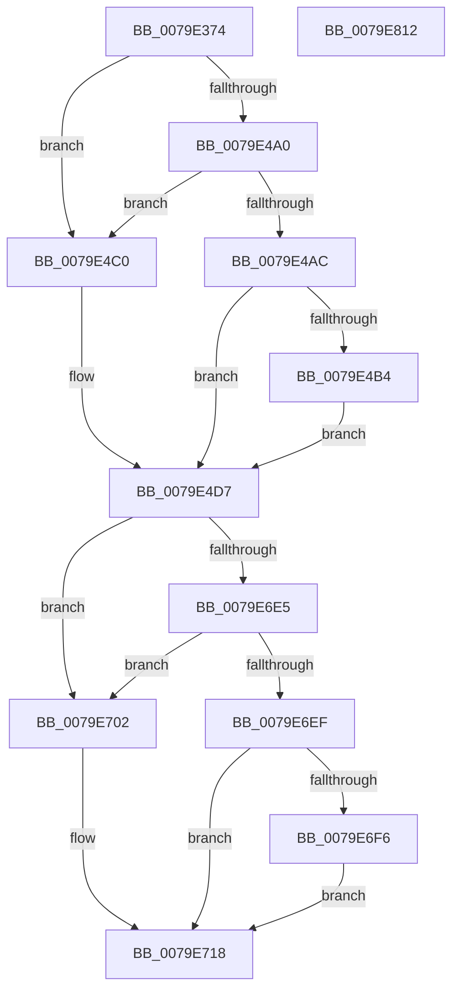

# SeAuditBootConfiguration

- RVA: `0x0079E374`–`0x0079E813` (길이 `1,183` bytes)
- VA: `0x000000014079E374`
- 실행 섹션: `PAGE`
- PDB 이름 있음: `예`; PDB Function 태그: `아니요`
- unwind 정보 RVA: `0x000D129C`
- 디코드: `278`개 명령, `1,183/1,183` bytes 표시
- 미해석 바이트: `0` (있으면 어셈블리에 `.byte`로 보존)

> 이 문서는 커널 이미지의 기계어와 PDB 기호를 분석해 생성했습니다. 4번과 5번은 함수 원형과 자료형을 바이너리 사용 방식에서 추정한 C 해석이며 원본 소스 복구 결과는 아닙니다.

## 1. Dependencies

- 직접 호출 지점: **19**; 고유 호출 대상: **9**
- 직접 호출자로 확인된 함수: **1**
- RIP 상대 이미지 참조: **3**

### Outgoing calls
- `0x0079E3D9` → [memset](../../text/6C/memset_function_006C6C40.md) (function, `0x006C6C40`)
- `0x0079E417` → [SeCaptureSubjectContext](../86/SeCaptureSubjectContext_function_0086B820.md) (function, `0x0086B820`)
- `0x0079E491` → [BcdUtilGetBootOptionString](../82/BcdUtilGetBootOptionString_function_00823DA0.md) (function, `0x00823DA0`)
- `0x0079E4CC` → [RtlInitUnicodeString](../../text/42/RtlInitUnicodeString_function_0042A780.md) (function, `0x0042A780`)
- `0x0079E4FB` → [BcdUtilGetBootOptionBoolean](../82/BcdUtilGetBootOptionBoolean_function_00823D14.md) (function, `0x00823D14`)
- `0x0079E53B` → [BcdUtilGetBootOptionInteger](../82/BcdUtilGetBootOptionInteger_function_00823D58.md) (function, `0x00823D58`)
- `0x0079E578` → [BcdUtilGetBootOptionBoolean](../82/BcdUtilGetBootOptionBoolean_function_00823D14.md) (function, `0x00823D14`)
- `0x0079E5AC` → [BcdUtilGetBootOptionBoolean](../82/BcdUtilGetBootOptionBoolean_function_00823D14.md) (function, `0x00823D14`)
- `0x0079E5E0` → [BcdUtilGetBootOptionInteger](../82/BcdUtilGetBootOptionInteger_function_00823D58.md) (function, `0x00823D58`)
- `0x0079E626` → [BcdUtilGetBootOptionBoolean](../82/BcdUtilGetBootOptionBoolean_function_00823D14.md) (function, `0x00823D14`)
- `0x0079E663` → [BcdUtilGetBootOptionBoolean](../82/BcdUtilGetBootOptionBoolean_function_00823D14.md) (function, `0x00823D14`)
- `0x0079E6A0` → [BcdUtilGetBootOptionBoolean](../82/BcdUtilGetBootOptionBoolean_function_00823D14.md) (function, `0x00823D14`)
- `0x0079E6DC` → [BcdUtilGetBootOptionString](../82/BcdUtilGetBootOptionString_function_00823DA0.md) (function, `0x00823DA0`)
- `0x0079E70E` → [RtlInitUnicodeString](../../text/42/RtlInitUnicodeString_function_0042A780.md) (function, `0x0042A780`)
- `0x0079E744` → [BcdUtilGetBootOptionInteger](../82/BcdUtilGetBootOptionInteger_function_00823D58.md) (function, `0x00823D58`)
- `0x0079E797` → [BcdUtilGetBootOptionBoolean](../82/BcdUtilGetBootOptionBoolean_function_00823D14.md) (function, `0x00823D14`)
- `0x0079E7D3` → [SepAdtLogAuditRecord](../../text/22/SepAdtLogAuditRecord_function_00224B6C.md) (function, `0x00224B6C`)
- `0x0079E7DD` → [SeReleaseSubjectContext](../86/SeReleaseSubjectContext_function_0086B710.md) (function, `0x0086B710`)
- `0x0079E7EC` → [_security_check_cookie](../../text/6A/_security_check_cookie_function_006AC640.md) (function, `0x006AC640`)

### Direct callers
- [IoInitSystemPreDrivers](../../init/C2/IoInitSystemPreDrivers_function_00C2AC3C.md) at `0x00C2B6EF`

### Static image references
- `0x0079E39A` → RVA `0x00E0A740` (`.data`; read)
- `0x0079E479` → RVA `0x000013A8` (`.rdata`; read)
- `0x0079E4C0` → RVA `0x00B05E40` (` ?? ::NNGAKEGL::`string'`; read)

## 2. Other-region calls and transfers

- 다른 실행 섹션으로 향하는 call: **5**
  - `0x0079E3D9` → [memset](../../text/6C/memset_function_006C6C40.md) (`PAGE` → `.text`)
  - `0x0079E4CC` → [RtlInitUnicodeString](../../text/42/RtlInitUnicodeString_function_0042A780.md) (`PAGE` → `.text`)
  - `0x0079E70E` → [RtlInitUnicodeString](../../text/42/RtlInitUnicodeString_function_0042A780.md) (`PAGE` → `.text`)
  - `0x0079E7D3` → [SepAdtLogAuditRecord](../../text/22/SepAdtLogAuditRecord_function_00224B6C.md) (`PAGE` → `.text`)
  - `0x0079E7EC` → [_security_check_cookie](../../text/6A/_security_check_cookie_function_006AC640.md) (`PAGE` → `.text`)
- 별도 외부 분기/꼬리 이동을 확인하지 못했습니다.

## 3. Assembly (complete function range)

```asm
0079E374  48 8B C4                        mov rax, rsp
0079E377  48 89 58 10                     mov qword ptr [rax + 0x10], rbx
0079E37B  48 89 70 18                     mov qword ptr [rax + 0x18], rsi
0079E37F  48 89 78 20                     mov qword ptr [rax + 0x20], rdi
0079E383  55                              push rbp
0079E384  41 54                           push r12
0079E386  41 55                           push r13
0079E388  41 56                           push r14
0079E38A  41 57                           push r15
0079E38C  48 8D A8 38 FC FF FF            lea rbp, [rax - 0x3c8]
0079E393  48 81 EC A0 04 00 00            sub rsp, 0x4a0
0079E39A  48 8B 05 9F C3 66 00            mov rax, qword ptr [rip + 0x66c39f]
0079E3A1  48 33 C4                        xor rax, rsp
0079E3A4  48 89 85 90 03 00 00            mov qword ptr [rbp + 0x390], rax
0079E3AB  48 8B D9                        mov rbx, rcx
0079E3AE  C7 44 24 58 00 00 00 80         mov dword ptr [rsp + 0x58], 0x80000000
0079E3B6  33 C0                           xor eax, eax
0079E3B8  48 8D 4C 24 70                  lea rcx, [rsp + 0x70]
0079E3BD  0F 57 C0                        xorps xmm0, xmm0
0079E3C0  89 44 24 5C                     mov dword ptr [rsp + 0x5c], eax
0079E3C4  33 F6                           xor esi, esi
0079E3C6  33 D2                           xor edx, edx
0079E3C8  41 B8 18 04 00 00               mov r8d, 0x418
0079E3CE  48 89 74 24 50                  mov qword ptr [rsp + 0x50], rsi
0079E3D3  F3 0F 7F 44 24 60               movdqu xmmword ptr [rsp + 0x60], xmm0
0079E3D9  E8 62 88 F2 FF                  call 0x1406c6c40
0079E3DE  0F 57 C0                        xorps xmm0, xmm0
0079E3E1  40 88 74 24 20                  mov byte ptr [rsp + 0x20], sil
0079E3E6  0F 57 C9                        xorps xmm1, xmm1
0079E3E9  48 89 74 24 28                  mov qword ptr [rsp + 0x28], rsi
0079E3EE  48 8D 4C 24 50                  lea rcx, [rsp + 0x50]
0079E3F3  C7 44 24 70 06 00 00 00         mov dword ptr [rsp + 0x70], 6
0079E3FB  0F 11 44 24 30                  movups xmmword ptr [rsp + 0x30], xmm0
0079E400  C7 45 80 91 00 08 00            mov dword ptr [rbp - 0x80], 0x80091
0079E407  8D 7E 08                        lea edi, [rsi + 8]
0079E40A  0F 11 4C 24 40                  movups xmmword ptr [rsp + 0x40], xmm1
0079E40F  C7 44 24 74 DA 12 00 00         mov dword ptr [rsp + 0x74], 0x12da
0079E417  E8 04 D4 0C 00                  call 0x14086b820
0079E41C  48 8B 4C 24 50                  mov rcx, qword ptr [rsp + 0x50]
0079E421  44 8D 76 04                     lea r14d, [rsi + 4]
0079E425  4C 8B 44 24 60                  mov r8, qword ptr [rsp + 0x60]
0079E42A  44 8D 7E 01                     lea r15d, [rsi + 1]
0079E42E  48 85 C9                        test rcx, rcx
0079E431  44 89 75 88                     mov dword ptr [rbp - 0x78], r14d
0079E435  49 8B C0                        mov rax, r8
0079E438  44 89 7D A8                     mov dword ptr [rbp - 0x58], r15d
0079E43C  48 0F 45 C1                     cmovne rax, rcx
0079E440  C7 45 AC 20 00 00 00            mov dword ptr [rbp - 0x54], 0x20
0079E447  4C 0F 45 C1                     cmovne r8, rcx
0079E44B  C7 45 C8 05 00 00 00            mov dword ptr [rbp - 0x38], 5
0079E452  48 8B CB                        mov rcx, rbx
0079E455  89 7D CC                        mov dword ptr [rbp - 0x34], edi
0079E458  48 8B 80 98 00 00 00            mov rax, qword ptr [rax + 0x98]
0079E45F  48 8B 10                        mov rdx, qword ptr [rax]
0079E462  48 89 55 A0                     mov qword ptr [rbp - 0x60], rdx
0079E466  0F B6 42 01                     movzx eax, byte ptr [rdx + 1]
0079E46A  BA 30 00 00 12                  mov edx, 0x12000030
0079E46F  8D 04 85 08 00 00 00            lea eax, [rax*4 + 8]
0079E476  89 45 8C                        mov dword ptr [rbp - 0x74], eax
0079E479  48 8D 05 28 2F 86 FF            lea rax, [rip - 0x79d0d8]
0079E480  48 89 45 C0                     mov qword ptr [rbp - 0x40], rax
0079E484  49 8B 40 18                     mov rax, qword ptr [r8 + 0x18]
0079E488  4C 8D 44 24 30                  lea r8, [rsp + 0x30]
0079E48D  48 89 45 D0                     mov qword ptr [rbp - 0x30], rax
0079E491  E8 0A 59 08 00                  call 0x140823da0
0079E496  41 BC FE FF 00 00               mov r12d, 0xfffe
0079E49C  85 C0                           test eax, eax
0079E49E  78 20                           js 0x14079e4c0
0079E4A0  44 0F B7 54 24 30               movzx r10d, word ptr [rsp + 0x30]
0079E4A6  66 45 85 D2                     test r10w, r10w
0079E4AA  74 14                           je 0x14079e4c0
0079E4AC  66 44 3B 54 24 32               cmp r10w, word ptr [rsp + 0x32]
0079E4B2  75 23                           jne 0x14079e4d7
0079E4B4  66 45 03 D4                     add r10w, r12w
0079E4B8  66 44 89 54 24 30               mov word ptr [rsp + 0x30], r10w
0079E4BE  EB 17                           jmp 0x14079e4d7
0079E4C0  48 8D 15 79 79 36 00            lea rdx, [rip + 0x367979]
0079E4C7  48 8D 4C 24 30                  lea rcx, [rsp + 0x30]
0079E4CC  E8 AF C2 C8 FF                  call 0x14042a780
0079E4D1  44 0F B7 54 24 30               movzx r10d, word ptr [rsp + 0x30]
0079E4D7  41 0F B7 C2                     movzx eax, r10w
0079E4DB  4C 8D 44 24 20                  lea r8, [rsp + 0x20]
0079E4E0  83 C0 10                        add eax, 0x10
0079E4E3  44 89 7D E8                     mov dword ptr [rbp - 0x18], r15d
0079E4E7  89 45 EC                        mov dword ptr [rbp - 0x14], eax
0079E4EA  BA 40 00 00 16                  mov edx, 0x16000040
0079E4EF  48 8D 44 24 30                  lea rax, [rsp + 0x30]
0079E4F4  48 8B CB                        mov rcx, rbx
0079E4F7  48 89 45 00                     mov qword ptr [rbp], rax
0079E4FB  E8 14 58 08 00                  call 0x140823d14
0079E500  0F B6 4C 24 20                  movzx ecx, byte ptr [rsp + 0x20]
0079E505  4C 8D 44 24 28                  lea r8, [rsp + 0x28]
0079E50A  85 C0                           test eax, eax
0079E50C  44 89 75 0C                     mov dword ptr [rbp + 0xc], r14d
0079E510  41 B9 33 07 00 00               mov r9d, 0x733
0079E516  41 BD 15 00 00 00               mov r13d, 0x15
0079E51C  0F 48 CE                        cmovs ecx, esi
0079E51F  44 89 6D 08                     mov dword ptr [rbp + 8], r13d
0079E523  88 4C 24 20                     mov byte ptr [rsp + 0x20], cl
0079E527  BA 47 00 00 15                  mov edx, 0x15000047
0079E52C  F6 D9                           neg cl
0079E52E  48 8B CB                        mov rcx, rbx
0079E531  48 1B C0                        sbb rax, rax
0079E534  49 03 C1                        add rax, r9
0079E537  48 89 45 10                     mov qword ptr [rbp + 0x10], rax
0079E53B  E8 18 58 08 00                  call 0x140823d58
0079E540  48 8B 4C 24 28                  mov rcx, qword ptr [rsp + 0x28]
0079E545  4C 8D 44 24 20                  lea r8, [rsp + 0x20]
0079E54A  85 C0                           test eax, eax
0079E54C  44 89 6D 28                     mov dword ptr [rbp + 0x28], r13d
0079E550  BA 41 01 00 26                  mov edx, 0x26000141
0079E555  44 89 75 2C                     mov dword ptr [rbp + 0x2c], r14d
0079E559  48 0F 48 CE                     cmovs rcx, rsi
0079E55D  48 89 4C 24 28                  mov qword ptr [rsp + 0x28], rcx
0079E562  49 2B CF                        sub rcx, r15
0079E565  48 F7 D9                        neg rcx
0079E568  48 8B CB                        mov rcx, rbx
0079E56B  48 1B C0                        sbb rax, rax
0079E56E  48 05 37 07 00 00               add rax, 0x737
0079E574  48 89 45 30                     mov qword ptr [rbp + 0x30], rax
0079E578  E8 97 57 08 00                  call 0x140823d14
0079E57D  0F B6 4C 24 20                  movzx ecx, byte ptr [rsp + 0x20]
0079E582  4C 8D 44 24 20                  lea r8, [rsp + 0x20]
0079E587  85 C0                           test eax, eax
0079E589  44 89 6D 48                     mov dword ptr [rbp + 0x48], r13d
0079E58D  BA A0 00 00 26                  mov edx, 0x260000a0
0079E592  44 89 75 4C                     mov dword ptr [rbp + 0x4c], r14d
0079E596  0F 48 CE                        cmovs ecx, esi
0079E599  88 4C 24 20                     mov byte ptr [rsp + 0x20], cl
0079E59D  F6 D9                           neg cl
0079E59F  48 8B CB                        mov rcx, rbx
0079E5A2  48 1B C0                        sbb rax, rax
0079E5A5  49 03 C1                        add rax, r9
0079E5A8  48 89 45 50                     mov qword ptr [rbp + 0x50], rax
0079E5AC  E8 63 57 08 00                  call 0x140823d14
0079E5B1  0F B6 4C 24 20                  movzx ecx, byte ptr [rsp + 0x20]
0079E5B6  4C 8D 44 24 28                  lea r8, [rsp + 0x28]
0079E5BB  85 C0                           test eax, eax
0079E5BD  44 89 6D 68                     mov dword ptr [rbp + 0x68], r13d
0079E5C1  BA 42 01 00 25                  mov edx, 0x25000142
0079E5C6  44 89 75 6C                     mov dword ptr [rbp + 0x6c], r14d
0079E5CA  0F 48 CE                        cmovs ecx, esi
0079E5CD  88 4C 24 20                     mov byte ptr [rsp + 0x20], cl
0079E5D1  F6 D9                           neg cl
0079E5D3  48 8B CB                        mov rcx, rbx
0079E5D6  48 1B C0                        sbb rax, rax
0079E5D9  49 03 C1                        add rax, r9
0079E5DC  48 89 45 70                     mov qword ptr [rbp + 0x70], rax
0079E5E0  E8 73 57 08 00                  call 0x140823d58
0079E5E5  48 8B 4C 24 28                  mov rcx, qword ptr [rsp + 0x28]
0079E5EA  4C 8D 44 24 20                  lea r8, [rsp + 0x20]
0079E5EF  85 C0                           test eax, eax
0079E5F1  44 89 AD 88 00 00 00            mov dword ptr [rbp + 0x88], r13d
0079E5F8  44 89 B5 8C 00 00 00            mov dword ptr [rbp + 0x8c], r14d
0079E5FF  48 0F 48 CE                     cmovs rcx, rsi
0079E603  48 89 4C 24 28                  mov qword ptr [rsp + 0x28], rcx
0079E608  49 2B CF                        sub rcx, r15
0079E60B  48 F7 D9                        neg rcx
0079E60E  48 1B C0                        sbb rax, rax
0079E611  48 05 39 07 00 00               add rax, 0x739
0079E617  48 89 85 90 00 00 00            mov qword ptr [rbp + 0x90], rax
0079E61E  BA 49 00 00 16                  mov edx, 0x16000049
0079E623  48 8B CB                        mov rcx, rbx
0079E626  E8 E9 56 08 00                  call 0x140823d14
0079E62B  0F B6 4C 24 20                  movzx ecx, byte ptr [rsp + 0x20]
0079E630  4C 8D 44 24 20                  lea r8, [rsp + 0x20]
0079E635  85 C0                           test eax, eax
0079E637  44 89 AD A8 00 00 00            mov dword ptr [rbp + 0xa8], r13d
0079E63E  BA 7E 00 00 16                  mov edx, 0x1600007e
0079E643  44 89 B5 AC 00 00 00            mov dword ptr [rbp + 0xac], r14d
0079E64A  0F 48 CE                        cmovs ecx, esi
0079E64D  88 4C 24 20                     mov byte ptr [rsp + 0x20], cl
0079E651  F6 D9                           neg cl
0079E653  48 8B CB                        mov rcx, rbx
0079E656  48 1B C0                        sbb rax, rax
0079E659  49 03 C1                        add rax, r9
0079E65C  48 89 85 B0 00 00 00            mov qword ptr [rbp + 0xb0], rax
0079E663  E8 AC 56 08 00                  call 0x140823d14
0079E668  0F B6 4C 24 20                  movzx ecx, byte ptr [rsp + 0x20]
0079E66D  4C 8D 44 24 20                  lea r8, [rsp + 0x20]
0079E672  85 C0                           test eax, eax
0079E674  44 89 AD C8 00 00 00            mov dword ptr [rbp + 0xc8], r13d
0079E67B  BA 48 00 00 16                  mov edx, 0x16000048
0079E680  44 89 B5 CC 00 00 00            mov dword ptr [rbp + 0xcc], r14d
0079E687  0F 48 CE                        cmovs ecx, esi
0079E68A  88 4C 24 20                     mov byte ptr [rsp + 0x20], cl
0079E68E  F6 D9                           neg cl
0079E690  48 8B CB                        mov rcx, rbx
0079E693  48 1B C0                        sbb rax, rax
0079E696  49 03 C1                        add rax, r9
0079E699  48 89 85 D0 00 00 00            mov qword ptr [rbp + 0xd0], rax
0079E6A0  E8 6F 56 08 00                  call 0x140823d14
0079E6A5  0F B6 7C 24 20                  movzx edi, byte ptr [rsp + 0x20]
0079E6AA  4C 8D 44 24 40                  lea r8, [rsp + 0x40]
0079E6AF  85 C0                           test eax, eax
0079E6B1  44 89 AD E8 00 00 00            mov dword ptr [rbp + 0xe8], r13d
0079E6B8  BA 17 01 00 22                  mov edx, 0x22000117
0079E6BD  44 89 B5 EC 00 00 00            mov dword ptr [rbp + 0xec], r14d
0079E6C4  0F 48 FE                        cmovs edi, esi
0079E6C7  40 8A C7                        mov al, dil
0079E6CA  F6 D8                           neg al
0079E6CC  48 1B C9                        sbb rcx, rcx
0079E6CF  49 03 C9                        add rcx, r9
0079E6D2  48 89 8D F0 00 00 00            mov qword ptr [rbp + 0xf0], rcx
0079E6D9  48 8B CB                        mov rcx, rbx
0079E6DC  E8 BF 56 08 00                  call 0x140823da0
0079E6E1  85 C0                           test eax, eax
0079E6E3  78 1D                           js 0x14079e702
0079E6E5  0F B7 44 24 40                  movzx eax, word ptr [rsp + 0x40]
0079E6EA  66 85 C0                        test ax, ax
0079E6ED  74 13                           je 0x14079e702
0079E6EF  66 3B 44 24 42                  cmp ax, word ptr [rsp + 0x42]
0079E6F4  75 22                           jne 0x14079e718
0079E6F6  66 45 03 D4                     add r10w, r12w
0079E6FA  66 44 89 54 24 30               mov word ptr [rsp + 0x30], r10w
0079E700  EB 16                           jmp 0x14079e718
0079E702  48 8D 15 37 77 36 00            lea rdx, [rip + 0x367737]
0079E709  48 8D 4C 24 40                  lea rcx, [rsp + 0x40]
0079E70E  E8 6D C0 C8 FF                  call 0x14042a780
0079E713  0F B7 44 24 40                  movzx eax, word ptr [rsp + 0x40]
0079E718  0F B7 C0                        movzx eax, ax
0079E71B  4C 8D 44 24 28                  lea r8, [rsp + 0x28]
0079E720  83 C0 10                        add eax, 0x10
0079E723  44 89 BD 08 01 00 00            mov dword ptr [rbp + 0x108], r15d
0079E72A  89 85 0C 01 00 00               mov dword ptr [rbp + 0x10c], eax
0079E730  BA F0 00 00 25                  mov edx, 0x250000f0
0079E735  48 8D 44 24 40                  lea rax, [rsp + 0x40]
0079E73A  48 8B CB                        mov rcx, rbx
0079E73D  48 89 85 20 01 00 00            mov qword ptr [rbp + 0x120], rax
0079E744  E8 0F 56 08 00                  call 0x140823d58
0079E749  48 8B 54 24 28                  mov rdx, qword ptr [rsp + 0x28]
0079E74E  85 C0                           test eax, eax
0079E750  44 8B C0                        mov r8d, eax
0079E753  44 89 AD 28 01 00 00            mov dword ptr [rbp + 0x128], r13d
0079E75A  48 0F 48 D6                     cmovs rdx, rsi
0079E75E  40 0F B6 C7                     movzx eax, dil
0079E762  48 FF CA                        dec rdx
0079E765  44 89 B5 2C 01 00 00            mov dword ptr [rbp + 0x12c], r14d
0079E76C  4C 3B FA                        cmp r15, rdx
0079E76F  48 8B CB                        mov rcx, rbx
0079E772  48 1B D2                        sbb rdx, rdx
0079E775  48 81 C2 39 07 00 00            add rdx, 0x739
0079E77C  45 85 C0                        test r8d, r8d
0079E77F  48 89 95 30 01 00 00            mov qword ptr [rbp + 0x130], rdx
0079E786  4C 8D 44 24 20                  lea r8, [rsp + 0x20]
0079E78B  BA F2 00 00 26                  mov edx, 0x260000f2
0079E790  0F 48 C6                        cmovs eax, esi
0079E793  88 44 24 20                     mov byte ptr [rsp + 0x20], al
0079E797  E8 78 55 08 00                  call 0x140823d14
0079E79C  0F B6 4C 24 20                  movzx ecx, byte ptr [rsp + 0x20]
0079E7A1  85 C0                           test eax, eax
0079E7A3  44 89 AD 48 01 00 00            mov dword ptr [rbp + 0x148], r13d
0079E7AA  0F 48 CE                        cmovs ecx, esi
0079E7AD  44 89 B5 4C 01 00 00            mov dword ptr [rbp + 0x14c], r14d
0079E7B4  F6 D9                           neg cl
0079E7B6  C7 44 24 78 0F 00 00 00         mov dword ptr [rsp + 0x78], 0xf
0079E7BE  48 8D 4C 24 70                  lea rcx, [rsp + 0x70]
0079E7C3  48 1B C0                        sbb rax, rax
0079E7C6  48 05 33 07 00 00               add rax, 0x733
0079E7CC  48 89 85 50 01 00 00            mov qword ptr [rbp + 0x150], rax
0079E7D3  E8 94 63 A8 FF                  call 0x140224b6c
0079E7D8  48 8D 4C 24 50                  lea rcx, [rsp + 0x50]
0079E7DD  E8 2E CF 0C 00                  call 0x14086b710
0079E7E2  48 8B 8D 90 03 00 00            mov rcx, qword ptr [rbp + 0x390]
0079E7E9  48 33 CC                        xor rcx, rsp
0079E7EC  E8 4F DE F0 FF                  call 0x1406ac640
0079E7F1  4C 8D 9C 24 A0 04 00 00         lea r11, [rsp + 0x4a0]
0079E7F9  49 8B 5B 38                     mov rbx, qword ptr [r11 + 0x38]
0079E7FD  49 8B 73 40                     mov rsi, qword ptr [r11 + 0x40]
0079E801  49 8B 7B 48                     mov rdi, qword ptr [r11 + 0x48]
0079E805  49 8B E3                        mov rsp, r11
0079E808  41 5F                           pop r15
0079E80A  41 5E                           pop r14
0079E80C  41 5D                           pop r13
0079E80E  41 5C                           pop r12
0079E810  5D                              pop rbp
0079E811  C3                              ret
0079E812  CC                              int3
```

## 4. C-style interpretation (structured pseudocode)

```c
__int64 __fastcall SeAuditBootConfiguration(__int64 a1, int a2)
{
    __int64 result;
    __int64 v_r10;
    __int64 v_rdi;
    __int64 v_rsi;
    __int64 v_rsp;
    unsigned __int64 v_stack_m28;
    unsigned int v_stack_m450;
    unsigned int v_stack_m454;
    unsigned __int64 v_stack_m458;
    unsigned __int64 v_stack_m468;
    unsigned int v_stack_m46C;
    unsigned int v_stack_m470;
    unsigned __int64 v_stack_m478;
    unsigned __int16 v_stack_m486;
    unsigned __int64 v_stack_m488;
    unsigned __int16 v_stack_m496;
    unsigned __int64 v_stack_m498;
    unsigned __int64 v_stack_m4A0;
    unsigned __int8 v_stack_m4A8;

    *(unsigned __int64 *)(v_rsp + 16) = v_rbx;
    *(unsigned __int64 *)(v_rsp + 24) = v_rsi;
    *(unsigned __int64 *)(v_rsp + 32) = v_rdi;
    v_rsp = (v_rsp) - (0x4A0ULL);
    result = (*(unsigned __int64 *)(v_rip + 6734751)) ^ (v_rsp);
    *(unsigned __int64 *)(v_rsp - 968 + 912) = result;
    v_stack_m470 = 0x80000000ULL;
    result = 0;
    v_stack_m46C = 0;
    v_rsi = 0;
    a2 = 0;
    v_stack_m478 = 0;
    v_stack_m468 = v_xmm0;
    result = memset(v_stack_m458, a2, (unsigned int)(0x418ULL), a4);
    v_stack_m4A8 = 0;
    v_stack_m4A0 = 0;
    v_stack_m458 = 6;
    v_stack_m498 = v_xmm0;
    *(unsigned int *)(v_rsp - 968 - 128) = 0x80091ULL;
    v_stack_m488 = v_xmm1;
    v_stack_m454 = 0x12DAULL;
    result = SeCaptureSubjectContext(v_stack_m478, a2, (unsigned int)(0x418ULL), a4);
    *(unsigned int *)(v_rsp - 968 - 120) = (unsigned int)(v_rsi + 4);
    *(unsigned int *)(v_rsp - 968 - 88) = (unsigned int)(v_rsi + 1);
    result = v_stack_m468;
    if (v_stack_m478 != 0) { result = v_stack_m478; }
    *(unsigned int *)(v_rsp - 968 - 84) = 32;
    a3 = v_stack_m468;
    if (v_stack_m478 != 0) { a3 = v_stack_m478; }
    *(unsigned int *)(v_rsp - 968 - 56) = 5;
    *(unsigned int *)(v_rsp - 968 - 52) = (unsigned int)(v_rsi + 8);
    *(unsigned __int64 *)(v_rsp - 968 - 96) = *(unsigned __int64 *)(*(unsigned __int64 *)(result + 152));
    *(unsigned int *)(v_rsp - 968 - 116) = (unsigned int)(*(unsigned __int8 *)(*(unsigned __int64 *)(*(unsigned __int64 *)(result + 152)) + 1) * 4 + 8);
    *(unsigned __int64 *)(v_rsp - 968 - 64) = v_rip - 7983320;
    *(unsigned __int64 *)(v_rsp - 968 - 48) = *(unsigned __int64 *)(a3 + 24);
    result = BcdUtilGetBootOptionString(a1, (unsigned int)(0x12000030ULL), v_stack_m498, a4);
    if (sign_flag) goto loc_0079E4C0;
    if ((unsigned __int16)(v_stack_m498) == 0) goto loc_0079E4C0;
    if (((unsigned __int16)(v_stack_m498)) != v_stack_m496) goto loc_0079E4D7;
    v_r10 = (unsigned __int16)((v_stack_m498) + ((unsigned __int16)((unsigned int)(0xFFFEULL))));
    v_stack_m498 = (unsigned __int16)(v_r10);
    goto loc_0079E4D7;
loc_0079E4C0:
    result = RtlInitUnicodeString(v_stack_m498, v_rip + 3570041, v_stack_m498, a4);
loc_0079E4D7:
    result = (unsigned int)(((unsigned __int16)(v_stack_m498)) + (16));
    *(unsigned int *)(v_rsp - 968 - 24) = (unsigned int)(v_rsi + 1);
    *(unsigned int *)(v_rsp - 968 - 20) = (unsigned int)(result);
    *(unsigned __int64 *)(v_rsp - 968) = v_stack_m498;
    result = BcdUtilGetBootOptionBoolean(a1, (unsigned int)(0x16000040ULL), v_stack_m4A8, a4);
    *(unsigned int *)(v_rsp - 968 + 12) = (unsigned int)(v_rsi + 4);
    a1 = v_stack_m4A8;
    if (sign_flag) { a1 = 0; }
    *(unsigned int *)(v_rsp - 968 + 8) = 21;
    v_stack_m4A8 = (unsigned __int8)(a1);
    a1 = (unsigned __int8)(-(a1));
    result = (result) + ((unsigned int)(0x733ULL));
    *(unsigned __int64 *)(v_rsp - 968 + 16) = result;
    result = BcdUtilGetBootOptionInteger(a1, (unsigned int)(0x15000047ULL), v_stack_m4A0, (unsigned int)(0x733ULL));
    *(unsigned int *)(v_rsp - 968 + 40) = 21;
    *(unsigned int *)(v_rsp - 968 + 44) = (unsigned int)(v_rsi + 4);
    a1 = v_stack_m4A0;
    if (sign_flag) { a1 = 0; }
    v_stack_m4A0 = a1;
    a1 = (a1) - (v_rsi + 1);
    a1 = -(a1);
    result = (result) + (0x737ULL);
    *(unsigned __int64 *)(v_rsp - 968 + 48) = result;
    result = BcdUtilGetBootOptionBoolean(a1, (unsigned int)(0x26000141ULL), v_stack_m4A8, (unsigned int)(0x733ULL));
    *(unsigned int *)(v_rsp - 968 + 72) = 21;
    *(unsigned int *)(v_rsp - 968 + 76) = (unsigned int)(v_rsi + 4);
    a1 = v_stack_m4A8;
    if (sign_flag) { a1 = 0; }
    v_stack_m4A8 = (unsigned __int8)(a1);
    a1 = (unsigned __int8)(-(a1));
    result = (result) + ((unsigned int)(0x733ULL));
    *(unsigned __int64 *)(v_rsp - 968 + 80) = result;
    result = BcdUtilGetBootOptionBoolean(a1, (unsigned int)(0x260000A0ULL), v_stack_m4A8, (unsigned int)(0x733ULL));
    *(unsigned int *)(v_rsp - 968 + 104) = 21;
    *(unsigned int *)(v_rsp - 968 + 108) = (unsigned int)(v_rsi + 4);
    a1 = v_stack_m4A8;
    if (sign_flag) { a1 = 0; }
    v_stack_m4A8 = (unsigned __int8)(a1);
    a1 = (unsigned __int8)(-(a1));
    result = (result) + ((unsigned int)(0x733ULL));
    *(unsigned __int64 *)(v_rsp - 968 + 112) = result;
    result = BcdUtilGetBootOptionInteger(a1, (unsigned int)(0x25000142ULL), v_stack_m4A0, (unsigned int)(0x733ULL));
    *(unsigned int *)(v_rsp - 968 + 136) = 21;
    *(unsigned int *)(v_rsp - 968 + 140) = (unsigned int)(v_rsi + 4);
    a1 = v_stack_m4A0;
    if (sign_flag) { a1 = 0; }
    v_stack_m4A0 = a1;
    a1 = (a1) - (v_rsi + 1);
    a1 = -(a1);
    result = (result) + (0x739ULL);
    *(unsigned __int64 *)(v_rsp - 968 + 144) = result;
    result = BcdUtilGetBootOptionBoolean(a1, (unsigned int)(0x16000049ULL), v_stack_m4A8, (unsigned int)(0x733ULL));
    *(unsigned int *)(v_rsp - 968 + 168) = 21;
    *(unsigned int *)(v_rsp - 968 + 172) = (unsigned int)(v_rsi + 4);
    a1 = v_stack_m4A8;
    if (sign_flag) { a1 = 0; }
    v_stack_m4A8 = (unsigned __int8)(a1);
    a1 = (unsigned __int8)(-(a1));
    result = (result) + ((unsigned int)(0x733ULL));
    *(unsigned __int64 *)(v_rsp - 968 + 176) = result;
    result = BcdUtilGetBootOptionBoolean(a1, (unsigned int)(0x1600007EULL), v_stack_m4A8, (unsigned int)(0x733ULL));
    *(unsigned int *)(v_rsp - 968 + 200) = 21;
    *(unsigned int *)(v_rsp - 968 + 204) = (unsigned int)(v_rsi + 4);
    a1 = v_stack_m4A8;
    if (sign_flag) { a1 = 0; }
    v_stack_m4A8 = (unsigned __int8)(a1);
    a1 = (unsigned __int8)(-(a1));
    result = (result) + ((unsigned int)(0x733ULL));
    *(unsigned __int64 *)(v_rsp - 968 + 208) = result;
    result = BcdUtilGetBootOptionBoolean(a1, (unsigned int)(0x16000048ULL), v_stack_m4A8, (unsigned int)(0x733ULL));
    *(unsigned int *)(v_rsp - 968 + 232) = 21;
    *(unsigned int *)(v_rsp - 968 + 236) = (unsigned int)(v_rsi + 4);
    v_rdi = v_stack_m4A8;
    if (sign_flag) { v_rdi = 0; }
    result = (unsigned __int8)(-((unsigned __int8)(v_rdi)));
    a1 = (a1) + ((unsigned int)(0x733ULL));
    *(unsigned __int64 *)(v_rsp - 968 + 240) = a1;
    result = BcdUtilGetBootOptionString(a1, (unsigned int)(0x22000117ULL), v_stack_m488, (unsigned int)(0x733ULL));
    if (sign_flag) goto loc_0079E702;
    if ((unsigned __int16)(v_stack_m488) == 0) goto loc_0079E702;
    if (((unsigned __int16)(v_stack_m488)) != v_stack_m486) goto loc_0079E718;
    v_r10 = (unsigned __int16)((v_stack_m498) + ((unsigned __int16)((unsigned int)(0xFFFEULL))));
    v_stack_m498 = (unsigned __int16)(v_r10);
    goto loc_0079E718;
loc_0079E702:
    result = RtlInitUnicodeString(v_stack_m488, v_rip + 3569463, v_stack_m488, (unsigned int)(0x733ULL));
loc_0079E718:
    result = (unsigned int)(((unsigned __int16)(v_stack_m488)) + (16));
    *(unsigned int *)(v_rsp - 968 + 264) = (unsigned int)(v_rsi + 1);
    *(unsigned int *)(v_rsp - 968 + 268) = (unsigned int)(result);
    *(unsigned __int64 *)(v_rsp - 968 + 288) = v_stack_m488;
    result = BcdUtilGetBootOptionInteger(a1, (unsigned int)(0x250000F0ULL), v_stack_m4A0, (unsigned int)(0x733ULL));
    *(unsigned int *)(v_rsp - 968 + 296) = 21;
    a2 = v_stack_m4A0;
    if (sign_flag) { a2 = 0; }
    a2 = (a2) - 1;
    *(unsigned int *)(v_rsp - 968 + 300) = (unsigned int)(v_rsi + 4);
    a2 = (a2) + (0x739ULL);
    *(unsigned __int64 *)(v_rsp - 968 + 304) = a2;
    result = (unsigned __int8)(v_rdi);
    if (sign_flag) { result = 0; }
    v_stack_m4A8 = (unsigned __int8)(result);
    result = BcdUtilGetBootOptionBoolean(a1, (unsigned int)(0x260000F2ULL), v_stack_m4A8, (unsigned int)(0x733ULL));
    *(unsigned int *)(v_rsp - 968 + 328) = 21;
    a1 = v_stack_m4A8;
    if (sign_flag) { a1 = 0; }
    *(unsigned int *)(v_rsp - 968 + 332) = (unsigned int)(v_rsi + 4);
    a1 = (unsigned __int8)(-(a1));
    v_stack_m450 = 15;
    result = (result) + (0x733ULL);
    *(unsigned __int64 *)(v_rsp - 968 + 336) = result;
    result = SepAdtLogAuditRecord(v_stack_m458, (unsigned int)(0x260000F2ULL), v_stack_m4A8, (unsigned int)(0x733ULL));
    result = SeReleaseSubjectContext(v_stack_m478, (unsigned int)(0x260000F2ULL), v_stack_m4A8, (unsigned int)(0x733ULL));
    a1 = (*(unsigned __int64 *)(v_rsp - 968 + 912)) ^ (v_rsp);
    result = _security_check_cookie(a1, (unsigned int)(0x260000F2ULL), v_stack_m4A8, (unsigned int)(0x733ULL));
    return result;
}
```

## 5. (Beta) C Style

```c
int64_t SeAuditBootConfiguration(int64_t Arg1, int32_t Arg2)
{
    int64_t result;
    int64_t local_r10;
    int64_t local_rdi;
    int64_t local_rsi;
    int64_t local_rsp;
    uint64_t v_stack_m28;
    uint32_t v_stack_m450;
    uint32_t v_stack_m454;
    uint64_t v_stack_m458;
    uint64_t v_stack_m468;
    uint32_t v_stack_m46C;
    uint32_t v_stack_m470;
    uint64_t v_stack_m478;
    uint16_t v_stack_m486;
    uint64_t v_stack_m488;
    uint16_t v_stack_m496;
    uint64_t v_stack_m498;
    uint64_t v_stack_m4A0;
    uint8_t v_stack_m4A8;

    *(uint64_t *)(local_rsp + 0x10) = local_rbx;
    *(uint64_t *)(local_rsp + 0x18) = local_rsi;
    *(uint64_t *)(local_rsp + 0x20) = local_rdi;
    local_rsp = (local_rsp) - (0x4A0ULL);
    result = (*(uint64_t *)(v_rip + 0x66C39F)) ^ (local_rsp);
    *(uint64_t *)(local_rsp - 0x3C8 + 0x390) = result;
    v_stack_m470 = 0x80000000ULL;
    result = 0;
    v_stack_m46C = 0;
    local_rsi = 0;
    Arg2 = 0;
    v_stack_m478 = 0;
    v_stack_m468 = v_xmm0;
    result = memset(v_stack_m458, Arg2, (uint32_t)(0x418ULL), a4);
    v_stack_m4A8 = 0;
    v_stack_m4A0 = 0;
    v_stack_m458 = 6;
    v_stack_m498 = v_xmm0;
    *(uint32_t *)(local_rsp - 0x3C8 - 0x80) = 0x80091ULL;
    v_stack_m488 = v_xmm1;
    v_stack_m454 = 0x12DAULL;
    result = SeCaptureSubjectContext(v_stack_m478, Arg2, (uint32_t)(0x418ULL), a4);
    *(uint32_t *)(local_rsp - 0x3C8 - 0x78) = (uint32_t)(local_rsi + 4);
    *(uint32_t *)(local_rsp - 0x3C8 - 0x58) = (uint32_t)(local_rsi + 1);
    result = v_stack_m468;
    if (v_stack_m478 != 0) { result = v_stack_m478; }
    *(uint32_t *)(local_rsp - 0x3C8 - 0x54) = 32;
    a3 = v_stack_m468;
    if (v_stack_m478 != 0) { a3 = v_stack_m478; }
    *(uint32_t *)(local_rsp - 0x3C8 - 0x38) = 5;
    *(uint32_t *)(local_rsp - 0x3C8 - 0x34) = (uint32_t)(local_rsi + 8);
    *(uint64_t *)(local_rsp - 0x3C8 - 0x60) = *(uint64_t *)(*(uint64_t *)(result + 0x98));
    *(uint32_t *)(local_rsp - 0x3C8 - 0x74) = (uint32_t)(*(uint8_t *)(*(uint64_t *)(*(uint64_t *)(result + 0x98)) + 0x1) * 4 + 8);
    *(uint64_t *)(local_rsp - 0x3C8 - 0x40) = v_rip - 7983320;
    *(uint64_t *)(local_rsp - 0x3C8 - 0x30) = *(uint64_t *)(a3 + 0x18);
    result = BcdUtilGetBootOptionString(Arg1, (uint32_t)(0x12000030ULL), v_stack_m498, a4);
    if (sign_flag) goto loc_0079E4C0;
    if ((uint16_t)(v_stack_m498) == 0) goto loc_0079E4C0;
    if (((uint16_t)(v_stack_m498)) != v_stack_m496) goto loc_0079E4D7;
    local_r10 = (uint16_t)((v_stack_m498) + ((uint16_t)((uint32_t)(0xFFFEULL))));
    v_stack_m498 = (uint16_t)(local_r10);
    goto loc_0079E4D7;
loc_0079E4C0:
    result = RtlInitUnicodeString(v_stack_m498, v_rip + 3570041, v_stack_m498, a4);
loc_0079E4D7:
    result = (uint32_t)(((uint16_t)(v_stack_m498)) + (16));
    *(uint32_t *)(local_rsp - 0x3C8 - 0x18) = (uint32_t)(local_rsi + 1);
    *(uint32_t *)(local_rsp - 0x3C8 - 0x14) = (uint32_t)(result);
    *(uint64_t *)(local_rsp - 0x3C8) = v_stack_m498;
    result = BcdUtilGetBootOptionBoolean(Arg1, (uint32_t)(0x16000040ULL), v_stack_m4A8, a4);
    *(uint32_t *)(local_rsp - 0x3C8 + 0xC) = (uint32_t)(local_rsi + 4);
    Arg1 = v_stack_m4A8;
    if (sign_flag) { Arg1 = 0; }
    *(uint32_t *)(local_rsp - 0x3C8 + 0x8) = 21;
    v_stack_m4A8 = (uint8_t)(Arg1);
    Arg1 = (uint8_t)(-(Arg1));
    result = (result) + ((uint32_t)(0x733ULL));
    *(uint64_t *)(local_rsp - 0x3C8 + 0x10) = result;
    result = BcdUtilGetBootOptionInteger(Arg1, (uint32_t)(0x15000047ULL), v_stack_m4A0, (uint32_t)(0x733ULL));
    *(uint32_t *)(local_rsp - 0x3C8 + 0x28) = 21;
    *(uint32_t *)(local_rsp - 0x3C8 + 0x2C) = (uint32_t)(local_rsi + 4);
    Arg1 = v_stack_m4A0;
    if (sign_flag) { Arg1 = 0; }
    v_stack_m4A0 = Arg1;
    Arg1 = (Arg1) - (local_rsi + 1);
    Arg1 = -(Arg1);
    result = (result) + (0x737ULL);
    *(uint64_t *)(local_rsp - 0x3C8 + 0x30) = result;
    result = BcdUtilGetBootOptionBoolean(Arg1, (uint32_t)(0x26000141ULL), v_stack_m4A8, (uint32_t)(0x733ULL));
    *(uint32_t *)(local_rsp - 0x3C8 + 0x48) = 21;
    *(uint32_t *)(local_rsp - 0x3C8 + 0x4C) = (uint32_t)(local_rsi + 4);
    Arg1 = v_stack_m4A8;
    if (sign_flag) { Arg1 = 0; }
    v_stack_m4A8 = (uint8_t)(Arg1);
    Arg1 = (uint8_t)(-(Arg1));
    result = (result) + ((uint32_t)(0x733ULL));
    *(uint64_t *)(local_rsp - 0x3C8 + 0x50) = result;
    result = BcdUtilGetBootOptionBoolean(Arg1, (uint32_t)(0x260000A0ULL), v_stack_m4A8, (uint32_t)(0x733ULL));
    *(uint32_t *)(local_rsp - 0x3C8 + 0x68) = 21;
    *(uint32_t *)(local_rsp - 0x3C8 + 0x6C) = (uint32_t)(local_rsi + 4);
    Arg1 = v_stack_m4A8;
    if (sign_flag) { Arg1 = 0; }
    v_stack_m4A8 = (uint8_t)(Arg1);
    Arg1 = (uint8_t)(-(Arg1));
    result = (result) + ((uint32_t)(0x733ULL));
    *(uint64_t *)(local_rsp - 0x3C8 + 0x70) = result;
    result = BcdUtilGetBootOptionInteger(Arg1, (uint32_t)(0x25000142ULL), v_stack_m4A0, (uint32_t)(0x733ULL));
    *(uint32_t *)(local_rsp - 0x3C8 + 0x88) = 21;
    *(uint32_t *)(local_rsp - 0x3C8 + 0x8C) = (uint32_t)(local_rsi + 4);
    Arg1 = v_stack_m4A0;
    if (sign_flag) { Arg1 = 0; }
    v_stack_m4A0 = Arg1;
    Arg1 = (Arg1) - (local_rsi + 1);
    Arg1 = -(Arg1);
    result = (result) + (0x739ULL);
    *(uint64_t *)(local_rsp - 0x3C8 + 0x90) = result;
    result = BcdUtilGetBootOptionBoolean(Arg1, (uint32_t)(0x16000049ULL), v_stack_m4A8, (uint32_t)(0x733ULL));
    *(uint32_t *)(local_rsp - 0x3C8 + 0xA8) = 21;
    *(uint32_t *)(local_rsp - 0x3C8 + 0xAC) = (uint32_t)(local_rsi + 4);
    Arg1 = v_stack_m4A8;
    if (sign_flag) { Arg1 = 0; }
    v_stack_m4A8 = (uint8_t)(Arg1);
    Arg1 = (uint8_t)(-(Arg1));
    result = (result) + ((uint32_t)(0x733ULL));
    *(uint64_t *)(local_rsp - 0x3C8 + 0xB0) = result;
    result = BcdUtilGetBootOptionBoolean(Arg1, (uint32_t)(0x1600007EULL), v_stack_m4A8, (uint32_t)(0x733ULL));
    *(uint32_t *)(local_rsp - 0x3C8 + 0xC8) = 21;
    *(uint32_t *)(local_rsp - 0x3C8 + 0xCC) = (uint32_t)(local_rsi + 4);
    Arg1 = v_stack_m4A8;
    if (sign_flag) { Arg1 = 0; }
    v_stack_m4A8 = (uint8_t)(Arg1);
    Arg1 = (uint8_t)(-(Arg1));
    result = (result) + ((uint32_t)(0x733ULL));
    *(uint64_t *)(local_rsp - 0x3C8 + 0xD0) = result;
    result = BcdUtilGetBootOptionBoolean(Arg1, (uint32_t)(0x16000048ULL), v_stack_m4A8, (uint32_t)(0x733ULL));
    *(uint32_t *)(local_rsp - 0x3C8 + 0xE8) = 21;
    *(uint32_t *)(local_rsp - 0x3C8 + 0xEC) = (uint32_t)(local_rsi + 4);
    local_rdi = v_stack_m4A8;
    if (sign_flag) { local_rdi = 0; }
    result = (uint8_t)(-((uint8_t)(local_rdi)));
    Arg1 = (Arg1) + ((uint32_t)(0x733ULL));
    *(uint64_t *)(local_rsp - 0x3C8 + 0xF0) = Arg1;
    result = BcdUtilGetBootOptionString(Arg1, (uint32_t)(0x22000117ULL), v_stack_m488, (uint32_t)(0x733ULL));
    if (sign_flag) goto loc_0079E702;
    if ((uint16_t)(v_stack_m488) == 0) goto loc_0079E702;
    if (((uint16_t)(v_stack_m488)) != v_stack_m486) goto loc_0079E718;
    local_r10 = (uint16_t)((v_stack_m498) + ((uint16_t)((uint32_t)(0xFFFEULL))));
    v_stack_m498 = (uint16_t)(local_r10);
    goto loc_0079E718;
loc_0079E702:
    result = RtlInitUnicodeString(v_stack_m488, v_rip + 3569463, v_stack_m488, (uint32_t)(0x733ULL));
loc_0079E718:
    result = (uint32_t)(((uint16_t)(v_stack_m488)) + (16));
    *(uint32_t *)(local_rsp - 0x3C8 + 0x108) = (uint32_t)(local_rsi + 1);
    *(uint32_t *)(local_rsp - 0x3C8 + 0x10C) = (uint32_t)(result);
    *(uint64_t *)(local_rsp - 0x3C8 + 0x120) = v_stack_m488;
    result = BcdUtilGetBootOptionInteger(Arg1, (uint32_t)(0x250000F0ULL), v_stack_m4A0, (uint32_t)(0x733ULL));
    *(uint32_t *)(local_rsp - 0x3C8 + 0x128) = 21;
    Arg2 = v_stack_m4A0;
    if (sign_flag) { Arg2 = 0; }
    Arg2 = (Arg2) - 1;
    *(uint32_t *)(local_rsp - 0x3C8 + 0x12C) = (uint32_t)(local_rsi + 4);
    Arg2 = (Arg2) + (0x739ULL);
    *(uint64_t *)(local_rsp - 0x3C8 + 0x130) = Arg2;
    result = (uint8_t)(local_rdi);
    if (sign_flag) { result = 0; }
    v_stack_m4A8 = (uint8_t)(result);
    result = BcdUtilGetBootOptionBoolean(Arg1, (uint32_t)(0x260000F2ULL), v_stack_m4A8, (uint32_t)(0x733ULL));
    *(uint32_t *)(local_rsp - 0x3C8 + 0x148) = 21;
    Arg1 = v_stack_m4A8;
    if (sign_flag) { Arg1 = 0; }
    *(uint32_t *)(local_rsp - 0x3C8 + 0x14C) = (uint32_t)(local_rsi + 4);
    Arg1 = (uint8_t)(-(Arg1));
    v_stack_m450 = 15;
    result = (result) + (0x733ULL);
    *(uint64_t *)(local_rsp - 0x3C8 + 0x150) = result;
    result = SepAdtLogAuditRecord(v_stack_m458, (uint32_t)(0x260000F2ULL), v_stack_m4A8, (uint32_t)(0x733ULL));
    result = SeReleaseSubjectContext(v_stack_m478, (uint32_t)(0x260000F2ULL), v_stack_m4A8, (uint32_t)(0x733ULL));
    Arg1 = (*(uint64_t *)(local_rsp - 0x3C8 + 0x390)) ^ (local_rsp);
    result = _security_check_cookie(Arg1, (uint32_t)(0x260000F2ULL), v_stack_m4A8, (uint32_t)(0x733ULL));
    return result;
}
```

## 6. Execution-region graph

[열기: 2D/3D 그래프와 함수 탐색 컨트롤 패널](../../../control-panel.html?section=page&rva=0x0079E374&view=graph)

- 2D 그래프는 위에서 아래로 흐르고, 3D 그래프는 빈 공간을 드래그해 회전합니다. Shift+드래그는 이동, 휠은 확대·축소, 함수 노드 선택은 대상 보고서 이동입니다.

### Static fallback


