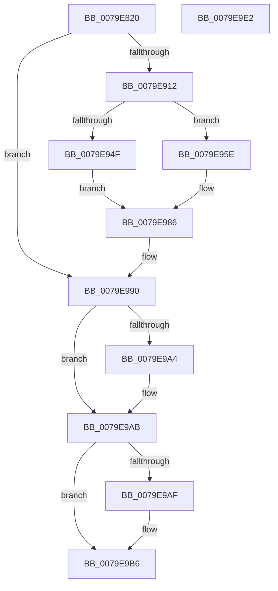

# SeAuditFipsCryptoSelftests

- RVA: `0x0079E820`–`0x0079E9E3` (길이 `451` bytes)
- VA: `0x000000014079E820`
- 실행 섹션: `PAGE`
- PDB 이름 있음: `예`; PDB Function 태그: `아니요`
- unwind 정보 RVA: `0x000D1188`
- 디코드: `101`개 명령, `451/451` bytes 표시
- 미해석 바이트: `0` (있으면 어셈블리에 `.byte`로 보존)

> 이 문서는 커널 이미지의 기계어와 PDB 기호를 분석해 생성했습니다. 4번과 5번은 함수 원형과 자료형을 바이너리 사용 방식에서 추정한 C 해석이며 원본 소스 복구 결과는 아닙니다.

## 1. Dependencies

- 직접 호출 지점: **9**; 고유 호출 대상: **9**
- 직접 호출자로 확인된 함수: **0**
- RIP 상대 이미지 참조: **2**

### Outgoing calls
- `0x0079E882` → [memset](../../text/6C/memset_function_006C6C40.md) (function, `0x006C6C40`)
- `0x0079E8A3` → [SeCaptureSubjectContext](../86/SeCaptureSubjectContext_function_0086B820.md) (function, `0x0086B820`)
- `0x0079E8F3` → [PsGetCurrentThreadProcess](../../text/47/PsGetCurrentThreadProcess_function_0047C7E0.md) (function, `0x0047C7E0`)
- `0x0079E907` → [PsGetAllocatedFullProcessImageNameEx](../91/PsGetAllocatedFullProcessImageNameEx_function_0091D6F0.md) (function, `0x0091D6F0`)
- `0x0079E98B` → [SepAdtLogAuditRecord](../../text/22/SepAdtLogAuditRecord_function_00224B6C.md) (function, `0x00224B6C`)
- `0x0079E995` → [SeReleaseSubjectContext](../86/SeReleaseSubjectContext_function_0086B710.md) (function, `0x0086B710`)
- `0x0079E9A6` → [ExFreePoolWithTag](../../poolcode/B8/ExFreePoolWithTag_function_00B82870.md) (function, `0x00B82870`)
- `0x0079E9B1` → [SepAuditFailed](../86/SepAuditFailed_function_0086EE20.md) (function, `0x0086EE20`)
- `0x0079E9C0` → [_security_check_cookie](../../text/6A/_security_check_cookie_function_006AC640.md) (function, `0x006AC640`)

### Direct callers
- 이 함수 시작 RVA로 연결되는 직접 call은 확인되지 않았습니다. 간접 호출은 완전히 역산할 수 없습니다.

### Static image references
- `0x0079E842` → RVA `0x00E0A740` (`.data`; read)
- `0x0079E8E8` → RVA `0x000013A8` (`.rdata`; read)

## 2. Other-region calls and transfers

- 다른 실행 섹션으로 향하는 call: **5**
  - `0x0079E882` → [memset](../../text/6C/memset_function_006C6C40.md) (`PAGE` → `.text`)
  - `0x0079E8F3` → [PsGetCurrentThreadProcess](../../text/47/PsGetCurrentThreadProcess_function_0047C7E0.md) (`PAGE` → `.text`)
  - `0x0079E98B` → [SepAdtLogAuditRecord](../../text/22/SepAdtLogAuditRecord_function_00224B6C.md) (`PAGE` → `.text`)
  - `0x0079E9A6` → [ExFreePoolWithTag](../../poolcode/B8/ExFreePoolWithTag_function_00B82870.md) (`PAGE` → `POOLCODE`)
  - `0x0079E9C0` → [_security_check_cookie](../../text/6A/_security_check_cookie_function_006AC640.md) (`PAGE` → `.text`)
- 별도 외부 분기/꼬리 이동을 확인하지 못했습니다.

## 3. Assembly (complete function range)

```asm
0079E820  48 8B C4                        mov rax, rsp
0079E823  48 89 58 08                     mov qword ptr [rax + 8], rbx
0079E827  48 89 70 10                     mov qword ptr [rax + 0x10], rsi
0079E82B  48 89 78 18                     mov qword ptr [rax + 0x18], rdi
0079E82F  4C 89 70 20                     mov qword ptr [rax + 0x20], r14
0079E833  55                              push rbp
0079E834  48 8D A8 78 FC FF FF            lea rbp, [rax - 0x388]
0079E83B  48 81 EC 80 04 00 00            sub rsp, 0x480
0079E842  48 8B 05 F7 BE 66 00            mov rax, qword ptr [rip + 0x66bef7]
0079E849  48 33 C4                        xor rax, rsp
0079E84C  48 89 85 70 03 00 00            mov qword ptr [rbp + 0x370], rax
0079E853  48 83 64 24 28 00               and qword ptr [rsp + 0x28], 0
0079E859  40 8A F1                        mov sil, cl
0079E85C  8B FA                           mov edi, edx
0079E85E  48 8D 4C 24 50                  lea rcx, [rsp + 0x50]
0079E863  33 C0                           xor eax, eax
0079E865  C7 44 24 30 00 00 00 80         mov dword ptr [rsp + 0x30], 0x80000000
0079E86D  0F 57 C0                        xorps xmm0, xmm0
0079E870  89 44 24 34                     mov dword ptr [rsp + 0x34], eax
0079E874  33 D2                           xor edx, edx
0079E876  41 B8 18 04 00 00               mov r8d, 0x418
0079E87C  F3 0F 7F 44 24 38               movdqu xmmword ptr [rsp + 0x38], xmm0
0079E882  E8 B9 83 F2 FF                  call 0x1406c6c40
0079E887  48 83 64 24 20 00               and qword ptr [rsp + 0x20], 0
0079E88D  48 8D 4C 24 28                  lea rcx, [rsp + 0x28]
0079E892  BB 01 00 00 00                  mov ebx, 1
0079E897  89 5C 24 50                     mov dword ptr [rsp + 0x50], ebx
0079E89B  8D 43 65                        lea eax, [rbx + 0x65]
0079E89E  66 89 44 24 60                  mov word ptr [rsp + 0x60], ax
0079E8A3  E8 78 CF 0C 00                  call 0x14086b820
0079E8A8  48 8B 44 24 28                  mov rax, qword ptr [rsp + 0x28]
0079E8AD  48 8B 4C 24 38                  mov rcx, qword ptr [rsp + 0x38]
0079E8B2  48 85 C0                        test rax, rax
0079E8B5  C7 44 24 68 04 00 00 00         mov dword ptr [rsp + 0x68], 4
0079E8BD  48 0F 45 C8                     cmovne rcx, rax
0079E8C1  89 5D 88                        mov dword ptr [rbp - 0x78], ebx
0079E8C4  C7 45 8C 20 00 00 00            mov dword ptr [rbp - 0x74], 0x20
0079E8CB  48 8B 81 98 00 00 00            mov rax, qword ptr [rcx + 0x98]
0079E8D2  48 8B 08                        mov rcx, qword ptr [rax]
0079E8D5  48 89 4D 80                     mov qword ptr [rbp - 0x80], rcx
0079E8D9  0F B6 41 01                     movzx eax, byte ptr [rcx + 1]
0079E8DD  8D 04 85 08 00 00 00            lea eax, [rax*4 + 8]
0079E8E4  89 44 24 6C                     mov dword ptr [rsp + 0x6c], eax
0079E8E8  48 8D 05 B9 2A 86 FF            lea rax, [rip - 0x79d547]
0079E8EF  48 89 45 A0                     mov qword ptr [rbp - 0x60], rax
0079E8F3  E8 E8 DE CD FF                  call 0x14047c7e0
0079E8F8  48 8D 54 24 20                  lea rdx, [rsp + 0x20]
0079E8FD  48 8B C8                        mov rcx, rax
0079E900  4C 8B B0 D0 01 00 00            mov r14, qword ptr [rax + 0x1d0]
0079E907  E8 E4 ED 17 00                  call 0x14091d6f0
0079E90C  8B D8                           mov ebx, eax
0079E90E  85 C0                           test eax, eax
0079E910  78 7E                           js 0x14079e990
0079E912  48 8B 54 24 20                  mov rdx, qword ptr [rsp + 0x20]
0079E917  B8 08 00 00 00                  mov eax, 8
0079E91C  C7 45 A8 0B 00 00 00            mov dword ptr [rbp - 0x58], 0xb
0079E923  89 45 AC                        mov dword ptr [rbp - 0x54], eax
0079E926  4C 89 75 B0                     mov qword ptr [rbp - 0x50], r14
0079E92A  0F B7 0A                        movzx ecx, word ptr [rdx]
0079E92D  44 8D 40 08                     lea r8d, [rax + 8]
0079E931  41 03 C8                        add ecx, r8d
0079E934  C7 45 C8 02 00 00 00            mov dword ptr [rbp - 0x38], 2
0079E93B  89 4D CC                        mov dword ptr [rbp - 0x34], ecx
0079E93E  48 89 55 E0                     mov qword ptr [rbp - 0x20], rdx
0079E942  C7 44 24 58 04 00 00 00         mov dword ptr [rsp + 0x58], 4
0079E94A  40 84 F6                        test sil, sil
0079E94D  74 0F                           je 0x14079e95e
0079E94F  C7 44 24 54 11 19 00 00         mov dword ptr [rsp + 0x54], 0x1911
0079E957  66 89 44 24 62                  mov word ptr [rsp + 0x62], ax
0079E95C  EB 28                           jmp 0x14079e986
0079E95E  C7 44 24 54 12 19 00 00         mov dword ptr [rsp + 0x54], 0x1912
0079E966  66 44 89 44 24 62               mov word ptr [rsp + 0x62], r8w
0079E96C  C7 45 E8 0A 00 00 00            mov dword ptr [rbp - 0x18], 0xa
0079E973  C7 45 EC 04 00 00 00            mov dword ptr [rbp - 0x14], 4
0079E97A  48 89 7D F0                     mov qword ptr [rbp - 0x10], rdi
0079E97E  C7 44 24 58 05 00 00 00         mov dword ptr [rsp + 0x58], 5
0079E986  48 8D 4C 24 50                  lea rcx, [rsp + 0x50]
0079E98B  E8 DC 61 A8 FF                  call 0x140224b6c
0079E990  48 8D 4C 24 28                  lea rcx, [rsp + 0x28]
0079E995  E8 76 CD 0C 00                  call 0x14086b710
0079E99A  48 8B 4C 24 20                  mov rcx, qword ptr [rsp + 0x20]
0079E99F  48 85 C9                        test rcx, rcx
0079E9A2  74 07                           je 0x14079e9ab
0079E9A4  33 D2                           xor edx, edx
0079E9A6  E8 C5 3E 3E 00                  call 0x140b82870
0079E9AB  85 DB                           test ebx, ebx
0079E9AD  79 07                           jns 0x14079e9b6
0079E9AF  8B CB                           mov ecx, ebx
0079E9B1  E8 6A 04 0D 00                  call 0x14086ee20
0079E9B6  48 8B 8D 70 03 00 00            mov rcx, qword ptr [rbp + 0x370]
0079E9BD  48 33 CC                        xor rcx, rsp
0079E9C0  E8 7B DC F0 FF                  call 0x1406ac640
0079E9C5  4C 8D 9C 24 80 04 00 00         lea r11, [rsp + 0x480]
0079E9CD  49 8B 5B 10                     mov rbx, qword ptr [r11 + 0x10]
0079E9D1  49 8B 73 18                     mov rsi, qword ptr [r11 + 0x18]
0079E9D5  49 8B 7B 20                     mov rdi, qword ptr [r11 + 0x20]
0079E9D9  4D 8B 73 28                     mov r14, qword ptr [r11 + 0x28]
0079E9DD  49 8B E3                        mov rsp, r11
0079E9E0  5D                              pop rbp
0079E9E1  C3                              ret
0079E9E2  CC                              int3
```

## 4. C-style interpretation (structured pseudocode)

```c
__int64 __fastcall SeAuditFipsCryptoSelftests(unsigned __int8 a1, int a2)
{
    __int64 result;
    __int64 v_rsp;
    unsigned int v_stack_m41C;
    unsigned int v_stack_m420;
    unsigned __int16 v_stack_m426;
    unsigned __int16 v_stack_m428;
    unsigned int v_stack_m430;
    unsigned int v_stack_m434;
    unsigned __int64 v_stack_m438;
    unsigned __int64 v_stack_m450;
    unsigned int v_stack_m454;
    unsigned int v_stack_m458;
    unsigned __int64 v_stack_m460;
    unsigned __int64 v_stack_m468;
    unsigned __int64 v_stack_m8;

    *(unsigned __int64 *)(v_rsp + 8) = v_rbx;
    *(unsigned __int64 *)(v_rsp + 16) = v_rsi;
    *(unsigned __int64 *)(v_rsp + 24) = v_rdi;
    *(unsigned __int64 *)(v_rsp + 32) = v_r14;
    v_rsp = (v_rsp) - (0x480ULL);
    result = (*(unsigned __int64 *)(v_rip + 6733559)) ^ (v_rsp);
    *(unsigned __int64 *)(v_rsp - 904 + 880) = result;
    result = 0;
    v_stack_m458 = 0x80000000ULL;
    v_stack_m454 = 0;
    a2 = 0;
    v_stack_m450 = v_xmm0;
    result = memset(v_stack_m438, a2, (unsigned int)(0x418ULL), a4);
    v_stack_m438 = 1;
    v_stack_m428 = (unsigned __int16)(1 + 101);
    result = SeCaptureSubjectContext(v_stack_m460, a2, (unsigned int)(0x418ULL), a4);
    v_stack_m420 = 4;
    a1 = v_stack_m450;
    if (v_stack_m460 != 0) { a1 = v_stack_m460; }
    *(unsigned int *)(v_rsp - 904 - 120) = 1;
    *(unsigned int *)(v_rsp - 904 - 116) = 32;
    *(unsigned __int64 *)(v_rsp - 904 - 128) = *(unsigned __int64 *)(*(unsigned __int64 *)(a1 + 152));
    v_stack_m41C = (unsigned int)(*(unsigned __int8 *)(*(unsigned __int64 *)(*(unsigned __int64 *)(a1 + 152)) + 1) * 4 + 8);
    *(unsigned __int64 *)(v_rsp - 904 - 96) = v_rip - 7984455;
    result = PsGetCurrentThreadProcess(*(unsigned __int64 *)(*(unsigned __int64 *)(a1 + 152)), a2, (unsigned int)(0x418ULL), a4);
    result = PsGetAllocatedFullProcessImageNameEx(result, v_stack_m468, (unsigned int)(0x418ULL), a4);
    if (sign_flag) goto loc_0079E990;
    *(unsigned int *)(v_rsp - 904 - 88) = 11;
    *(unsigned int *)(v_rsp - 904 - 84) = 8;
    *(unsigned __int64 *)(v_rsp - 904 - 80) = *(unsigned __int64 *)(result + 464);
    a1 = (unsigned int)((*(unsigned __int16 *)(v_stack_m468)) + ((unsigned int)(8 + 8)));
    *(unsigned int *)(v_rsp - 904 - 56) = 2;
    *(unsigned int *)(v_rsp - 904 - 52) = a1;
    *(unsigned __int64 *)(v_rsp - 904 - 32) = v_stack_m468;
    v_stack_m430 = 4;
    if (a1 == 0) goto loc_0079E95E;
    v_stack_m434 = 0x1911ULL;
    v_stack_m426 = 8;
    goto loc_0079E986;
loc_0079E95E:
    v_stack_m434 = 0x1912ULL;
    v_stack_m426 = (unsigned __int16)(8 + 8);
    *(unsigned int *)(v_rsp - 904 - 24) = 10;
    *(unsigned int *)(v_rsp - 904 - 20) = 4;
    *(unsigned __int64 *)(v_rsp - 904 - 16) = (unsigned int)(a2);
    v_stack_m430 = 5;
loc_0079E986:
    result = SepAdtLogAuditRecord(v_stack_m438, v_stack_m468, 8 + 8, a4);
loc_0079E990:
    result = SeReleaseSubjectContext(v_stack_m460, v_stack_m468, 8 + 8, a4);
    if (v_stack_m468 != 0) {
        a2 = 0;
        result = ExFreePoolWithTag(v_stack_m468, a2, 8 + 8, a4);
    }
    if (sign_flag) {
        a1 = (unsigned int)((unsigned int)((unsigned int)(result)));
        result = SepAuditFailed(a1, a2, 8 + 8, a4);
    }
    a1 = (*(unsigned __int64 *)(v_rsp - 904 + 880)) ^ (v_rsp);
    result = _security_check_cookie(a1, a2, 8 + 8, a4);
    return result;
}
```

## 5. (Beta) C Style

```c
int64_t SeAuditFipsCryptoSelftests(uint8_t Arg1, int32_t Arg2)
{
    int64_t result;
    int64_t local_rsp;
    uint32_t v_stack_m41C;
    uint32_t v_stack_m420;
    uint16_t v_stack_m426;
    uint16_t v_stack_m428;
    uint32_t v_stack_m430;
    uint32_t v_stack_m434;
    uint64_t v_stack_m438;
    uint64_t v_stack_m450;
    uint32_t v_stack_m454;
    uint32_t v_stack_m458;
    uint64_t v_stack_m460;
    uint64_t v_stack_m468;
    uint64_t v_stack_m8;

    *(uint64_t *)(local_rsp + 0x8) = local_rbx;
    *(uint64_t *)(local_rsp + 0x10) = local_rsi;
    *(uint64_t *)(local_rsp + 0x18) = local_rdi;
    *(uint64_t *)(local_rsp + 0x20) = local_r14;
    local_rsp = (local_rsp) - (0x480ULL);
    result = (*(uint64_t *)(v_rip + 0x66BEF7)) ^ (local_rsp);
    *(uint64_t *)(local_rsp - 0x388 + 0x370) = result;
    result = 0;
    v_stack_m458 = 0x80000000ULL;
    v_stack_m454 = 0;
    Arg2 = 0;
    v_stack_m450 = v_xmm0;
    result = memset(v_stack_m438, Arg2, (uint32_t)(0x418ULL), a4);
    v_stack_m438 = 1;
    v_stack_m428 = (uint16_t)(1 + 101);
    result = SeCaptureSubjectContext(v_stack_m460, Arg2, (uint32_t)(0x418ULL), a4);
    v_stack_m420 = 4;
    Arg1 = v_stack_m450;
    if (v_stack_m460 != 0) { Arg1 = v_stack_m460; }
    *(uint32_t *)(local_rsp - 0x388 - 0x78) = 1;
    *(uint32_t *)(local_rsp - 0x388 - 0x74) = 32;
    *(uint64_t *)(local_rsp - 0x388 - 0x80) = *(uint64_t *)(*(uint64_t *)(Arg1 + 0x98));
    v_stack_m41C = (uint32_t)(*(uint8_t *)(*(uint64_t *)(*(uint64_t *)(Arg1 + 0x98)) + 0x1) * 4 + 8);
    *(uint64_t *)(local_rsp - 0x388 - 0x60) = v_rip - 7984455;
    result = PsGetCurrentThreadProcess(*(uint64_t *)(*(uint64_t *)(Arg1 + 0x98)), Arg2, (uint32_t)(0x418ULL), a4);
    result = PsGetAllocatedFullProcessImageNameEx(result, v_stack_m468, (uint32_t)(0x418ULL), a4);
    if (sign_flag) goto loc_0079E990;
    *(uint32_t *)(local_rsp - 0x388 - 0x58) = 11;
    *(uint32_t *)(local_rsp - 0x388 - 0x54) = 8;
    *(uint64_t *)(local_rsp - 0x388 - 0x50) = *(uint64_t *)(result + 0x1D0);
    Arg1 = (uint32_t)((*(uint16_t *)(v_stack_m468)) + ((uint32_t)(8 + 8)));
    *(uint32_t *)(local_rsp - 0x388 - 0x38) = 2;
    *(uint32_t *)(local_rsp - 0x388 - 0x34) = Arg1;
    *(uint64_t *)(local_rsp - 0x388 - 0x20) = v_stack_m468;
    v_stack_m430 = 4;
    if (Arg1 == 0) goto loc_0079E95E;
    v_stack_m434 = 0x1911ULL;
    v_stack_m426 = 8;
    goto loc_0079E986;
loc_0079E95E:
    v_stack_m434 = 0x1912ULL;
    v_stack_m426 = (uint16_t)(8 + 8);
    *(uint32_t *)(local_rsp - 0x388 - 0x18) = 10;
    *(uint32_t *)(local_rsp - 0x388 - 0x14) = 4;
    *(uint64_t *)(local_rsp - 0x388 - 0x10) = (uint32_t)(Arg2);
    v_stack_m430 = 5;
loc_0079E986:
    result = SepAdtLogAuditRecord(v_stack_m438, v_stack_m468, 8 + 8, a4);
loc_0079E990:
    result = SeReleaseSubjectContext(v_stack_m460, v_stack_m468, 8 + 8, a4);
    if (v_stack_m468 != 0) {
        Arg2 = 0;
        result = ExFreePoolWithTag(v_stack_m468, Arg2, 8 + 8, a4);
    }
    if (sign_flag) {
        Arg1 = (uint32_t)((uint32_t)((uint32_t)(result)));
        result = SepAuditFailed(Arg1, Arg2, 8 + 8, a4);
    }
    Arg1 = (*(uint64_t *)(local_rsp - 0x388 + 0x370)) ^ (local_rsp);
    result = _security_check_cookie(Arg1, Arg2, 8 + 8, a4);
    return result;
}
```

## 6. Execution-region graph

[열기: 2D/3D 그래프와 함수 탐색 컨트롤 패널](../../../control-panel.html?section=page&rva=0x0079E820&view=graph)

- 2D 그래프는 위에서 아래로 흐르고, 3D 그래프는 빈 공간을 드래그해 회전합니다. Shift+드래그는 이동, 휠은 확대·축소, 함수 노드 선택은 대상 보고서 이동입니다.

### Static fallback


