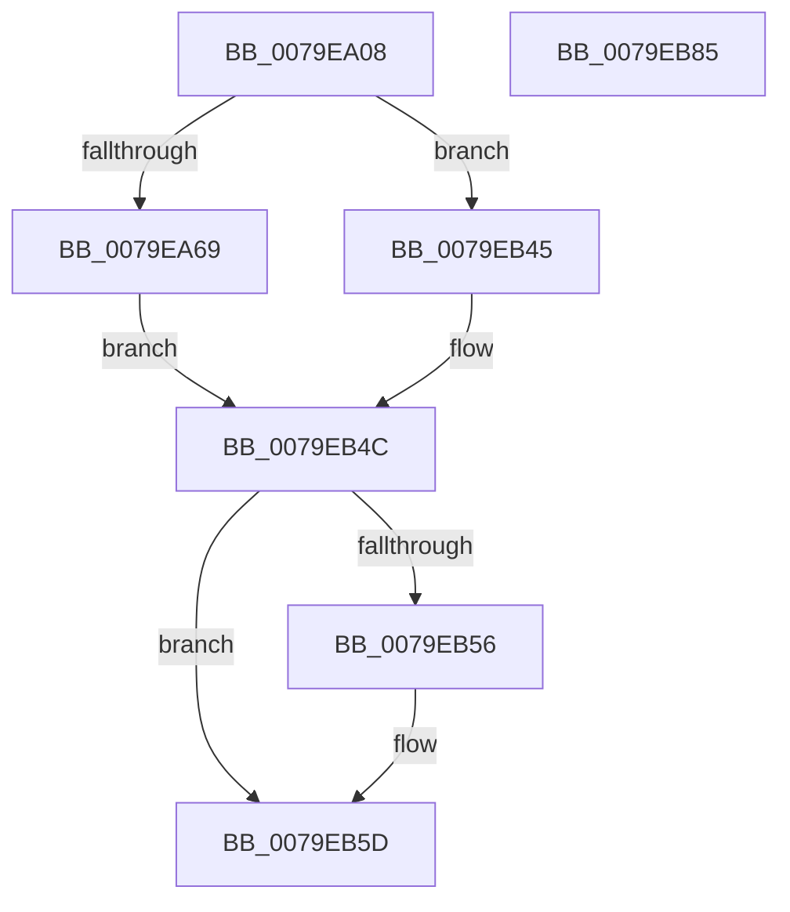

# SeAuditProcessExit

- RVA: `0x0079EA08`–`0x0079EB86` (길이 `382` bytes)
- VA: `0x000000014079EA08`
- 실행 섹션: `PAGE`
- PDB 이름 있음: `예`; PDB Function 태그: `아니요`
- unwind 정보 RVA: `0x000D1278`
- 디코드: `84`개 명령, `382/382` bytes 표시
- 미해석 바이트: `0` (있으면 어셈블리에 `.byte`로 보존)

> 이 문서는 커널 이미지의 기계어와 PDB 기호를 분석해 생성했습니다. 4번과 5번은 함수 원형과 자료형을 바이너리 사용 방식에서 추정한 C 해석이며 원본 소스 복구 결과는 아닙니다.

## 1. Dependencies

- 직접 호출 지점: **8**; 고유 호출 대상: **8**
- 직접 호출자로 확인된 함수: **1**
- RIP 상대 이미지 참조: **2**

### Outgoing calls
- `0x0079EA4F` → [memset](../../text/6C/memset_function_006C6C40.md) (function, `0x006C6C40`)
- `0x0079EA5C` → [PsGetAllocatedFullProcessImageNameEx](../91/PsGetAllocatedFullProcessImageNameEx_function_0091D6F0.md) (function, `0x0091D6F0`)
- `0x0079EA71` → [PsReferencePrimaryTokenWithTag](../../text/20/PsReferencePrimaryTokenWithTag_function_0020FF80.md) (function, `0x0020FF80`)
- `0x0079EB36` → [SepAdtLogAuditRecord](../../text/22/SepAdtLogAuditRecord_function_00224B6C.md) (function, `0x00224B6C`)
- `0x0079EB3E` → [ObfDereferenceObject](../../text/2F/ObfDereferenceObject_function_002F9350.md) (function, `0x002F9350`)
- `0x0079EB47` → [SepAuditFailed](../86/SepAuditFailed_function_0086EE20.md) (function, `0x0086EE20`)
- `0x0079EB58` → [ExFreePoolWithTag](../../poolcode/B8/ExFreePoolWithTag_function_00B82870.md) (function, `0x00B82870`)
- `0x0079EB67` → [_security_check_cookie](../../text/6A/_security_check_cookie_function_006AC640.md) (function, `0x006AC640`)

### Direct callers
- [PspExitLastThread](../90/PspExitLastThread_function_00904184.md) at `0x0090444C`

### Static image references
- `0x0079EA26` → RVA `0x00E0A740` (`.data`; read)
- `0x0079EA95` → RVA `0x000013A8` (`.rdata`; read)

## 2. Other-region calls and transfers

- 다른 실행 섹션으로 향하는 call: **6**
  - `0x0079EA4F` → [memset](../../text/6C/memset_function_006C6C40.md) (`PAGE` → `.text`)
  - `0x0079EA71` → [PsReferencePrimaryTokenWithTag](../../text/20/PsReferencePrimaryTokenWithTag_function_0020FF80.md) (`PAGE` → `.text`)
  - `0x0079EB36` → [SepAdtLogAuditRecord](../../text/22/SepAdtLogAuditRecord_function_00224B6C.md) (`PAGE` → `.text`)
  - `0x0079EB3E` → [ObfDereferenceObject](../../text/2F/ObfDereferenceObject_function_002F9350.md) (`PAGE` → `.text`)
  - `0x0079EB58` → [ExFreePoolWithTag](../../poolcode/B8/ExFreePoolWithTag_function_00B82870.md) (`PAGE` → `POOLCODE`)
  - `0x0079EB67` → [_security_check_cookie](../../text/6A/_security_check_cookie_function_006AC640.md) (`PAGE` → `.text`)
- 별도 외부 분기/꼬리 이동을 확인하지 못했습니다.

## 3. Assembly (complete function range)

```asm
0079EA08  48 8B C4                        mov rax, rsp
0079EA0B  48 89 58 10                     mov qword ptr [rax + 0x10], rbx
0079EA0F  48 89 70 18                     mov qword ptr [rax + 0x18], rsi
0079EA13  48 89 78 20                     mov qword ptr [rax + 0x20], rdi
0079EA17  55                              push rbp
0079EA18  48 8D A8 98 FC FF FF            lea rbp, [rax - 0x368]
0079EA1F  48 81 EC 60 04 00 00            sub rsp, 0x460
0079EA26  48 8B 05 13 BD 66 00            mov rax, qword ptr [rip + 0x66bd13]
0079EA2D  48 33 C4                        xor rax, rsp
0079EA30  48 89 85 50 03 00 00            mov qword ptr [rbp + 0x350], rax
0079EA37  48 83 64 24 20 00               and qword ptr [rsp + 0x20], 0
0079EA3D  48 8B F9                        mov rdi, rcx
0079EA40  8B F2                           mov esi, edx
0079EA42  48 8D 4C 24 30                  lea rcx, [rsp + 0x30]
0079EA47  33 D2                           xor edx, edx
0079EA49  41 B8 18 04 00 00               mov r8d, 0x418
0079EA4F  E8 EC 81 F2 FF                  call 0x1406c6c40
0079EA54  48 8D 54 24 20                  lea rdx, [rsp + 0x20]
0079EA59  48 8B CF                        mov rcx, rdi
0079EA5C  E8 8F EC 17 00                  call 0x14091d6f0
0079EA61  85 C0                           test eax, eax
0079EA63  0F 88 DC 00 00 00               js 0x14079eb45
0079EA69  BA 44 66 6C 74                  mov edx, 0x746c6644
0079EA6E  48 8B CF                        mov rcx, rdi
0079EA71  E8 0A 15 A7 FF                  call 0x14020ff80
0079EA76  41 BA 05 00 00 00               mov r10d, 5
0079EA7C  48 8B D8                        mov rbx, rax
0079EA7F  48 8B 88 98 00 00 00            mov rcx, qword ptr [rax + 0x98]
0079EA86  45 8D 4A FF                     lea r9d, [r10 - 1]
0079EA8A  45 8D 5A 03                     lea r11d, [r10 + 3]
0079EA8E  4C 8B 01                        mov r8, qword ptr [rcx]
0079EA91  48 8B 48 18                     mov rcx, qword ptr [rax + 0x18]
0079EA95  48 8D 05 0C 29 86 FF            lea rax, [rip - 0x79d6f4]
0079EA9C  44 89 54 24 30                  mov dword ptr [rsp + 0x30], r10d
0079EAA1  C7 44 24 40 87 00 08 00         mov dword ptr [rsp + 0x40], 0x80087
0079EAA9  C7 44 24 34 51 12 00 00         mov dword ptr [rsp + 0x34], 0x1251
0079EAB1  44 89 4C 24 48                  mov dword ptr [rsp + 0x48], r9d
0079EAB6  41 0F B6 50 01                  movzx edx, byte ptr [r8 + 1]
0079EABB  48 89 4D 90                     mov qword ptr [rbp - 0x70], rcx
0079EABF  48 8B 4C 24 20                  mov rcx, qword ptr [rsp + 0x20]
0079EAC4  48 89 45 80                     mov qword ptr [rbp - 0x80], rax
0079EAC8  48 8B 87 D0 01 00 00            mov rax, qword ptr [rdi + 0x1d0]
0079EACF  8D 14 95 08 00 00 00            lea edx, [rdx*4 + 8]
0079EAD6  48 89 45 D0                     mov qword ptr [rbp - 0x30], rax
0079EADA  89 54 24 4C                     mov dword ptr [rsp + 0x4c], edx
0079EADE  4C 89 44 24 60                  mov qword ptr [rsp + 0x60], r8
0079EAE3  C7 44 24 68 01 00 00 00         mov dword ptr [rsp + 0x68], 1
0079EAEB  C7 44 24 6C 20 00 00 00         mov dword ptr [rsp + 0x6c], 0x20
0079EAF3  44 89 55 88                     mov dword ptr [rbp - 0x78], r10d
0079EAF7  44 89 5D 8C                     mov dword ptr [rbp - 0x74], r11d
0079EAFB  C7 45 A8 0A 00 00 00            mov dword ptr [rbp - 0x58], 0xa
0079EB02  44 89 4D AC                     mov dword ptr [rbp - 0x54], r9d
0079EB06  48 89 75 B0                     mov qword ptr [rbp - 0x50], rsi
0079EB0A  C7 45 C8 0B 00 00 00            mov dword ptr [rbp - 0x38], 0xb
0079EB11  44 89 5D CC                     mov dword ptr [rbp - 0x34], r11d
0079EB15  C7 45 E8 02 00 00 00            mov dword ptr [rbp - 0x18], 2
0079EB1C  0F B7 01                        movzx eax, word ptr [rcx]
0079EB1F  83 C0 10                        add eax, 0x10
0079EB22  48 89 4D 00                     mov qword ptr [rbp], rcx
0079EB26  48 8D 4C 24 30                  lea rcx, [rsp + 0x30]
0079EB2B  89 45 EC                        mov dword ptr [rbp - 0x14], eax
0079EB2E  C7 44 24 38 06 00 00 00         mov dword ptr [rsp + 0x38], 6
0079EB36  E8 31 60 A8 FF                  call 0x140224b6c
0079EB3B  48 8B CB                        mov rcx, rbx
0079EB3E  E8 0D A8 B5 FF                  call 0x1402f9350
0079EB43  EB 07                           jmp 0x14079eb4c
0079EB45  8B C8                           mov ecx, eax
0079EB47  E8 D4 02 0D 00                  call 0x14086ee20
0079EB4C  48 8B 4C 24 20                  mov rcx, qword ptr [rsp + 0x20]
0079EB51  48 85 C9                        test rcx, rcx
0079EB54  74 07                           je 0x14079eb5d
0079EB56  33 D2                           xor edx, edx
0079EB58  E8 13 3D 3E 00                  call 0x140b82870
0079EB5D  48 8B 8D 50 03 00 00            mov rcx, qword ptr [rbp + 0x350]
0079EB64  48 33 CC                        xor rcx, rsp
0079EB67  E8 D4 DA F0 FF                  call 0x1406ac640
0079EB6C  4C 8D 9C 24 60 04 00 00         lea r11, [rsp + 0x460]
0079EB74  49 8B 5B 18                     mov rbx, qword ptr [r11 + 0x18]
0079EB78  49 8B 73 20                     mov rsi, qword ptr [r11 + 0x20]
0079EB7C  49 8B 7B 28                     mov rdi, qword ptr [r11 + 0x28]
0079EB80  49 8B E3                        mov rsp, r11
0079EB83  5D                              pop rbp
0079EB84  C3                              ret
0079EB85  CC                              int3
```

## 4. C-style interpretation (structured pseudocode)

```c
__int64 __fastcall SeAuditProcessExit(__int64 a1, int a2)
{
    __int64 result;
    __int64 v_rsp;
    unsigned int v_stack_m3FC;
    unsigned int v_stack_m400;
    unsigned __int64 v_stack_m408;
    unsigned int v_stack_m41C;
    unsigned int v_stack_m420;
    unsigned int v_stack_m428;
    unsigned int v_stack_m430;
    unsigned int v_stack_m434;
    unsigned __int64 v_stack_m438;
    unsigned __int64 v_stack_m448;
    unsigned __int64 v_stack_m8;

    *(unsigned __int64 *)(v_rsp + 16) = v_rbx;
    *(unsigned __int64 *)(v_rsp + 24) = v_rsi;
    *(unsigned __int64 *)(v_rsp + 32) = v_rdi;
    v_rsp = (v_rsp) - (0x460ULL);
    result = (*(unsigned __int64 *)(v_rip + 6733075)) ^ (v_rsp);
    *(unsigned __int64 *)(v_rsp - 872 + 848) = result;
    a2 = 0;
    result = memset(v_stack_m438, a2, (unsigned int)(0x418ULL), a4);
    result = PsGetAllocatedFullProcessImageNameEx(a1, v_stack_m448, (unsigned int)(0x418ULL), a4);
    if (sign_flag) goto loc_0079EB45;
    result = PsReferencePrimaryTokenWithTag(a1, (unsigned int)(0x746C6644ULL), (unsigned int)(0x418ULL), a4);
    v_stack_m438 = 5;
    v_stack_m428 = 0x80087ULL;
    v_stack_m434 = 0x1251ULL;
    v_stack_m420 = (unsigned int)(5 - 1);
    *(unsigned __int64 *)(v_rsp - 872 - 112) = *(unsigned __int64 *)(result + 24);
    *(unsigned __int64 *)(v_rsp - 872 - 128) = v_rip - 7984884;
    *(unsigned __int64 *)(v_rsp - 872 - 48) = *(unsigned __int64 *)(a1 + 464);
    v_stack_m41C = (unsigned int)(*(unsigned __int8 *)(*(unsigned __int64 *)(*(unsigned __int64 *)(result + 152)) + 1) * 4 + 8);
    v_stack_m408 = *(unsigned __int64 *)(*(unsigned __int64 *)(result + 152));
    v_stack_m400 = 1;
    v_stack_m3FC = 32;
    *(unsigned int *)(v_rsp - 872 - 120) = 5;
    *(unsigned int *)(v_rsp - 872 - 116) = (unsigned int)(5 + 3);
    *(unsigned int *)(v_rsp - 872 - 88) = 10;
    *(unsigned int *)(v_rsp - 872 - 84) = (unsigned int)(5 - 1);
    *(unsigned __int64 *)(v_rsp - 872 - 80) = (unsigned int)(a2);
    *(unsigned int *)(v_rsp - 872 - 56) = 11;
    *(unsigned int *)(v_rsp - 872 - 52) = (unsigned int)(5 + 3);
    *(unsigned int *)(v_rsp - 872 - 24) = 2;
    result = (unsigned int)((*(unsigned __int16 *)(v_stack_m448)) + (16));
    *(unsigned __int64 *)(v_rsp - 872) = v_stack_m448;
    *(unsigned int *)(v_rsp - 872 - 20) = (unsigned int)(result);
    v_stack_m430 = 6;
    result = SepAdtLogAuditRecord(v_stack_m438, *(unsigned __int8 *)(*(unsigned __int64 *)(*(unsigned __int64 *)(result + 152)) + 1) * 4 + 8, *(unsigned __int64 *)(*(unsigned __int64 *)(result + 152)), 5 - 1);
    result = ObfDereferenceObject(result, *(unsigned __int8 *)(*(unsigned __int64 *)(*(unsigned __int64 *)(result + 152)) + 1) * 4 + 8, *(unsigned __int64 *)(*(unsigned __int64 *)(result + 152)), 5 - 1);
    goto loc_0079EB4C;
loc_0079EB45:
    result = SepAuditFailed((unsigned int)((unsigned int)(result)), *(unsigned __int8 *)(*(unsigned __int64 *)(*(unsigned __int64 *)(result + 152)) + 1) * 4 + 8, *(unsigned __int64 *)(*(unsigned __int64 *)(result + 152)), 5 - 1);
loc_0079EB4C:
    if (v_stack_m448 != 0) {
        a2 = 0;
        result = ExFreePoolWithTag(v_stack_m448, a2, *(unsigned __int64 *)(*(unsigned __int64 *)(result + 152)), 5 - 1);
    }
    a1 = (*(unsigned __int64 *)(v_rsp - 872 + 848)) ^ (v_rsp);
    result = _security_check_cookie(a1, a2, *(unsigned __int64 *)(*(unsigned __int64 *)(result + 152)), 5 - 1);
    return result;
}
```

## 5. (Beta) C Style

```c
int64_t SeAuditProcessExit(void *Arg1, int32_t Arg2)
{
    uint8_t *arg1 = (uint8_t *)Arg1;

    int64_t result;
    int64_t local_rsp;
    uint32_t v_stack_m3FC;
    uint32_t v_stack_m400;
    uint64_t v_stack_m408;
    uint32_t v_stack_m41C;
    uint32_t v_stack_m420;
    uint32_t v_stack_m428;
    uint32_t v_stack_m430;
    uint32_t v_stack_m434;
    uint64_t v_stack_m438;
    uint64_t v_stack_m448;
    uint64_t v_stack_m8;

    *(uint64_t *)(local_rsp + 0x10) = local_rbx;
    *(uint64_t *)(local_rsp + 0x18) = local_rsi;
    *(uint64_t *)(local_rsp + 0x20) = local_rdi;
    local_rsp = (local_rsp) - (0x460ULL);
    result = (*(uint64_t *)(v_rip + 0x66BD13)) ^ (local_rsp);
    *(uint64_t *)(local_rsp - 0x368 + 0x350) = result;
    Arg2 = 0;
    result = memset(v_stack_m438, Arg2, (uint32_t)(0x418ULL), a4);
    result = PsGetAllocatedFullProcessImageNameEx(Arg1, v_stack_m448, (uint32_t)(0x418ULL), a4);
    if (sign_flag) goto loc_0079EB45;
    result = PsReferencePrimaryTokenWithTag(Arg1, (uint32_t)(0x746C6644ULL), (uint32_t)(0x418ULL), a4);
    v_stack_m438 = 5;
    v_stack_m428 = 0x80087ULL;
    v_stack_m434 = 0x1251ULL;
    v_stack_m420 = (uint32_t)(5 - 1);
    *(uint64_t *)(local_rsp - 0x368 - 0x70) = *(uint64_t *)(result + 0x18);
    *(uint64_t *)(local_rsp - 0x368 - 0x80) = v_rip - 7984884;
    *(uint64_t *)(local_rsp - 0x368 - 0x30) = *(uint64_t *)(arg1 + 0x1D0);
    v_stack_m41C = (uint32_t)(*(uint8_t *)(*(uint64_t *)(*(uint64_t *)(result + 0x98)) + 0x1) * 4 + 8);
    v_stack_m408 = *(uint64_t *)(*(uint64_t *)(result + 0x98));
    v_stack_m400 = 1;
    v_stack_m3FC = 32;
    *(uint32_t *)(local_rsp - 0x368 - 0x78) = 5;
    *(uint32_t *)(local_rsp - 0x368 - 0x74) = (uint32_t)(5 + 3);
    *(uint32_t *)(local_rsp - 0x368 - 0x58) = 10;
    *(uint32_t *)(local_rsp - 0x368 - 0x54) = (uint32_t)(5 - 1);
    *(uint64_t *)(local_rsp - 0x368 - 0x50) = (uint32_t)(Arg2);
    *(uint32_t *)(local_rsp - 0x368 - 0x38) = 11;
    *(uint32_t *)(local_rsp - 0x368 - 0x34) = (uint32_t)(5 + 3);
    *(uint32_t *)(local_rsp - 0x368 - 0x18) = 2;
    result = (uint32_t)((*(uint16_t *)(v_stack_m448)) + (16));
    *(uint64_t *)(local_rsp - 0x368) = v_stack_m448;
    *(uint32_t *)(local_rsp - 0x368 - 0x14) = (uint32_t)(result);
    v_stack_m430 = 6;
    result = SepAdtLogAuditRecord(v_stack_m438, *(uint8_t *)(*(uint64_t *)(*(uint64_t *)(result + 0x98)) + 0x1) * 4 + 8, *(uint64_t *)(*(uint64_t *)(result + 0x98)), 5 - 1);
    result = ObfDereferenceObject(result, *(uint8_t *)(*(uint64_t *)(*(uint64_t *)(result + 0x98)) + 0x1) * 4 + 8, *(uint64_t *)(*(uint64_t *)(result + 0x98)), 5 - 1);
    goto loc_0079EB4C;
loc_0079EB45:
    result = SepAuditFailed((uint32_t)((uint32_t)(result)), *(uint8_t *)(*(uint64_t *)(*(uint64_t *)(result + 0x98)) + 0x1) * 4 + 8, *(uint64_t *)(*(uint64_t *)(result + 0x98)), 5 - 1);
loc_0079EB4C:
    if (v_stack_m448 != 0) {
        Arg2 = 0;
        result = ExFreePoolWithTag(v_stack_m448, Arg2, *(uint64_t *)(*(uint64_t *)(result + 0x98)), 5 - 1);
    }
    Arg1 = (*(uint64_t *)(local_rsp - 0x368 + 0x350)) ^ (local_rsp);
    result = _security_check_cookie(Arg1, Arg2, *(uint64_t *)(*(uint64_t *)(result + 0x98)), 5 - 1);
    return result;
}
```

### 관측된 메모리 오프셋

구조체 형식이 확인되지 않은 접근은 인자 기준의 오프셋으로만 기록했습니다.

| 기준 인자 | 오프셋 표현 | 폭 (bit) | 접근 |
|---|---:|---:|---|
| `Arg1` | `+ 0x1D0` | `64` | `R` |

## 6. Execution-region graph

[열기: 2D/3D 그래프와 함수 탐색 컨트롤 패널](../../../control-panel.html?section=page&rva=0x0079EA08&view=graph)

- 2D 그래프는 위에서 아래로 흐르고, 3D 그래프는 빈 공간을 드래그해 회전합니다. Shift+드래그는 이동, 휠은 확대·축소, 함수 노드 선택은 대상 보고서 이동입니다.

### Static fallback


