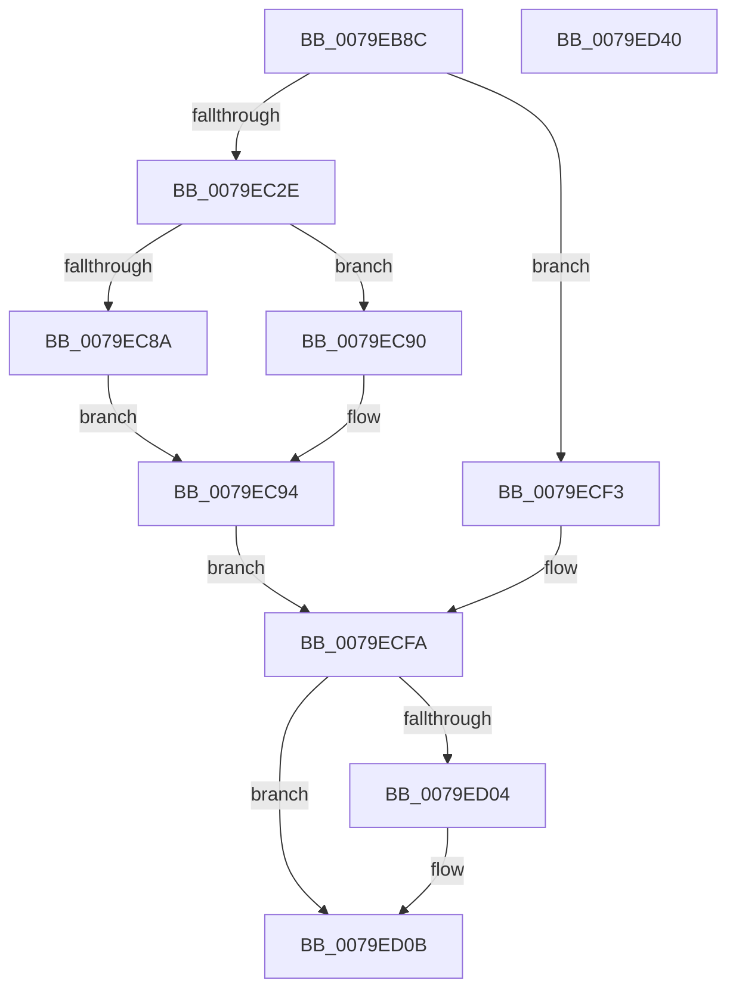

# SeAuditSystemTimeChange

- RVA: `0x0079EB8C`–`0x0079ED41` (길이 `437` bytes)
- VA: `0x000000014079EB8C`
- 실행 섹션: `PAGE`
- PDB 이름 있음: `예`; PDB Function 태그: `아니요`
- unwind 정보 RVA: `0x000D11B0`
- 디코드: `104`개 명령, `437/437` bytes 표시
- 미해석 바이트: `0` (있으면 어셈블리에 `.byte`로 보존)

> 이 문서는 커널 이미지의 기계어와 PDB 기호를 분석해 생성했습니다. 4번과 5번은 함수 원형과 자료형을 바이너리 사용 방식에서 추정한 C 해석이며 원본 소스 복구 결과는 아닙니다.

## 1. Dependencies

- 직접 호출 지점: **9**; 고유 호출 대상: **9**
- 직접 호출자로 확인된 함수: **1**
- RIP 상대 이미지 참조: **2**

### Outgoing calls
- `0x0079EBDC` → [SeCaptureSubjectContext](../86/SeCaptureSubjectContext_function_0086B820.md) (function, `0x0086B820`)
- `0x0079EBFF` → [PsGetCurrentThreadProcess](../../text/47/PsGetCurrentThreadProcess_function_0047C7E0.md) (function, `0x0047C7E0`)
- `0x0079EC14` → [memset](../../text/6C/memset_function_006C6C40.md) (function, `0x006C6C40`)
- `0x0079EC21` → [PsGetAllocatedFullProcessImageNameEx](../91/PsGetAllocatedFullProcessImageNameEx_function_0091D6F0.md) (function, `0x0091D6F0`)
- `0x0079ECEC` → [SepAdtLogAuditRecord](../../text/22/SepAdtLogAuditRecord_function_00224B6C.md) (function, `0x00224B6C`)
- `0x0079ECF5` → [SepAuditFailed](../86/SepAuditFailed_function_0086EE20.md) (function, `0x0086EE20`)
- `0x0079ED06` → [ExFreePoolWithTag](../../poolcode/B8/ExFreePoolWithTag_function_00B82870.md) (function, `0x00B82870`)
- `0x0079ED10` → [SeReleaseSubjectContext](../86/SeReleaseSubjectContext_function_0086B710.md) (function, `0x0086B710`)
- `0x0079ED1F` → [_security_check_cookie](../../text/6A/_security_check_cookie_function_006AC640.md) (function, `0x006AC640`)

### Direct callers
- [NtSetSystemTime](../7C/NtSetSystemTime_function_007C65F0.md) at `0x007C6747`

### Static image references
- `0x0079EBAD` → RVA `0x00E0A740` (`.data`; read)
- `0x0079EC5F` → RVA `0x000013A8` (`.rdata`; read)

## 2. Other-region calls and transfers

- 다른 실행 섹션으로 향하는 call: **5**
  - `0x0079EBFF` → [PsGetCurrentThreadProcess](../../text/47/PsGetCurrentThreadProcess_function_0047C7E0.md) (`PAGE` → `.text`)
  - `0x0079EC14` → [memset](../../text/6C/memset_function_006C6C40.md) (`PAGE` → `.text`)
  - `0x0079ECEC` → [SepAdtLogAuditRecord](../../text/22/SepAdtLogAuditRecord_function_00224B6C.md) (`PAGE` → `.text`)
  - `0x0079ED06` → [ExFreePoolWithTag](../../poolcode/B8/ExFreePoolWithTag_function_00B82870.md) (`PAGE` → `POOLCODE`)
  - `0x0079ED1F` → [_security_check_cookie](../../text/6A/_security_check_cookie_function_006AC640.md) (`PAGE` → `.text`)
- 별도 외부 분기/꼬리 이동을 확인하지 못했습니다.

## 3. Assembly (complete function range)

```asm
0079EB8C  48 89 5C 24 18                  mov qword ptr [rsp + 0x18], rbx
0079EB91  48 89 74 24 20                  mov qword ptr [rsp + 0x20], rsi
0079EB96  55                              push rbp
0079EB97  57                              push rdi
0079EB98  41 55                           push r13
0079EB9A  41 56                           push r14
0079EB9C  41 57                           push r15
0079EB9E  48 8D AC 24 80 FC FF FF         lea rbp, [rsp - 0x380]
0079EBA6  48 81 EC 80 04 00 00            sub rsp, 0x480
0079EBAD  48 8B 05 8C BB 66 00            mov rax, qword ptr [rip + 0x66bb8c]
0079EBB4  48 33 C4                        xor rax, rsp
0079EBB7  48 89 85 70 03 00 00            mov qword ptr [rbp + 0x370], rax
0079EBBE  48 83 64 24 20 00               and qword ptr [rsp + 0x20], 0
0079EBC4  0F 57 C0                        xorps xmm0, xmm0
0079EBC7  48 8B D9                        mov rbx, rcx
0079EBCA  48 8B FA                        mov rdi, rdx
0079EBCD  48 8D 4C 24 28                  lea rcx, [rsp + 0x28]
0079EBD2  0F 11 44 24 28                  movups xmmword ptr [rsp + 0x28], xmm0
0079EBD7  0F 11 44 24 38                  movups xmmword ptr [rsp + 0x38], xmm0
0079EBDC  E8 3F CC 0C 00                  call 0x14086b820
0079EBE1  48 8B 74 24 28                  mov rsi, qword ptr [rsp + 0x28]
0079EBE6  4C 8B 7C 24 38                  mov r15, qword ptr [rsp + 0x38]
0079EBEB  48 85 F6                        test rsi, rsi
0079EBEE  49 8B C7                        mov rax, r15
0079EBF1  48 0F 45 C6                     cmovne rax, rsi
0079EBF5  48 8B 80 98 00 00 00            mov rax, qword ptr [rax + 0x98]
0079EBFC  4C 8B 30                        mov r14, qword ptr [rax]
0079EBFF  E8 DC DB CD FF                  call 0x14047c7e0
0079EC04  33 D2                           xor edx, edx
0079EC06  48 8D 4C 24 50                  lea rcx, [rsp + 0x50]
0079EC0B  41 B8 18 04 00 00               mov r8d, 0x418
0079EC11  4C 8B E8                        mov r13, rax
0079EC14  E8 27 80 F2 FF                  call 0x1406c6c40
0079EC19  48 8D 54 24 20                  lea rdx, [rsp + 0x20]
0079EC1E  49 8B CD                        mov rcx, r13
0079EC21  E8 CA EA 17 00                  call 0x14091d6f0
0079EC26  85 C0                           test eax, eax
0079EC28  0F 88 C5 00 00 00               js 0x14079ecf3
0079EC2E  41 0F B6 46 01                  movzx eax, byte ptr [r14 + 1]
0079EC33  B9 01 00 00 00                  mov ecx, 1
0079EC38  89 4C 24 50                     mov dword ptr [rsp + 0x50], ecx
0079EC3C  C7 44 24 54 08 12 00 00         mov dword ptr [rsp + 0x54], 0x1208
0079EC44  C7 44 24 60 64 00 08 00         mov dword ptr [rsp + 0x60], 0x80064
0079EC4C  C7 44 24 68 04 00 00 00         mov dword ptr [rsp + 0x68], 4
0079EC54  8D 04 85 08 00 00 00            lea eax, [rax*4 + 8]
0079EC5B  89 44 24 6C                     mov dword ptr [rsp + 0x6c], eax
0079EC5F  48 8D 05 42 27 86 FF            lea rax, [rip - 0x79d8be]
0079EC66  48 89 45 A0                     mov qword ptr [rbp - 0x60], rax
0079EC6A  8D 51 07                        lea edx, [rcx + 7]
0079EC6D  4C 89 75 80                     mov qword ptr [rbp - 0x80], r14
0079EC71  89 4D 88                        mov dword ptr [rbp - 0x78], ecx
0079EC74  C7 45 8C 20 00 00 00            mov dword ptr [rbp - 0x74], 0x20
0079EC7B  C7 45 A8 05 00 00 00            mov dword ptr [rbp - 0x58], 5
0079EC82  89 55 AC                        mov dword ptr [rbp - 0x54], edx
0079EC85  48 85 F6                        test rsi, rsi
0079EC88  74 06                           je 0x14079ec90
0079EC8A  48 8B 46 18                     mov rax, qword ptr [rsi + 0x18]
0079EC8E  EB 04                           jmp 0x14079ec94
0079EC90  49 8B 47 18                     mov rax, qword ptr [r15 + 0x18]
0079EC94  48 8B 4C 24 20                  mov rcx, qword ptr [rsp + 0x20]
0079EC99  48 89 45 B0                     mov qword ptr [rbp - 0x50], rax
0079EC9D  B8 0C 00 00 00                  mov eax, 0xc
0079ECA2  89 45 C8                        mov dword ptr [rbp - 0x38], eax
0079ECA5  89 45 E8                        mov dword ptr [rbp - 0x18], eax
0079ECA8  49 8B 85 D0 01 00 00            mov rax, qword ptr [r13 + 0x1d0]
0079ECAF  48 89 45 10                     mov qword ptr [rbp + 0x10], rax
0079ECB3  0F B7 01                        movzx eax, word ptr [rcx]
0079ECB6  83 C0 10                        add eax, 0x10
0079ECB9  48 89 4D 40                     mov qword ptr [rbp + 0x40], rcx
0079ECBD  48 8D 4C 24 50                  lea rcx, [rsp + 0x50]
0079ECC2  89 45 2C                        mov dword ptr [rbp + 0x2c], eax
0079ECC5  89 55 CC                        mov dword ptr [rbp - 0x34], edx
0079ECC8  48 89 5D D0                     mov qword ptr [rbp - 0x30], rbx
0079ECCC  89 55 EC                        mov dword ptr [rbp - 0x14], edx
0079ECCF  48 89 7D F0                     mov qword ptr [rbp - 0x10], rdi
0079ECD3  C7 45 08 0B 00 00 00            mov dword ptr [rbp + 8], 0xb
0079ECDA  89 55 0C                        mov dword ptr [rbp + 0xc], edx
0079ECDD  C7 45 28 02 00 00 00            mov dword ptr [rbp + 0x28], 2
0079ECE4  C7 44 24 58 07 00 00 00         mov dword ptr [rsp + 0x58], 7
0079ECEC  E8 7B 5E A8 FF                  call 0x140224b6c
0079ECF1  EB 07                           jmp 0x14079ecfa
0079ECF3  8B C8                           mov ecx, eax
0079ECF5  E8 26 01 0D 00                  call 0x14086ee20
0079ECFA  48 8B 4C 24 20                  mov rcx, qword ptr [rsp + 0x20]
0079ECFF  48 85 C9                        test rcx, rcx
0079ED02  74 07                           je 0x14079ed0b
0079ED04  33 D2                           xor edx, edx
0079ED06  E8 65 3B 3E 00                  call 0x140b82870
0079ED0B  48 8D 4C 24 28                  lea rcx, [rsp + 0x28]
0079ED10  E8 FB C9 0C 00                  call 0x14086b710
0079ED15  48 8B 8D 70 03 00 00            mov rcx, qword ptr [rbp + 0x370]
0079ED1C  48 33 CC                        xor rcx, rsp
0079ED1F  E8 1C D9 F0 FF                  call 0x1406ac640
0079ED24  4C 8D 9C 24 80 04 00 00         lea r11, [rsp + 0x480]
0079ED2C  49 8B 5B 40                     mov rbx, qword ptr [r11 + 0x40]
0079ED30  49 8B 73 48                     mov rsi, qword ptr [r11 + 0x48]
0079ED34  49 8B E3                        mov rsp, r11
0079ED37  41 5F                           pop r15
0079ED39  41 5E                           pop r14
0079ED3B  41 5D                           pop r13
0079ED3D  5F                              pop rdi
0079ED3E  5D                              pop rbp
0079ED3F  C3                              ret
0079ED40  CC                              int3
```

## 4. C-style interpretation (structured pseudocode)

```c
__int64 __fastcall SeAuditSystemTimeChange(__int64 a1, __int64 a2)
{
    __int64 result;
    __int64 v_rsp;
    unsigned __int64 v_stack_m28;
    unsigned __int64 v_stack_m368;
    unsigned int v_stack_m37C;
    unsigned __int64 v_stack_m38;
    unsigned int v_stack_m380;
    unsigned __int64 v_stack_m398;
    unsigned int v_stack_m39C;
    unsigned int v_stack_m3A0;
    unsigned __int64 v_stack_m3A8;
    unsigned __int64 v_stack_m3B8;
    unsigned int v_stack_m3BC;
    unsigned int v_stack_m3C0;
    unsigned __int64 v_stack_m3D8;
    unsigned int v_stack_m3DC;
    unsigned int v_stack_m3E0;
    unsigned __int64 v_stack_m3F8;
    unsigned int v_stack_m3FC;
    unsigned int v_stack_m400;
    unsigned __int64 v_stack_m408;
    unsigned int v_stack_m41C;
    unsigned int v_stack_m420;
    unsigned __int64 v_stack_m428;
    unsigned int v_stack_m43C;
    unsigned int v_stack_m440;
    unsigned int v_stack_m448;
    unsigned int v_stack_m450;
    unsigned int v_stack_m454;
    unsigned __int64 v_stack_m458;
    unsigned __int64 v_stack_m470;
    unsigned __int64 v_stack_m480;
    unsigned __int64 v_stack_m488;
    unsigned __int64 v_stack_p18;
    unsigned __int64 v_stack_p20;

    v_stack_p18 = v_rbx;
    v_stack_p20 = v_rsi;
    v_rsp = (v_rsp) - (0x480ULL);
    result = (*(unsigned __int64 *)(v_rip + 6732684)) ^ (v_rsp);
    v_stack_m38 = result;
    v_stack_m480 = v_xmm0;
    v_stack_m470 = v_xmm0;
    result = SeCaptureSubjectContext(v_stack_m480, a2, a3, a4);
    result = v_stack_m470;
    if (v_stack_m480 != 0) { result = v_stack_m480; }
    result = PsGetCurrentThreadProcess(v_stack_m480, a2, a3, a4);
    a2 = 0;
    result = memset(v_stack_m458, a2, (unsigned int)(0x418ULL), a4);
    result = PsGetAllocatedFullProcessImageNameEx(result, v_stack_m488, (unsigned int)(0x418ULL), a4);
    if (sign_flag) goto loc_0079ECF3;
    v_stack_m458 = 1;
    v_stack_m454 = 0x1208ULL;
    v_stack_m448 = 0x80064ULL;
    v_stack_m440 = 4;
    v_stack_m43C = (unsigned int)(*(unsigned __int8 *)(*(unsigned __int64 *)(*(unsigned __int64 *)(result + 152)) + 1) * 4 + 8);
    v_stack_m408 = v_rip - 7985342;
    v_stack_m428 = *(unsigned __int64 *)(*(unsigned __int64 *)(result + 152));
    v_stack_m420 = 1;
    v_stack_m41C = 32;
    v_stack_m400 = 5;
    v_stack_m3FC = (unsigned int)(1 + 7);
    if (v_stack_m480 == 0) goto loc_0079EC90;
    goto loc_0079EC94;
loc_0079EC90:
loc_0079EC94:
    v_stack_m3F8 = *(unsigned __int64 *)(v_stack_m470 + 24);
    v_stack_m3E0 = 12;
    v_stack_m3C0 = 12;
    v_stack_m398 = *(unsigned __int64 *)(result + 464);
    result = (unsigned int)((*(unsigned __int16 *)(v_stack_m488)) + (16));
    v_stack_m368 = v_stack_m488;
    v_stack_m37C = (unsigned int)(result);
    v_stack_m3DC = (unsigned int)(1 + 7);
    v_stack_m3D8 = a1;
    v_stack_m3BC = (unsigned int)(1 + 7);
    v_stack_m3B8 = 0;
    v_stack_m3A0 = 11;
    v_stack_m39C = (unsigned int)(1 + 7);
    v_stack_m380 = 2;
    v_stack_m450 = 7;
    result = SepAdtLogAuditRecord(v_stack_m458, 1 + 7, (unsigned int)(0x418ULL), a4);
    goto loc_0079ECFA;
loc_0079ECF3:
    result = SepAuditFailed((unsigned int)((unsigned int)(result)), 1 + 7, (unsigned int)(0x418ULL), a4);
loc_0079ECFA:
    if (v_stack_m488 != 0) {
        a2 = 0;
        result = ExFreePoolWithTag(v_stack_m488, a2, (unsigned int)(0x418ULL), a4);
    }
    result = SeReleaseSubjectContext(v_stack_m480, a2, (unsigned int)(0x418ULL), a4);
    a1 = (v_stack_m38) ^ (v_rsp);
    result = _security_check_cookie(a1, a2, (unsigned int)(0x418ULL), a4);
    return result;
}
```

## 5. (Beta) C Style

```c
int64_t SeAuditSystemTimeChange(int64_t Arg1, int64_t Arg2)
{
    int64_t result;
    int64_t local_rsp;
    uint64_t v_stack_m28;
    uint64_t v_stack_m368;
    uint32_t v_stack_m37C;
    uint64_t v_stack_m38;
    uint32_t v_stack_m380;
    uint64_t v_stack_m398;
    uint32_t v_stack_m39C;
    uint32_t v_stack_m3A0;
    uint64_t v_stack_m3A8;
    uint64_t v_stack_m3B8;
    uint32_t v_stack_m3BC;
    uint32_t v_stack_m3C0;
    uint64_t v_stack_m3D8;
    uint32_t v_stack_m3DC;
    uint32_t v_stack_m3E0;
    uint64_t v_stack_m3F8;
    uint32_t v_stack_m3FC;
    uint32_t v_stack_m400;
    uint64_t v_stack_m408;
    uint32_t v_stack_m41C;
    uint32_t v_stack_m420;
    uint64_t v_stack_m428;
    uint32_t v_stack_m43C;
    uint32_t v_stack_m440;
    uint32_t v_stack_m448;
    uint32_t v_stack_m450;
    uint32_t v_stack_m454;
    uint64_t v_stack_m458;
    uint64_t v_stack_m470;
    uint64_t v_stack_m480;
    uint64_t v_stack_m488;
    uint64_t v_stack_p18;
    uint64_t v_stack_p20;

    v_stack_p18 = local_rbx;
    v_stack_p20 = local_rsi;
    local_rsp = (local_rsp) - (0x480ULL);
    result = (*(uint64_t *)(v_rip + 0x66BB8C)) ^ (local_rsp);
    v_stack_m38 = result;
    v_stack_m480 = v_xmm0;
    v_stack_m470 = v_xmm0;
    result = SeCaptureSubjectContext(v_stack_m480, Arg2, a3, a4);
    result = v_stack_m470;
    if (v_stack_m480 != 0) { result = v_stack_m480; }
    result = PsGetCurrentThreadProcess(v_stack_m480, Arg2, a3, a4);
    Arg2 = 0;
    result = memset(v_stack_m458, Arg2, (uint32_t)(0x418ULL), a4);
    result = PsGetAllocatedFullProcessImageNameEx(result, v_stack_m488, (uint32_t)(0x418ULL), a4);
    if (sign_flag) goto loc_0079ECF3;
    v_stack_m458 = 1;
    v_stack_m454 = 0x1208ULL;
    v_stack_m448 = 0x80064ULL;
    v_stack_m440 = 4;
    v_stack_m43C = (uint32_t)(*(uint8_t *)(*(uint64_t *)(*(uint64_t *)(result + 0x98)) + 0x1) * 4 + 8);
    v_stack_m408 = v_rip - 7985342;
    v_stack_m428 = *(uint64_t *)(*(uint64_t *)(result + 0x98));
    v_stack_m420 = 1;
    v_stack_m41C = 32;
    v_stack_m400 = 5;
    v_stack_m3FC = (uint32_t)(1 + 7);
    if (v_stack_m480 == 0) goto loc_0079EC90;
    goto loc_0079EC94;
loc_0079EC90:
loc_0079EC94:
    v_stack_m3F8 = *(uint64_t *)(v_stack_m470 + 0x18);
    v_stack_m3E0 = 12;
    v_stack_m3C0 = 12;
    v_stack_m398 = *(uint64_t *)(result + 0x1D0);
    result = (uint32_t)((*(uint16_t *)(v_stack_m488)) + (16));
    v_stack_m368 = v_stack_m488;
    v_stack_m37C = (uint32_t)(result);
    v_stack_m3DC = (uint32_t)(1 + 7);
    v_stack_m3D8 = Arg1;
    v_stack_m3BC = (uint32_t)(1 + 7);
    v_stack_m3B8 = 0;
    v_stack_m3A0 = 11;
    v_stack_m39C = (uint32_t)(1 + 7);
    v_stack_m380 = 2;
    v_stack_m450 = 7;
    result = SepAdtLogAuditRecord(v_stack_m458, 1 + 7, (uint32_t)(0x418ULL), a4);
    goto loc_0079ECFA;
loc_0079ECF3:
    result = SepAuditFailed((uint32_t)((uint32_t)(result)), 1 + 7, (uint32_t)(0x418ULL), a4);
loc_0079ECFA:
    if (v_stack_m488 != 0) {
        Arg2 = 0;
        result = ExFreePoolWithTag(v_stack_m488, Arg2, (uint32_t)(0x418ULL), a4);
    }
    result = SeReleaseSubjectContext(v_stack_m480, Arg2, (uint32_t)(0x418ULL), a4);
    Arg1 = (v_stack_m38) ^ (local_rsp);
    result = _security_check_cookie(Arg1, Arg2, (uint32_t)(0x418ULL), a4);
    return result;
}
```

## 6. Execution-region graph

[열기: 2D/3D 그래프와 함수 탐색 컨트롤 패널](../../../control-panel.html?section=page&rva=0x0079EB8C&view=graph)

- 2D 그래프는 위에서 아래로 흐르고, 3D 그래프는 빈 공간을 드래그해 회전합니다. Shift+드래그는 이동, 휠은 확대·축소, 함수 노드 선택은 대상 보고서 이동입니다.

### Static fallback


