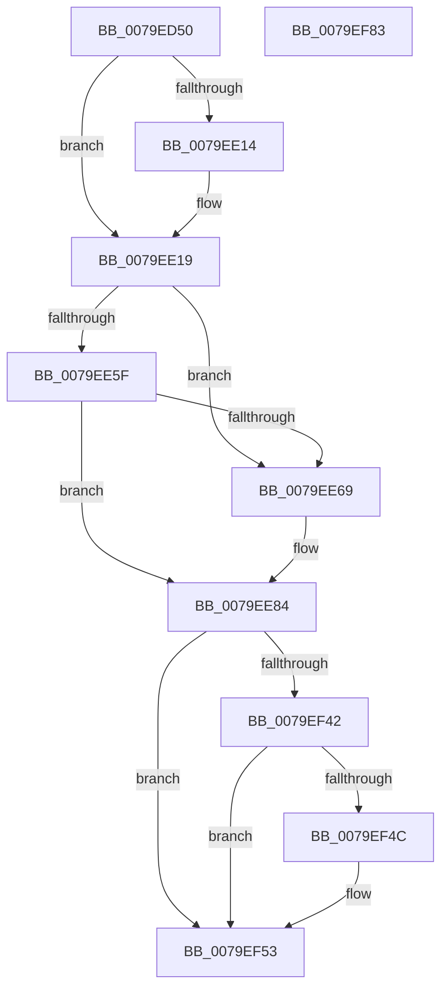

# SeAuditTransactionStateChange

- RVA: `0x0079ED50`–`0x0079EF84` (길이 `564` bytes)
- VA: `0x000000014079ED50`
- 실행 섹션: `PAGE`
- PDB 이름 있음: `예`; PDB Function 태그: `아니요`
- unwind 정보 RVA: `0x000D115C`
- 디코드: `132`개 명령, `564/564` bytes 표시
- 미해석 바이트: `0` (있으면 어셈블리에 `.byte`로 보존)

> 이 문서는 커널 이미지의 기계어와 PDB 기호를 분석해 생성했습니다. 4번과 5번은 함수 원형과 자료형을 바이너리 사용 방식에서 추정한 C 해석이며 원본 소스 복구 결과는 아닙니다.

## 1. Dependencies

- 직접 호출 지점: **10**; 고유 호출 대상: **9**
- 직접 호출자로 확인된 함수: **0**
- RIP 상대 이미지 참조: **3**

### Outgoing calls
- `0x0079EDBA` → [memset](../../text/6C/memset_function_006C6C40.md) (function, `0x006C6C40`)
- `0x0079EE1E` → [SeCaptureSubjectContext](../86/SeCaptureSubjectContext_function_0086B820.md) (function, `0x0086B820`)
- `0x0079EE49` → [PsGetCurrentThreadProcess](../../text/47/PsGetCurrentThreadProcess_function_0047C7E0.md) (function, `0x0047C7E0`)
- `0x0079EE56` → [PsGetAllocatedFullProcessImageNameEx](../91/PsGetAllocatedFullProcessImageNameEx_function_0091D6F0.md) (function, `0x0091D6F0`)
- `0x0079EE75` → [RtlInitUnicodeString](../../text/42/RtlInitUnicodeString_function_0042A780.md) (function, `0x0042A780`)
- `0x0079EEFC` → [PsGetCurrentThreadProcess](../../text/47/PsGetCurrentThreadProcess_function_0047C7E0.md) (function, `0x0047C7E0`)
- `0x0079EF29` → [SepAdtLogAuditRecord](../../text/22/SepAdtLogAuditRecord_function_00224B6C.md) (function, `0x00224B6C`)
- `0x0079EF33` → [SeReleaseSubjectContext](../86/SeReleaseSubjectContext_function_0086B710.md) (function, `0x0086B710`)
- `0x0079EF4E` → [ExFreePoolWithTag](../../poolcode/B8/ExFreePoolWithTag_function_00B82870.md) (function, `0x00B82870`)
- `0x0079EF5D` → [_security_check_cookie](../../text/6A/_security_check_cookie_function_006AC640.md) (function, `0x006AC640`)

### Direct callers
- 이 함수 시작 RVA로 연결되는 직접 call은 확인되지 않았습니다. 간접 호출은 완전히 역산할 수 없습니다.

### Static image references
- `0x0079ED76` → RVA `0x00E0A740` (`.data`; read)
- `0x0079EE69` → RVA `0x00B00250` (` ?? ::NNGAKEGL::`string'`; read)
- `0x0079EEB9` → RVA `0x000013A8` (`.rdata`; read)

## 2. Other-region calls and transfers

- 다른 실행 섹션으로 향하는 call: **7**
  - `0x0079EDBA` → [memset](../../text/6C/memset_function_006C6C40.md) (`PAGE` → `.text`)
  - `0x0079EE49` → [PsGetCurrentThreadProcess](../../text/47/PsGetCurrentThreadProcess_function_0047C7E0.md) (`PAGE` → `.text`)
  - `0x0079EE75` → [RtlInitUnicodeString](../../text/42/RtlInitUnicodeString_function_0042A780.md) (`PAGE` → `.text`)
  - `0x0079EEFC` → [PsGetCurrentThreadProcess](../../text/47/PsGetCurrentThreadProcess_function_0047C7E0.md) (`PAGE` → `.text`)
  - `0x0079EF29` → [SepAdtLogAuditRecord](../../text/22/SepAdtLogAuditRecord_function_00224B6C.md) (`PAGE` → `.text`)
  - `0x0079EF4E` → [ExFreePoolWithTag](../../poolcode/B8/ExFreePoolWithTag_function_00B82870.md) (`PAGE` → `POOLCODE`)
  - `0x0079EF5D` → [_security_check_cookie](../../text/6A/_security_check_cookie_function_006AC640.md) (`PAGE` → `.text`)
- 별도 외부 분기/꼬리 이동을 확인하지 못했습니다.

## 3. Assembly (complete function range)

```asm
0079ED50  48 8B C4                        mov rax, rsp
0079ED53  48 89 58 08                     mov qword ptr [rax + 8], rbx
0079ED57  48 89 70 10                     mov qword ptr [rax + 0x10], rsi
0079ED5B  48 89 78 18                     mov qword ptr [rax + 0x18], rdi
0079ED5F  55                              push rbp
0079ED60  41 54                           push r12
0079ED62  41 55                           push r13
0079ED64  41 56                           push r14
0079ED66  41 57                           push r15
0079ED68  48 8D A8 38 FC FF FF            lea rbp, [rax - 0x3c8]
0079ED6F  48 81 EC A0 04 00 00            sub rsp, 0x4a0
0079ED76  48 8B 05 C3 B9 66 00            mov rax, qword ptr [rip + 0x66b9c3]
0079ED7D  48 33 C4                        xor rax, rsp
0079ED80  48 89 85 90 03 00 00            mov qword ptr [rbp + 0x390], rax
0079ED87  48 83 64 24 38 00               and qword ptr [rsp + 0x38], 0
0079ED8D  48 8B DA                        mov rbx, rdx
0079ED90  45 8B F8                        mov r15d, r8d
0079ED93  4C 8B E1                        mov r12, rcx
0079ED96  33 C0                           xor eax, eax
0079ED98  C7 44 24 40 00 00 00 80         mov dword ptr [rsp + 0x40], 0x80000000
0079EDA0  0F 57 C0                        xorps xmm0, xmm0
0079EDA3  89 44 24 44                     mov dword ptr [rsp + 0x44], eax
0079EDA7  33 D2                           xor edx, edx
0079EDA9  48 8D 4C 24 60                  lea rcx, [rsp + 0x60]
0079EDAE  41 B8 18 04 00 00               mov r8d, 0x418
0079EDB4  F3 0F 7F 44 24 48               movdqu xmmword ptr [rsp + 0x48], xmm0
0079EDBA  E8 81 7E F2 FF                  call 0x1406c6c40
0079EDBF  48 83 64 24 20 00               and qword ptr [rsp + 0x20], 0
0079EDC5  48 8D B5 80 03 00 00            lea rsi, [rbp + 0x380]
0079EDCC  B8 75 00 00 00                  mov eax, 0x75
0079EDD1  C7 44 24 60 03 00 00 00         mov dword ptr [rsp + 0x60], 3
0079EDD9  48 85 DB                        test rbx, rbx
0079EDDC  66 89 44 24 70                  mov word ptr [rsp + 0x70], ax
0079EDE1  B8 10 00 00 00                  mov eax, 0x10
0079EDE6  C7 44 24 64 79 13 00 00         mov dword ptr [rsp + 0x64], 0x1379
0079EDEE  0F 57 C0                        xorps xmm0, xmm0
0079EDF1  0F 57 C9                        xorps xmm1, xmm1
0079EDF4  48 0F 45 F3                     cmovne rsi, rbx
0079EDF8  0F 11 85 80 03 00 00            movups xmmword ptr [rbp + 0x380], xmm0
0079EDFF  44 8D 68 F8                     lea r13d, [rax - 8]
0079EE03  66 44 89 6C 24 72               mov word ptr [rsp + 0x72], r13w
0079EE09  0F 11 4C 24 28                  movups xmmword ptr [rsp + 0x28], xmm1
0079EE0E  41 83 FF 06                     cmp r15d, 6
0079EE12  75 05                           jne 0x14079ee19
0079EE14  66 89 44 24 72                  mov word ptr [rsp + 0x72], ax
0079EE19  48 8D 4C 24 38                  lea rcx, [rsp + 0x38]
0079EE1E  E8 FD C9 0C 00                  call 0x14086b820
0079EE23  48 8B 4C 24 38                  mov rcx, qword ptr [rsp + 0x38]
0079EE28  48 8B 5C 24 48                  mov rbx, qword ptr [rsp + 0x48]
0079EE2D  48 85 C9                        test rcx, rcx
0079EE30  48 8B C3                        mov rax, rbx
0079EE33  48 0F 45 C1                     cmovne rax, rcx
0079EE37  48 0F 45 D9                     cmovne rbx, rcx
0079EE3B  48 8B 80 98 00 00 00            mov rax, qword ptr [rax + 0x98]
0079EE42  48 8B 5B 18                     mov rbx, qword ptr [rbx + 0x18]
0079EE46  4C 8B 30                        mov r14, qword ptr [rax]
0079EE49  E8 92 D9 CD FF                  call 0x14047c7e0
0079EE4E  48 8D 54 24 20                  lea rdx, [rsp + 0x20]
0079EE53  48 8B C8                        mov rcx, rax
0079EE56  E8 95 E8 17 00                  call 0x14091d6f0
0079EE5B  85 C0                           test eax, eax
0079EE5D  78 0A                           js 0x14079ee69
0079EE5F  48 8B 7C 24 20                  mov rdi, qword ptr [rsp + 0x20]
0079EE64  48 85 FF                        test rdi, rdi
0079EE67  75 1B                           jne 0x14079ee84
0079EE69  48 8D 15 E0 13 36 00            lea rdx, [rip + 0x3613e0]
0079EE70  48 8D 4C 24 28                  lea rcx, [rsp + 0x28]
0079EE75  E8 06 B9 C8 FF                  call 0x14042a780
0079EE7A  48 8D 7C 24 28                  lea rdi, [rsp + 0x28]
0079EE7F  48 89 7C 24 20                  mov qword ptr [rsp + 0x20], rdi
0079EE84  41 0F B6 46 01                  movzx eax, byte ptr [r14 + 1]
0079EE89  BA 04 00 00 00                  mov edx, 4
0079EE8E  48 89 5D C0                     mov qword ptr [rbp - 0x40], rbx
0079EE92  89 54 24 78                     mov dword ptr [rsp + 0x78], edx
0079EE96  4C 89 75 90                     mov qword ptr [rbp - 0x70], r14
0079EE9A  8D 04 85 08 00 00 00            lea eax, [rax*4 + 8]
0079EEA1  C7 45 98 01 00 00 00            mov dword ptr [rbp - 0x68], 1
0079EEA8  8D 4A 09                        lea ecx, [rdx + 9]
0079EEAB  89 44 24 7C                     mov dword ptr [rsp + 0x7c], eax
0079EEAF  8D 5A 0C                        lea ebx, [rdx + 0xc]
0079EEB2  C7 45 9C 20 00 00 00            mov dword ptr [rbp - 0x64], 0x20
0079EEB9  48 8D 05 E8 24 86 FF            lea rax, [rip - 0x79db18]
0079EEC0  C7 45 B8 05 00 00 00            mov dword ptr [rbp - 0x48], 5
0079EEC7  48 89 45 B0                     mov qword ptr [rbp - 0x50], rax
0079EECB  44 89 6D BC                     mov dword ptr [rbp - 0x44], r13d
0079EECF  89 4D D8                        mov dword ptr [rbp - 0x28], ecx
0079EED2  89 5D DC                        mov dword ptr [rbp - 0x24], ebx
0079EED5  4C 89 65 F0                     mov qword ptr [rbp - 0x10], r12
0079EED9  C7 45 F8 03 00 00 00            mov dword ptr [rbp - 8], 3
0079EEE0  89 55 FC                        mov dword ptr [rbp - 4], edx
0079EEE3  4C 89 7D 00                     mov qword ptr [rbp], r15
0079EEE7  89 4D 18                        mov dword ptr [rbp + 0x18], ecx
0079EEEA  89 5D 1C                        mov dword ptr [rbp + 0x1c], ebx
0079EEED  48 89 75 30                     mov qword ptr [rbp + 0x30], rsi
0079EEF1  C7 45 38 0B 00 00 00            mov dword ptr [rbp + 0x38], 0xb
0079EEF8  44 89 6D 3C                     mov dword ptr [rbp + 0x3c], r13d
0079EEFC  E8 DF D8 CD FF                  call 0x14047c7e0
0079EF01  C7 45 58 02 00 00 00            mov dword ptr [rbp + 0x58], 2
0079EF08  48 89 7D 70                     mov qword ptr [rbp + 0x70], rdi
0079EF0C  44 89 6C 24 68                  mov dword ptr [rsp + 0x68], r13d
0079EF11  48 8B 88 D0 01 00 00            mov rcx, qword ptr [rax + 0x1d0]
0079EF18  0F B7 07                        movzx eax, word ptr [rdi]
0079EF1B  03 C3                           add eax, ebx
0079EF1D  48 89 4D 40                     mov qword ptr [rbp + 0x40], rcx
0079EF21  48 8D 4C 24 60                  lea rcx, [rsp + 0x60]
0079EF26  89 45 5C                        mov dword ptr [rbp + 0x5c], eax
0079EF29  E8 3E 5C A8 FF                  call 0x140224b6c
0079EF2E  48 8D 4C 24 38                  lea rcx, [rsp + 0x38]
0079EF33  E8 D8 C7 0C 00                  call 0x14086b710
0079EF38  48 8B 4C 24 20                  mov rcx, qword ptr [rsp + 0x20]
0079EF3D  48 85 C9                        test rcx, rcx
0079EF40  74 11                           je 0x14079ef53
0079EF42  48 8D 44 24 28                  lea rax, [rsp + 0x28]
0079EF47  48 3B C8                        cmp rcx, rax
0079EF4A  74 07                           je 0x14079ef53
0079EF4C  33 D2                           xor edx, edx
0079EF4E  E8 1D 39 3E 00                  call 0x140b82870
0079EF53  48 8B 8D 90 03 00 00            mov rcx, qword ptr [rbp + 0x390]
0079EF5A  48 33 CC                        xor rcx, rsp
0079EF5D  E8 DE D6 F0 FF                  call 0x1406ac640
0079EF62  4C 8D 9C 24 A0 04 00 00         lea r11, [rsp + 0x4a0]
0079EF6A  49 8B 5B 30                     mov rbx, qword ptr [r11 + 0x30]
0079EF6E  49 8B 73 38                     mov rsi, qword ptr [r11 + 0x38]
0079EF72  49 8B 7B 40                     mov rdi, qword ptr [r11 + 0x40]
0079EF76  49 8B E3                        mov rsp, r11
0079EF79  41 5F                           pop r15
0079EF7B  41 5E                           pop r14
0079EF7D  41 5D                           pop r13
0079EF7F  41 5C                           pop r12
0079EF81  5D                              pop rbp
0079EF82  C3                              ret
0079EF83  CC                              int3
```

## 4. C-style interpretation (structured pseudocode)

```c
__int64 __fastcall SeAuditTransactionStateChange(__int64 a1, __int64 a2, int a3)
{
    __int64 result;
    __int64 v_rbx;
    __int64 v_rdi;
    __int64 v_rsi;
    __int64 v_rsp;
    unsigned __int64 v_stack_m28;
    unsigned int v_stack_m44C;
    unsigned int v_stack_m450;
    unsigned __int16 v_stack_m456;
    unsigned __int16 v_stack_m458;
    unsigned int v_stack_m460;
    unsigned int v_stack_m464;
    unsigned __int64 v_stack_m468;
    unsigned __int64 v_stack_m480;
    unsigned int v_stack_m484;
    unsigned int v_stack_m488;
    unsigned __int64 v_stack_m490;
    unsigned __int64 v_stack_m4A0;
    unsigned __int64 v_stack_m4A8;

    *(unsigned __int64 *)(v_rsp + 8) = v_rbx;
    *(unsigned __int64 *)(v_rsp + 16) = v_rsi;
    *(unsigned __int64 *)(v_rsp + 24) = v_rdi;
    v_rsp = (v_rsp) - (0x4A0ULL);
    result = (*(unsigned __int64 *)(v_rip + 6732227)) ^ (v_rsp);
    *(unsigned __int64 *)(v_rsp - 968 + 912) = result;
    result = 0;
    v_stack_m488 = 0x80000000ULL;
    v_stack_m484 = 0;
    a2 = 0;
    v_stack_m480 = v_xmm0;
    result = memset(v_stack_m468, a2, (unsigned int)(0x418ULL), a4);
    v_stack_m468 = 3;
    v_stack_m458 = 117;
    v_stack_m464 = 0x1379ULL;
    v_rsi = v_rsp - 968 + 896;
    if (0 != 0) { v_rsi = 0; }
    *(unsigned __int64 *)(v_rsp - 968 + 896) = v_xmm0;
    v_stack_m456 = (unsigned __int16)(16 - 8);
    v_stack_m4A0 = v_xmm1;
    if (((unsigned int)((unsigned int)(a3))) == 6) {
        v_stack_m456 = 16;
    }
    result = SeCaptureSubjectContext(v_stack_m490, a2, (unsigned int)(0x418ULL), a4);
    result = v_stack_m480;
    if (v_stack_m490 != 0) { result = v_stack_m490; }
    v_rbx = v_stack_m480;
    if (v_stack_m490 != 0) { v_rbx = v_stack_m490; }
    result = PsGetCurrentThreadProcess(v_stack_m490, a2, (unsigned int)(0x418ULL), a4);
    result = PsGetAllocatedFullProcessImageNameEx(result, v_stack_m4A8, (unsigned int)(0x418ULL), a4);
    if (sign_flag) goto loc_0079EE69;
    v_rdi = v_stack_m4A8;
    if (v_stack_m4A8 == 0) {
        a2 = v_rip + 3544032;
        a1 = v_stack_m4A0;
        result = RtlInitUnicodeString(a1, a2, (unsigned int)(0x418ULL), a4);
        v_rdi = v_stack_m4A0;
        v_stack_m4A8 = v_rdi;
    }
    *(unsigned __int64 *)(v_rsp - 968 - 64) = *(unsigned __int64 *)(v_rbx + 24);
    v_stack_m450 = 4;
    *(unsigned __int64 *)(v_rsp - 968 - 112) = *(unsigned __int64 *)(*(unsigned __int64 *)(result + 152));
    *(unsigned int *)(v_rsp - 968 - 104) = 1;
    v_stack_m44C = (unsigned int)(*(unsigned __int8 *)(*(unsigned __int64 *)(*(unsigned __int64 *)(result + 152)) + 1) * 4 + 8);
    *(unsigned int *)(v_rsp - 968 - 100) = 32;
    *(unsigned int *)(v_rsp - 968 - 72) = 5;
    *(unsigned __int64 *)(v_rsp - 968 - 80) = v_rip - 7985944;
    *(unsigned int *)(v_rsp - 968 - 68) = (unsigned int)(16 - 8);
    *(unsigned int *)(v_rsp - 968 - 40) = (unsigned int)(4 + 9);
    *(unsigned int *)(v_rsp - 968 - 36) = (unsigned int)(4 + 12);
    *(unsigned __int64 *)(v_rsp - 968 - 16) = a1;
    *(unsigned int *)(v_rsp - 968 - 8) = 3;
    *(unsigned int *)(v_rsp - 968 - 4) = 4;
    *(unsigned __int64 *)(v_rsp - 968) = (unsigned int)(a3);
    *(unsigned int *)(v_rsp - 968 + 24) = (unsigned int)(4 + 9);
    *(unsigned int *)(v_rsp - 968 + 28) = (unsigned int)(4 + 12);
    *(unsigned __int64 *)(v_rsp - 968 + 48) = v_rsi;
    *(unsigned int *)(v_rsp - 968 + 56) = 11;
    *(unsigned int *)(v_rsp - 968 + 60) = (unsigned int)(16 - 8);
    result = PsGetCurrentThreadProcess(4 + 9, 4, (unsigned int)(0x418ULL), a4);
    *(unsigned int *)(v_rsp - 968 + 88) = 2;
    *(unsigned __int64 *)(v_rsp - 968 + 112) = v_rdi;
    v_stack_m460 = (unsigned int)(16 - 8);
    result = (unsigned int)((*(unsigned __int16 *)(v_rdi)) + ((unsigned int)(4 + 12)));
    *(unsigned __int64 *)(v_rsp - 968 + 64) = *(unsigned __int64 *)(result + 464);
    *(unsigned int *)(v_rsp - 968 + 92) = (unsigned int)(result);
    result = SepAdtLogAuditRecord(v_stack_m468, 4, (unsigned int)(0x418ULL), a4);
    result = SeReleaseSubjectContext(v_stack_m490, 4, (unsigned int)(0x418ULL), a4);
    if (v_stack_m4A8 == 0) goto loc_0079EF53;
    result = v_stack_m4A0;
    if (v_stack_m4A8 != v_stack_m4A0) {
        a2 = 0;
        result = ExFreePoolWithTag(v_stack_m4A8, a2, (unsigned int)(0x418ULL), a4);
    }
    a1 = (*(unsigned __int64 *)(v_rsp - 968 + 912)) ^ (v_rsp);
    result = _security_check_cookie(a1, a2, (unsigned int)(0x418ULL), a4);
    return result;
}
```

## 5. (Beta) C Style

```c
int64_t SeAuditTransactionStateChange(int64_t Arg1, int64_t Arg2, int32_t Arg3)
{
    int64_t result;
    int64_t local_rbx;
    int64_t local_rdi;
    int64_t local_rsi;
    int64_t local_rsp;
    uint64_t v_stack_m28;
    uint32_t v_stack_m44C;
    uint32_t v_stack_m450;
    uint16_t v_stack_m456;
    uint16_t v_stack_m458;
    uint32_t v_stack_m460;
    uint32_t v_stack_m464;
    uint64_t v_stack_m468;
    uint64_t v_stack_m480;
    uint32_t v_stack_m484;
    uint32_t v_stack_m488;
    uint64_t v_stack_m490;
    uint64_t v_stack_m4A0;
    uint64_t v_stack_m4A8;

    *(uint64_t *)(local_rsp + 0x8) = local_rbx;
    *(uint64_t *)(local_rsp + 0x10) = local_rsi;
    *(uint64_t *)(local_rsp + 0x18) = local_rdi;
    local_rsp = (local_rsp) - (0x4A0ULL);
    result = (*(uint64_t *)(v_rip + 0x66B9C3)) ^ (local_rsp);
    *(uint64_t *)(local_rsp - 0x3C8 + 0x390) = result;
    result = 0;
    v_stack_m488 = 0x80000000ULL;
    v_stack_m484 = 0;
    Arg2 = 0;
    v_stack_m480 = v_xmm0;
    result = memset(v_stack_m468, Arg2, (uint32_t)(0x418ULL), a4);
    v_stack_m468 = 3;
    v_stack_m458 = 117;
    v_stack_m464 = 0x1379ULL;
    local_rsi = local_rsp - 968 + 896;
    if (0 != 0) { local_rsi = 0; }
    *(uint64_t *)(local_rsp - 0x3C8 + 0x380) = v_xmm0;
    v_stack_m456 = (uint16_t)(16 - 8);
    v_stack_m4A0 = v_xmm1;
    if (((uint32_t)((uint32_t)(Arg3))) == 6) {
        v_stack_m456 = 16;
    }
    result = SeCaptureSubjectContext(v_stack_m490, Arg2, (uint32_t)(0x418ULL), a4);
    result = v_stack_m480;
    if (v_stack_m490 != 0) { result = v_stack_m490; }
    local_rbx = v_stack_m480;
    if (v_stack_m490 != 0) { local_rbx = v_stack_m490; }
    result = PsGetCurrentThreadProcess(v_stack_m490, Arg2, (uint32_t)(0x418ULL), a4);
    result = PsGetAllocatedFullProcessImageNameEx(result, v_stack_m4A8, (uint32_t)(0x418ULL), a4);
    if (sign_flag) goto loc_0079EE69;
    local_rdi = v_stack_m4A8;
    if (v_stack_m4A8 == 0) {
        Arg2 = v_rip + 3544032;
        Arg1 = v_stack_m4A0;
        result = RtlInitUnicodeString(Arg1, Arg2, (uint32_t)(0x418ULL), a4);
        local_rdi = v_stack_m4A0;
        v_stack_m4A8 = local_rdi;
    }
    *(uint64_t *)(local_rsp - 0x3C8 - 0x40) = *(uint64_t *)(local_rbx + 0x18);
    v_stack_m450 = 4;
    *(uint64_t *)(local_rsp - 0x3C8 - 0x70) = *(uint64_t *)(*(uint64_t *)(result + 0x98));
    *(uint32_t *)(local_rsp - 0x3C8 - 0x68) = 1;
    v_stack_m44C = (uint32_t)(*(uint8_t *)(*(uint64_t *)(*(uint64_t *)(result + 0x98)) + 0x1) * 4 + 8);
    *(uint32_t *)(local_rsp - 0x3C8 - 0x64) = 32;
    *(uint32_t *)(local_rsp - 0x3C8 - 0x48) = 5;
    *(uint64_t *)(local_rsp - 0x3C8 - 0x50) = v_rip - 7985944;
    *(uint32_t *)(local_rsp - 0x3C8 - 0x44) = (uint32_t)(16 - 8);
    *(uint32_t *)(local_rsp - 0x3C8 - 0x28) = (uint32_t)(4 + 9);
    *(uint32_t *)(local_rsp - 0x3C8 - 0x24) = (uint32_t)(4 + 12);
    *(uint64_t *)(local_rsp - 0x3C8 - 0x10) = Arg1;
    *(uint32_t *)(local_rsp - 0x3C8 - 0x8) = 3;
    *(uint32_t *)(local_rsp - 0x3C8 - 0x4) = 4;
    *(uint64_t *)(local_rsp - 0x3C8) = (uint32_t)(Arg3);
    *(uint32_t *)(local_rsp - 0x3C8 + 0x18) = (uint32_t)(4 + 9);
    *(uint32_t *)(local_rsp - 0x3C8 + 0x1C) = (uint32_t)(4 + 12);
    *(uint64_t *)(local_rsp - 0x3C8 + 0x30) = local_rsi;
    *(uint32_t *)(local_rsp - 0x3C8 + 0x38) = 11;
    *(uint32_t *)(local_rsp - 0x3C8 + 0x3C) = (uint32_t)(16 - 8);
    result = PsGetCurrentThreadProcess(4 + 9, 4, (uint32_t)(0x418ULL), a4);
    *(uint32_t *)(local_rsp - 0x3C8 + 0x58) = 2;
    *(uint64_t *)(local_rsp - 0x3C8 + 0x70) = local_rdi;
    v_stack_m460 = (uint32_t)(16 - 8);
    result = (uint32_t)((*(uint16_t *)(local_rdi)) + ((uint32_t)(4 + 12)));
    *(uint64_t *)(local_rsp - 0x3C8 + 0x40) = *(uint64_t *)(result + 0x1D0);
    *(uint32_t *)(local_rsp - 0x3C8 + 0x5C) = (uint32_t)(result);
    result = SepAdtLogAuditRecord(v_stack_m468, 4, (uint32_t)(0x418ULL), a4);
    result = SeReleaseSubjectContext(v_stack_m490, 4, (uint32_t)(0x418ULL), a4);
    if (v_stack_m4A8 == 0) goto loc_0079EF53;
    result = v_stack_m4A0;
    if (v_stack_m4A8 != v_stack_m4A0) {
        Arg2 = 0;
        result = ExFreePoolWithTag(v_stack_m4A8, Arg2, (uint32_t)(0x418ULL), a4);
    }
    Arg1 = (*(uint64_t *)(local_rsp - 0x3C8 + 0x390)) ^ (local_rsp);
    result = _security_check_cookie(Arg1, Arg2, (uint32_t)(0x418ULL), a4);
    return result;
}
```

## 6. Execution-region graph

[열기: 2D/3D 그래프와 함수 탐색 컨트롤 패널](../../../control-panel.html?section=page&rva=0x0079ED50&view=graph)

- 2D 그래프는 위에서 아래로 흐르고, 3D 그래프는 빈 공간을 드래그해 회전합니다. Shift+드래그는 이동, 휠은 확대·축소, 함수 노드 선택은 대상 보고서 이동입니다.

### Static fallback


