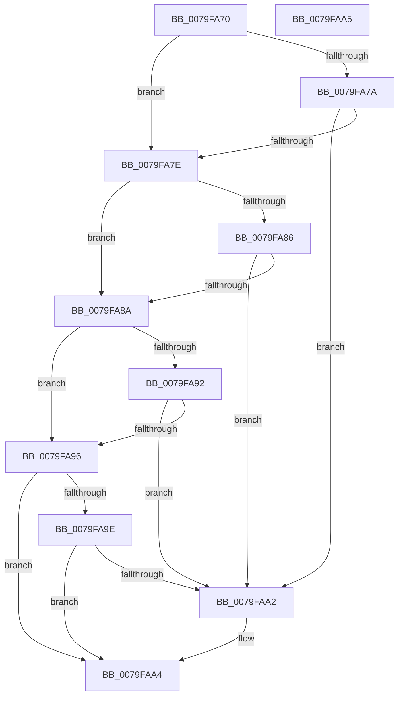

# SeAuditingFileEvents

- RVA: `0x0079FA70`–`0x0079FAA6` (길이 `54` bytes)
- VA: `0x000000014079FA70`
- 실행 섹션: `PAGE`
- PDB 이름 있음: `예`; PDB Function 태그: `아니요`
- unwind 정보 RVA: `0x000DB714`
- 디코드: `20`개 명령, `54/54` bytes 표시
- 미해석 바이트: `0` (있으면 어셈블리에 `.byte`로 보존)

> 이 문서는 커널 이미지의 기계어와 PDB 기호를 분석해 생성했습니다. 4번과 5번은 함수 원형과 자료형을 바이너리 사용 방식에서 추정한 C 해석이며 원본 소스 복구 결과는 아닙니다.

## 1. Dependencies

- 직접 호출 지점: **0**; 고유 호출 대상: **0**
- 직접 호출자로 확인된 함수: **0**
- RIP 상대 이미지 참조: **4**

### Outgoing calls
- 직접 디코드된 call 명령이 없습니다.

### Direct callers
- 이 함수 시작 RVA로 연결되는 직접 call은 확인되지 않았습니다. 간접 호출은 완전히 역산할 수 없습니다.

### Static image references
- `0x0079FA72` → RVA `0x00F04AE4` (`.data`; read)
- `0x0079FA7E` → RVA `0x00F04AE5` (`.data`; read)
- `0x0079FA8A` → RVA `0x00F04AE6` (`.data`; read)
- `0x0079FA96` → RVA `0x00F04AE7` (`.data`; read)

## 2. Other-region calls and transfers

- 다른 실행 섹션으로 향하는 call: **0**
- 별도 외부 분기/꼬리 이동을 확인하지 못했습니다.

## 3. Assembly (complete function range)

```asm
0079FA70  32 C0                           xor al, al
0079FA72  38 05 6C 50 76 00               cmp byte ptr [rip + 0x76506c], al
0079FA78  74 04                           je 0x14079fa7e
0079FA7A  84 C9                           test cl, cl
0079FA7C  75 24                           jne 0x14079faa2
0079FA7E  38 05 61 50 76 00               cmp byte ptr [rip + 0x765061], al
0079FA84  74 04                           je 0x14079fa8a
0079FA86  84 C9                           test cl, cl
0079FA88  74 18                           je 0x14079faa2
0079FA8A  38 05 56 50 76 00               cmp byte ptr [rip + 0x765056], al
0079FA90  74 04                           je 0x14079fa96
0079FA92  84 C9                           test cl, cl
0079FA94  75 0C                           jne 0x14079faa2
0079FA96  38 05 4B 50 76 00               cmp byte ptr [rip + 0x76504b], al
0079FA9C  74 06                           je 0x14079faa4
0079FA9E  84 C9                           test cl, cl
0079FAA0  75 02                           jne 0x14079faa4
0079FAA2  B0 01                           mov al, 1
0079FAA4  C3                              ret
0079FAA5  CC                              int3
```

## 4. C-style interpretation (structured pseudocode)

```c
__int64 __fastcall SeAuditingFileEvents(unsigned __int8 a1)
{
    __int64 result;

    result = 0;
    if ((*(unsigned __int8 *)(v_rip + 7753836)) == 0) goto loc_0079FA7E;
    if (a1 != 0) goto loc_0079FAA2;
loc_0079FA7E:
    if ((*(unsigned __int8 *)(v_rip + 7753825)) == 0) goto loc_0079FA8A;
    if (a1 == 0) goto loc_0079FAA2;
loc_0079FA8A:
    if ((*(unsigned __int8 *)(v_rip + 7753814)) == 0) goto loc_0079FA96;
    if (a1 != 0) goto loc_0079FAA2;
loc_0079FA96:
    if ((*(unsigned __int8 *)(v_rip + 7753803)) == 0) goto loc_0079FAA4;
    if (a1 == 0) {
        result = 1;
    }
    return result;
}
```

## 5. (Beta) C Style

```c
int64_t SeAuditingFileEvents(uint8_t Arg1)
{
    int64_t result;

    result = 0;
    if ((*(uint8_t *)(v_rip + 0x76506C)) == 0) goto loc_0079FA7E;
    if (Arg1 != 0) goto loc_0079FAA2;
loc_0079FA7E:
    if ((*(uint8_t *)(v_rip + 0x765061)) == 0) goto loc_0079FA8A;
    if (Arg1 == 0) goto loc_0079FAA2;
loc_0079FA8A:
    if ((*(uint8_t *)(v_rip + 0x765056)) == 0) goto loc_0079FA96;
    if (Arg1 != 0) goto loc_0079FAA2;
loc_0079FA96:
    if ((*(uint8_t *)(v_rip + 0x76504B)) == 0) goto loc_0079FAA4;
    if (Arg1 == 0) {
        result = 1;
    }
    return result;
}
```

## 6. Execution-region graph

[열기: 2D/3D 그래프와 함수 탐색 컨트롤 패널](../../../control-panel.html?section=page&rva=0x0079FA70&view=graph)

- 2D 그래프는 위에서 아래로 흐르고, 3D 그래프는 빈 공간을 드래그해 회전합니다. Shift+드래그는 이동, 휠은 확대·축소, 함수 노드 선택은 대상 보고서 이동입니다.

### Static fallback


