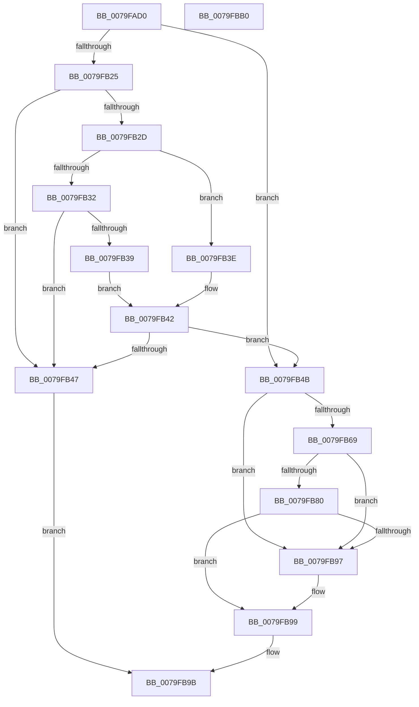

# SeAuditingFileOrGlobalEvents

- RVA: `0x0079FAD0`–`0x0079FBB1` (길이 `225` bytes)
- VA: `0x000000014079FAD0`
- 실행 섹션: `PAGE`
- PDB 이름 있음: `예`; PDB Function 태그: `아니요`
- unwind 정보 RVA: `0x000A7960`
- 디코드: `70`개 명령, `225/225` bytes 표시
- 미해석 바이트: `0` (있으면 어셈블리에 `.byte`로 보존)

> 이 문서는 커널 이미지의 기계어와 PDB 기호를 분석해 생성했습니다. 4번과 5번은 함수 원형과 자료형을 바이너리 사용 방식에서 추정한 C 해석이며 원본 소스 복구 결과는 아닙니다.

## 1. Dependencies

- 직접 호출 지점: **5**; 고유 호출 대상: **3**
- 직접 호출자로 확인된 함수: **0**
- RIP 상대 이미지 참조: **1**

### Outgoing calls
- `0x0079FB05` → [RtlInitUnicodeString](../../text/42/RtlInitUnicodeString_function_0042A780.md) (function, `0x0042A780`)
- `0x0079FB19` → [SepRmGlobalSaclFind](../97/SepRmGlobalSaclFind_function_00973DD4.md) (function, `0x00973DD4`)
- `0x0079FB60` → [SepAdtAuditThisEventWithContext](../87/SepAdtAuditThisEventWithContext_function_00870AC0.md) (function, `0x00870AC0`)
- `0x0079FB77` → [SepAdtAuditThisEventWithContext](../87/SepAdtAuditThisEventWithContext_function_00870AC0.md) (function, `0x00870AC0`)
- `0x0079FB8E` → [SepAdtAuditThisEventWithContext](../87/SepAdtAuditThisEventWithContext_function_00870AC0.md) (function, `0x00870AC0`)

### Direct callers
- 이 함수 시작 RVA로 연결되는 직접 call은 확인되지 않았습니다. 간접 호출은 완전히 역산할 수 없습니다.

### Static image references
- `0x0079FAED` → RVA `0x00AFCBB0` (` ?? ::NNGAKEGL::`string'`; read)

## 2. Other-region calls and transfers

- 다른 실행 섹션으로 향하는 call: **1**
  - `0x0079FB05` → [RtlInitUnicodeString](../../text/42/RtlInitUnicodeString_function_0042A780.md) (`PAGE` → `.text`)
- 별도 외부 분기/꼬리 이동을 확인하지 못했습니다.

## 3. Assembly (complete function range)

```asm
0079FAD0  48 8B C4                        mov rax, rsp
0079FAD3  48 89 58 08                     mov qword ptr [rax + 8], rbx
0079FAD7  48 89 68 18                     mov qword ptr [rax + 0x18], rbp
0079FADB  48 89 70 20                     mov qword ptr [rax + 0x20], rsi
0079FADF  57                              push rdi
0079FAE0  48 83 EC 30                     sub rsp, 0x30
0079FAE4  48 8B FA                        mov rdi, rdx
0079FAE7  40 8A F1                        mov sil, cl
0079FAEA  0F 57 C0                        xorps xmm0, xmm0
0079FAED  48 8D 15 BC D0 35 00            lea rdx, [rip + 0x35d0bc]
0079FAF4  33 DB                           xor ebx, ebx
0079FAF6  48 8D 48 E8                     lea rcx, [rax - 0x18]
0079FAFA  48 89 58 10                     mov qword ptr [rax + 0x10], rbx
0079FAFE  49 8B E8                        mov rbp, r8
0079FB01  0F 11 40 E8                     movups xmmword ptr [rax - 0x18], xmm0
0079FB05  E8 76 AC C8 FF                  call 0x14042a780
0079FB0A  41 B1 01                        mov r9b, 1
0079FB0D  4C 8D 44 24 20                  lea r8, [rsp + 0x20]
0079FB12  33 D2                           xor edx, edx
0079FB14  48 8D 4C 24 48                  lea rcx, [rsp + 0x48]
0079FB19  E8 B6 42 1D 00                  call 0x140973dd4
0079FB1E  3D 34 00 00 C0                  cmp eax, 0xc0000034
0079FB23  75 26                           jne 0x14079fb4b
0079FB25  0F B7 47 02                     movzx eax, word ptr [rdi + 2]
0079FB29  A8 10                           test al, 0x10
0079FB2B  74 1A                           je 0x14079fb47
0079FB2D  66 85 C0                        test ax, ax
0079FB30  79 0C                           jns 0x14079fb3e
0079FB32  8B 47 0C                        mov eax, dword ptr [rdi + 0xc]
0079FB35  85 C0                           test eax, eax
0079FB37  74 0E                           je 0x14079fb47
0079FB39  48 03 C7                        add rax, rdi
0079FB3C  EB 04                           jmp 0x14079fb42
0079FB3E  48 8B 47 18                     mov rax, qword ptr [rdi + 0x18]
0079FB42  48 85 C0                        test rax, rax
0079FB45  75 04                           jne 0x14079fb4b
0079FB47  32 C0                           xor al, al
0079FB49  EB 50                           jmp 0x14079fb9b
0079FB4B  40 84 F6                        test sil, sil
0079FB4E  4C 8B CD                        mov r9, rbp
0079FB51  40 8A D6                        mov dl, sil
0079FB54  B9 75 00 00 00                  mov ecx, 0x75
0079FB59  40 0F 94 C7                     sete dil
0079FB5D  44 8A C7                        mov r8b, dil
0079FB60  E8 5B 0F 0D 00                  call 0x140870ac0
0079FB65  84 C0                           test al, al
0079FB67  75 2E                           jne 0x14079fb97
0079FB69  4C 8B CD                        mov r9, rbp
0079FB6C  44 8A C7                        mov r8b, dil
0079FB6F  40 8A D6                        mov dl, sil
0079FB72  B9 82 00 00 00                  mov ecx, 0x82
0079FB77  E8 44 0F 0D 00                  call 0x140870ac0
0079FB7C  84 C0                           test al, al
0079FB7E  75 17                           jne 0x14079fb97
0079FB80  4C 8B CD                        mov r9, rbp
0079FB83  44 8A C7                        mov r8b, dil
0079FB86  40 8A D6                        mov dl, sil
0079FB89  B9 03 00 00 00                  mov ecx, 3
0079FB8E  E8 2D 0F 0D 00                  call 0x140870ac0
0079FB93  84 C0                           test al, al
0079FB95  74 02                           je 0x14079fb99
0079FB97  B3 01                           mov bl, 1
0079FB99  8A C3                           mov al, bl
0079FB9B  48 8B 5C 24 40                  mov rbx, qword ptr [rsp + 0x40]
0079FBA0  48 8B 6C 24 50                  mov rbp, qword ptr [rsp + 0x50]
0079FBA5  48 8B 74 24 58                  mov rsi, qword ptr [rsp + 0x58]
0079FBAA  48 83 C4 30                     add rsp, 0x30
0079FBAE  5F                              pop rdi
0079FBAF  C3                              ret
0079FBB0  CC                              int3
```

## 4. C-style interpretation (structured pseudocode)

```c
__int64 __fastcall SeAuditingFileOrGlobalEvents(unsigned __int8 a1, __int64 a2, __int64 a3)
{
    __int64 result;
    __int64 v_rbx;
    __int64 v_rdi;
    __int64 v_rsp;
    unsigned __int64 v_stack_m18;
    unsigned __int64 v_stack_p10;
    unsigned __int64 v_stack_p18;
    unsigned __int64 v_stack_p20;
    unsigned __int64 v_stack_p8;

    *(unsigned __int64 *)(v_rsp + 8) = v_rbx;
    *(unsigned __int64 *)(v_rsp + 24) = v_rbp;
    *(unsigned __int64 *)(v_rsp + 32) = v_rsi;
    v_rsp = (v_rsp) - (48);
    v_rbx = 0;
    *(unsigned __int64 *)(v_rsp + 16) = 0;
    *(unsigned __int64 *)(v_rsp - 24) = v_xmm0;
    result = RtlInitUnicodeString(v_rsp - 24, v_rip + 3526844, a3, a4);
    a2 = 0;
    result = SepRmGlobalSaclFind(v_stack_p10, a2, v_stack_m18, 1);
    if (((unsigned int)(result)) != 0xC0000034ULL) goto loc_0079FB4B;
    if ((((unsigned __int8)(*(unsigned __int16 *)(a2 + 2))) & (16)) == 0) goto loc_0079FB47;
    if (!sign_flag) goto loc_0079FB3E;
    if ((unsigned int)((unsigned int)(*(unsigned int *)(a2 + 12))) == 0) goto loc_0079FB47;
    result = ((unsigned int)(*(unsigned int *)(a2 + 12))) + (0);
    goto loc_0079FB42;
loc_0079FB3E:
loc_0079FB42:
    if (*(unsigned __int64 *)(a2 + 24) != 0) goto loc_0079FB4B;
loc_0079FB47:
    result = 0;
    goto loc_0079FB9B;
loc_0079FB4B:
    v_rdi = (a1 == 0) ? 1 : 0;
    result = SepAdtAuditThisEventWithContext(117, a1, (unsigned __int8)(v_rdi), a3);
    if ((unsigned __int8)(result) != 0) goto loc_0079FB97;
    result = SepAdtAuditThisEventWithContext(130, a1, (unsigned __int8)(v_rdi), a3);
    if ((unsigned __int8)(result) != 0) goto loc_0079FB97;
    result = SepAdtAuditThisEventWithContext(3, a1, (unsigned __int8)(v_rdi), a3);
    if ((unsigned __int8)(result) != 0) {
        v_rbx = 1;
    }
loc_0079FB9B:
    v_rsp = (v_rsp) + (48);
    return (unsigned __int8)(v_rbx);
}
```

## 5. (Beta) C Style

```c
int64_t SeAuditingFileOrGlobalEvents(uint8_t Arg1, void *Arg2, int64_t Arg3)
{
    uint8_t *arg2 = (uint8_t *)Arg2;

    int64_t result;
    int64_t local_rbx;
    int64_t local_rdi;
    int64_t local_rsp;
    uint64_t v_stack_m18;
    uint64_t v_stack_p10;
    uint64_t v_stack_p18;
    uint64_t v_stack_p20;
    uint64_t v_stack_p8;

    *(uint64_t *)(local_rsp + 0x8) = local_rbx;
    *(uint64_t *)(local_rsp + 0x18) = local_rbp;
    *(uint64_t *)(local_rsp + 0x20) = local_rsi;
    local_rsp = (local_rsp) - (48);
    local_rbx = 0;
    *(uint64_t *)(local_rsp + 0x10) = 0;
    *(uint64_t *)(local_rsp - 0x18) = v_xmm0;
    result = RtlInitUnicodeString(local_rsp - 24, v_rip + 3526844, Arg3, a4);
    Arg2 = 0;
    result = SepRmGlobalSaclFind(v_stack_p10, Arg2, v_stack_m18, 1);
    if (((uint32_t)(result)) != 0xC0000034ULL) goto loc_0079FB4B;
    if ((((uint8_t)(*(uint16_t *)(arg2 + 0x2))) & (16)) == 0) goto loc_0079FB47;
    if (!sign_flag) goto loc_0079FB3E;
    if ((uint32_t)((uint32_t)(*(uint32_t *)(arg2 + 0xC))) == 0) goto loc_0079FB47;
    result = ((uint32_t)(*(uint32_t *)(arg2 + 0xC))) + (0);
    goto loc_0079FB42;
loc_0079FB3E:
loc_0079FB42:
    if (*(uint64_t *)(arg2 + 0x18) != 0) goto loc_0079FB4B;
loc_0079FB47:
    result = 0;
    goto loc_0079FB9B;
loc_0079FB4B:
    local_rdi = (Arg1 == 0) ? 1 : 0;
    result = SepAdtAuditThisEventWithContext(117, Arg1, (uint8_t)(local_rdi), Arg3);
    if ((uint8_t)(result) != 0) goto loc_0079FB97;
    result = SepAdtAuditThisEventWithContext(130, Arg1, (uint8_t)(local_rdi), Arg3);
    if ((uint8_t)(result) != 0) goto loc_0079FB97;
    result = SepAdtAuditThisEventWithContext(3, Arg1, (uint8_t)(local_rdi), Arg3);
    if ((uint8_t)(result) != 0) {
        local_rbx = 1;
    }
loc_0079FB9B:
    local_rsp = (local_rsp) + (48);
    return (uint8_t)(local_rbx);
}
```

### 관측된 메모리 오프셋

구조체 형식이 확인되지 않은 접근은 인자 기준의 오프셋으로만 기록했습니다.

| 기준 인자 | 오프셋 표현 | 폭 (bit) | 접근 |
|---|---:|---:|---|
| `Arg2` | `+ 0x2` | `16` | `R` |
| `Arg2` | `+ 0xC` | `32` | `R` |
| `Arg2` | `+ 0x18` | `64` | `R` |

## 6. Execution-region graph

[열기: 2D/3D 그래프와 함수 탐색 컨트롤 패널](../../../control-panel.html?section=page&rva=0x0079FAD0&view=graph)

- 2D 그래프는 위에서 아래로 흐르고, 3D 그래프는 빈 공간을 드래그해 회전합니다. Shift+드래그는 이동, 휠은 확대·축소, 함수 노드 선택은 대상 보고서 이동입니다.

### Static fallback


