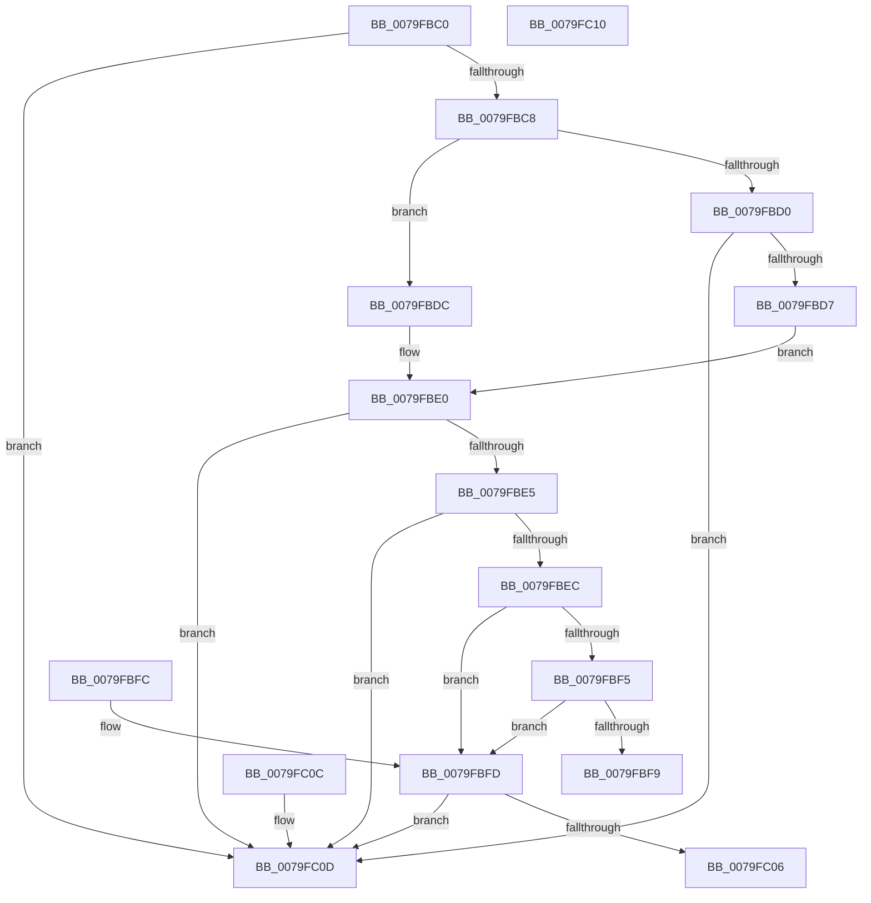

# SeAuditingHardLinkEvents

- RVA: `0x0079FBC0`–`0x0079FC11` (길이 `81` bytes)
- VA: `0x000000014079FBC0`
- 실행 섹션: `PAGE`
- PDB 이름 있음: `예`; PDB Function 태그: `아니요`
- unwind 정보 RVA: `0x000DB714`
- 디코드: `32`개 명령, `81/81` bytes 표시
- 미해석 바이트: `0` (있으면 어셈블리에 `.byte`로 보존)

> 이 문서는 커널 이미지의 기계어와 PDB 기호를 분석해 생성했습니다. 4번과 5번은 함수 원형과 자료형을 바이너리 사용 방식에서 추정한 C 해석이며 원본 소스 복구 결과는 아닙니다.

## 1. Dependencies

- 직접 호출 지점: **0**; 고유 호출 대상: **0**
- 직접 호출자로 확인된 함수: **0**
- RIP 상대 이미지 참조: **2**

### Outgoing calls
- 직접 디코드된 call 명령이 없습니다.

### Direct callers
- 이 함수 시작 RVA로 연결되는 직접 call은 확인되지 않았습니다. 간접 호출은 완전히 역산할 수 없습니다.

### Static image references
- `0x0079FBEC` → RVA `0x00F04AE4` (`.data`; read)
- `0x0079FBFD` → RVA `0x00F04AE5` (`.data`; read)

## 2. Other-region calls and transfers

- 다른 실행 섹션으로 향하는 call: **0**
- 별도 외부 분기/꼬리 이동을 확인하지 못했습니다.

## 3. Assembly (complete function range)

```asm
0079FBC0  0F B7 42 02                     movzx eax, word ptr [rdx + 2]
0079FBC4  A8 10                           test al, 0x10
0079FBC6  74 45                           je 0x14079fc0d
0079FBC8  45 33 C0                        xor r8d, r8d
0079FBCB  66 85 C0                        test ax, ax
0079FBCE  79 0C                           jns 0x14079fbdc
0079FBD0  8B 42 0C                        mov eax, dword ptr [rdx + 0xc]
0079FBD3  85 C0                           test eax, eax
0079FBD5  74 36                           je 0x14079fc0d
0079FBD7  48 03 C2                        add rax, rdx
0079FBDA  EB 04                           jmp 0x14079fbe0
0079FBDC  48 8B 42 18                     mov rax, qword ptr [rdx + 0x18]
0079FBE0  48 85 C0                        test rax, rax
0079FBE3  74 28                           je 0x14079fc0d
0079FBE5  66 44 3B 40 04                  cmp r8w, word ptr [rax + 4]
0079FBEA  74 21                           je 0x14079fc0d
0079FBEC  44 38 05 F1 4E 76 00            cmp byte ptr [rip + 0x764ef1], r8b
0079FBF3  74 08                           je 0x14079fbfd
0079FBF5  84 C9                           test cl, cl
0079FBF7  74 04                           je 0x14079fbfd
0079FBF9  B0 01                           mov al, 1
0079FBFB  C3                              ret
0079FBFC  CC                              int3
0079FBFD  44 38 05 E1 4E 76 00            cmp byte ptr [rip + 0x764ee1], r8b
0079FC04  74 07                           je 0x14079fc0d
0079FC06  84 C9                           test cl, cl
0079FC08  0F 94 C0                        sete al
0079FC0B  C3                              ret
0079FC0C  CC                              int3
0079FC0D  32 C0                           xor al, al
0079FC0F  C3                              ret
0079FC10  CC                              int3
```

## 4. C-style interpretation (structured pseudocode)

```c
__int64 __fastcall SeAuditingHardLinkEvents(unsigned __int8 a1, __int64 a2, int a3)
{
    __int64 result;

    if ((((unsigned __int8)(*(unsigned __int16 *)(a2 + 2))) & (16)) == 0) goto loc_0079FC0D;
    a3 = 0;
    if (!sign_flag) goto loc_0079FBDC;
    if ((unsigned int)((unsigned int)(*(unsigned int *)(a2 + 12))) == 0) goto loc_0079FC0D;
    result = ((unsigned int)(*(unsigned int *)(a2 + 12))) + (a2);
    goto loc_0079FBE0;
loc_0079FBDC:
loc_0079FBE0:
    if (*(unsigned __int64 *)(a2 + 24) == 0) goto loc_0079FC0D;
    if (0 == (*(unsigned __int16 *)(*(unsigned __int64 *)(a2 + 24) + 4))) goto loc_0079FC0D;
    if ((*(unsigned __int8 *)(v_rip + 7753457)) == 0) goto loc_0079FBFD;
    if (a1 == 0) goto loc_0079FBFD;
    return 1;
loc_0079FBFD:
    if ((*(unsigned __int8 *)(v_rip + 7753441)) == 0) goto loc_0079FC0D;
    result = (a1 == 0) ? 1 : 0;
    return result;
loc_0079FC0D:
    result = 0;
    return result;
}
```

## 5. (Beta) C Style

```c
int64_t SeAuditingHardLinkEvents(uint8_t Arg1, void *Arg2, int32_t Arg3)
{
    uint8_t *arg2 = (uint8_t *)Arg2;

    int64_t result;

    if ((((uint8_t)(*(uint16_t *)(arg2 + 0x2))) & (16)) == 0) goto loc_0079FC0D;
    Arg3 = 0;
    if (!sign_flag) goto loc_0079FBDC;
    if ((uint32_t)((uint32_t)(*(uint32_t *)(arg2 + 0xC))) == 0) goto loc_0079FC0D;
    result = ((uint32_t)(*(uint32_t *)(arg2 + 0xC))) + (Arg2);
    goto loc_0079FBE0;
loc_0079FBDC:
loc_0079FBE0:
    if (*(uint64_t *)(arg2 + 0x18) == 0) goto loc_0079FC0D;
    if (0 == (*(uint16_t *)(*(uint64_t *)(arg2 + 0x18) + 0x4))) goto loc_0079FC0D;
    if ((*(uint8_t *)(v_rip + 0x764EF1)) == 0) goto loc_0079FBFD;
    if (Arg1 == 0) goto loc_0079FBFD;
    return 1;
loc_0079FBFD:
    if ((*(uint8_t *)(v_rip + 0x764EE1)) == 0) goto loc_0079FC0D;
    result = (Arg1 == 0) ? 1 : 0;
    return result;
loc_0079FC0D:
    result = 0;
    return result;
}
```

### 관측된 메모리 오프셋

구조체 형식이 확인되지 않은 접근은 인자 기준의 오프셋으로만 기록했습니다.

| 기준 인자 | 오프셋 표현 | 폭 (bit) | 접근 |
|---|---:|---:|---|
| `Arg2` | `+ 0x2` | `16` | `R` |
| `Arg2` | `+ 0xC` | `32` | `R` |
| `Arg2` | `+ 0x18` | `64` | `R` |

## 6. Execution-region graph

[열기: 2D/3D 그래프와 함수 탐색 컨트롤 패널](../../../control-panel.html?section=page&rva=0x0079FBC0&view=graph)

- 2D 그래프는 위에서 아래로 흐르고, 3D 그래프는 빈 공간을 드래그해 회전합니다. Shift+드래그는 이동, 휠은 확대·축소, 함수 노드 선택은 대상 보고서 이동입니다.

### Static fallback


