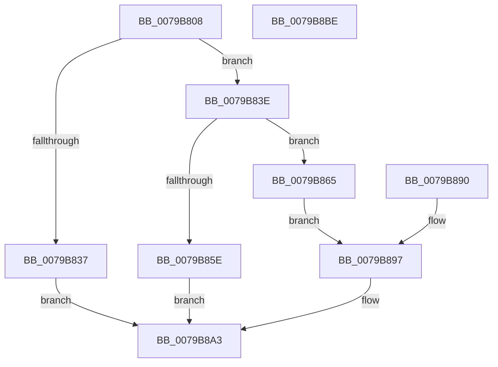

# SeCodeIntegritySetInformationProcess

- RVA: `0x0079B808`–`0x0079B8BF` (길이 `183` bytes)
- VA: `0x000000014079B808`
- 실행 섹션: `PAGE`
- PDB 이름 있음: `예`; PDB Function 태그: `아니요`
- unwind 정보 RVA: `0x000D0794`
- 디코드: `54`개 명령, `183/183` bytes 표시
- 미해석 바이트: `0` (있으면 어셈블리에 `.byte`로 보존)

> 이 문서는 커널 이미지의 기계어와 PDB 기호를 분석해 생성했습니다. 4번과 5번은 함수 원형과 자료형을 바이너리 사용 방식에서 추정한 C 해석이며 원본 소스 복구 결과는 아닙니다.

## 1. Dependencies

- 직접 호출 지점: **4**; 고유 호출 대상: **4**
- 직접 호출자로 확인된 함수: **1**
- RIP 상대 이미지 참조: **1**

### Outgoing calls
- `0x0079B84C` → [ExAllocatePool2](../../poolcode/B8/ExAllocatePool2_function_00B820F0.md) (function, `0x00B820F0`)
- `0x0079B86E` → [memcpy](../../text/6C/memcpy_function_006C6840.md) (function, `0x006C6840`)
- `0x0079B887` → [guard_dispatch_icall](../../text/6B/guard_dispatch_icall_function_006BAAD0.md) (function, `0x006BAAD0`)
- `0x0079B89C` → [ExFreePoolWithTag](../../poolcode/B8/ExFreePoolWithTag_function_00B82870.md) (function, `0x00B82870`)

### Direct callers
- [NtSetInformationProcess](../AE/NtSetInformationProcess_function_00AE5370.md) at `0x00AE96E8`

### Static image references
- `0x0079B82D` → RVA `0x00F04EE8` (`.data`; read)

## 2. Other-region calls and transfers

- 다른 실행 섹션으로 향하는 call: **4**
  - `0x0079B84C` → [ExAllocatePool2](../../poolcode/B8/ExAllocatePool2_function_00B820F0.md) (`PAGE` → `POOLCODE`)
  - `0x0079B86E` → [memcpy](../../text/6C/memcpy_function_006C6840.md) (`PAGE` → `.text`)
  - `0x0079B887` → [guard_dispatch_icall](../../text/6B/guard_dispatch_icall_function_006BAAD0.md) (`PAGE` → `.text`)
  - `0x0079B89C` → [ExFreePoolWithTag](../../poolcode/B8/ExFreePoolWithTag_function_00B82870.md) (`PAGE` → `POOLCODE`)
- 별도 외부 분기/꼬리 이동을 확인하지 못했습니다.

## 3. Assembly (complete function range)

```asm
0079B808  48 89 5C 24 08                  mov qword ptr [rsp + 8], rbx
0079B80D  48 89 74 24 10                  mov qword ptr [rsp + 0x10], rsi
0079B812  48 89 7C 24 18                  mov qword ptr [rsp + 0x18], rdi
0079B817  41 54                           push r12
0079B819  41 56                           push r14
0079B81B  41 57                           push r15
0079B81D  48 83 EC 50                     sub rsp, 0x50
0079B821  45 8B F1                        mov r14d, r9d
0079B824  49 8B F0                        mov rsi, r8
0079B827  44 8B FA                        mov r15d, edx
0079B82A  4C 8B E1                        mov r12, rcx
0079B82D  48 83 3D B3 96 76 00 00         cmp qword ptr [rip + 0x7696b3], 0
0079B835  75 07                           jne 0x14079b83e
0079B837  B8 BB 00 00 C0                  mov eax, 0xc00000bb
0079B83C  EB 65                           jmp 0x14079b8a3
0079B83E  41 B8 53 65 20 20               mov r8d, 0x20206553
0079B844  49 8B D6                        mov rdx, r14
0079B847  B9 00 01 00 00                  mov ecx, 0x100
0079B84C  E8 9F 68 3E 00                  call 0x140b820f0
0079B851  48 8B D8                        mov rbx, rax
0079B854  48 89 44 24 40                  mov qword ptr [rsp + 0x40], rax
0079B859  48 85 C0                        test rax, rax
0079B85C  75 07                           jne 0x14079b865
0079B85E  B8 17 00 00 C0                  mov eax, 0xc0000017
0079B863  EB 3E                           jmp 0x14079b8a3
0079B865  4D 8B C6                        mov r8, r14
0079B868  48 8B D6                        mov rdx, rsi
0079B86B  48 8B CB                        mov rcx, rbx
0079B86E  E8 CD AF F2 FF                  call 0x1406c6840
0079B873  90                              nop
0079B874  48 8B 05 6D 96 76 00            mov rax, qword ptr [rip + 0x76966d]
0079B87B  45 8B CE                        mov r9d, r14d
0079B87E  4C 8B C3                        mov r8, rbx
0079B881  41 8B D7                        mov edx, r15d
0079B884  49 8B CC                        mov rcx, r12
0079B887  E8 44 F2 F1 FF                  call 0x1406baad0
0079B88C  8B F8                           mov edi, eax
0079B88E  EB 07                           jmp 0x14079b897
0079B890  8B F8                           mov edi, eax
0079B892  48 8B 5C 24 40                  mov rbx, qword ptr [rsp + 0x40]
0079B897  33 D2                           xor edx, edx
0079B899  48 8B CB                        mov rcx, rbx
0079B89C  E8 CF 6F 3E 00                  call 0x140b82870
0079B8A1  8B C7                           mov eax, edi
0079B8A3  4C 8D 5C 24 50                  lea r11, [rsp + 0x50]
0079B8A8  49 8B 5B 20                     mov rbx, qword ptr [r11 + 0x20]
0079B8AC  49 8B 73 28                     mov rsi, qword ptr [r11 + 0x28]
0079B8B0  49 8B 7B 30                     mov rdi, qword ptr [r11 + 0x30]
0079B8B4  49 8B E3                        mov rsp, r11
0079B8B7  41 5F                           pop r15
0079B8B9  41 5E                           pop r14
0079B8BB  41 5C                           pop r12
0079B8BD  C3                              ret
0079B8BE  CC                              int3
```

## 4. C-style interpretation (structured pseudocode)

```c
__int64 __fastcall SeCodeIntegritySetInformationProcess(__int64 a1, int a2, __int64 a3, int a4)
{
    __int64 result;
    __int64 v_rsp;
    unsigned __int64 v_stack_m18;
    unsigned __int64 v_stack_m28;
    unsigned __int64 v_stack_p10;
    unsigned __int64 v_stack_p18;
    unsigned __int64 v_stack_p8;

    v_stack_p8 = v_rbx;
    v_stack_p10 = v_rsi;
    v_stack_p18 = v_rdi;
    v_rsp = (v_rsp) - (80);
    if ((*(unsigned __int64 *)(v_rip + 7771827)) != 0) goto loc_0079B83E;
    goto loc_0079B8A3;
loc_0079B83E:
    result = ExAllocatePool2(256, (unsigned int)(a4), (unsigned int)(0x20206553ULL), a4);
    v_stack_m28 = result;
    if (result != 0) goto loc_0079B865;
    goto loc_0079B8A3;
loc_0079B865:
    result = memcpy(result, a3, (unsigned int)(a4), a4);
    result = guard_dispatch_icall(a1, (unsigned int)((unsigned int)((unsigned int)(a2))), result, (unsigned int)((unsigned int)((unsigned int)(a4))));
    goto loc_0079B897;
loc_0079B897:
    a2 = 0;
    result = ExFreePoolWithTag(result, a2, result, (unsigned int)((unsigned int)((unsigned int)(a4))));
loc_0079B8A3:
    return (unsigned int)((unsigned int)((unsigned int)((unsigned int)(result))));
}
```

## 5. (Beta) C Style

```c
int64_t SeCodeIntegritySetInformationProcess(int64_t Arg1, int32_t Arg2, int64_t Arg3, int32_t Arg4)
{
    int64_t result;
    int64_t local_rsp;
    uint64_t v_stack_m18;
    uint64_t v_stack_m28;
    uint64_t v_stack_p10;
    uint64_t v_stack_p18;
    uint64_t v_stack_p8;

    v_stack_p8 = local_rbx;
    v_stack_p10 = local_rsi;
    v_stack_p18 = local_rdi;
    local_rsp = (local_rsp) - (80);
    if ((*(uint64_t *)(v_rip + 0x7696B3)) != 0) goto loc_0079B83E;
    goto loc_0079B8A3;
loc_0079B83E:
    result = ExAllocatePool2(256, (uint32_t)(Arg4), (uint32_t)(0x20206553ULL), Arg4);
    v_stack_m28 = result;
    if (result != 0) goto loc_0079B865;
    goto loc_0079B8A3;
loc_0079B865:
    result = memcpy(result, Arg3, (uint32_t)(Arg4), Arg4);
    result = guard_dispatch_icall(Arg1, (uint32_t)((uint32_t)((uint32_t)(Arg2))), result, (uint32_t)((uint32_t)((uint32_t)(Arg4))));
    goto loc_0079B897;
loc_0079B897:
    Arg2 = 0;
    result = ExFreePoolWithTag(result, Arg2, result, (uint32_t)((uint32_t)((uint32_t)(Arg4))));
loc_0079B8A3:
    return (uint32_t)((uint32_t)((uint32_t)((uint32_t)(result))));
}
```

## 6. Execution-region graph

[열기: 2D/3D 그래프와 함수 탐색 컨트롤 패널](../../../control-panel.html?section=page&rva=0x0079B808&view=graph)

- 2D 그래프는 위에서 아래로 흐르고, 3D 그래프는 빈 공간을 드래그해 회전합니다. Shift+드래그는 이동, 휠은 확대·축소, 함수 노드 선택은 대상 보고서 이동입니다.

### Static fallback


