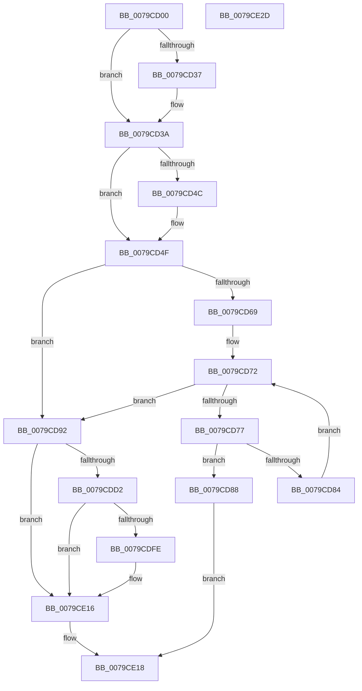

# SeFilterToken

- RVA: `0x0079CD00`–`0x0079CE2E` (길이 `302` bytes)
- VA: `0x000000014079CD00`
- 실행 섹션: `PAGE`
- PDB 이름 있음: `예`; PDB Function 태그: `아니요`
- unwind 정보 RVA: `0x000D0810`
- 디코드: `87`개 명령, `302/302` bytes 표시
- 미해석 바이트: `0` (있으면 어셈블리에 `.byte`로 보존)

> 이 문서는 커널 이미지의 기계어와 PDB 기호를 분석해 생성했습니다. 4번과 5번은 함수 원형과 자료형을 바이너리 사용 방식에서 추정한 C 해석이며 원본 소스 복구 결과는 아닙니다.

## 1. Dependencies

- 직접 호출 지점: **3**; 고유 호출 대상: **3**
- 직접 호출자로 확인된 함수: **1**
- RIP 상대 이미지 참조: **0**

### Outgoing calls
- `0x0079CDC7` → [SepFilterToken](../9C/SepFilterToken_function_009C6B80.md) (function, `0x009C6B80`)
- `0x0079CDF3` → [ObInsertObjectEx](../8B/ObInsertObjectEx_function_008B97A0.md) (function, `0x008B97A0`)
- `0x0079CE06` → [SepFinalizeTokenAcls](../8B/SepFinalizeTokenAcls_function_008B63F4.md) (function, `0x008B63F4`)

### Direct callers
- [CmpCreateRegistryProcessToken](../7E/CmpCreateRegistryProcessToken_function_007E7F6C.md) at `0x007E8052`

### Static image references
- 디코드된 RIP-relative 메모리 참조가 없습니다.

## 2. Other-region calls and transfers

- 다른 실행 섹션으로 향하는 call: **0**
- 별도 외부 분기/꼬리 이동을 확인하지 못했습니다.

## 3. Assembly (complete function range)

```asm
0079CD00  48 8B C4                        mov rax, rsp
0079CD03  48 89 58 08                     mov qword ptr [rax + 8], rbx
0079CD07  48 89 68 10                     mov qword ptr [rax + 0x10], rbp
0079CD0B  56                              push rsi
0079CD0C  57                              push rdi
0079CD0D  41 56                           push r14
0079CD0F  48 83 EC 60                     sub rsp, 0x60
0079CD13  48 8B BC 24 A8 00 00 00         mov rdi, qword ptr [rsp + 0xa8]
0079CD1B  33 DB                           xor ebx, ebx
0079CD1D  48 83 60 18 00                  and qword ptr [rax + 0x18], 0
0079CD22  45 33 D2                        xor r10d, r10d
0079CD25  45 33 DB                        xor r11d, r11d
0079CD28  33 F6                           xor esi, esi
0079CD2A  8B EA                           mov ebp, edx
0079CD2C  4C 8B F1                        mov r14, rcx
0079CD2F  48 21 1F                        and qword ptr [rdi], rbx
0079CD32  4D 85 C0                        test r8, r8
0079CD35  74 03                           je 0x14079cd3a
0079CD37  41 8B 18                        mov ebx, dword ptr [r8]
0079CD3A  49 8D 40 08                     lea rax, [r8 + 8]
0079CD3E  49 F7 D8                        neg r8
0079CD41  48 1B D2                        sbb rdx, rdx
0079CD44  48 23 D0                        and rdx, rax
0079CD47  4D 85 C9                        test r9, r9
0079CD4A  74 03                           je 0x14079cd4f
0079CD4C  41 8B 31                        mov esi, dword ptr [r9]
0079CD4F  49 8D 41 04                     lea rax, [r9 + 4]
0079CD53  49 F7 D9                        neg r9
0079CD56  4D 1B C0                        sbb r8, r8
0079CD59  4C 23 C0                        and r8, rax
0079CD5C  48 8B 84 24 A0 00 00 00         mov rax, qword ptr [rsp + 0xa0]
0079CD64  48 85 C0                        test rax, rax
0079CD67  74 29                           je 0x14079cd92
0079CD69  44 8B 10                        mov r10d, dword ptr [rax]
0079CD6C  4C 8D 58 08                     lea r11, [rax + 8]
0079CD70  33 C9                           xor ecx, ecx
0079CD72  41 3B CA                        cmp ecx, r10d
0079CD75  73 1B                           jae 0x14079cd92
0079CD77  8B C1                           mov eax, ecx
0079CD79  48 03 C0                        add rax, rax
0079CD7C  41 83 7C C3 08 00               cmp dword ptr [r11 + rax*8 + 8], 0
0079CD82  75 04                           jne 0x14079cd88
0079CD84  FF C1                           inc ecx
0079CD86  EB EA                           jmp 0x14079cd72
0079CD88  B8 0D 00 00 C0                  mov eax, 0xc000000d
0079CD8D  E9 86 00 00 00                  jmp 0x14079ce18
0079CD92  48 8D 84 24 90 00 00 00         lea rax, [rsp + 0x90]
0079CD9A  44 8B CB                        mov r9d, ebx
0079CD9D  48 89 44 24 50                  mov qword ptr [rsp + 0x50], rax
0079CDA2  49 8B CE                        mov rcx, r14
0079CDA5  83 64 24 48 00                  and dword ptr [rsp + 0x48], 0
0079CDAA  4C 89 5C 24 40                  mov qword ptr [rsp + 0x40], r11
0079CDAF  44 89 54 24 38                  mov dword ptr [rsp + 0x38], r10d
0079CDB4  4C 89 44 24 30                  mov qword ptr [rsp + 0x30], r8
0079CDB9  44 8B C5                        mov r8d, ebp
0079CDBC  89 74 24 28                     mov dword ptr [rsp + 0x28], esi
0079CDC0  48 89 54 24 20                  mov qword ptr [rsp + 0x20], rdx
0079CDC5  33 D2                           xor edx, edx
0079CDC7  E8 B4 9D 22 00                  call 0x1409c6b80
0079CDCC  8B D8                           mov ebx, eax
0079CDCE  85 C0                           test eax, eax
0079CDD0  78 44                           js 0x14079ce16
0079CDD2  48 83 64 24 30 00               and qword ptr [rsp + 0x30], 0
0079CDD8  45 33 C9                        xor r9d, r9d
0079CDDB  48 83 64 24 28 00               and qword ptr [rsp + 0x28], 0
0079CDE1  45 33 C0                        xor r8d, r8d
0079CDE4  48 8B 8C 24 90 00 00 00         mov rcx, qword ptr [rsp + 0x90]
0079CDEC  33 D2                           xor edx, edx
0079CDEE  83 64 24 20 00                  and dword ptr [rsp + 0x20], 0
0079CDF3  E8 A8 C9 11 00                  call 0x1408b97a0
0079CDF8  8B D8                           mov ebx, eax
0079CDFA  85 C0                           test eax, eax
0079CDFC  78 18                           js 0x14079ce16
0079CDFE  48 8B 8C 24 90 00 00 00         mov rcx, qword ptr [rsp + 0x90]
0079CE06  E8 E9 95 11 00                  call 0x1408b63f4
0079CE0B  48 8B 84 24 90 00 00 00         mov rax, qword ptr [rsp + 0x90]
0079CE13  48 89 07                        mov qword ptr [rdi], rax
0079CE16  8B C3                           mov eax, ebx
0079CE18  4C 8D 5C 24 60                  lea r11, [rsp + 0x60]
0079CE1D  49 8B 5B 20                     mov rbx, qword ptr [r11 + 0x20]
0079CE21  49 8B 6B 28                     mov rbp, qword ptr [r11 + 0x28]
0079CE25  49 8B E3                        mov rsp, r11
0079CE28  41 5E                           pop r14
0079CE2A  5F                              pop rdi
0079CE2B  5E                              pop rsi
0079CE2C  C3                              ret
0079CE2D  CC                              int3
```

## 4. C-style interpretation (structured pseudocode)

```c
__int64 __fastcall SeFilterToken(__int64 a1, __int64 a2, __int64 a3, __int64 a4, __int64 a5, __int64 a6)
{
    __int64 result;
    __int64 v_r10;
    __int64 v_r11;
    __int64 v_rbx;
    __int64 v_rsi;
    __int64 v_rsp;
    unsigned __int64 v_stack_m18;
    unsigned __int64 v_stack_m28;
    unsigned int v_stack_m30;
    unsigned __int64 v_stack_m38;
    unsigned int v_stack_m40;
    unsigned __int64 v_stack_m48;
    unsigned int v_stack_m50;
    unsigned __int64 v_stack_m58;
    unsigned __int64 v_stack_p18;

    *(unsigned __int64 *)(v_rsp + 8) = v_rbx;
    *(unsigned __int64 *)(v_rsp + 16) = v_rbp;
    v_rsp = (v_rsp) - (96);
    v_rbx = 0;
    v_r10 = 0;
    v_r11 = 0;
    v_rsi = 0;
    if (a3 != 0) {
        v_rbx = *(unsigned int *)(a3);
    }
    a3 = -(a3);
    a2 = (a2) & (a3 + 8);
    if (a4 != 0) {
        v_rsi = *(unsigned int *)(a4);
    }
    a4 = -(a4);
    a3 = (a3) & (a4 + 4);
    if (a5 == 0) goto loc_0079CD92;
    a1 = 0;
loc_0079CD72:
    if (0 >= ((unsigned int)((unsigned int)(*(unsigned int *)(a5))))) goto loc_0079CD92;
    result = (0) + (0);
    if ((*(unsigned int *)(a5 + 8 + result * 8 + 8)) != 0) goto loc_0079CD88;
    a1 = (unsigned int)((a1) + 1);
    goto loc_0079CD72;
loc_0079CD88:
    goto loc_0079CE18;
loc_0079CD92:
    v_stack_m28 = v_stack_p18;
    v_stack_m38 = a5 + 8;
    v_stack_m40 = (unsigned int)((unsigned int)(*(unsigned int *)(a5)));
    v_stack_m48 = a3;
    v_stack_m50 = (unsigned int)(v_rsi);
    v_stack_m58 = a2;
    a2 = 0;
    result = SepFilterToken(a1, a2, (unsigned int)((unsigned int)((unsigned int)((unsigned int)(a2)))), (unsigned int)((unsigned int)(v_rbx)));
    if (sign_flag) goto loc_0079CE16;
    a4 = 0;
    a3 = 0;
    a2 = 0;
    result = ObInsertObjectEx(v_stack_p18, a2, a3, a4);
    if (!(sign_flag)) {
        a1 = v_stack_p18;
        result = SepFinalizeTokenAcls(a1, a2, a3, a4);
        result = v_stack_p18;
        *(unsigned __int64 *)(a6) = result;
    }
loc_0079CE18:
    return (unsigned int)((unsigned int)((unsigned int)((unsigned int)(result))));
}
```

## 5. (Beta) C Style

```c
int64_t SeFilterToken(int64_t Arg1, int64_t Arg2, int64_t Arg3, int64_t Arg4, int64_t Arg5, void *Arg6)
{
    uint8_t *arg6 = (uint8_t *)Arg6;

    int64_t result;
    int64_t local_r10;
    int64_t local_r11;
    int64_t local_rbx;
    int64_t local_rsi;
    int64_t local_rsp;
    uint64_t v_stack_m18;
    uint64_t v_stack_m28;
    uint32_t v_stack_m30;
    uint64_t v_stack_m38;
    uint32_t v_stack_m40;
    uint64_t v_stack_m48;
    uint32_t v_stack_m50;
    uint64_t v_stack_m58;
    uint64_t v_stack_p18;

    *(uint64_t *)(local_rsp + 0x8) = local_rbx;
    *(uint64_t *)(local_rsp + 0x10) = local_rbp;
    local_rsp = (local_rsp) - (96);
    local_rbx = 0;
    local_r10 = 0;
    local_r11 = 0;
    local_rsi = 0;
    if (Arg3 != 0) {
        local_rbx = *(uint32_t *)(Arg3);
    }
    Arg3 = -(Arg3);
    Arg2 = (Arg2) & (Arg3 + 8);
    if (Arg4 != 0) {
        local_rsi = *(uint32_t *)(Arg4);
    }
    Arg4 = -(Arg4);
    Arg3 = (Arg3) & (Arg4 + 4);
    if (Arg5 == 0) goto loc_0079CD92;
    Arg1 = 0;
loc_0079CD72:
    if (0 >= ((uint32_t)((uint32_t)(*(uint32_t *)(Arg5))))) goto loc_0079CD92;
    result = (0) + (0);
    if ((*(uint32_t *)(Arg5 + 0x8 + result * 8 + 0x8)) != 0) goto loc_0079CD88;
    Arg1 = (uint32_t)((Arg1) + 1);
    goto loc_0079CD72;
loc_0079CD88:
    goto loc_0079CE18;
loc_0079CD92:
    v_stack_m28 = v_stack_p18;
    v_stack_m38 = Arg5 + 8;
    v_stack_m40 = (uint32_t)((uint32_t)(*(uint32_t *)(Arg5)));
    v_stack_m48 = Arg3;
    v_stack_m50 = (uint32_t)(local_rsi);
    v_stack_m58 = Arg2;
    Arg2 = 0;
    result = SepFilterToken(Arg1, Arg2, (uint32_t)((uint32_t)((uint32_t)((uint32_t)(Arg2)))), (uint32_t)((uint32_t)(local_rbx)));
    if (sign_flag) goto loc_0079CE16;
    Arg4 = 0;
    Arg3 = 0;
    Arg2 = 0;
    result = ObInsertObjectEx(v_stack_p18, Arg2, Arg3, Arg4);
    if (!(sign_flag)) {
        Arg1 = v_stack_p18;
        result = SepFinalizeTokenAcls(Arg1, Arg2, Arg3, Arg4);
        result = v_stack_p18;
        *(uint64_t *)(arg6) = result;
    }
loc_0079CE18:
    return (uint32_t)((uint32_t)((uint32_t)((uint32_t)(result))));
}
```

### 관측된 메모리 오프셋

구조체 형식이 확인되지 않은 접근은 인자 기준의 오프셋으로만 기록했습니다.

| 기준 인자 | 오프셋 표현 | 폭 (bit) | 접근 |
|---|---:|---:|---|
| `Arg6` | `+ 0x0` | `64` | `R/W` |
| `Arg6` | `+ 0x0` | `64` | `W` |

## 6. Execution-region graph

[열기: 2D/3D 그래프와 함수 탐색 컨트롤 패널](../../../control-panel.html?section=page&rva=0x0079CD00&view=graph)

- 2D 그래프는 위에서 아래로 흐르고, 3D 그래프는 빈 공간을 드래그해 회전합니다. Shift+드래그는 이동, 휠은 확대·축소, 함수 노드 선택은 대상 보고서 이동입니다.

### Static fallback


